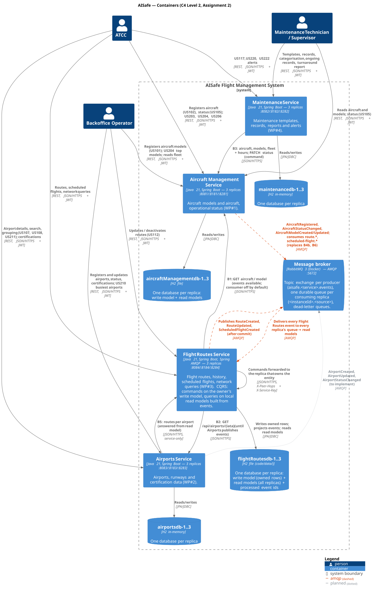
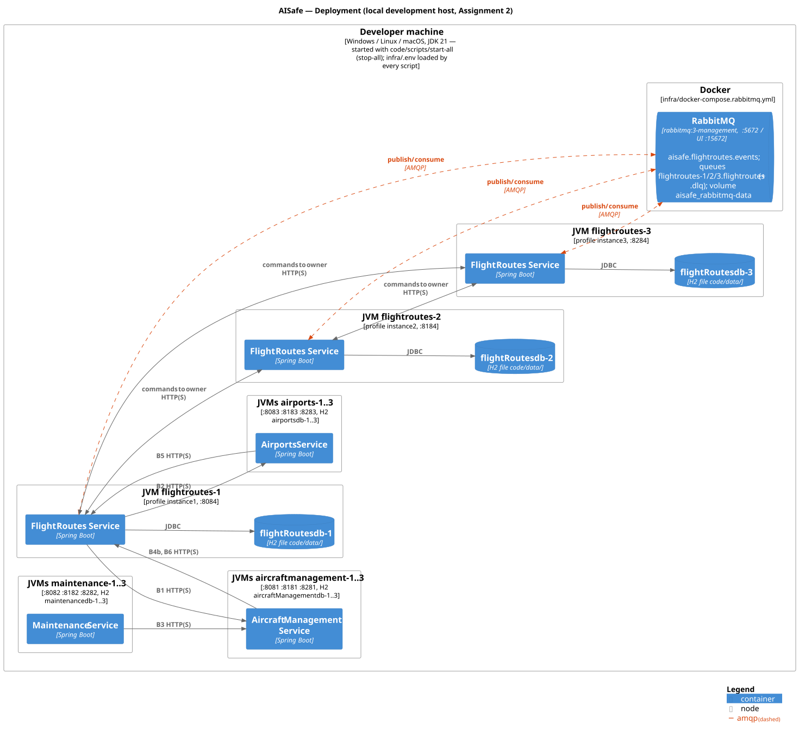

# C4 Level 2 — Containers

> The separately deployable units that make up AISafe, the technology of each one and how they communicate. Zoom of the single box of [Level 1](../1-context/Context.md).



## 1. Containers

The monolith was decomposed by **bounded context** (domain-driven segregation). Each service is a separate Spring Boot application, runs as **three replicas** (at least two are required), and each replica owns **its own database** (*database per service instance*). Data of another service is only reachable through that service's REST API or its events. Since Assignment 2 a **RabbitMQ** broker carries the events between services and between the replicas of a service.

| Container | Technology | Replicas (port) | Data (one database per replica) | Responsibility (bounded context) | Details |
|---|---|---|---|---|---|
| **Aircraft Management Service** | Java 21, Spring Boot 4 | 8081 / 8181 / 8281 | H2 `aircraftManagementdb-N` (in memory) | *Fleet*: aircraft models, aircraft, operational status (WP#1) | [L3](../3-components/aircraftmanagement/AircraftManagement-Components.md) |
| **Maintenance Service** | Java 21, Spring Boot 4 | 8082 / 8182 / 8282 | H2 `maintenancedb-N` (in memory) | *Maintenance*: templates, records, reports and due-maintenance alerts (WP#4) | [L3](../3-components/maintenance/Maintenance-Components.md) |
| **Airports Service** | Java 21, Spring Boot 4 | 8083 / 8183 / 8283 | H2 `airportsdb-N` (in memory) | *Airport infrastructure*: airports, runways, certification (WP#2) | [L3](../3-components/airports/Airports-Components.md) |
| **Flight Routes Service** | Java 21, Spring Boot 4, Spring AMQP | 8084 / 8184 / 8284 | H2 **file** `code/data/flightRoutesdb-N`: write model + CQRS read models | *Flight operations*: routes, history, scheduled flights, network queries (WP#3) | [L3](../3-components/flightroutes/FlightRoutes-Components.md) |
| **Message broker** | RabbitMQ 3 (Docker, `infra/docker-compose.rabbitmq.yml`) | 1 (AMQP 5672, UI 15672) | durable queues in the volume `aisafe_rabbitmq-data` | Topic exchange per producing service, one durable queue per consuming replica, dead-letter queues ([Integration-Contracts §9.2](Integration-Contracts.md#92-exchanges-routing-keys-and-queues)) | — |
| *common* (library, not a container) | Java library | embedded in every service | — | Security, peer forwarding, resilience, audit, **messaging** (`EventPublisher`, subscriptions, retry/DLQ, idempotency) — the same distributed behaviour in every container | [L3](../3-components/common/Common-Components.md) |

Ports, database names and per-replica configuration: [Ports.md](Ports.md).

## 2. Communication between containers

| Style | Used for | Protocol |
|---|---|---|
| **REST (synchronous)** | Every **external client** request (unchanged API), the **commands** forwarded to the replica that owns an entity, and the bridges between services that are not yet event-based | HTTP/JSON, JWT |
| **Events (asynchronous)** | State changes broadcast to every replica of the producer (CQRS read models) and to the services that keep a copy of that data | AMQP 0-9-1 (RabbitMQ), JSON envelope `IntegrationEvent` |

**Users** call every service's REST API (Swagger at `/swagger-ui.html`) with `Authorization: Bearer <JWT>`. Which role reaches which container is decided by each service's `<Service>AuthorizationRules`:

| Role | Aircraft Management | Airports | Flight Routes | Maintenance |
|---|---|---|---|---|
| Backoffice Operator | registers aircraft models (US101); US204 top models; reads aircraft and models | registers and updates airports, operational status, certifications (US106, US106a, US109, US208); US210 busiest airports | updates / deactivates routes (US112) | — |
| ATCC | registers aircraft (US102); status (US105); US203, US204, US206; reads aircraft and models | airport details, search and grouping (US107, US108, US211); certifications (US106a) | routes, route history, scheduled flights, network queries (US110–US114, US209, US212–US216) | statistics, cost report and alerts (US117, US220, US222) |
| Maintenance Technician / Supervisor | reads aircraft and models; status (US105) | — | — | templates, records, categorisation, ongoing records, turnaround report |

The `ADMIN` role exists in the token, but no endpoint requires it.

**REST calls between containers** (status of each bridge in Assignment 2: [Integration-Contracts §9.6](Integration-Contracts.md#96-status-of-every-bridge)):

| From | To | Endpoints | Purpose |
|---|---|---|---|
| Flight Routes | Airports | B2: `GET /api/airports/{iata}` | Coordinates (route distance) and operational status (US110, US209, US212, US216) — event consumer ready, waiting for Airports events |
| Flight Routes | Aircraft Management | B1: `GET /api/aircrafts/{reg}`, `GET /api/aircraft-models/{model}` | Status, seating capacity and range (US212, US213) — event consumer ready, waiting for Aircraft Management events |
| Aircraft Management | Flight Routes | B4b: `GET /api/scheduled-flights/statistics/minutes-by-aircraft` | Flight minutes per aircraft for US204 and US206 (answered from Flight Routes' read model) |
| Aircraft Management | Flight Routes | B6: `GET /api/routes/compatible?range=&capacity=` | Active routes compatible with an aircraft (US203) (read model) |
| Airports | Flight Routes | B5: `GET /api/routes/statistics/count-by-airport` | Route counts per airport (US210) (read model) |
| Maintenance | Aircraft Management | B3a: `GET /api/aircrafts/{reg}` | Aircraft exists, its model and status (US115, US116) |
| Maintenance | Aircraft Management | B3b: `PATCH /api/aircrafts/{reg}/status` | `UNDER_MAINTENANCE` when a record starts (US115), `AVAILABLE` when the last ongoing record is completed (US119); kept synchronous (a command) |
| Maintenance | Aircraft Management | B3c: `GET /api/aircraft-models/{model}` | Applicable models of a template exist (US115 templates) |
| Maintenance | Aircraft Management | B3d: `GET /api/aircrafts?page=&size=100`, `GET /api/aircrafts/operational-hours?page=&size=100` | Fleet and flight hours for due-maintenance alerts (US222) |
| Replica | other replicas of the **same** service | Flight Routes: only **commands** for an entity it does not own (`PATCH /api/routes/{id}`). Other services: also GET forwarding/aggregation (section 3.2) | One owner per entity |

**Events (AMQP):**

| Publisher → exchange | Events | Consumers |
|---|---|---|
| Flight Routes → `aisafe.flightroutes.events` | `RouteCreated`, `RouteUpdated`, `ScheduledFlightCreated` | every Flight Routes replica (queue `<instanceId>.flightroutes`): read models `REPLICATED_ROUTE`, `REPLICATED_SCHEDULED_FLIGHT`. Available to Airports (B5) and Aircraft Management (B4b, B6) |
| Aircraft Management → `aisafe.aircraftmanagement.events` (to implement) | `AircraftRegistered`, `AircraftStatusChanged`, `AircraftModelCreated` | Flight Routes (consumer ready, off), Maintenance |
| Airports → `aisafe.airports.events` (to implement) | `AirportCreated`, `AirportUpdated`, `AirportStatusChanged` | Flight Routes (consumer ready, off) |

The B4b, B5 and B6 endpoints are **service-only** (section 3.7): a user calling them directly gets `401`, even with a valid JWT. Flight Routes also provides `GET /api/scheduled-flights/operational-hours` (B4a), but no other service calls it. Maintenance is only a consumer: the aircraft status in Aircraft Management is the single source of truth for availability.

Exact schemas, status codes, roles and replica behaviour: [Integration-Contracts.md](Integration-Contracts.md) (REST in sections 2–8; events in [section 9](Integration-Contracts.md#9-assignment-2--event-contracts): envelope, exchanges and queues, event catalogue, how to publish and consume). Messaging reliability and limitations: sections 3.4–3.6 below. The `/api/v2/unicorns` mock (read-model contract, served by a Postman mock server): [Unicorns-Mock.md](Unicorns-Mock.md).

**Context mapping (DDD):** a caller is a *customer* of the called service (*supplier*); each caller translates the remote DTOs or event payloads into its own model in an **anti-corruption layer** (`clients` package, `events/external`). Aggregates of other services are referenced only **by identity** (IATA code, registration number). Event payloads are a **published language** owned by the producer. The `common` library is a technical *shared kernel* without domain classes.

**HTTP headers used between containers**

| Header | Direction | Meaning |
|---|---|---|
| `Authorization: Bearer <JWT>` | request | End user; forwarded unchanged to peers and remote services |
| `X-Correlation-Id` | request/response | Request id, propagated to every replica/service, written in every log line and copied into the events the request causes |
| `X-Peer-Hops` | request | Present only in replica-to-replica calls; the receiver does not forward again |
| `X-Service-Key` | request | Shared secret that authenticates the calling service. Sent automatically by `common` on every inter-service and peer call; **required** on peer calls and on the service-only Flight Routes endpoints |
| `X-Caller-Instance` | request | Calling replica/service (audit) |
| `X-Partial-Response`, `X-Unavailable-Peers` | response | A peer did not answer an aggregated GET (Aircraft Management, Airports, Maintenance). Flight Routes' GETs never need it: they read local read models |

## 3. Distribution design decisions

### 3.1 Instance replication and data partitioning

- **Cloning:** the same JAR runs three times with the Spring profiles `instance1`, `instance2`, `instance3` (port, instance id, database, peer list in `application-instanceN.properties`). The scripts start 1–3 replicas per service (`start-all`, `start-replicas`, `run-instance`).
- **Database per replica:** no shared database. A record's **write model** is stored in the replica that received the write (partitioning by write location). Flight Routes uses a **file** database per replica (`code/data/flightRoutesdb-N`), so data and read models survive a restart; the other services still use in-memory H2.
- **Single owner per record:** a write to an existing record is executed by the replica that stores it; other replicas forward the command to it (unicast). Each record has exactly one writer, so there are no write conflicts between replicas, and its events come from one producer, in order.
- **Peer discovery:** static peer list per replica (`aisafe.peers.urls`), full mesh, excluding the replica itself.

### 3.2 Queries: CQRS read models (Flight Routes) and peer aggregation (Assignment 1)

**Flight Routes (Assignment 2, CQRS).** The service is split into a **command side** (`command` package: create/update routes, schedule flights, on the owner's write model) and a **query side** (`query` package). Every change is published as a state-carrying event; **every replica projects every event** into its own read models (`REPLICATED_ROUTE` with history, `REPLICATED_SCHEDULED_FLIGHT`). All GET endpoints — including the ones other services call (B4a, B4b, B5, B6) — read only those local tables: no peer call, no aggregation, no `X-Partial-Response`. The owner applies its own event inside the write transaction, so it reads its writes at once; the event delivered back to it is skipped as a duplicate. Flow and tables: [Flight Routes L3 §6](../3-components/flightroutes/FlightRoutes-Components.md#6-cqrs-flow-write--event--projection-on-every-replica).

**Aircraft Management, Airports, Maintenance (Assignment 1, still in use).** When a GET reaches a replica that does not hold all the data, the replica forwards the query to its peers and aggregates the answers (`PeerClient` of `common`):

| Kind of GET | Strategy |
|---|---|
| One resource by id | Local lookup; if missing, **parallel** GET to all peers; the first `200` wins; `404` means "not mine"; nobody has it → `404` |
| Collections | Local query + the **same GET** to all peers in parallel; merge **by id** (local copy wins); paginate **after** merging |
| Statistics / counts | Each replica computes over its own data; results are **summed** (each record lives in exactly one replica) |

Peer calls carry `X-Peer-Hops: 1`; a peer request is never forwarded again, and `X-Peer-Hops > 1` is rejected. Peers are called on the same endpoint with the user's JWT, so they apply the same access rules.

### 3.3 Consistency model (CAP)

AISafe favours **Availability and Partition tolerance (AP)** with **eventual consistency**.

**Assignment 2 model (Flight Routes; the target for every service):**

| Aspect | Decision |
|---|---|
| Writes | **Owner-based**: one replica owns each entity (the one that created it) and executes every command for it, in a local ACID transaction with optimistic locking (`@Version`: overlapping updates → one success and one `409`). Commands that reach another replica are forwarded to the owner. |
| Reads | **CQRS read models updated by events**, local to each replica. Strongly consistent on the owner (same transaction, read-your-writes); **eventually consistent** elsewhere: a few milliseconds behind normally, longer while a replica is down (its durable queue keeps the events). |
| Between services | A consumer keeps a copy of the data it needs, fed by the producer's events (e.g. Flight Routes' `KNOWN_AIRCRAFT`). Where acting on a stale copy is not acceptable, the owner of the data re-validates or a compensation undoes the action ([Integration-Contracts §9.7](Integration-Contracts.md#97-consistency-of-the-event-based-bridges)). |
| Convergence | Every replica reaches the same read model once it has processed the same events: duplicates are ignored (eventId), reordering cannot happen for one entity (single producer, `version` as a safety net), late events wait in durable queues. Lost events (no outbox) and late subscribers are the known exceptions (section 3.6). |
| Uniqueness | Checked on the local read model (e.g. one route per origin/destination, one flight per aircraft and time slot). Inside the consistency window two replicas can accept a duplicate — the accepted price of AP. |
| Stale clients | The version is not part of any update request (no `ETag`/`If-Match`), so sequential updates from stale data are last-writer-wins ([Integration-Contracts §8](Integration-Contracts.md#8-known-limitations)). |

**Alternatives considered:**

| Alternative | Why not (or not yet) |
|---|---|
| **HTTP forwarding and aggregation on every GET** (Assignment 1, still used by the other services) | Always fresh, but a read needs every peer: latency grows with the replicas, a peer down gives partial answers (`X-Partial-Response`) and an entity of a stopped replica is invisible (`404`). With read models a single replica answers everything, even with all its peers down. |
| **One shared database, or a single writer for everything / quorum / consensus** | Strong consistency, but it blocks writes during a partition (CP) and contradicts *database per instance*. |
| **Fanout exchange** | Also broadcasts to every replica, but cannot filter by event type; topic gives broadcast **plus** per-consumer filtering with one exchange per service (section 3.5). |
| **Competing consumers** (one queue shared by the replicas of a service) | Each event would reach only one replica, but every replica needs every event to build its own read model. Used per *instance* queues instead. |
| **Transactional outbox** | Would make publishing reliable (no event lost when the broker is down at commit time). Not implemented yet; the gap and the design are in section 3.6. |

### 3.4 Fault tolerance

| Mechanism | Configuration (`aisafe.*`) |
|---|---|
| **Timeouts** on every remote call | `http.connect-timeout=1s`, `http.read-timeout=3s`, `http.aggregation-timeout=5s` |
| **Retry with exponential backoff** (only I/O errors, timeouts, 5xx; never 4xx) | `http.max-retries=2`, `http.initial-backoff=100ms` |
| **Circuit breaker** per target (CLOSED → OPEN after N failures → HALF_OPEN after the open time) | `circuit-breaker.failure-threshold=3`, `circuit-breaker.open-duration=10s` |
| **Load balancing + failover** to other services (round-robin over all their replicas) | `services.<service>.urls` |
| **Graceful degradation** — partial responses instead of errors (aggregated GETs) | `X-Partial-Response` |
| **Health checks** — liveness (JVM serves HTTP), readiness (includes RabbitMQ), full health (peers and circuits) | `/actuator/health/liveness`, `/actuator/health/readiness`, `/actuator/health` |
| `503 Service Unavailable` only when **no** replica of a remote service (or the owner of an entity) answers | — |

**Messaging reliability.** Configured once in `common` (`EventMessagingAutoConfiguration`, `ConsumerRetry`, `EventSubscription`) and identical in every service; names and the publish/consume guide are in [Integration-Contracts §9](Integration-Contracts.md#9-assignment-2--event-contracts).

| Rule | How |
|---|---|
| Messages survive a **broker** restart | Durable exchanges and queues; messages sent as persistent; broker data in the Docker volume `aisafe_rabbitmq-data` |
| Messages survive a **consumer** restart | One durable, non-exclusive, non-auto-delete queue per instance: events wait there while the replica is down and are applied when it comes back |
| The producer knows the broker got the event | `publisher-confirm-type=simple`: `EventPublisher` waits for the broker's confirm (`aisafe.messaging.confirm-timeout`, 5 s) and throws `AmqpException` otherwise |
| Ack only after successful processing | Acknowledge mode `AUTO`: ack when the listener method returns (the projection has committed), reject when it throws |
| Bounded retries | `aisafe.messaging.max-attempts` (3 in total) with exponential back-off (`initial-interval` 500 ms × `multiplier` 2, up to `max-interval` 5 s), inside the consumer |
| Failed messages are kept, not lost | After the last attempt the message is rejected **without requeue**; the queue's dead-letter settings send it to `aisafe.dlx`, then to `<queue>.dlq` (never lost, never retried forever). Inspect it in the management UI (queue → *Get messages*) |
| Duplicates are harmless | Delivery is **at least once**: `IdempotentEventHandler` + `ProcessedEventStore` (JPA, same transaction as the change) skip an `eventId` already processed. Handlers also upsert |
| Order per entity | One consumer per queue (`concurrentConsumers = 1`), and only the owner replica publishes an entity's events, so the events of one entity arrive in order. `version` in the payload ignores stale events (safety net for replays) |

**Broker down: what happens.**

| | Behaviour |
|---|---|
| Writes (POST/PATCH) | **Succeed.** The change is committed on the owner and visible there at once (its read model is updated in the same transaction). Publishing after the commit fails: the event is **lost** for the other replicas (logged as `... was committed but could not be published (event lost ...)`, see section 3.6) |
| Reads (GET) | **Keep working** on every replica, from its local read model (possibly stale). No peer and no broker is needed |
| Health | `/actuator/health/liveness` stays `UP` (the JVM serves HTTP; `start-all` waits for this). `/actuator/health/readiness` and `/actuator/health` show `rabbit: DOWN` (`503`) |
| Recovery | The listener containers reconnect by themselves when the broker is back; queued events are then delivered. Lost events are not re-sent (section 3.6) |

### 3.5 Messaging design decision: topic exchange (not fanout)

| | Fanout exchange | Topic exchange (chosen) |
|---|---|---|
| Routing | Copies **every** message to **every** bound queue; the routing key is ignored | Copies a message to the queues whose binding **pattern** matches its routing key (`route.*`, `scheduled-flight.created`, `#`) |
| Broadcast to all replicas | Yes | Yes. Each replica has its own queue, and `#` (or `route.*`) matches everything |
| A consumer that wants only some events | Receives everything and discards in code, or the producer needs one exchange **per event type** | Binds only the keys it needs, e.g. Airports binds `route.*` and never receives `scheduled-flight.*` |
| Adding a new event type | New exchange (if split per type) or extra traffic to every consumer | New routing key on the same exchange; existing consumers are not affected |
| Cost | Slightly cheaper matching | Negligible at our volume |

**Why topic:** we need broadcast (every replica must get every event, so it can update its own database), and a fanout exchange gives that. But each service publishes several event types and each consumer needs a different subset. A topic exchange gives the same broadcast **plus** filtering in the broker, with **one exchange per service** and readable routing keys (`<aggregate>.<action>`). A direct exchange would filter only by exact key, with no wildcards (`route.*`).

### 3.6 Known limitations of messaging

| Limitation | Effect | Mitigation today | Alternative (future work) |
|---|---|---|---|
| **No transactional outbox** | Events are published *after* the commit. If the broker is unreachable at that moment (or the JVM dies between commit and publish), the change is saved but the event is lost. The owner shows it; the other replicas do not, until a later event of the same entity carries the full state again. | Logged as an error; state-carrying events mean the **next** update repairs the read models; the owner is always correct. | **Transactional outbox**: write the event to an `OUTBOX` table in the same transaction as the change; a relay publishes pending rows and marks them sent (retrying while the broker is down). Gives at-least-once publishing; consumers are already idempotent. Alternatively, change data capture (e.g. Debezium) on that table. |
| **New replicas (or new subscribers) miss past events** | A queue only receives events published after it was declared. A brand-new replica (empty database) or a service that subscribes later starts with an **empty** read model. | Demo data is re-published by the replica that inserts it. With file databases (`code/data/`) a restarted replica keeps its read models and its queue keeps the events it missed while down. | **Snapshot / replay**: a bootstrap endpoint or command that re-publishes the current state of every entity owned by each replica (a `...Snapshot` event per entity, or a dedicated replay exchange), or an event store kept by the producer. |
| **Eventual consistency window** | Between a commit on the owner and the arrival of its event, another replica answers with the old state (no read-your-writes across replicas). Typically milliseconds; longer while a consumer is down or busy retrying. Checks done on a replica's read model (route uniqueness, flight overlap) can miss a write made on another replica inside that window. | Clients that need their own write read it from the replica that executed it; the window is measured in folder 9 of the Flight Routes Postman collection. | Route the check to a single owner (e.g. partition uniqueness by origin airport), or a unique constraint in a shared store, at the cost of availability. |
| **Stale queues** | Durable queues keep events for replicas that are not running, including queues of **old instance ids** (e.g. after renaming instances, or the random ids of the broker test, which deletes its own queues). Stale queues grow forever. | — | In development: purge or delete the queues in the management UI (Queues → queue → *Purge* / *Delete*) when a replica id is no longer used, after erasing `code/data/` (so a fresh database does not get half the history), or erase everything with `docker compose ... down -v`. Never purge the queue of a replica that is only temporarily down: that is how it catches up. Inspect, fix and then purge (or re-publish) `.dlq` queues. |

### 3.7 Security

| Concern | Implementation |
|---|---|
| **Access control (RBAC)** | Stateless JWT validated by every replica (shared `jwt.secret`), roles in the token, per-endpoint rules in each service (`<Service>AuthorizationRules`). Unauthenticated → `401`, wrong role → `403`. |
| **Inter-service authentication** | Shared secret `X-Service-Key` (`aisafe.security.service-key`, env `AISAFE_SERVICE_KEY`), compared in constant time, **sent automatically on every inter-service and peer call** by the `common` `RestClient`. It is **required** (otherwise `401`) on replica-to-replica calls (`X-Peer-Hops`) and on the **service-only** endpoints a provider lists in `aisafe.security.service-only-paths` — in Flight Routes: `count-by-airport` (B5), `compatible` (B6), `minutes-by-aircraft` (B4b), `operational-hours` (B4a) and `usage-by-route`. A wrong key is always rejected. The user's JWT and role are still checked. |
| **Broker credentials** | No default account: user and password come from `infra/.env` (git-ignored, template `infra/.env.example`), loaded by the scripts into `RABBITMQ_USER`/`RABBITMQ_PASSWORD`. |
| **Encryption in transit** | Profile `tls`: HTTPS (TLS 1.3/1.2) on every replica and on every outgoing call (`aisafe.scheme=https`, truststore `aisafe.tls.trust-store`). The development certificate (CN/SAN `localhost`) is **not in git**: `code/scripts/generate-dev-certs.*` creates it in `code/common/src/main/resources/tls/`, and the jars must be rebuilt afterwards. AMQP runs in plain text on `localhost` (development only). |
| **Audit logging** | Logger `AUDIT`: one line per request with user, roles, method, path, status, source (`client:<ip>`, `peer:<replica>`, `service:<name>`), duration and correlation id; one log file per replica (`code/logs/<service>-N.log`). Published and applied events are logged with their eventId. |
| **Development token** | `POST /auth/dev-token` only while there is no login service; **enabled by default**, disabled with `AISAFE_DEV_TOKEN=false`. `jwt.secret` and the service key also have development defaults in `application.properties` and must be overridden (`JWT_SECRET`, `AISAFE_SERVICE_KEY`) outside development. |
| **Per-service rules** | Each `<Service>AuthorizationRules` lists only its own endpoints and must not call `anyRequest()`: `common` adds `anyRequest().authenticated()` and stops the service at start-up with a message naming the class if a rule calls it. |

## 4. Deployment



Local deployment: RabbitMQ runs in Docker; every replica is a JVM on the developer machine (12 JVMs with 3 replicas of each service), started from `code/` with:

```bash
./scripts/start-all.sh [replicas 1-3] [profiles] [jvm-options]                 # broker + all 4 services; defaults: 3, none, -Xmx320m
.\scripts\start-all.ps1 [-Replicas 1-3] [-Profiles demo,tls] [-Memory "-Xmx320m"]   # Windows
./scripts/stop-all.sh [--broker]  .\scripts\stop-all.ps1 [-Broker]             # stops everything start-all started
./scripts/start-replicas.sh <service> [profiles] [replicas]                    # N replicas of one service
.\scripts\start-replicas.ps1 -Service <service> [-Profiles demo] [-Replicas 2]
./scripts/run-instance.sh <service> <1|2|3> [profiles]                          # a single replica
```

`start-all` checks RabbitMQ (and starts it with `docker compose` if needed), builds the jars once if they are missing (or older than the TLS certificate), starts every replica through `run-instance`, writes `code/logs/<service>-<n>.out` and `.pid` (git-ignored), waits for `/actuator/health/liveness` and prints a table of URLs and liveness. Every script loads `infra/.env`. `stop-all` stops every replica listed in `code/logs/*.pid`, including the JVM under each wrapper. Flight Routes' databases are in `code/data/` (git-ignored; delete it to start from the demo data). On a machine with little memory, use 1 or 2 replicas per service.

The diagram details Flight Routes; the other services are deployed the same way (one JVM and one H2 database per replica, each replica with its own queue on the broker once it consumes events). Ports and per-replica configuration: [Ports.md](Ports.md).
