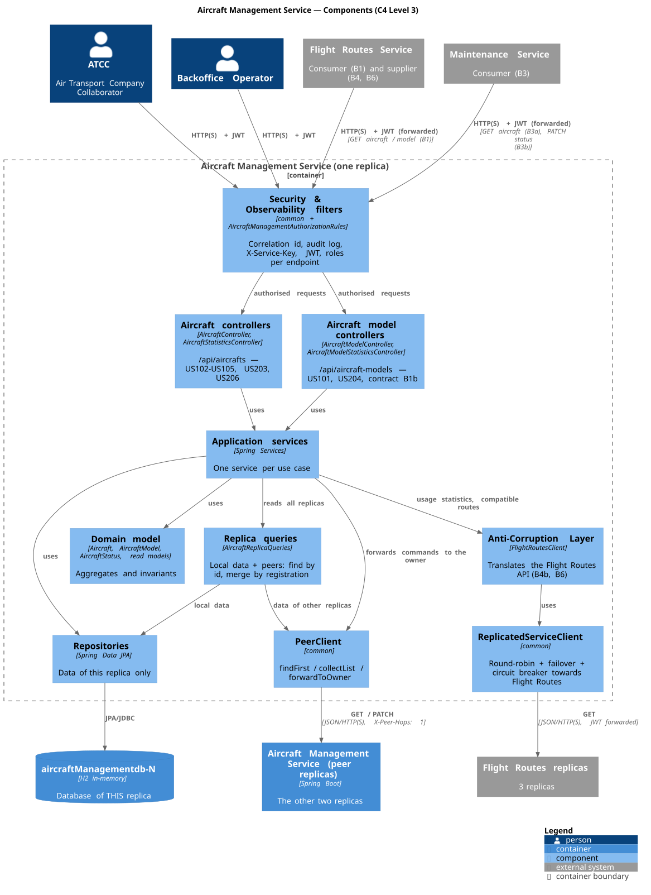

# C4 Level 3 — Aircraft Management Service: Components

> Zoom into the **Aircraft Management Service** container of [Level 2](../../2-containers/Containers.md): its major building blocks and how they collaborate. One replica is shown; the three replicas are identical.
> Lower levels: [L4 Code](../../4-code/aircraftmanagement/AircraftManagement-Code.md) · [+1 Scenarios](../../5-scenarios/aircraftmanagement/AircraftManagement-Scenarios.md)

## 1. Container summary

| Property | Value |
|---|---|
| Bounded context | *Fleet* — owns the `AircraftModel` and `Aircraft` aggregates (WP#1: US101–US105, US201–US206) |
| Replicas | `aircraftmanagement-1` :8081, `aircraftmanagement-2` :8181, `aircraftmanagement-3` :8281 |
| Database | H2 in-memory per replica: `aircraftManagementdb-1/2/3` |
| Source code | [code/aircraftmanagement](../../../code/aircraftmanagement) |
| API | `http://localhost:8081/swagger-ui.html` (any replica) |
| Supplies to other containers | Flight Routes: aircraft status/capacity/model and model range (B1a, B1b); Maintenance: aircraft lookup and status update (B3a, B3b) — see [Integration-Contracts](../../2-containers/Integration-Contracts.md) |
| Consumes from other containers | Flight Routes: flight minutes per aircraft (B4b) and compatible routes (B6) |

## 2. Components

| Component | Technology / classes | Responsibility |
|---|---|---|
| **Security & Observability filters** | `common` filters + [`AircraftManagementAuthorizationRules`](../../../code/aircraftmanagement/src/main/java/isep/psoft/aisafe/infrastructure/security/AircraftManagementAuthorizationRules.java) | Correlation id, audit log, `X-Service-Key` check, JWT authentication, role rules per endpoint. The rules accept the roles of the **end users of the consumer services**, because the JWT is forwarded on inter-service calls |
| **Aircraft controllers** | [`AircraftController`](../../../code/aircraftmanagement/src/main/java/isep/psoft/aisafe/aircraftmanagement/controllers/AircraftController.java), [`AircraftStatisticsController`](../../../code/aircraftmanagement/src/main/java/isep/psoft/aisafe/aircraftmanagement/controllers/AircraftStatisticsController.java) (Spring REST) | `/api/aircrafts` — US102, US103, US104, US105 and the queries that combine Flight Routes data (US203, US206) |
| **Aircraft model controllers** | [`AircraftModelController`](../../../code/aircraftmanagement/src/main/java/isep/psoft/aisafe/aircraftmanagement/controllers/AircraftModelController.java), [`AircraftModelStatisticsController`](../../../code/aircraftmanagement/src/main/java/isep/psoft/aisafe/aircraftmanagement/controllers/AircraftModelStatisticsController.java) (Spring REST) | `/api/aircraft-models` — US101, contract B1b, US204 |
| **Application services** | `CreateAircraftModelService`, `CreateAircraftService`, `SearchAircraftsService`, `SearchAircraftModelsService`, `UpdateAircraftStatusService`, `CalculateOperationalHoursService`, `TopUtilizedModelsService`, `FindCompatibleRoutesService` | One service per use case: transactions, orchestration, cross-replica uniqueness checks |
| **Replica queries** | [`AircraftReplicaQueries`](../../../code/aircraftmanagement/src/main/java/isep/psoft/aisafe/aircraftmanagement/services/AircraftReplicaQueries.java) | Combines the local data with the data of the peer replicas: find an aircraft/model in any replica, merge collections by registration number, encode peer URIs |
| **Domain model** | `domain` package: `Aircraft`, `AircraftModel`, `AircraftStatus`, read models `AircraftSummary`, `AircraftModelSummary` | Aggregates `Aircraft` and `AircraftModel` and their invariants; status transition rule — see [L4](../../4-code/aircraftmanagement/AircraftManagement-Code.md) |
| **Repositories** | `AircraftRepository`, `AircraftModelRepository` (Spring Data JPA) | Access to the data of **this** replica only |
| **Anti-Corruption Layer** | [`FlightRoutesClient`](../../../code/aircraftmanagement/src/main/java/isep/psoft/aisafe/aircraftmanagement/clients/FlightRoutesClient.java), `CompatibleRouteDTO`, `RestClientConfig` | Translates the Flight Routes API into local results and reports partial answers (`X-Partial-Response`) |
| **Assembler / DTOs** | `AircraftAssembler`, `dto` package, `PageDTO` | Published language: API contract separate from the domain; stable page format |
| **PeerClient** *(common)* | `PeerClient` | GET to the peer replicas (first answer / aggregation) and command forwarding to the owner replica |
| **ReplicatedServiceClient** *(common)* | `ReplicatedServiceClient`, `ReplicatedServiceClientFactory` | Round-robin + failover over the replicas of Flight Routes |
| **ResilientExecutor** *(common)* | `ResilientExecutor`, `CircuitBreaker` | Timeouts, retry with exponential backoff, circuit breaker per target |
| **Error mapping / OpenAPI** | `GlobalExceptionHandler`, `OpenApiConfig` | Exception → HTTP status; Swagger UI with the JWT *Authorize* button |
| *Demo data* | `DemoDataBootstrap` (properties `aisafe.bootstrap.*`) | Loads **different** models and aircraft in each replica, to demonstrate peer-to-peer behaviour |

The `common` components are described in [common — Components](../common/Common-Components.md).

## 3. Provided interfaces (REST API)

Every endpoint is served by every replica; **every GET returns the data of all replicas**.

**Aircraft — `/api/aircrafts`**

| Method | Endpoint | US | Input | Output | Roles | Status |
|---|---|---|---|---|---|---|
| POST | `/api/aircrafts` | US102 | `CreateAircraftDTO` (registrationNumber, modelName, seatingCapacity, manufacturingDate, status?) | `201` `AircraftDTO` | ATCC | Implemented |
| GET | `/api/aircrafts?modelName=&status=&manufacturingYear=&page=&size=` | US104 | optional filters (combined with AND), `page` ≥ 0, `size` 1–100 (default 20) | `200` `PageDTO<AircraftDTO>` | ATCC, BACKOFFICE_OPERATOR, MAINTENANCE_TECHNICIAN, MAINTENANCE_SUPERVISOR | Implemented |
| GET | `/api/aircrafts/{registrationNumber}` | US103, **B1a**, B3a | registration number | `200` `AircraftDTO` | ATCC, BACKOFFICE_OPERATOR, MAINTENANCE_TECHNICIAN, MAINTENANCE_SUPERVISOR | Implemented |
| PATCH | `/api/aircrafts/{registrationNumber}/status` | US105, **B3b** | `UpdateAircraftStatusDTO` (`status`) | `200` `AircraftDTO` | ATCC, MAINTENANCE_TECHNICIAN, MAINTENANCE_SUPERVISOR | Implemented |
| GET | `/api/aircrafts/operational-hours?page=&size=` | US206 | pagination | `200` `PageDTO<AircraftOperationalHoursDTO>` (+ `X-Partial-Response`) | ATCC | Implemented |
| GET | `/api/aircrafts/{registrationNumber}/compatible-routes` | US203 | registration number | `200` `List<CompatibleRouteDTO>` (+ `X-Partial-Response`) | ATCC | Implemented |

**Aircraft models — `/api/aircraft-models`**

| Method | Endpoint | US | Input | Output | Roles | Status |
|---|---|---|---|---|---|---|
| POST | `/api/aircraft-models` | US101 | `CreateAircraftModelDTO` (modelName, manufacturer, seatingCapacity, fuelCapacity, maximumRange, cruisingSpeed) | `201` `AircraftModelDTO` | BACKOFFICE_OPERATOR | Implemented |
| GET | `/api/aircraft-models/{modelName}` | **B1b** | model name | `200` `AircraftModelDTO` | ATCC, BACKOFFICE_OPERATOR, MAINTENANCE_TECHNICIAN, MAINTENANCE_SUPERVISOR | Implemented |
| GET | `/api/aircraft-models/top-utilized?limit=` | US204 | `limit` 1–20 (default 5) | `200` `List<ModelUtilizationDTO>` (+ `X-Partial-Response`) | BACKOFFICE_OPERATOR, ATCC | Implemented (see observation O1) |

**Planned (not implemented yet — proposed design, to be confirmed with the customer)**

| Method | Endpoint | US | Idea | Roles |
|---|---|---|---|---|
| PATCH | `/api/aircraft-models/{modelName}` | US201 | Partial update of the specifications; executed by the owner replica (`PeerClient.forwardToOwner`); `@Version` → `409` on a clash | BACKOFFICE_OPERATOR |
| POST / PATCH | `/api/aircraft-models` (+ optional `imageUrl`) | US202 | Optional image/diagram stored as a **URL** (same decision as the photos of Airports); no file upload | BACKOFFICE_OPERATOR |
| GET | `/api/aircrafts/{registrationNumber}/availability` | US205 | Real-time availability: the stored status (`AVAILABLE`, `UNDER_MAINTENANCE`, `INACTIVE`) and `IN_FLIGHT` — needs a decision on who sets `IN_FLIGHT` (open question Q-AM1) | ATCC |
| GET | `/api/aircrafts?feature=…` | US224 (bonus) | Search by features (Wi-Fi, engine type): new optional attributes of the model | ATCC |

Infrastructure endpoints (from `common`): `GET /actuator/health`, `POST /auth/dev-token` (development only), `/swagger-ui.html`, `/v3/api-docs`.

**Errors** — body `{ "error": "<message>" }` (Bean Validation: `{ "<field>": "<message>" }`):

| Exception | HTTP | Example in this service |
|---|---|---|
| `IllegalArgumentException`, `MethodArgumentNotValidException` | 400 | invalid status string, unknown model when registering an aircraft, `size` out of range, bad registration format |
| `EntityNotFoundException` | 404 | aircraft or model not found in any replica |
| `IllegalStateException`, `ObjectOptimisticLockingFailureException` | 409 | model/aircraft already exists; `IN_FLIGHT` → `UNDER_MAINTENANCE`/`INACTIVE`; concurrent update (`@Version`) |
| `RemoteServiceUnavailableException` | 503 | no Flight Routes replica answered (US203, US204, US206), or no peer reachable to execute a command |
| `ResponseStatusException` | same status | Flight Routes rejected the forwarded JWT (`401`/`403`); business error of the owner replica |

## 4. Required interfaces

| Component | Calls | Endpoint | Contract | US |
|---|---|---|---|---|
| `FlightRoutesClient.minutesByAircraft` | Flight Routes (all replicas) | `GET /api/scheduled-flights/statistics/minutes-by-aircraft` | B4b | US204, US206 |
| `FlightRoutesClient.compatibleRoutes` | Flight Routes (all replicas) | `GET /api/routes/compatible?range=&capacity=` | B6 | US203 |
| `PeerClient` | Aircraft Management peer replicas | the same endpoint as the incoming request (`GET /api/aircrafts/{reg}`, `GET /api/aircrafts?…`, `GET /api/aircraft-models/{name}`, `PATCH /api/aircrafts/{reg}/status`), `X-Peer-Hops: 1` | — | US102–US105 |

## 5. How the components realise the distribution requirements

| Requirement | Components involved |
|---|---|
| Peer forwarding of GET by id (US103/B1a, B1b, uniqueness checks of US101/US102) | services → `AircraftReplicaQueries.findAircraft` / `findModel` → `PeerClient.findFirst` |
| Aggregation of collections (US104; the fleet used by US203, US204, US206) | `SearchAircraftsService.search` → `AircraftReplicaQueries.withPeers` → `PeerClient.collectList`, merged by registration number; `AircraftController` paginates **after** merging |
| Aggregated statistics (US204, US206) | `CalculateOperationalHoursService`, `TopUtilizedModelsService`: fleet of all replicas (above) × flight minutes of all Flight Routes replicas (`FlightRoutesClient` → `ReplicatedServiceClient`) |
| Single owner per record (US105) | `UpdateAircraftStatusService` → local update, otherwise `PeerClient.forwardToOwner` |
| Concurrent updates | `@Version` on `Aircraft` and `AircraftModel` → `ObjectOptimisticLockingFailureException` → `409` |
| Calls to other services with failover | ACL (`FlightRoutesClient`) → `ReplicatedServiceClient` → `ResilientExecutor` |
| Partial answers | `PeerClient` marks `X-Partial-Response` when a peer fails; the statistics controllers also mark it when **Flight Routes** answered partially |
| Security and audit | filter chain of `common` + `AircraftManagementAuthorizationRules` (JWT, roles, `X-Service-Key` on peer calls, audit log, TLS with profile `tls`) |

The system-wide decisions (consistency model, fault tolerance, security) are in [L2 §3](../../2-containers/Containers.md#3-distribution-design-decisions).

## 6. Observations

- **O1 — US204 for Backoffice Operators.** The US says the *Backoffice Operator* sees the Top 5, and `AircraftManagementAuthorizationRules` allows `BACKOFFICE_OPERATOR` and `ATCC`. But the JWT is forwarded to Flight Routes, whose rule for `/api/scheduled-flights/**` accepts only `ATCC` ([Integration-Contracts Q4](../../2-containers/Integration-Contracts.md#7-open-decisions-need-group-agreement)). A Backoffice token is therefore expected to end in `403` ("Flight Routes rejected the request.") until that rule is widened. The Postman collection has a request that documents this.
- **O2 — HATEOAS.** The PSOFT non-functional requirements ask for links in the representations. The starter is a dependency, but `AircraftAssembler` returns plain DTOs (no `_links`) and `springdoc.enable-hateoas=false`. To be added (the contract allows extra fields such as `_links`).
- **O3 — Implementation status.** US101–US105, US203, US204, US206 are implemented. US201, US202, US205 and the bonus US223/US224 are planned only.
