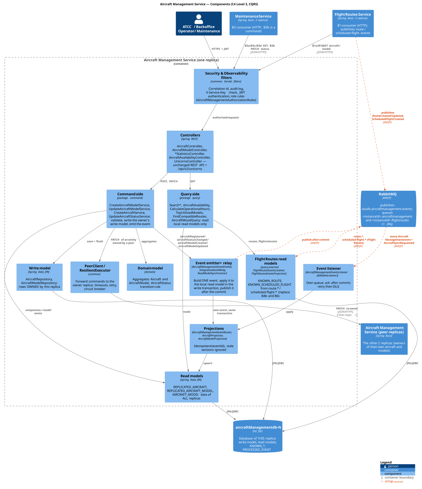

# C4 Level 3 — Aircraft Management Service: Components

> Zoom into the **Aircraft Management Service** container of [Level 2](../../2-containers/Containers.md): its major building blocks and how they collaborate. One replica is shown; the three replicas are identical.
> Lower levels: [L4 Code](../../4-code/aircraftmanagement/AircraftManagement-Code.md) · [+1 Scenarios](../../5-scenarios/aircraftmanagement/AircraftManagement-Scenarios.md)



## 1. Container summary

| Property | Value |
|---|---|
| Bounded context | *Fleet* — owns the `AircraftModel` and `Aircraft` aggregates (WP#1: US101–US105, US201, US203–US206) |
| Replicas | `aircraftmanagement-1` :8081, `aircraftmanagement-2` :8181, `aircraftmanagement-3` :8281 |
| Database | H2 **file** per replica: `code/data/aircraftManagementdb-1/2/3` — write model (owned rows), read models (rows of every replica), copies of Flight Routes data, processed event ids |
| Messaging | Publishes on `aisafe.aircraftmanagement.events`; consumes its own events from `<instanceId>.aircraftmanagement` and the route / scheduled-flight events of Flight Routes from `<instanceId>.flightroutes` ([Integration-Contracts §9](../../2-containers/Integration-Contracts.md#9-assignment-2--event-contracts); flow in section 6) |
| Source code | [code/aircraftmanagement](../../../code/aircraftmanagement) |
| API | `http://localhost:8081/swagger-ui.html` (any replica) |
| Supplies to other containers | Flight Routes: aircraft and model (B1a, B1b, HTTP); Maintenance: aircraft lookup, fleet and hours (B3a, B3c, B3d, HTTP) and status change (B3b, HTTP command). Events `AircraftRegistered`, `AircraftStatusChanged`, `AircraftModelCreated`, `AircraftModelUpdated` for any consumer (Flight Routes `KNOWN_AIRCRAFT*` is ready for them) |
| Consumes from other containers | **No HTTP call any more.** Flight Routes events `RouteCreated`, `RouteUpdated`, `ScheduledFlightCreated` replace bridges B6 and B4b |

## 2. Components

The module is split into a **command side** (writes) and a **query side** (reads) — CQRS, the same structure as Flight Routes. Both share the domain, the controllers and the `common` infrastructure.

| Component | Technology / classes | Responsibility |
|---|---|---|
| **Security & Observability filters** | `common` filters + [`AircraftManagementAuthorizationRules`](../../../code/aircraftmanagement/src/main/java/isep/psoft/aisafe/infrastructure/security/AircraftManagementAuthorizationRules.java) | Correlation id, audit log, `X-Service-Key` check, JWT authentication, role rules per endpoint. The rules accept the roles of the **end users of the consumer services**, because the JWT is forwarded |
| **Controllers** | `AircraftController`, `AircraftModelController`, `AircraftStatisticsController`, `AircraftModelStatisticsController`, `AircraftAvailabilityController`, [`UnicornsController`](../../../code/aircraftmanagement/src/main/java/isep/psoft/aisafe/aircraftmanagement/controllers/UnicornsController.java) | Unchanged REST API: POST/PATCH go to the command side, every GET to the query side. New: `GET /api/v2/unicorns` |
| **Command side** | package [`command`](../../../code/aircraftmanagement/src/main/java/isep/psoft/aisafe/aircraftmanagement/command): `CreateAircraftModelService` (US101), `UpdateAircraftModelService` (US201), `CreateAircraftService` (US102), `UpdateAircraftStatusService` (US105, B3b) | Validate, write the **owner's** write model (forward to the owner if the entity is not local), emit one event. Checks that need data of every replica (registration / model name unique, model exists) read the local read models |
| **Event emitter and relay** | `AircraftManagementEventEmitter`, `OutgoingIntegrationEvent`, `IntegrationEventRelay`, `IntegrationEventTransport` (+ `infrastructure.messaging.RabbitIntegrationEventTransport`) | Build one `IntegrationEvent`, apply it to the local read model **in the write transaction** (read-your-writes), publish the same event after the commit through `common`'s `EventPublisher` |
| **Startup synchronisation** | `ReadModelSynchronizer`, `AircraftStateRepublisher`, event `AircraftSyncRequested` (same design as Airports) | On start, a replica republishes the state of every model and aircraft it **owns** (same `version`) and asks the other replicas to do the same, so a late or new replica fills its read model, and a late subscriber or an event lost while the broker was down is healed (section 6) |
| **Write model** | `AircraftRepository`, `AircraftModelRepository` (Spring Data JPA) | Rows **owned** by this replica only; used only by the command side, the bootstrap and the announcer |
| **Query side** | package [`query`](../../../code/aircraftmanagement/src/main/java/isep/psoft/aisafe/aircraftmanagement/query): `SearchAircraftsService` (US103, US104, B1a, B3a), `SearchAircraftModelsService` (B1b, B3c), `AircraftAvailabilityService` (US205), `CalculateOperationalHoursService` (US206, B3d), `TopUtilizedModelsService` (US204), `FindCompatibleRoutesService` (US203), `FlightMinutesService`, `AircraftMoodQueryService` (unicorns) | Answer every GET from **this replica's read models**: no peer call, no aggregation, no call to Flight Routes, never `X-Partial-Response` |
| **Read models** | `ReplicatedAircraft`, `ReplicatedAircraftModel`, `AircraftMood` and their repositories | Copies of the aircraft and models of **every** replica (with owner, source version and last event) and the mood projection |
| **Projections** | `AircraftManagementEventRouter`, `AircraftProjection` (aircraft + mood, one transaction), `AircraftModelProjection`, `infrastructure.messaging.JpaProcessedEventStore` | Apply events idempotently (eventId recorded in the same transaction), ignore stale versions and unknown types |
| **Event listener** | `AircraftManagementEventsListener` (`@RabbitListener`), `infrastructure.messaging.AircraftManagementMessagingConfiguration` | Consume `aircraft.*`, `aircraft-model.*` and `aircraft-sync.requested` from this replica's queue; ack after commit; bounded retry then DLQ (`common`) |
| **Flight Routes read models** | package `query.external`: `KnownRoute`, `KnownScheduledFlight`, `FlightRoutesEventsProjection`, `FlightRoutesEventsListener`; `events.external` (contracts) | Consumer of Flight Routes' `route.*` and `scheduled-flight.*` (queue `<instanceId>.flightroutes`); feeds US203 (replaces B6) and US204/US206 (replaces B4b) |
| **Event contracts** | package `events`: `AircraftEvents`, `AircraftEventPayload`, `AircraftModelEvents`, `AircraftModelEventPayload` | Published language of Aircraft Management (names, routing keys, payload records) |
| **Domain model** | `domain` package: `Aircraft`, `AircraftModel`, `AircraftStatus`, views `AircraftSummary`, `AircraftModelSummary` | Aggregates and invariants; status transition rule — see [L4](../../4-code/aircraftmanagement/AircraftManagement-Code.md) |
| **Assembler / DTOs** | `AircraftAssembler`, `dto` package (`PageDTO`, `AircraftMoodDTO`, ...) | API contract separate from the domain; stable page format |
| **PeerClient / ResilientExecutor** *(common)* | `PeerClient`, `ResilientExecutor`, `CircuitBreaker` | Only `forwardToOwner`: a PATCH for an aircraft / model owned by another replica |
| **Error mapping / OpenAPI** | `GlobalExceptionHandler`, `OpenApiConfig` | Exception → HTTP status; Swagger UI with the JWT *Authorize* button |
| *Demo data* | `DemoDataBootstrap` (profile `demo`) | On `ApplicationReadyEvent`, inserts this replica's demo models/aircraft **only if missing** and emits their events like any other write |

The `common` components are described in [common — Components](../common/Common-Components.md).

## 3. Provided interfaces (REST API)

Every endpoint is served by every replica. **Every GET answers from the local read models**, which contain the data of all replicas (eventually consistent: a write made on another replica appears when its event arrives).

**Aircraft — `/api/aircrafts`**

| Method | Endpoint | US | Side | Input | Output | Roles |
|---|---|---|---|---|---|---|
| POST | `/api/aircrafts` | US102 | command | `CreateAircraftDTO` (registrationNumber, modelName, seatingCapacity, manufacturingDate, status?) | `201` `AircraftDTO` | ATCC |
| GET | `/api/aircrafts?modelName=&status=&manufacturingYear=&page=&size=` | US104, B3d | query | optional filters (AND), `page` ≥ 0, `size` 1–100 | `200` `PageDTO<AircraftDTO>` | ATCC, BACKOFFICE_OPERATOR, MAINTENANCE_* |
| GET | `/api/aircrafts/{registrationNumber}` | US103, **B1a**, B3a | query | registration number | `200` `AircraftDTO` | ATCC, BACKOFFICE_OPERATOR, MAINTENANCE_* |
| PATCH | `/api/aircrafts/{registrationNumber}/status` | US105, **B3b** | command (owner) | `UpdateAircraftStatusDTO` (`status`) | `200` `AircraftDTO` | ATCC, MAINTENANCE_* |
| GET | `/api/aircrafts/{registrationNumber}/availability`, `/api/aircrafts/availability` | US205 | query | — | `200` `AircraftAvailabilityDTO` / `FleetAvailabilityDTO` | ATCC |
| GET | `/api/aircrafts/operational-hours?page=&size=` | US206, B3d | query | pagination | `200` `PageDTO<AircraftOperationalHoursDTO>` | ATCC |
| GET | `/api/aircrafts/{registrationNumber}/compatible-routes` | US203 | query | registration number | `200` `List<CompatibleRouteDTO>` | ATCC |

**Aircraft models — `/api/aircraft-models`**

| Method | Endpoint | US | Side | Input | Output | Roles |
|---|---|---|---|---|---|---|
| POST | `/api/aircraft-models` | US101 | command | `CreateAircraftModelDTO` | `201` `AircraftModelDTO` | BACKOFFICE_OPERATOR |
| GET | `/api/aircraft-models/{modelName}` | **B1b**, B3c | query | model name | `200` `AircraftModelDTO` | ATCC, BACKOFFICE_OPERATOR, MAINTENANCE_* |
| PATCH | `/api/aircraft-models/{modelName}` | US201 | command (owner) | `UpdateAircraftModelDTO` (any subset) | `200` `AircraftModelDTO` | BACKOFFICE_OPERATOR |
| GET | `/api/aircraft-models/top-utilized?limit=` | US204 | query | `limit` 1–20 (default 5) | `200` `List<ModelUtilizationDTO>` | BACKOFFICE_OPERATOR, ATCC |

**Assignment 2 — `/api/v2/unicorns`**

| Method | Endpoint | Side | Output | Roles |
|---|---|---|---|---|
| GET | `/api/v2/unicorns` | query (projection `AIRCRAFT_MOOD`) | `200` `List<AircraftMoodDTO>`: `registration`, `model`, `operationalStatus`, `mood`, `timestamp`, `source = "read-model"` ([contract](../../2-containers/Unicorns-Mock.md)) | any AISafe role |

`X-Partial-Response` is no longer produced by this service. Infrastructure endpoints (from `common` / Spring Boot): `GET /actuator/health`, `/actuator/health/liveness`, `/actuator/health/readiness` (includes RabbitMQ), `POST /auth/dev-token` (development only), `/swagger-ui.html`.

**Errors** — body `{ "error": "<message>" }` (Bean Validation: `{ "<field>": "<message>" }`):

| Exception | HTTP | Example in this service |
|---|---|---|
| `IllegalArgumentException`, `MethodArgumentNotValidException` | 400 | invalid status, unknown model when registering an aircraft, `size` out of range |
| `EntityNotFoundException` | 404 | aircraft or model not in the read model (no replica has announced it) |
| `IllegalStateException`, `ObjectOptimisticLockingFailureException` | 409 | model/aircraft already exists; `IN_FLIGHT` → `UNDER_MAINTENANCE`/`INACTIVE`; concurrent update (`@Version`) |
| `RemoteServiceUnavailableException` | 503 | the owner replica of the aircraft/model being changed is down |
| `ResponseStatusException` | same status | business error of the owner replica after forwarding |

## 4. Required interfaces

| Component | Calls | Endpoint / channel |
|---|---|---|
| `PeerClient` | Aircraft Management peer replicas | `PATCH /api/aircrafts/{reg}/status`, `PATCH /api/aircraft-models/{name}` forwarded to the owner, `X-Peer-Hops: 1` |
| `RabbitIntegrationEventTransport` | RabbitMQ | publish to `aisafe.aircraftmanagement.events` |
| `AircraftManagementEventsListener` | RabbitMQ | consume `<instanceId>.aircraftmanagement` |
| `FlightRoutesEventsListener` | RabbitMQ | consume `<instanceId>.flightroutes` (Flight Routes' `route.*`, `scheduled-flight.*`) |

## 5. How the components realise the distribution requirements

| Requirement | Components involved |
|---|---|
| CQRS: separate write and read models | `command` services → write model; `query` services → read models; events in between |
| Every replica sees every aircraft and model (US103, US104, B1, B3) | events → `AircraftManagementEventsListener` → `AircraftManagementEventRouter` → `AircraftProjection` / `AircraftModelProjection` → `REPLICATED_*` |
| Data of another service without HTTP (US203, US204, US206) | Flight Routes events → `FlightRoutesEventsListener` → `FlightRoutesEventsProjection` → `KNOWN_ROUTE`, `KNOWN_SCHEDULED_FLIGHT` |
| Read-your-writes on the owner | `AircraftManagementEventEmitter` applies the event to the local read model in the write transaction |
| Single owner per entity (US105, US201) | `Update*Service` → `PeerClient.forwardToOwner`; only the owner publishes the entity's events (in order) |
| Concurrent updates | `@Version` on `Aircraft` and `AircraftModel` → `409` |
| Reliable consumption | durable queue per replica, ack after commit, bounded retry, DLQ, `JpaProcessedEventStore` (idempotency) |
| Late subscribers / lost events | `ReadModelSynchronizer`: republish the owned state on start + `AircraftSyncRequested` to the peers |
| Broker down | writes still committed (event lost, logged; republished at the next start or sync request), reads served from read models, liveness `UP` / readiness `DOWN` |
| Database per instance, survives restarts | file H2 per replica; demo bootstrap inserts only missing rows |
| Security and audit | filter chain of `common` + `AircraftManagementAuthorizationRules` |

The system-wide decisions are in [L2 §3](../../2-containers/Containers.md#3-distribution-design-decisions); the event contracts in [Integration-Contracts §9](../../2-containers/Integration-Contracts.md#9-assignment-2--event-contracts).

## 6. CQRS flow: write → event → projection on every replica (and on Flight Routes)

```text
POST/PATCH ─▶ command/*Service ──(1) save + flush──▶ write model (AIRCRAFT / AIRCRAFT_MODEL, owned rows only)
                 │
                 └─(2) AircraftManagementEventEmitter: build ONE IntegrationEvent
                        ├─(3) AircraftManagementEventRouter → projection → read model of THIS replica   } same transaction
                        └─(4) OutgoingIntegrationEvent (Spring)                                           }
                                       │ AFTER COMMIT
                                       ▼
                        IntegrationEventRelay ─▶ RabbitIntegrationEventTransport ─▶ [aisafe.aircraftmanagement.events]
                                                                                      │ aircraft.*, aircraft-model.*
                        ┌─────────────────────────────────────────────┬───────────────┴──────────────┐
                        ▼                                             ▼                              ▼
       aircraftmanagement-1.aircraftmanagement        ...-2/-3.aircraftmanagement        flightroutes-N.aircraftmanagement
       (owner: eventId already processed → skipped)   → REPLICATED_AIRCRAFT(_MODEL),     (Flight Routes KNOWN_AIRCRAFT*,
                                                        AIRCRAFT_MOOD                      when enabled)

[aisafe.flightroutes.events] ─ route.*, scheduled-flight.* ─▶ aircraftmanagement-N.flightroutes ─▶ KNOWN_ROUTE, KNOWN_SCHEDULED_FLIGHT

GET ─▶ query/*Service ─▶ local tables only (no peer calls, no call to Flight Routes, no X-Partial-Response)
```

| Read model (table) | Built from | Answers |
|---|---|---|
| `REPLICATED_AIRCRAFT` | `AircraftRegistered`, `AircraftStatusChanged` | US103/B1a/B3a by id, US104 search, US205, fleet of US204/US206; uniqueness check of US102 |
| `REPLICATED_AIRCRAFT_MODEL` | `AircraftModelCreated`, `AircraftModelUpdated` | B1b/B3c, range of US203; uniqueness of US101, model check of US102 |
| `AIRCRAFT_MOOD` | `AircraftRegistered`, `AircraftStatusChanged` | `GET /api/v2/unicorns` |
| `KNOWN_ROUTE` | Flight Routes `RouteCreated`, `RouteUpdated` | US203 (replaces B6) |
| `KNOWN_SCHEDULED_FLIGHT` | Flight Routes `ScheduledFlightCreated`, `ScheduledFlightStatusChanged` | US204, US206 (replaces B4b) |
| `PROCESSED_EVENT` | every applied event | idempotency |

**Startup synchronisation (same design as Airports).** A queue only receives events published after it exists, and there is no outbox. On the very first start the replicas start in parallel, so a replica can publish its demo data before a peer (or Flight Routes) has declared its queue; a new replica, or one whose database was erased, starts empty. On `ApplicationReadyEvent` (after the demo data), `ReadModelSynchronizer` (1) republishes, through `AircraftStateRepublisher`, the current state of the rows this replica owns, with their **current** `version`, and (2) publishes `AircraftSyncRequested` (routing key `aircraft-sync.requested`, which does not match `aircraft.*`, so only Aircraft Management replicas receive it); every other replica answers by republishing what it owns. Consumers that already have an entity apply an identical upsert (only *older* versions are ignored); consumers that missed it catch up. Alternatives: a transactional outbox (fixes lost events, not late subscribers), or a snapshot endpoint (needs HTTP between replicas again).

Sequence diagrams: [+1 Scenarios](../../5-scenarios/aircraftmanagement/AircraftManagement-Scenarios.md).

## 7. Observations

- **O1 — HATEOAS.** `AircraftAssembler` returns plain DTOs (no `_links`); the contract allows adding them later.
- **O2 — Implementation status.** US101–US105, US201, US203–US206 and `/api/v2/unicorns` are implemented. US202 (model image) and the bonus US223/US224 are not.
- **O3 — US205 "real time".** Availability is read from the local read model: current on the owner replica as soon as the command commits, and on the other replicas once the `AircraftStatusChanged` event is applied (typically milliseconds). Flight Routes still reads the status over HTTP (B1a), so scheduling (US212) uses the owner's current value.
