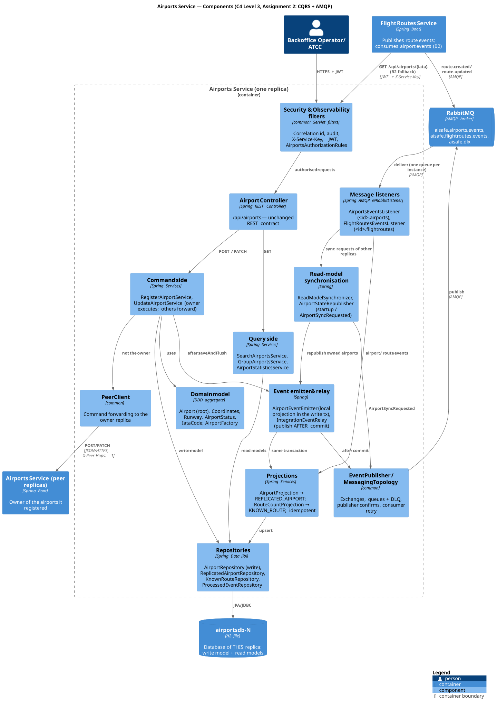

# C4 Level 3 — Airports Service: Components

> Zoom into the **Airports Service** container of [Level 2](../../2-containers/Containers.md): its major building blocks and how they collaborate. One replica is shown; all replicas are identical.
> Lower levels: [L4 Code](../../4-code/airports/Airports-Code.md) · [+1 Scenarios](../../5-scenarios/airports/Airports-Scenarios.md)



## 1. Container summary

| Property | Value |
|---|---|
| Bounded context | Airport infrastructure — owns `Airport` (runways, certifications, facilities, status) |
| Replicas | `airports-1` :8083, `airports-2` :8183 (`airports-3` :8283 optional). Assignment 2 requires at least two |
| Database | **Database-per-Service, one per instance**: H2 file `code/data/airportsdb-N.mv.db`. Each replica reads and writes only its own |
| Messaging | RabbitMQ (AMQP). Publishes to `aisafe.airports.events`; consumes its own queue `<instanceId>.airports` and `<instanceId>.flightroutes` |
| Source code | [code/airports](../../../code/airports) |
| API | `http://localhost:8083/swagger-ui.html` (any replica). External endpoints stay HTTP REST |

## 2. Components

The service follows **CQRS**: commands change the **write model** (`Airport`, partitioned — each airport is stored only by its owner replica); queries read **read models** that every replica keeps complete, fed only by events.

| Component | Technology / classes | Responsibility |
|---|---|---|
| **Security & Observability filters** | `common` filters + [`AirportsAuthorizationRules`](../../../code/airports/src/main/java/isep/psoft/aisafe/infrastructure/security/AirportsAuthorizationRules.java) | Correlation id, audit log, `X-Service-Key` check, JWT authentication, role rules per endpoint; any other request to `/api/airports` is denied |
| **Airport Controller** | [`AirportController`](../../../code/airports/src/main/java/isep/psoft/aisafe/airports/controllers/AirportController.java) (Spring REST) | `/api/airports` — US106–US109, US106a, US207, US208, US210, US211 (same contract as Assignment 1) |
| **Command side** | [`RegisterAirportService`](../../../code/airports/src/main/java/isep/psoft/aisafe/airports/command/RegisterAirportService.java), [`UpdateAirportService`](../../../code/airports/src/main/java/isep/psoft/aisafe/airports/command/UpdateAirportService.java) | Execute the commands on the owner replica (forward them to the owner otherwise), `saveAndFlush` the write model and announce the change |
| **Event emitter & relay** | [`AirportEventEmitter`](../../../code/airports/src/main/java/isep/psoft/aisafe/airports/command/AirportEventEmitter.java), [`IntegrationEventRelay`](../../../code/airports/src/main/java/isep/psoft/aisafe/airports/command/IntegrationEventRelay.java), [`RabbitIntegrationEventTransport`](../../../code/airports/src/main/java/isep/psoft/aisafe/infrastructure/messaging/RabbitIntegrationEventTransport.java) | Build ONE event with the full state; apply it to the local read model inside the write transaction (read-your-writes); publish it to RabbitMQ **after the commit** |
| **Read-model synchronisation** | [`ReadModelSynchronizer`](../../../code/airports/src/main/java/isep/psoft/aisafe/airports/command/ReadModelSynchronizer.java), [`AirportStateRepublisher`](../../../code/airports/src/main/java/isep/psoft/aisafe/airports/command/AirportStateRepublisher.java) | On startup: republish the owned airports and send `AirportSyncRequested` so the other replicas republish theirs (a queue only receives events published after it exists) |
| **Query side** | [`SearchAirportsService`](../../../code/airports/src/main/java/isep/psoft/aisafe/airports/query/SearchAirportsService.java), [`GroupAirportsService`](../../../code/airports/src/main/java/isep/psoft/aisafe/airports/query/GroupAirportsService.java), [`AirportStatisticsService`](../../../code/airports/src/main/java/isep/psoft/aisafe/airports/query/AirportStatisticsService.java) | US107, US108, US211, US210 answered **only from local read models**: no peer calls, no partial responses |
| **Projections** | [`AirportProjection`](../../../code/airports/src/main/java/isep/psoft/aisafe/airports/query/AirportProjection.java), [`RouteCountProjection`](../../../code/airports/src/main/java/isep/psoft/aisafe/airports/query/external/RouteCountProjection.java) | Apply events to the read models: idempotent (`PROCESSED_EVENT`), stale versions ignored, unknown types ignored |
| **Message listeners** | [`AirportsEventsListener`](../../../code/airports/src/main/java/isep/psoft/aisafe/infrastructure/messaging/AirportsEventsListener.java), [`FlightRoutesEventsListener`](../../../code/airports/src/main/java/isep/psoft/aisafe/infrastructure/messaging/FlightRoutesEventsListener.java), [`AirportsMessagingConfiguration`](../../../code/airports/src/main/java/isep/psoft/aisafe/infrastructure/messaging/AirportsMessagingConfiguration.java) | Declare this replica's queues, DLQs and bindings; consume them and route by `eventType` |
| **Domain model** | `domain` + `factories` packages | Aggregate `Airport`, Value Objects `Coordinates`, `Runway`, `AirportStatus`, `IataCode`; `AirportFactory` — see [L4](../../4-code/airports/Airports-Code.md) |
| **Repositories** | `AirportRepository` (write model), `ReplicatedAirportRepository`, `KnownRouteRepository`, `ProcessedEventRepository` (Spring Data JPA) | Access to the database of **this** replica only |
| **PeerClient** *(common)* | [`PeerClient`](../../../code/common/src/main/java/isep/sidis/common/peers/PeerClient.java) | Only for **commands**: forward a write to the owner replica (unicast) |
| **Messaging library** *(common)* | `EventPublisher`, `MessagingTopology`, `EventSubscription`, `IdempotentEventHandler`, `ConsumerRetry` | Exchanges, queues, DLQ, publisher confirms, consumer retry with back-off |
| *Demo data* | [`DemoDataBootstrap`](../../../code/airports/src/main/java/isep/psoft/aisafe/airports/bootstrap/DemoDataBootstrap.java) (profile `demo`) | Loads a different set of airports in each replica and announces them (`AirportCreated`) |

The `common` components are described in [common — Components](../common/Common-Components.md).

## 3. Provided interfaces

### 3.1 REST API (unchanged for clients)

Every endpoint is served by every replica; **every GET returns the airports of all replicas, read from the local read model**. IATA codes in paths are case-insensitive (normalised to upper case); an invalid code gives `400`.

| Method | Endpoint | US | Side | Input | Output | Roles |
|---|---|---|---|---|---|---|
| POST | `/api/airports` | US106, US207 | command | `CreateAirportDTO` (iataCode, name, city, country, region?, timezone, latitude, longitude, runways[], terminals?, gates?, services?, photoUrls?, operationalHours?, contactEmail?, contactPhone?) | `201` `AirportDTO` + `Location` | BACKOFFICE_OPERATOR |
| GET | `/api/airports/{iataCode}` | US107 (contract B2) | query | IATA code | `200` `AirportDTO` | BACKOFFICE_OPERATOR, ATCC |
| GET | `/api/airports?city=&country=&name=` | US108 | query | optional filters (city/country exact, name contains; case-insensitive) | `200` `List<AirportDTO>` sorted by IATA | ATCC |
| POST | `/api/airports/{iataCode}/certifications` | US106a | command | `AddCertificationDTO` (aircraftModel) | `201` `AirportDTO` | BACKOFFICE_OPERATOR, ATCC |
| PATCH | `/api/airports/{iataCode}/status` | US109 | command | `UpdateAirportStatusDTO` (`OPERATIONAL` / `CLOSED` / `UNDER_MAINTENANCE`) | `200` `AirportDTO` | BACKOFFICE_OPERATOR |
| PATCH | `/api/airports/{iataCode}` | US208 | command | `UpdateAirportDetailsDTO` (any of operationalHours, contactEmail, contactPhone, terminals, gates, services, photoUrls) | `200` `AirportDTO` | BACKOFFICE_OPERATOR |
| GET | `/api/airports/statistics/busiest?limit=` | US210 | query | `limit` 1–100 (default 5) | `200` `List<BusiestAirportDTO>` (rank, iataCode, name, city, country, routeCount) | BACKOFFICE_OPERATOR |
| GET | `/api/airports/grouped?by=` | US211 | query | `country` (default) / `region` | `200` `List<AirportGroupDTO>` (group, count, airports) | ATCC |

US209 (routes from/to an airport) is served by Flight Routes: `GET /api/routes/by-airport/{iataCode}`.

Infrastructure endpoints (from `common`): `GET /actuator/health` (peers, circuit breakers, **RabbitMQ**), `/actuator/health/liveness`, `/actuator/health/readiness` (includes the broker), `POST /auth/dev-token` (development only), `/swagger-ui.html`.

**Errors** — body `{ "error": "<message>" }` (Bean Validation: `{ "<field>": "<message>" }`):

| Exception | HTTP |
|---|---|
| `IllegalArgumentException` (invalid IATA, timezone, status, grouping, limit…), `MethodArgumentNotValidException` | 400 |
| `EntityNotFoundException` (airport not in the read model; for commands: no replica owns it) | 404 |
| `IllegalStateException` (IATA already registered, model already certified), `ObjectOptimisticLockingFailureException` | 409 |
| `RemoteServiceUnavailableException` (command for an airport whose owner replica does not answer) | 503 |
| `ResponseStatusException` (business error of the owner replica) | same status |

### 3.2 Events published (AMQP)

Exchange `aisafe.airports.events` (topic, durable), published only by the **owner** replica, after the commit. Payload `AirportEventPayload`: the **full state** of the airport (`iataCode`, `name`, `city`, `country`, `region`, `timezone`, `latitude`, `longitude`, `status`, `runways[]`, `certifiedModels`, `terminals`, `gates`, `services`, `photoUrls`, `operationalHours`, `contactEmail`, `contactPhone`) plus `version` (`@Version` of the write model). Contract: [Integration-Contracts §9.4](../../2-containers/Integration-Contracts.md#94-events-expected-from-the-other-services).

| `eventType` | Routing key | Raised by | Consumers |
|---|---|---|---|
| `AirportCreated` | `airport.created` | US106/US207 (and demo bootstrap) | every Airports replica (`REPLICATED_AIRPORT`); Flight Routes `KNOWN_AIRPORT` (B2) |
| `AirportUpdated` | `airport.updated` | US106a, US208; startup synchronisation | same |
| `AirportStatusChanged` | `airport.status-changed` | US109 | same |
| `AirportSyncRequested` | `airport-sync.requested` | a replica that has just started (payload `requestedBy`) | the other Airports replicas only (it does **not** match `airport.*`) |

## 4. Required interfaces

| Component | Uses | Interface |
|---|---|---|
| `AirportsEventsListener` | RabbitMQ, queue `<instanceId>.airports` (+ `.dlq`) | bindings `airport.*`, `airport-sync.requested` on `aisafe.airports.events` |
| `FlightRoutesEventsListener` | RabbitMQ, queue `<instanceId>.flightroutes` (+ `.dlq`) | binding `route.*` on `aisafe.flightroutes.events` (`RouteCreated`, `RouteUpdated`) — replaces the HTTP bridge B5 |
| `PeerClient` | Airports peer replicas | the same command (`POST`/`PATCH`), `X-Peer-Hops: 1`, `X-Service-Key` |

Airports **no longer calls any other service over HTTP**.

## 5. How the components realise the requirements of Assignment 2

| Requirement | Components involved |
|---|---|
| **CQRS** | commands in `command/` change `Airport` (write model); queries in `query/` read `REPLICATED_AIRPORT` and `KNOWN_ROUTE` (read models); the only link between both is the event |
| **AMQP + message broker** | `AirportEventEmitter` → `IntegrationEventRelay` → `EventPublisher` → `aisafe.airports.events`; `AirportsEventsListener` / `FlightRoutesEventsListener` consume one durable queue per instance |
| **External endpoints stay REST** | `AirportController` is unchanged; only the internals moved to CQRS |
| **Database-per-Service** | one H2 file per instance (`airportsdb-N`); no table is shared, other services' data arrives by event (`KNOWN_ROUTE`) |
| **≥ 2 instances** | `airports-1`, `airports-2` (scripts: `start-all -Replicas 2`) |
| Single owner per airport | `UpdateAirportService.onOwner` → `PeerClient.forwardToOwner`; only the owner publishes, so the events of one airport are ordered |
| Read-your-writes on the owner | the emitter applies the event to the local read model in the write transaction |
| At-least-once delivery, duplicates | `IdempotentEventHandler` + `JpaProcessedEventStore` (same transaction), upsert by id, `version` check |
| Poison messages | exception → bounded retry with back-off (`ConsumerRetry`) → `<queue>.dlq` |
| Replicas that missed events | `ReadModelSynchronizer` on `ApplicationReadyEvent` |
| Broker down | the replica stays live and keeps answering reads from its read model; readiness goes `DOWN`; an event that cannot be published after the commit is logged (no outbox) |

## 6. CQRS flow: write → event → projection on every replica

```text
POST/PATCH ─▶ command/*Service ──(1) save + flush──▶ write model AIRPORT (owned airports only)
                 │
                 └─(2) AirportEventEmitter: build ONE IntegrationEvent (full state + version)
                        ├─(3) AirportProjection → REPLICATED_AIRPORT of THIS replica          } same transaction
                        └─(4) OutgoingIntegrationEvent (Spring)                               }
                                       │ AFTER COMMIT
                                       ▼
                        IntegrationEventRelay ─▶ RabbitIntegrationEventTransport ─▶ [aisafe.airports.events]
                                                                                        │ airport.*
                         ┌──────────────────────────────────────────────┬───────────────┴──────────────┐
                         ▼                                              ▼                              ▼
               airports-1.airports                            airports-2.airports            flightroutes-N.airports
               (owner: eventId already processed → skipped)   AirportsEventsListener         KNOWN_AIRPORT (B2)
                                                              → AirportProjection → REPLICATED_AIRPORT

[aisafe.flightroutes.events] ── route.* ──▶ airports-N.flightroutes ─▶ RouteCountProjection ─▶ KNOWN_ROUTE (US210)

GET ─▶ query/*Service ─▶ REPLICATED_AIRPORT / KNOWN_ROUTE of this replica only (no peer calls)
```

| Read model (table) | Built from | Answers |
|---|---|---|
| `REPLICATED_AIRPORT` (+ runways, certifications, services, photos) | `AirportCreated`, `AirportUpdated`, `AirportStatusChanged` | US107, US108, US211, airport details of US210, IATA uniqueness check of US106 |
| `KNOWN_ROUTE` | Flight Routes `RouteCreated`, `RouteUpdated` | route counts per airport (US210) |
| `PROCESSED_EVENT` | every applied event | idempotency |

Sequence diagrams: [S1–S5 in Scenarios](../../5-scenarios/airports/Airports-Scenarios.md#4-scenarios-sequence-diagrams).
