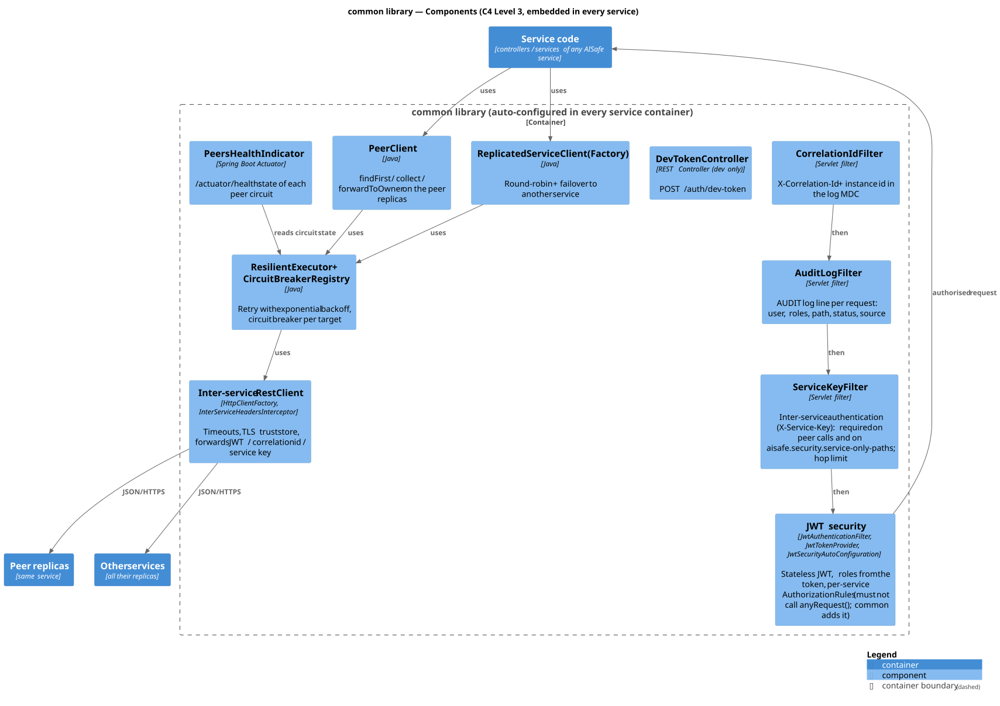

# C4 Level 3 — common library: Components

> The `common` library is **not a container**: it is embedded in every service container and auto-configured by Spring Boot (`META-INF/spring/...AutoConfiguration.imports`). It gives every service the same security, peer forwarding and resilience behaviour ([L2 §3](../../2-containers/Containers.md#3-distribution-design-decisions)).
> Lower level: [L4 Code](../../4-code/common/Common-Code.md)



## Components

| Component | Classes | Responsibility | How a service uses it |
|---|---|---|---|
| **CorrelationIdFilter** | `observability.CorrelationIdFilter` | Assigns/propagates `X-Correlation-Id`; puts it and the instance id in the log MDC | automatic |
| **AuditLogFilter** | `observability.AuditLogFilter` | One `AUDIT` log line per request (user, roles, method, path, status, source, duration) | automatic |
| **ServiceKeyFilter** | `security.ServiceKeyFilter` | Inter-service authentication with `X-Service-Key`: `401` for a peer request (`X-Peer-Hops`) without key, for a request to a **service-only path** without key (`{"error":"This endpoint is only available to AISafe services."}`) and for any wrong key; `400` for `X-Peer-Hops > 1`. With a valid key the request continues to the JWT and role checks | set `aisafe.security.service-key` (same in every service); list the endpoints that only other services may call in `aisafe.security.service-only-paths` (Ant patterns, default empty) |
| **JWT security** | `security.JwtAuthenticationFilter`, `JwtTokenProvider`, `JwtSecurityAutoConfiguration`, `AuthorizationRules` | Stateless JWT authentication; security filter chain (public `/actuator/health`, Swagger, `/h2-console`, `/auth/dev-token`); per-service access rules, then `anyRequest().authenticated()` | implement a `<Service>AuthorizationRules` bean that lists **only its own endpoints** and **never calls `anyRequest()`** (`common` adds it; if a rule calls it, the service does not start and the message names the class) |
| **DevTokenController** | `security.DevTokenController` | `POST /auth/dev-token` for tests (dev only) | `aisafe.security.dev-token.enabled=true` |
| **PeerClient** | `peers.PeerClient`, `PeerResult` | `findFirst`, `collect`/`collectList`, `forwardToOwner` on the replicas of the same service | inject `PeerClient`; set `aisafe.peers.urls` |
| **ReplicatedServiceClient** | `remote.ReplicatedServiceClient(Factory)`, `RemoteServiceUnavailableException` | Round-robin + failover over the replicas of another service; `503` if none answers | `factory.create("Airports", urls)` |
| **ResilientExecutor** | `resilience.ResilientExecutor`, `CircuitBreaker`, `CircuitBreakerRegistry` | Retry with exponential backoff; circuit breaker per target | used by the two clients above |
| **Inter-service RestClient** | `http.HttpClientFactory`, `InterServiceHeadersInterceptor`, `OutboundHeaders`, `AisafeHeaders` | Timeouts, TLS truststore, propagation of JWT / correlation id; adds `X-Service-Key` to **every** inter-service and peer call | bean `interServiceRestClient` (used by `PeerClient` and every `ReplicatedServiceClient`) |
| **PeersHealthIndicator** | `peers.PeersHealthIndicator` | `peers` component of `/actuator/health` with the circuit state of each target | automatic |
| **Configuration** | `config.AisafeProperties` | All `aisafe.*` properties (peers, timeouts, retry, circuit breaker, security — `service-key`, `service-only-paths`, `dev-token.enabled` —, TLS) | `application*.properties` |

## Request pipeline (order of the filters)

`CorrelationIdFilter` → `AuditLogFilter` → `ServiceKeyFilter` → `JwtAuthenticationFilter` → authorization rules → controller.

## Usage examples

How to call another service, answer with the data of all replicas and forward commands to the owner (which `common` API to use in each situation, with the reference implementation in Flight Routes): [Integration-Contracts §5](../../2-containers/Integration-Contracts.md#5-intra-service-peer-protocol-replicas-of-the-same-service). Checklist for a service that provides an endpoint (including service-only paths and the `AuthorizationRules` rule): [Integration-Contracts §6](../../2-containers/Integration-Contracts.md#6-checklist-for-a-provider-implementing-a-contract).

Example of the per-service configuration (Flight Routes, `application.properties`):

```properties
aisafe.security.service-key=${AISAFE_SERVICE_KEY:dev-only-service-key-aisafe-2026}
aisafe.security.service-only-paths=/api/routes/statistics/count-by-airport,\
  /api/routes/compatible,\
  /api/scheduled-flights/statistics/minutes-by-aircraft,\
  /api/scheduled-flights/operational-hours,\
  /api/scheduled-flights/statistics/usage-by-route
```
