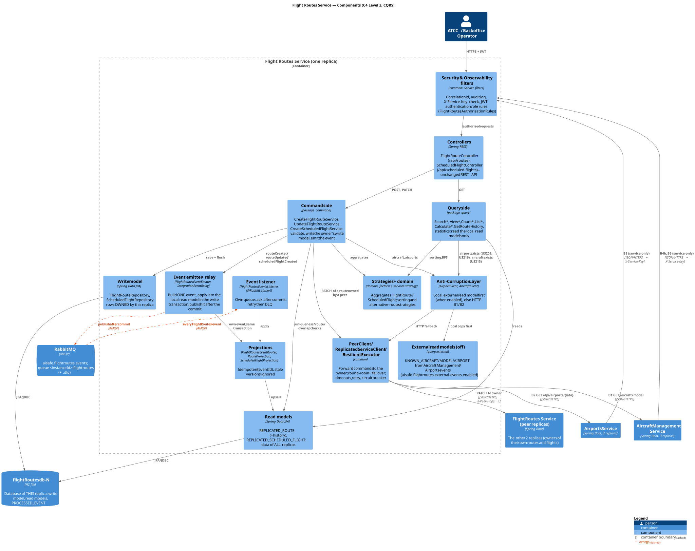

# C4 Level 3 — Flight Routes Service: Components

> Zoom into the **Flight Routes Service** container of [Level 2](../../2-containers/Containers.md): its major building blocks and how they collaborate. One replica is shown; the three replicas are identical.
> Lower levels: [L4 Code](../../4-code/flightroutes/FlightRoutes-Code.md) · [+1 Scenarios](../../5-scenarios/flightroutes/FlightRoutes-Scenarios.md)



## 1. Container summary

| Property | Value |
|---|---|
| Bounded context | Flight Operations — owns `FlightRoute` and `ScheduledFlight` |
| Replicas | `flightroutes-1` :8084, `flightroutes-2` :8184, `flightroutes-3` :8284 |
| Database | H2 **file** per replica: `code/data/flightRoutesdb-1/2/3` — write model (owned rows), read models (rows of every replica), processed event ids |
| Messaging | Publishes on `aisafe.flightroutes.events`; consumes its own events from queue `<instanceId>.flightroutes` ([Integration-Contracts §9](../../2-containers/Integration-Contracts.md#9-assignment-2--event-contracts); flow in section 6) |
| Source code | [code/flightroutes](../../../code/flightroutes) |
| API | `http://localhost:8084/swagger-ui.html` (any replica) |
| Supplies to other containers | Aircraft Management: B4b minutes per aircraft (US204, US206), B6 compatible routes (US203); Airports: B5 route counts per airport (US210) — all **service-only** ([Integration-Contracts §2.8](../../2-containers/Integration-Contracts.md#28-service-only-endpoints)), all answered from read models. Events `RouteCreated`, `RouteUpdated`, `ScheduledFlightCreated` for any consumer |
| Consumes from other containers | Airports: B2 airport by IATA; Aircraft Management: B1 aircraft and aircraft model (HTTP). Event consumer for both ready and off ([Integration-Contracts §9](../../2-containers/Integration-Contracts.md#9-assignment-2--event-contracts)) |

## 2. Components

The module is split into a **command side** (writes) and a **query side** (reads) — CQRS. Both share the domain, the controllers and the `common` infrastructure.

| Component | Technology / classes | Responsibility |
|---|---|---|
| **Security & Observability filters** | `common` filters + [`FlightRoutesAuthorizationRules`](../../../code/flightroutes/src/main/java/isep/psoft/aisafe/infrastructure/security/FlightRoutesAuthorizationRules.java) | Correlation id, audit log, `X-Service-Key` check (required on peer calls and on the service-only paths listed in `aisafe.security.service-only-paths`), JWT authentication, role rules per endpoint |
| **Controllers** | [`FlightRouteController`](../../../code/flightroutes/src/main/java/isep/psoft/aisafe/flightroutes/controllers/FlightRouteController.java), [`ScheduledFlightController`](../../../code/flightroutes/src/main/java/isep/psoft/aisafe/flightroutes/controllers/ScheduledFlightController.java) | Unchanged REST API: POST/PATCH go to the command side, every GET to the query side |
| **Command side** | package [`command`](../../../code/flightroutes/src/main/java/isep/psoft/aisafe/flightroutes/command): `CreateFlightRouteService` (US110), `UpdateFlightRouteService` (US112), `CreateScheduledFlightService` (US212) | Validate (business rules, remote checks), write the **owner's** write model, emit one event. Checks that need data of every replica (route uniqueness, route lookup, schedule overlap) read the local read models |
| **Event emitter and relay** | `FlightRoutesEventEmitter`, `OutgoingIntegrationEvent`, `IntegrationEventRelay`, `IntegrationEventTransport` (+ `infrastructure.messaging.RabbitIntegrationEventTransport`) | Build one `IntegrationEvent`, apply it to the local read model **in the write transaction** (read-your-writes), and publish the same event after the commit through `common`'s `EventPublisher` |
| **Write model** | `FlightRouteRepository`, `ScheduledFlightRepository` (Spring Data JPA) | Rows **owned** by this replica only; used only by the command side and the demo bootstrap |
| **Query side** | package [`query`](../../../code/flightroutes/src/main/java/isep/psoft/aisafe/flightroutes/query): `SearchFlightRoutesService` (US113, US114, US203), `ViewRoutesByAirportService` (US209), `GetRouteHistoryService` (US111), `CountRoutesByAirportService` (US210), `ListActiveRoutesService` (US214), `CalculateNetworkDistanceService` (US215), `SearchAlternativeRoutesService` (US216), `ViewScheduledFlightsByAircraftService` (US213), `ScheduledFlightStatisticsService`, `CalculateOperationalHoursService` (US206), `Pages` | Answer every GET from **this replica's read models**: no peer call, no aggregation, never `X-Partial-Response` |
| **Read models** | `ReplicatedRoute` (+ `ReplicatedRouteHistory`), `ReplicatedScheduledFlight` and their repositories | Copies of the routes (with history) and flights of **every** replica, with owner, source version and last event |
| **Projections** | `FlightRoutesEventRouter`, `RouteProjection`, `ScheduledFlightProjection`, `infrastructure.messaging.JpaProcessedEventStore` | Apply events idempotently (eventId recorded in the same transaction), ignore stale versions and unknown types |
| **Event listener** | `FlightRoutesEventsListener` (`@RabbitListener`), `infrastructure.messaging.FlightRoutesMessagingConfiguration` | Consume `route.*` and `scheduled-flight.*` from this replica's queue; ack after commit; bounded retry then DLQ (`common`) |
| **External read models** *(off by default)* | package `query.external`: `KnownAircraft`, `KnownAircraftModel`, `KnownAirport`, `ExternalEventsProjection`, `ExternalEventsListener`, `ExternalReadModels`; `events.external` (contracts) | Consumer of Aircraft Management / Airports events, enabled with `aisafe.flightroutes.external-events.enabled=true` once they publish |
| **Anti-Corruption Layer** | `AirportClient`, `AircraftClient` → `AirportSnapshot`, `AircraftSnapshot`; `RestClientConfig` | External read model first (when enabled), else HTTP B1/B2 |
| **Strategies** | `RouteSortStrategy` (`PopularitySortStrategy`, `DistanceSortStrategy`), `RouteSearchStrategy` (`MinStopsRouteSearch`) | Interchangeable sorting (US214) and alternative-route algorithm (US216), applied to read-model views |
| **Domain model** | `domain` + `factories` packages | Aggregates `FlightRoute` and `ScheduledFlight`, Value Objects, views (`RouteSummary`, `Itinerary`, `RouteUsage`) — see [L4](../../4-code/flightroutes/FlightRoutes-Code.md) |
| **Event contracts** | package `events`: `RouteEvents`, `RouteEventPayload`, `ScheduledFlightEvents`, `ScheduledFlightEventPayload` | Published language of Flight Routes (names, routing keys, payload records) |
| **PeerClient** *(common)* | [`PeerClient`](../../../code/common/src/main/java/isep/sidis/common/peers/PeerClient.java) | Only `forwardToOwner`: a PATCH for a route owned by another replica |
| **ReplicatedServiceClient / ResilientExecutor** *(common)* | `ReplicatedServiceClient`, `ResilientExecutor`, `CircuitBreaker` | Round-robin + failover over the replicas of Airports / Aircraft Management; timeouts, retry with exponential backoff, circuit breaker per target |
| *Demo data* | `DemoDataBootstrap` (profile `demo`) | On `ApplicationReadyEvent`, inserts this replica's demo routes/flights **only if missing** and emits their events like any other write |

The `common` components are described in [common — Components](../common/Common-Components.md).

## 3. Provided interfaces (REST API)

Every endpoint is served by every replica. **Every GET answers from the local read models**, which contain the data of all replicas (eventually consistent: a write made on another replica appears when its event arrives).

Endpoints marked **service-only** are listed in `aisafe.security.service-only-paths` (`application.properties`): they are called by other AISafe services, which send `X-Service-Key` automatically. A request without the key gets `401 {"error":"This endpoint is only available to AISafe services."}` even with a valid JWT; with the key, the role rule below still applies.

**Flight routes — `/api/routes`**

| Method | Endpoint | US | Side | Input | Output | Roles |
|---|---|---|---|---|---|---|
| POST | `/api/routes` | US110 | command | `CreateRouteDTO` (originIATA, destIATA, estimatedFlightTime, minRange, minCapacity) | `201` `FlightRouteDTO` | ATCC |
| GET | `/api/routes/{id}` | US113 | query | route ID | `200` `FlightRouteDTO` | ATCC |
| GET | `/api/routes/search?origin=&dest=` | US114 | query | optional IATA codes | `200` `List<FlightRouteDTO>` | ATCC |
| PATCH | `/api/routes/{id}` | US112 | command (owner) | `UpdateRouteDTO` (any of minRange, minCapacity, estimatedFlightTime, status) | `200` `FlightRouteDTO` | ATCC, BACKOFFICE_OPERATOR |
| GET | `/api/routes/{id}/history` | US111 | query | route ID | `200` `List<RouteHistoryDTO>` | ATCC |
| GET | `/api/routes/by-airport/{iataCode}` | US209 | query | IATA code | `200` `List<FlightRouteDTO>` | ATCC |
| GET | `/api/routes/active?sortBy=` | US214 | query | `popularity` (default) / `distance` | `200` `List<FlightRouteDTO>` with `usageCount` | ATCC |
| GET | `/api/routes/network/total-distance` | US215 | query | — | `200` `NetworkDistanceDTO` | ATCC |
| GET | `/api/routes/alternatives?origin=&dest=` | US216 | query | IATA codes | `200` `List<ItineraryDTO>` | ATCC |
| GET | `/api/routes/compatible?range=&capacity=` | US203 (B6) — **service-only** | query | aircraft range and capacity | `200` `List<FlightRouteDTO>` | ATCC, MAINTENANCE_SUPERVISOR, MAINTENANCE_TECHNICIAN |
| GET | `/api/routes/statistics/count-by-airport` | US210 (B5) — **service-only** | query | — | `200` `Map<IATA, Long>` | BACKOFFICE_OPERATOR |

**Scheduled flights — `/api/scheduled-flights`**

| Method | Endpoint | US | Side | Input | Output | Roles |
|---|---|---|---|---|---|---|
| POST | `/api/scheduled-flights` | US212 | command | `CreateScheduledFlightDTO` (aircraftRegistration, routeID, date, time) | `201` `ScheduledFlightDTO` + links | ATCC |
| GET | `/api/scheduled-flights/{id}` | — | query | flight ID | `200` `ScheduledFlightDTO` | ATCC |
| GET | `/api/scheduled-flights?aircraft=&page=&size=` | US213 | query | registration + pagination | `200` `PagedModel<ScheduledFlightDTO>` | ATCC |
| GET | `/api/scheduled-flights/search?aircraft=&date=&time=` | US213/US212 | query | registration, optional date/time | `200` `List<ScheduledFlightDTO>` | ATCC |
| GET | `/api/scheduled-flights/operational-hours` | B4a — **service-only** | query | pagination | `200` `Page<AircraftOperationalHoursDTO>` | ATCC |
| GET | `/api/scheduled-flights/statistics/usage-by-route` | US214 — **service-only** | query | — | `200` `Map<routeId, Long>` | ATCC |
| GET | `/api/scheduled-flights/statistics/minutes-by-aircraft` | US204, US206 (B4b) — **service-only** | query | — | `200` `Map<registration, Long>` | ATCC, BACKOFFICE_OPERATOR |

The Assignment 2 proof-of-concept endpoint `/api/routes/replicated` was **removed**: the endpoints above now read the same read model.

Infrastructure endpoints (from `common` / Spring Boot): `GET /actuator/health` (everything, including peers, circuits and RabbitMQ), `GET /actuator/health/liveness` (JVM serves HTTP; used by `start-all`), `GET /actuator/health/readiness` (includes RabbitMQ), `POST /auth/dev-token` (development only), `/swagger-ui.html`.

**Errors** — body `{ "error": "<message>" }` (Bean Validation: `{ "<field>": "<message>" }`):

| Exception | HTTP |
|---|---|
| `IllegalArgumentException`, `MethodArgumentNotValidException` | 400 |
| `EntityNotFoundException` | 404 |
| `IllegalStateException`, `ObjectOptimisticLockingFailureException` (overlapping updates, see §5) | 409 |
| missing `X-Service-Key` on a service-only endpoint, missing/invalid JWT (empty body) | 401 |
| `RouteRequirementsNotMetException` | 422 |
| `RemoteServiceUnavailableException` (no replica of a remote service answered, or the owner replica of the route is down) | 503 |
| `ResponseStatusException` (remote 401/403, business error of the owner replica) | same status |

## 4. Required interfaces

| Component | Calls | Endpoint / channel |
|---|---|---|
| `AirportClient` | Airports (all replicas) | `GET /api/airports/{iata}` (B2), unless `KNOWN_AIRPORT` has it |
| `AircraftClient` | Aircraft Management (all replicas) | `GET /api/aircrafts/{reg}`, `GET /api/aircraft-models/{model}` (B1), unless `KNOWN_AIRCRAFT(_MODEL)` has it |
| `PeerClient` | Flight Routes peer replicas | `PATCH /api/routes/{id}` forwarded to the owner, `X-Peer-Hops: 1` |
| `RabbitIntegrationEventTransport` | RabbitMQ | publish to `aisafe.flightroutes.events` |
| `FlightRoutesEventsListener` | RabbitMQ | consume `<instanceId>.flightroutes` |
| `ExternalEventsListener` (off) | RabbitMQ | consume `<instanceId>.aircraftmanagement`, `<instanceId>.airports` |

## 5. How the components realise the distribution requirements

| Requirement | Components involved |
|---|---|
| CQRS: separate write and read models | `command` services → write model; `query` services → read models; events in between |
| Every replica sees every route and flight (US113, US114, US203, US209, US111, US213) | events → `FlightRoutesEventsListener` → `FlightRoutesEventRouter` → `RouteProjection` / `ScheduledFlightProjection` → `REPLICATED_*` |
| Statistics over all replicas (US206, US210, US214) | `ScheduledFlightStatisticsService`, `CountRoutesByAirportService` on the read models (no sums of partial results) |
| Whole-network queries (US214, US215, US216) | `ReplicatedRouteRepository.findAllActive` → strategies |
| Read-your-writes on the owner | `FlightRoutesEventEmitter` applies the event to the local read model in the write transaction |
| Single owner per entity (US112) | `UpdateFlightRouteService` → `PeerClient.forwardToOwner`; only the owner publishes the entity's events (in order) |
| Concurrent updates of a route (US112) | `FlightRoute` `@Version` on the owner replica: two **overlapping** PATCHes give one `200` and one `409` (`GlobalExceptionHandler`). **Known limitation:** the version is not returned by GET nor accepted by PATCH (no `ETag`/`If-Match`), so an update from stale data is not detected ([Integration-Contracts §8](../../2-containers/Integration-Contracts.md#8-known-limitations)) |
| Reliable consumption | durable queue per replica, ack after commit, bounded retry, DLQ, `JpaProcessedEventStore` (idempotency) |
| Broker down | writes still committed (event lost, logged), reads served from read models, liveness `UP` / readiness `DOWN` |
| Database per instance, survives restarts | file H2 per replica; demo bootstrap inserts only missing rows |
| Calls to other services with failover | ACL → `ReplicatedServiceClient` → `ResilientExecutor` |
| Security and audit | filter chain of `common` + `FlightRoutesAuthorizationRules`; service-only endpoints via `aisafe.security.service-only-paths` |

The system-wide decisions (consistency model, fault tolerance, security) are in [L2 §3](../../2-containers/Containers.md#3-distribution-design-decisions), including messaging reliability and its known limitations ([L2 §3.4–3.6](../../2-containers/Containers.md#34-fault-tolerance)); the event contracts in [Integration-Contracts §9](../../2-containers/Integration-Contracts.md#9-assignment-2--event-contracts).

## 6. CQRS flow: write → event → projection on every replica

```text
POST/PATCH ─▶ command/*Service ──(1) save + flush──▶ write model (FLIGHT_ROUTE / SCHEDULED_FLIGHT, owned rows only)
                 │
                 └─(2) FlightRoutesEventEmitter: build ONE IntegrationEvent
                        ├─(3) FlightRoutesEventRouter → projection → read model of THIS replica   } same transaction
                        └─(4) OutgoingIntegrationEvent (Spring)                                     }
                                       │ AFTER COMMIT
                                       ▼
                        IntegrationEventRelay ─▶ RabbitIntegrationEventTransport ─▶ [aisafe.flightroutes.events]
                                                                                       │ route.*, scheduled-flight.*
                              ┌────────────────────────────────────────────────────────┼──────────────────────┐
                              ▼                                                        ▼                      ▼
                 flightroutes-1.flightroutes                              ...-2.flightroutes       ...-3.flightroutes
                 (owner: eventId already processed → skipped)             FlightRoutesEventsListener → router → projection
                                                                          → REPLICATED_ROUTE / REPLICATED_SCHEDULED_FLIGHT

GET ─▶ query/*Service ─▶ REPLICATED_* tables of this replica only (no peer calls, no X-Partial-Response)
```

| Read model (table) | Built from | Answers |
|---|---|---|
| `REPLICATED_ROUTE` (+ `REPLICATED_ROUTE_HISTORY`) | `RouteCreated`, `RouteUpdated` | US113 by id, US114 search, US209 by airport, US111 history, US203 compatible (B6 provider), US210 count-by-airport (B5 provider), US214/215/216 network; uniqueness check of US110 |
| `REPLICATED_SCHEDULED_FLIGHT` | `ScheduledFlightCreated`, `ScheduledFlightStatusChanged` | US213 flights by aircraft / search / by id, US214 popularity, US206 operational hours and minutes-by-aircraft (B4a/B4b provider); overlap check of US212 |
| `KNOWN_AIRCRAFT`, `KNOWN_AIRCRAFT_MODEL`, `KNOWN_AIRPORT` (off by default) | Aircraft Management / Airports events ([Integration-Contracts §9.4](../../2-containers/Integration-Contracts.md#94-events-expected-from-the-other-services)) | B1 / B2 lookups once enabled |
| `PROCESSED_EVENT` | every applied event | idempotency |

The former endpoint `/api/routes/replicated` was **removed**: the existing GET endpoints now answer from the same read model, so it was redundant. Each database is a file per replica (`code/data/flightRoutesdb-N.mv.db`), so the read models survive restarts. Demo data (`demo` profile) is inserted on `ApplicationReadyEvent`, only when missing, and published like any other write by the replica that inserts it. Sequence diagrams: [SD-WriteEventProjection and SD-ReadModelQuery](../../5-scenarios/flightroutes/FlightRoutes-Scenarios.md).
