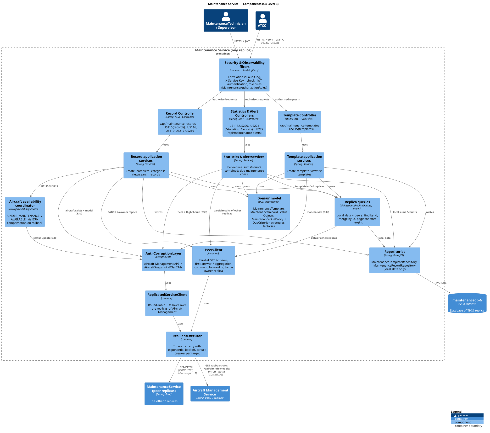

# C4 Level 3 — Maintenance Service: Components

> Zoom into the **Maintenance Service** container of [Level 2](../../2-containers/Containers.md): its major building blocks and how they collaborate. One replica is shown; the three replicas are identical.
> Lower levels: [L4 Code](../../4-code/maintenance/Maintenance-Code.md) · [+1 Scenarios](../../5-scenarios/maintenance/Maintenance-Scenarios.md)

## 1. Container summary

| Property | Value |
|---|---|
| Bounded context | *Maintenance* — owns the `MaintenanceTemplate` and `MaintenanceRecord` aggregates (WP#4: US115, US116, US117, US119, US217–US222; WP#0A: preloaded templates) |
| Replicas | `maintenance-1` :8082, `maintenance-2` :8182, `maintenance-3` :8282 |
| Database | H2 in-memory per replica: `maintenancedb-1/2/3` |
| Source code | [code/maintenance](../../../code/maintenance) |
| API | `http://localhost:8082/swagger-ui.html` (any replica) |
| Supplies to other containers | Nothing — no other service calls Maintenance (*Flight Routes never calls Maintenance*, [Integration-Contracts §3](../../2-containers/Integration-Contracts.md#3-bridge-catalogue)) |
| Consumes from other containers | Aircraft Management: aircraft lookup (B3a), aircraft status update (B3b), aircraft model lookup (B3c), fleet and operational hours (B3d) |

## 2. Components

| Component | Technology / classes | Responsibility |
|---|---|---|
| **Security & Observability filters** | `common` filters + [`MaintenanceAuthorizationRules`](../../../code/maintenance/src/main/java/isep/psoft/aisafe/infrastructure/security/MaintenanceAuthorizationRules.java) | Correlation id, audit log, `X-Service-Key` check, JWT authentication, role rules per endpoint (section 3). The rules also accept the roles whose requests reach this replica **as peer calls** (the user's JWT is forwarded) |
| **Template controller** | [`MaintenanceTemplateController`](../../../code/maintenance/src/main/java/isep/psoft/aisafe/maintenance/controllers/MaintenanceTemplateController.java) (Spring REST) | `/api/maintenance-templates` — US115 (templates), template lookup and listing |
| **Record controller** | [`MaintenanceRecordController`](../../../code/maintenance/src/main/java/isep/psoft/aisafe/maintenance/controllers/MaintenanceRecordController.java) (Spring REST) | `/api/maintenance-records` — US115 (records), US116, US119, US217, US218, US219 |
| **Statistics controller** | [`MaintenanceStatisticsController`](../../../code/maintenance/src/main/java/isep/psoft/aisafe/maintenance/controllers/MaintenanceStatisticsController.java) (Spring REST) | `/api/maintenance-records/statistics/**`, `/reports/**` — US117, US220, US221 and the per-replica summary used by US222 |
| **Alert controller** | [`MaintenanceAlertController`](../../../code/maintenance/src/main/java/isep/psoft/aisafe/maintenance/controllers/MaintenanceAlertController.java) (Spring REST) | `/api/maintenance-alerts` — US222 (check triggered manually by the user, conversation 016) |
| **Template application services** | `CreateMaintenanceTemplateService`, `ViewMaintenanceTemplatesService` | Create a template (models validated in Aircraft Management, unique name in every replica that answers), get/list templates of all replicas |
| **Record application services** | `CreateMaintenanceRecordService`, `CompleteMaintenanceRecordService`, `CategorizeMaintenanceRecordService`, `ViewMaintenanceRecordsService` | One service per use case: transactions, orchestration, forwarding of commands to the owner replica |
| **Aircraft availability coordinator** | [`AircraftAvailabilityService`](../../../code/maintenance/src/main/java/isep/psoft/aisafe/maintenance/services/AircraftAvailabilityService.java) | US115: puts the aircraft `UNDER_MAINTENANCE` through B3b **after the record was flushed and before the commit** (B3b fails → nothing saved; commit fails afterwards → **compensating PATCH**). US119: releases it to `AVAILABLE` only when **no other record of the aircraft is ongoing in any replica** and every replica answered; otherwise the aircraft stays `UNDER_MAINTENANCE` (safe side) |
| **Statistics and alerts services** | `MaintenanceStatisticsService`, `MaintenanceAlertService` | Partial results per replica (sums and counts) combined into a fleet-wide result; due-maintenance check (US222), which still answers with calendar-day alerts (flagged partial) when flight hours are unavailable |
| **Replica queries** | [`MaintenanceReplicaQueries`](../../../code/maintenance/src/main/java/isep/psoft/aisafe/maintenance/services/MaintenanceReplicaQueries.java), `Pages` | Combine local data with the peer replicas: find a record/template in any replica, merge collections **by id**, paginate **after** merging, encode peer URIs |
| **Domain model** | `domain` + `factories` packages | Aggregates `MaintenanceTemplate` and `MaintenanceRecord`, Value Objects, read models, the due-maintenance policy (`MaintenanceDuePolicy` + `DueCriterion` strategies) — see [L4](../../4-code/maintenance/Maintenance-Code.md) |
| **Repositories** | `MaintenanceTemplateRepository`, `MaintenanceRecordRepository` (Spring Data JPA) | Access to the data of **this** replica only; local grouping queries for statistics |
| **Anti-Corruption Layer** | [`AircraftClient`](../../../code/maintenance/src/main/java/isep/psoft/aisafe/maintenance/clients/AircraftClient.java) → `AircraftSnapshot`; `RestClientConfig` | Translates the Aircraft Management API (B3a–B3d) into local read-only views; `404` → `EntityNotFoundException`, `401/403/409` → same status, no replica → `503` |
| **Assemblers / DTOs** | `MaintenanceRecordAssembler`, `MaintenanceTemplateAssembler`, `dto` package, `PageDTO` | Published language: API contract separate from the domain; HATEOAS links (also on records received from peers); stable page format |
| **PeerClient** *(common)* | `PeerClient` | GET to the peer replicas (first answer / aggregation) and command forwarding to the owner replica |
| **ReplicatedServiceClient** *(common)* | `ReplicatedServiceClient`, `ReplicatedServiceClientFactory` | Round-robin + failover over the replicas of Aircraft Management |
| **ResilientExecutor** *(common)* | `ResilientExecutor`, `CircuitBreaker` | Timeouts, retry with exponential backoff, circuit breaker per target |
| **Error mapping / OpenAPI** | `GlobalExceptionHandler`, `OpenApiConfig` | Exception → HTTP status; Swagger UI with the JWT *Authorize* button |
| *Reference data* | `ReferenceTemplatesBootstrap` (every replica) | WP#0A: preloads the standard maintenance templates **with deterministic ids**, so the copies in the three replicas are the same template |
| *Demo data* | `DemoDataBootstrap` (profile `demo`) | Loads **different** maintenance records in each replica, to demonstrate peer-to-peer behaviour |

The `common` components are described in [common — Components](../common/Common-Components.md).

## 3. Provided interfaces (REST API)

Every endpoint is served by every replica; **every GET returns the data of all replicas** (flagged with `X-Partial-Response: true` when a replica did not answer).

**Maintenance templates — `/api/maintenance-templates`**

| Method | Endpoint | US | Input | Output | Roles |
|---|---|---|---|---|---|
| POST | `/api/maintenance-templates` | US115 (templates) | `CreateMaintenanceTemplateDTO` (name, type, applicableModels, checklist, flightHoursInterval?, calendarDaysInterval?) | `201` `MaintenanceTemplateDTO` + `Location` + links | MAINTENANCE_TECHNICIAN |
| GET | `/api/maintenance-templates/{id}` | — | template id | `200` `MaintenanceTemplateDTO` | MAINTENANCE_TECHNICIAN, MAINTENANCE_SUPERVISOR, ATCC |
| GET | `/api/maintenance-templates?model=&type=&name=` | — (also peer queries of US115/US222) | optional filters | `200` `List<MaintenanceTemplateDTO>` | MAINTENANCE_TECHNICIAN, MAINTENANCE_SUPERVISOR, ATCC |

**Maintenance records — `/api/maintenance-records`**

| Method | Endpoint | US | Input | Output | Roles |
|---|---|---|---|---|---|
| POST | `/api/maintenance-records` | US115 (records) | `CreateMaintenanceRecordDTO` (aircraftRegistration, templateId, description, startDate, expectedDurationMinutes, component?) | `201` `MaintenanceRecordDTO` (with the template's checklist) + `Location` + links | MAINTENANCE_TECHNICIAN |
| GET | `/api/maintenance-records/{id}` | — | record id | `200` `MaintenanceRecordDTO` | MAINTENANCE_TECHNICIAN, MAINTENANCE_SUPERVISOR, ATCC |
| GET | `/api/maintenance-records/aircraft/{registration}?page=&size=` | US116 | registration + pagination | `200` `PageDTO<MaintenanceRecordDTO>` | MAINTENANCE_TECHNICIAN, MAINTENANCE_SUPERVISOR |
| GET | `/api/maintenance-records?aircraft=&component=&status=&from=&to=&page=&size=` | US218 | optional filters (AND); `from`/`to` = range of the start date | `200` `PageDTO<MaintenanceRecordDTO>` | MAINTENANCE_TECHNICIAN, MAINTENANCE_SUPERVISOR |
| GET | `/api/maintenance-records/ongoing?page=&size=` | US219 | pagination | `200` `PageDTO<MaintenanceRecordDTO>` | MAINTENANCE_SUPERVISOR |
| GET | `/api/maintenance-records/search?aircraft=&component=&status=&from=&to=` | — (replica query) | same filters, **not paginated** | `200` `List<MaintenanceRecordDTO>` | MAINTENANCE_TECHNICIAN, MAINTENANCE_SUPERVISOR, ATCC |
| PATCH | `/api/maintenance-records/{id}/complete` | US119 | `CompleteMaintenanceRecordDTO` (notes, cost, actualDurationMinutes, completionDate?, aircraftFlightHours?) | `200` `MaintenanceRecordDTO` + header `X-Aircraft-Released: true\|false` | MAINTENANCE_TECHNICIAN |
| PATCH | `/api/maintenance-records/{id}/component` | US217 | `CategorizeRecordDTO` (component: ENGINE, AIRFRAME, AVIONICS, INTERIOR, EXTERIOR) | `200` `MaintenanceRecordDTO` | MAINTENANCE_TECHNICIAN |

**Statistics and reports — `/api/maintenance-records/statistics`, `/api/maintenance-records/reports`**

| Method | Endpoint | US | Input | Output | Roles |
|---|---|---|---|---|---|
| GET | `/api/maintenance-records/statistics/hours` | US117 | — | `200` `FleetMaintenanceHoursDTO` (total + per aircraft) | ATCC |
| GET | `/api/maintenance-records/reports/costs?groupBy=AIRCRAFT\|MODEL` | US220 | grouping (default `AIRCRAFT`) | `200` `CostReportDTO` | ATCC |
| GET | `/api/maintenance-records/reports/turnaround` | US221 | — | `200` `TurnaroundReportDTO` (per aircraft model) | MAINTENANCE_SUPERVISOR |
| GET | `/api/maintenance-records/statistics/last-completions` | — (replica query of US222) | — | `200` `List<LastCompletionDTO>` | ATCC |

**Alerts — `/api/maintenance-alerts`**

| Method | Endpoint | US | Input | Output | Roles |
|---|---|---|---|---|---|
| GET | `/api/maintenance-alerts` | US222 | — | `200` `List<MaintenanceAlertDTO>` (+ `X-Partial-Response`) | ATCC |

Infrastructure endpoints (from `common`): `GET /actuator/health`, `POST /auth/dev-token` (development only), `/swagger-ui.html`.

**Why the replica queries are separate endpoints.** The client-facing lists are paginated, but a page can only be cut after the data of every replica has been merged. Peers are therefore asked through `/search` (complete local list, no pagination) and `/statistics/last-completions` (local partial result), exactly as Flight Routes does with `/api/scheduled-flights/search`. These endpoints are also usable by clients, with the same JWT rules.

**Errors** — body `{ "error": "<message>" }` (Bean Validation: `{ "<field>": "<message>" }`):

| Exception | HTTP | Examples |
|---|---|---|
| `IllegalArgumentException`, `MethodArgumentNotValidException`, type mismatch | 400 | invalid component/type/status, template not applicable to the aircraft model, start date in the future, unknown aircraft model in a template, duplicate template name |
| `EntityNotFoundException` | 404 | record/template not found in any replica, aircraft not found (B3a) |
| `IllegalStateException`, `ObjectOptimisticLockingFailureException` | 409 | record already completed, categorising a completed record, concurrent update (`@Version`), aircraft in flight (B3b answered 409) |
| `RemoteServiceUnavailableException` | 503 | no replica of Aircraft Management answered; no peer answered a forwarded command |
| `ResponseStatusException` | same status | remote 401/403/409; business error of the owner replica |

## 4. Required interfaces

| Component | Calls | Endpoint | Bridge |
|---|---|---|---|
| `AircraftClient` | Aircraft Management (all replicas) | `GET /api/aircrafts/{registrationNumber}` | B3a |
| `AircraftClient` | Aircraft Management | `PATCH /api/aircrafts/{registrationNumber}/status` | B3b |
| `AircraftClient` | Aircraft Management | `GET /api/aircraft-models/{modelName}` | B3c |
| `AircraftClient` | Aircraft Management | `GET /api/aircrafts?page=&size=`, `GET /api/aircrafts/operational-hours?page=&size=` | B3d |
| `PeerClient` | Maintenance peer replicas | the replica queries above, `X-Peer-Hops: 1` | — |

Exact schemas, status codes and roles: [Integration-Contracts §4 — B3](../../2-containers/Integration-Contracts.md#b3-maintenance--aircraft-management-implemented).

## 5. How the components realise the distribution requirements

| Requirement | Components involved |
|---|---|
| Peer forwarding of GET by id (record, template) | `ViewMaintenanceRecordsService` / `ViewMaintenanceTemplatesService` → `MaintenanceReplicaQueries` → `PeerClient.findFirst` |
| Aggregation of collections (US116, US218, US219, template list) | services → `MaintenanceReplicaQueries.searchRecords` / `PeerClient.collectList` (merged **by id**) → `Pages` (page cut after merging) |
| Aggregated statistics (US117, US220, US221) | `MaintenanceStatisticsService` → `PeerClient.collect`: every replica returns **sums and counts** of its own records, the entry replica adds them (averages are computed only after adding, never averaged twice) |
| Fleet-wide check (US222) | `MaintenanceAlertService` → templates and last completions of every replica + fleet and flight hours from Aircraft Management → `MaintenanceDuePolicy` |
| Single owner per record (US119, US217) | `CompleteMaintenanceRecordService`, `CategorizeMaintenanceRecordService` → `PeerClient.forwardToOwner` |
| Cross-service consistency of the aircraft status (US115, US119) | `AircraftAvailabilityService` → `AircraftClient` (B3b): US115 inside the local transaction with compensation on rollback; US119 by the replica that received the client request, after the owner completed the record |
| Calls to Aircraft Management with failover | `AircraftClient` → `ReplicatedServiceClient` → `ResilientExecutor` |
| Security and audit | filter chain of `common` + `MaintenanceAuthorizationRules` |

The system-wide decisions (consistency model, fault tolerance, security) are in [L2 §3](../../2-containers/Containers.md#3-distribution-design-decisions).
