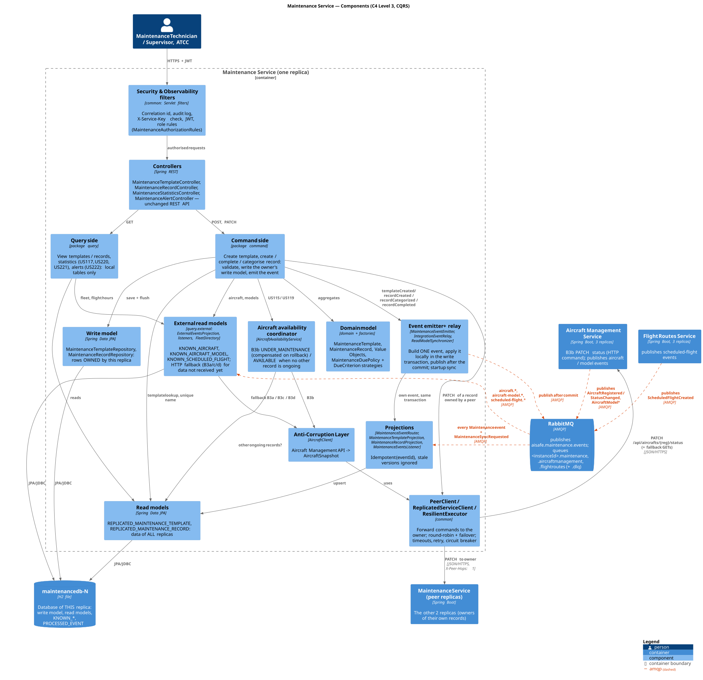

# C4 Level 3 — Maintenance Service: Components

> Zoom into the **Maintenance Service** container of [Level 2](../../2-containers/Containers.md): its major building blocks and how they collaborate. One replica is shown; the three replicas are identical.
> Lower levels: [L4 Code](../../4-code/maintenance/Maintenance-Code.md) · [+1 Scenarios](../../5-scenarios/maintenance/Maintenance-Scenarios.md)



## 1. Container summary

| Property | Value |
|---|---|
| Bounded context | *Maintenance* — owns the `MaintenanceTemplate` and `MaintenanceRecord` aggregates (WP#4: US115, US116, US117, US119, US217–US222; WP#0A: preloaded templates) |
| Replicas | `maintenance-1` :8082, `maintenance-2` :8182, `maintenance-3` :8282 |
| Database | One H2 **file** database per replica: `code/data/maintenancedb-1/2/3` (write model + read models + processed event ids) |
| Architecture (Assignment 2) | **CQRS**: `command` package (writes on the owner's write model, events published to RabbitMQ) and `query` package (every GET on local read models) |
| Source code | [code/maintenance](../../../code/maintenance) |
| API | `http://localhost:8082/swagger-ui.html` (any replica). The external API is unchanged: HTTP REST |
| Publishes | `aisafe.maintenance.events`: `MaintenanceTemplateCreated`, `MaintenanceRecordCreated`, `MaintenanceRecordCategorized`, `MaintenanceRecordCompleted` (+ internal `MaintenanceSyncRequested`) |
| Consumes | Its own events (queue `<instanceId>.maintenance`); Aircraft Management `aircraft.*`, `aircraft-model.*` (queue `<instanceId>.aircraftmanagement`); Flight Routes `scheduled-flight.*` (queue `<instanceId>.flightroutes`) |
| HTTP to other services | Aircraft Management **B3b** (status change, a command: kept synchronous). B3a, B3c and B3d only as a **fallback** while the local copy does not have the data yet |
| Supplies to other containers | Nothing by HTTP. Its events are available to any service that wants them (none subscribes today) |

## 2. Components

| Component | Technology / classes | Responsibility |
|---|---|---|
| **Security & Observability filters** | `common` filters + [`MaintenanceAuthorizationRules`](../../../code/maintenance/src/main/java/isep/psoft/aisafe/infrastructure/security/MaintenanceAuthorizationRules.java) | Correlation id, audit log, `X-Service-Key` check (forwarded commands), JWT authentication, role rules per endpoint (section 3) |
| **REST controllers** | `MaintenanceTemplateController`, `MaintenanceRecordController`, `MaintenanceStatisticsController`, `MaintenanceAlertController` | The external API (unchanged from Assignment 1). POST/PATCH go to the command side; GET to the query side |
| **Command services** (`command`) | `CreateMaintenanceTemplateService`, `CreateMaintenanceRecordService`, `CompleteMaintenanceRecordService`, `CategorizeMaintenanceRecordService` | One service per use case. Change the **write model of the replica that owns the entity** in a local ACID transaction (optimistic locking `@Version`); a command for a record of another replica is forwarded to its owner (`PeerClient.forwardToOwner`); if no peer executes it but the read model knows the record, its owner is down → `503` (`RecordOwnership`) |
| **Event emitter + relay** (`command`) | [`MaintenanceEventEmitter`](../../../code/maintenance/src/main/java/isep/psoft/aisafe/maintenance/command/MaintenanceEventEmitter.java), `IntegrationEventRelay`, `OutgoingIntegrationEvent`, `IntegrationEventTransport` | Builds **one** state-carrying `IntegrationEvent`, applies it to this replica's read model **in the write transaction** (read-your-writes on the owner), and publishes it **after the commit** (a rolled-back change is never announced) |
| **Aircraft availability coordinator** (`command`) | [`AircraftAvailabilityService`](../../../code/maintenance/src/main/java/isep/psoft/aisafe/maintenance/command/AircraftAvailabilityService.java) | US115: B3b `UNDER_MAINTENANCE` after the record is flushed and before the commit (B3b fails → nothing saved, no event; commit fails afterwards → **compensating PATCH**). US119: `AVAILABLE` only when the **read model** has no other ongoing record of the aircraft |
| **Startup synchronisation** (`command`) | `ReadModelSynchronizer`, `MaintenanceStateRepublisher` | On start: republish the templates and records this replica owns and publish `MaintenanceSyncRequested`; the other replicas answer by republishing theirs. Fills a new or late replica |
| **Projections** (`query`) | `MaintenanceEventRouter`, `MaintenanceTemplateProjection`, `MaintenanceRecordProjection`, `MaintenanceEventsListener` | Apply Maintenance events to `REPLICATED_MAINTENANCE_TEMPLATE` / `REPLICATED_MAINTENANCE_RECORD`: idempotent by `eventId` (recorded in the same transaction), older `version` ignored, unknown types ignored |
| **Query services** (`query`) | `ViewMaintenanceTemplatesService`, `ViewMaintenanceRecordsService`, `MaintenanceStatisticsService`, `MaintenanceAlertService`, `RecordFilter` | Every GET, on local tables only: no peer call, no aggregation, never `X-Partial-Response` (except US222 when an external copy is not available, below) |
| **External read models** (`query.external`) | `ExternalEventsProjection`, `AircraftManagementEventsListener`, `FlightRoutesEventsListener`, `KnownAircraft`, `KnownAircraftModel`, `KnownScheduledFlight` | Local copies of the data of other services, fed by their events: `KNOWN_AIRCRAFT` (B3a, fleet of B3d), `KNOWN_AIRCRAFT_MODEL` (B3c), `KNOWN_SCHEDULED_FLIGHT` (flight minutes, hours of B3d) |
| **Fleet directory** (`query.external`) | [`FleetDirectory`](../../../code/maintenance/src/main/java/isep/psoft/aisafe/maintenance/query/external/FleetDirectory.java), `ExternalSyncState` | Single entry point for aircraft data: **local copy first**; HTTP to Aircraft Management only for an entity not received yet (it is then remembered), the first fleet listing (seeded once) and the flight hours while no flight event was received |
| **Anti-Corruption Layer** | [`AircraftClient`](../../../code/maintenance/src/main/java/isep/psoft/aisafe/maintenance/clients/AircraftClient.java) → `AircraftSnapshot`; event payload records in `events.external` | Translate the API and the published language of Aircraft Management and Flight Routes into local views. The event names are repeated on purpose (no shared code between services) |
| **Messaging infrastructure** | `MaintenanceMessagingConfiguration`, `RabbitIntegrationEventTransport`, `JpaProcessedEventStore` + `common` (`EventPublisher`, `EventSubscription`, retry/DLQ) | Exchange, three queues per replica with their DLQs, publisher confirms, processed ids in the replica's database |
| **Domain model** | `domain` + `factories` | Aggregates `MaintenanceTemplate` and `MaintenanceRecord`, Value Objects, due-maintenance policy (`MaintenanceDuePolicy` + `DueCriterion` strategies) — see [L4](../../4-code/maintenance/Maintenance-Code.md) |
| **Repositories** | write model: `MaintenanceTemplateRepository`, `MaintenanceRecordRepository`; read models: `Replicated*Repository`, `Known*Repository` | Spring Data JPA on this replica's database |
| **Assemblers / DTOs** | `MaintenanceRecordAssembler`, `MaintenanceTemplateAssembler`, `dto` | API contract separate from the domain and from the read model; HATEOAS links; `ownerInstance` tells which replica owns a record |
| *Reference / demo data* | `ReferenceTemplatesBootstrap`, `DemoDataBootstrap` (profile `demo`) | WP#0A templates in every replica with **deterministic ids**; different demo records per replica, inserted once and announced as events |

The `common` components are described in [common — Components](../common/Common-Components.md).

## 3. Provided interfaces (REST API)

Every endpoint is served by every replica. **Every GET is answered from the local read models**, which hold the data of every replica (eventually consistent).

**Maintenance templates — `/api/maintenance-templates`**

| Method | Endpoint | US | Side | Input | Output | Roles |
|---|---|---|---|---|---|---|
| POST | `/api/maintenance-templates` | US115 (templates) | command | `CreateMaintenanceTemplateDTO` (name, type, applicableModels, checklist, flightHoursInterval?, calendarDaysInterval?) | `201` `MaintenanceTemplateDTO` + `Location` | MAINTENANCE_TECHNICIAN |
| GET | `/api/maintenance-templates/{id}` | — | query | template id | `200` `MaintenanceTemplateDTO` | MAINTENANCE_TECHNICIAN, MAINTENANCE_SUPERVISOR, ATCC |
| GET | `/api/maintenance-templates?model=&type=&name=` | — | query | optional filters | `200` `List<MaintenanceTemplateDTO>` | MAINTENANCE_TECHNICIAN, MAINTENANCE_SUPERVISOR, ATCC |

**Maintenance records — `/api/maintenance-records`**

| Method | Endpoint | US | Side | Input | Output | Roles |
|---|---|---|---|---|---|---|
| POST | `/api/maintenance-records` | US115 (records) | command | `CreateMaintenanceRecordDTO` (aircraftRegistration, templateId, description, startDate, expectedDurationMinutes, component?) | `201` `MaintenanceRecordDTO` (checklist of the template, `ownerInstance`) + `Location` | MAINTENANCE_TECHNICIAN |
| GET | `/api/maintenance-records/{id}` | — | query | record id | `200` `MaintenanceRecordDTO` | MAINTENANCE_TECHNICIAN, MAINTENANCE_SUPERVISOR, ATCC |
| GET | `/api/maintenance-records/aircraft/{registration}?page=&size=` | US116 | query | registration + pagination | `200` `PageDTO<MaintenanceRecordDTO>` | MAINTENANCE_TECHNICIAN, MAINTENANCE_SUPERVISOR |
| GET | `/api/maintenance-records?aircraft=&component=&status=&from=&to=&page=&size=` | US218 | query | optional filters (AND) | `200` `PageDTO<MaintenanceRecordDTO>` | MAINTENANCE_TECHNICIAN, MAINTENANCE_SUPERVISOR |
| GET | `/api/maintenance-records/ongoing?page=&size=` | US219 | query | pagination | `200` `PageDTO<MaintenanceRecordDTO>` | MAINTENANCE_SUPERVISOR |
| PATCH | `/api/maintenance-records/{id}/complete` | US119 | command (owner) | `CompleteMaintenanceRecordDTO` (notes, cost, actualDurationMinutes, completionDate?, aircraftFlightHours?) | `200` `MaintenanceRecordDTO` + `X-Aircraft-Released: true\|false` | MAINTENANCE_TECHNICIAN |
| PATCH | `/api/maintenance-records/{id}/component` | US217 | command (owner) | `CategorizeRecordDTO` (ENGINE, AIRFRAME, AVIONICS, INTERIOR, EXTERIOR) | `200` `MaintenanceRecordDTO` | MAINTENANCE_TECHNICIAN |

**Statistics, reports and alerts**

| Method | Endpoint | US | Side | Output | Roles |
|---|---|---|---|---|---|
| GET | `/api/maintenance-records/statistics/hours` | US117 | query | `200` `FleetMaintenanceHoursDTO` (total + per aircraft) | ATCC |
| GET | `/api/maintenance-records/reports/costs?groupBy=AIRCRAFT\|MODEL` | US220 | query | `200` `CostReportDTO` | ATCC |
| GET | `/api/maintenance-records/reports/turnaround` | US221 | query | `200` `TurnaroundReportDTO` (per aircraft model) | MAINTENANCE_SUPERVISOR |
| GET | `/api/maintenance-alerts` | US222 | query | `200` `List<MaintenanceAlertDTO>` (+ `X-Partial-Response` only if an external copy was unavailable) | ATCC |

Infrastructure endpoints (from `common`): `GET /actuator/health` (+ `/liveness`, `/readiness` with RabbitMQ), `POST /auth/dev-token` (development only), `/swagger-ui.html`.

**Removed in Assignment 2:** `GET /api/maintenance-records/search` and `GET /api/maintenance-records/statistics/last-completions`. They existed only so that a replica could ask its peers for their data (aggregation). With read models every replica already has that data.

**Errors** — body `{ "error": "<message>" }` (Bean Validation: `{ "<field>": "<message>" }`):

| Exception | HTTP | Examples |
|---|---|---|
| `IllegalArgumentException`, `MethodArgumentNotValidException`, type mismatch | 400 | invalid component/type/status, template not applicable to the model, start date in the future, unknown aircraft model, duplicate template name |
| `EntityNotFoundException` | 404 | record/template not in the read model, aircraft not found (local copy and Aircraft Management) |
| `IllegalStateException`, `ObjectOptimisticLockingFailureException` | 409 | record already completed, categorising a completed record, concurrent update (`@Version`), aircraft in flight (B3b answered 409) |
| `RemoteServiceUnavailableException` | 503 | no replica of Aircraft Management answered a needed call; the **owner** of a record is down (forwarded command) |
| `ResponseStatusException` | same status | remote 401/403/409; business error of the owner replica |

## 4. Required interfaces

| Component | Provider | Interface | Bridge | Kind |
|---|---|---|---|---|
| `AircraftClient` (via `AircraftAvailabilityService`) | Aircraft Management (round-robin + failover) | `PATCH /api/aircrafts/{registrationNumber}/status` | B3b | HTTP command (kept) |
| `ExternalEventsProjection` | Aircraft Management | `aircraft.registered`, `aircraft.status-changed` → `KNOWN_AIRCRAFT` | replaces B3a and the fleet of B3d | AMQP |
| `ExternalEventsProjection` | Aircraft Management | `aircraft-model.created`, `aircraft-model.updated` → `KNOWN_AIRCRAFT_MODEL` | replaces B3c | AMQP |
| `ExternalEventsProjection` | Flight Routes | `scheduled-flight.created` (`.status-changed` reserved) → `KNOWN_SCHEDULED_FLIGHT` | replaces the hours of B3d | AMQP |
| `FleetDirectory` → `AircraftClient` | Aircraft Management | `GET /api/aircrafts/{reg}`, `GET /api/aircraft-models/{model}`, `GET /api/aircrafts?page=&size=`, `GET /api/aircrafts/operational-hours` | B3a, B3c, B3d | HTTP **fallback only** |
| `PeerClient` | Maintenance peer replicas | the PATCH commands above, `X-Peer-Hops: 1` + `X-Service-Key` | — | HTTP (forward to owner) |

Event and bridge contracts: [Integration-Contracts §4 (B3) and §9](../../2-containers/Integration-Contracts.md#9-assignment-2--event-contracts).

## 5. How the components realise the requirements of Assignment 2

| Requirement | Components involved |
|---|---|
| **CQRS** (independent write and read models) | Write model `MAINTENANCE_TEMPLATE` / `MAINTENANCE_RECORD` (only the owner's rows) changed by `command/*Service`; read models `REPLICATED_*` (every replica's rows) and `KNOWN_*` (other services) built by projections and read by `query/*Service` |
| **AMQP + message broker between services** | `EventPublisher` (common) → `aisafe.maintenance.events`; listeners on the Aircraft Management and Flight Routes exchanges; `IntegrationEventRelay` publishes after the commit |
| **External endpoints stay HTTP REST** | Controllers unchanged; the forwarded commands and B3b are the only HTTP between processes |
| **Database per service instance** | One H2 file per replica (`code/data/maintenancedb-N`); no table is shared; another service's data is a local copy fed by its events |
| **At least two instances** | Three replicas (`instance1..3` profiles); every one answers every query alone |
| Single owner per record (US119, US217) | `Complete…`/`CategorizeMaintenanceRecordService` → `PeerClient.forwardToOwner`; only the owner publishes the record's events, so they arrive in order |
| Cross-service consistency of the aircraft status | `AircraftAvailabilityService` (B3b inside the transaction + compensation). Aircraft Management then publishes `AircraftStatusChanged`, which updates `KNOWN_AIRCRAFT` here and `AIRCRAFT_MOOD` (`/api/v2/unicorns`) there |
| Fault tolerance of messaging | `common`: durable queues, persistent messages, publisher confirms, bounded retries, DLQ, idempotent projections; startup synchronisation |

## 6. CQRS flow: write → event → projection on every replica

```text
POST/PATCH ─▶ command/*Service ──(1) save + flush──▶ write model (MAINTENANCE_TEMPLATE / MAINTENANCE_RECORD, owned rows only)
                 │                (US115: B3b PATCH UNDER_MAINTENANCE to Aircraft Management, compensated on rollback)
                 └─(2) MaintenanceEventEmitter: build ONE IntegrationEvent (full state + version)
                        ├─(3) MaintenanceEventRouter → projection → read model of THIS replica   } same transaction
                        └─(4) OutgoingIntegrationEvent (Spring)                                   }
                                       │ AFTER COMMIT
                                       ▼
                        IntegrationEventRelay ─▶ RabbitIntegrationEventTransport ─▶ [aisafe.maintenance.events] (topic)
                                                                    │ maintenance-template.*, maintenance-record.*
                        ┌───────────────────────────────────────────┼───────────────────────────────────────┐
                        ▼                                           ▼                                       ▼
            maintenance-1.maintenance                   maintenance-2.maintenance                maintenance-3.maintenance
            (owner: eventId already processed → skip)   → REPLICATED_MAINTENANCE_RECORD/TEMPLATE  → same

[aisafe.aircraftmanagement.events] ─ aircraft.*, aircraft-model.* ─▶ maintenance-N.aircraftmanagement ─▶ KNOWN_AIRCRAFT, KNOWN_AIRCRAFT_MODEL
[aisafe.flightroutes.events]       ─ scheduled-flight.*          ─▶ maintenance-N.flightroutes       ─▶ KNOWN_SCHEDULED_FLIGHT

GET ─▶ query/*Service ─▶ local tables only (no peer call, no X-Partial-Response)
```

| Read model (table) | Built from | Answers |
|---|---|---|
| `REPLICATED_MAINTENANCE_TEMPLATE` | `MaintenanceTemplateCreated` | template GETs, template lookup of US115 (records), unique name of US115 (templates), periodic templates of US222 |
| `REPLICATED_MAINTENANCE_RECORD` | `MaintenanceRecordCreated`, `…Categorized`, `…Completed` | GET by id, US116, US117, US218, US219, US220, US221, last completions of US222, "other ongoing record?" of US119 |
| `KNOWN_AIRCRAFT` | Aircraft Management `AircraftRegistered`, `AircraftStatusChanged` (+ HTTP fallback, remembered) | aircraft of US115 and US116, fleet of US222 |
| `KNOWN_AIRCRAFT_MODEL` | `AircraftModelCreated`, `AircraftModelUpdated` (+ HTTP fallback) | applicable models of US115 (templates) |
| `KNOWN_SCHEDULED_FLIGHT` | Flight Routes `ScheduledFlightCreated` (`…StatusChanged` reserved) | flight hours per aircraft of US222 |
| `EXTERNAL_SYNC_STATE` | first HTTP listing of the fleet | "fleet copy seeded once" marker |
| `PROCESSED_EVENT` | every applied event | idempotency |

**Startup synchronisation (same design as Airports and Aircraft Management).** A queue only receives events published after it exists. On the first start the replicas start in parallel; a new replica, or one whose database was erased, starts empty. On `ApplicationReadyEvent` (after the reference and demo data), `ReadModelSynchronizer` republishes, through `MaintenanceStateRepublisher`, the current state of the templates and records this replica owns, and publishes `MaintenanceSyncRequested` (routing key `maintenance-sync.requested`, which does not match `maintenance-record.*`); every other replica answers by republishing what it owns. Upserts with the same version are harmless; older versions are ignored. The three `@RabbitListener`s start only on `ApplicationReadyEvent`, after the reference and demo data were written (`MaintenanceListenersStarter`): events that arrive earlier wait in the durable queues, so the startup writes and the projection of other replicas' events never insert the same read-model row at the same time.

**Data of other services that arrived before Maintenance's queues existed.** Aircraft Management republishes its aircraft and models on every start, so `KNOWN_AIRCRAFT` fills itself; until then `FleetDirectory` reads an unknown aircraft once over HTTP and keeps it, and seeds the fleet once for US222. Flight Routes has no replay, so `KNOWN_SCHEDULED_FLIGHT` only has the flights scheduled after the queue `maintenance-N.flightroutes` exists (durable, so a replica that is down still gets them); while no flight event was received at all, US222 asks Aircraft Management for the hours (B3d), which has them all.

Sequence diagrams: [+1 Scenarios](../../5-scenarios/maintenance/Maintenance-Scenarios.md).

## 7. Observations

- **Assignment 1 → 2.** Before, a replica that did not have a record asked its peers (`findFirst`, `collect`) and merged the answers; a stopped replica made its records invisible (`404`) and answers partial. Now a GET never leaves the replica, and the records of a stopped replica stay readable everywhere. The price is eventual consistency: a record created on replica 2 appears on replica 1 a few milliseconds later.
- **Statistics are simpler.** Every replica has every record, so the sums and counts of Assignment 1 are no longer exchanged between replicas; the average of US221 is still computed as total minutes / completed records.
- **US119 release decision.** It is taken on the read model of the replica that received the request. Inside the consistency window a record of the same aircraft created on another replica a few milliseconds earlier may not be visible yet, and the aircraft could be released. Accepted risk (documented in [L2 §3.6](../../2-containers/Containers.md#36-known-limitations-of-messaging)); the fix would be to let Aircraft Management count open maintenance records per aircraft (one owner of the decision).
- **No outbox.** If the broker is down at commit time, the change is saved on the owner but its event is lost for the others until the next change of that entity or the next startup synchronisation (common limitation of the group, [L2 §3.6](../../2-containers/Containers.md#36-known-limitations-of-messaging)).
