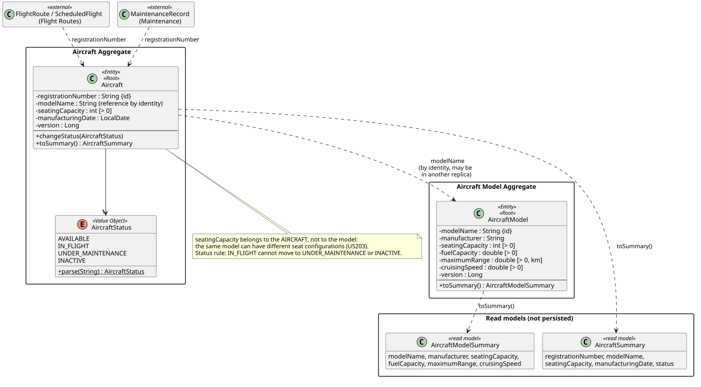
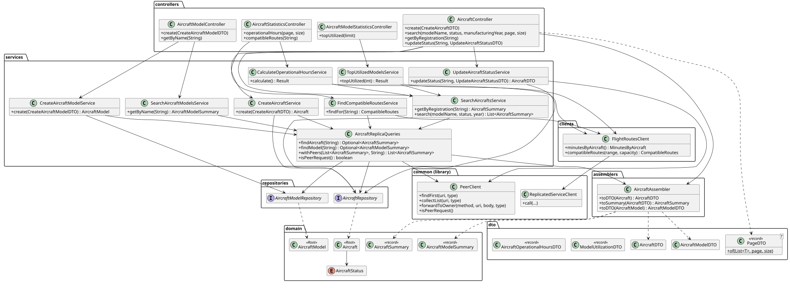

# C4 Level 4 — Aircraft Management Service: Code

> Zoom into the components of [L3](../../3-components/aircraftmanagement/AircraftManagement-Components.md): the significant classes, their relationships and the design patterns. Class names link to the source code.
> Source root: [code/aircraftmanagement/src/main/java/isep/psoft/aisafe](../../../code/aircraftmanagement/src/main/java/isep/psoft/aisafe)

## 1. Domain model

### Aggregates

| Aggregate | Root | Value Objects | Invariants protected by the root |
|---|---|---|---|
| Aircraft Model | [`AircraftModel`](../../../code/aircraftmanagement/src/main/java/isep/psoft/aisafe/aircraftmanagement/domain/AircraftModel.java) | — (primitive attributes) | Model name and manufacturer required; seating capacity, fuel capacity, maximum range (km) and cruising speed strictly positive |
| Aircraft | [`Aircraft`](../../../code/aircraftmanagement/src/main/java/isep/psoft/aisafe/aircraftmanagement/domain/Aircraft.java) | [`AircraftStatus`](../../../code/aircraftmanagement/src/main/java/isep/psoft/aisafe/aircraftmanagement/domain/AircraftStatus.java) | Registration number and model name required; seating capacity positive; status defaults to `AVAILABLE`; an `IN_FLIGHT` aircraft cannot change to `UNDER_MAINTENANCE` or `INACTIVE` (`changeStatus`) |

- **Identity.** The identity of an aircraft is its **registration number** and the identity of a model is its **model name** (`@Id`), not technical ids. Other services reference aircraft and models this way (Flight Routes stores the registration number, Maintenance too), so a lookup on any replica is a primary-key read.
- **`Aircraft` → `AircraftModel` by identity.** `Aircraft` stores only `modelName`. The model may live in **another replica**, so a JPA association (foreign key/JOIN) is impossible. Existence of the model is verified at creation time through `AircraftReplicaQueries.findModel`.
- **The seating capacity is an attribute of the aircraft**, not only of the model: the same model can have different seat configurations and therefore different capacities (US203). `AircraftModel.seatingCapacity` is the model's reference value.
- **Optimistic locking.** Both roots have `@Version`. Two concurrent updates of the same aircraft in the owner replica → the second fails with `ObjectOptimisticLockingFailureException` → `409`. `saveAndFlush` forces the check inside the request, so the conflict is reported to the caller.
- **State only through behaviour.** `Aircraft` and `AircraftModel` have no setters; `Aircraft.status` changes only through `changeStatus`, which holds the transition rule. Constructors validate, so an invalid aggregate cannot be created.
- **Read models** (not persisted, no identity): [`AircraftSummary`](../../../code/aircraftmanagement/src/main/java/isep/psoft/aisafe/aircraftmanagement/domain/AircraftSummary.java) and [`AircraftModelSummary`](../../../code/aircraftmanagement/src/main/java/isep/psoft/aisafe/aircraftmanagement/domain/AircraftModelSummary.java) — immutable records, independent of the replica where the record is stored. They are created from local entities (`toSummary()`) and from DTOs received from peers (`AircraftAssembler.toSummary`), so the services treat local and remote records in the same way.
- **Status transitions.** Only the rule "`IN_FLIGHT` → `UNDER_MAINTENANCE`/`INACTIVE` is forbidden" exists (proposal for contract question Q7). Other transitions are accepted; setting the current status again is a no-op.
- **Statuses** are the strings fixed in [Integration-Contracts §2.2](../../2-containers/Integration-Contracts.md): `AVAILABLE`, `IN_FLIGHT`, `UNDER_MAINTENANCE`, `INACTIVE` (the value Flight Routes requires to schedule is exactly `AVAILABLE`). `AircraftStatus.parse` accepts any case and rejects unknown values with `400`.

## 2. Class diagram

## 3. Design rationale (responsibility assignment)

**Register aircraft model / aircraft (US101, US102)**

| Question: which class is responsible for... | Answer | Justification (patterns) |
|---|---|---|
| ...receiving the HTTP request and validating the input format? | `AircraftController` / `AircraftModelController` + `CreateAircraftDTO` / `CreateAircraftModelDTO` (Bean Validation: required fields, positive numbers, registration pattern `^[A-Z0-9]{1,2}-[A-Z0-9]{2,5}$`, date not in the future) | **Controller (REST)**, **DTO** |
| ...coordinating the use case and the transaction? | `CreateAircraftService`, `CreateAircraftModelService` | **Application Service** |
| ...checking that the registration/model name is not used in any replica? | `AircraftReplicaQueries.findAircraft` / `findModel` → repository + `PeerClient.findFirst` | **Repository** (local) + peer query. Best-effort (AP): a peer that is down is skipped |
| ...checking that the aircraft's model exists (in any replica)? | `AircraftReplicaQueries.findModel` | **Indirection** — the model may be remote, so there is no association |
| ...enforcing the domain rules? | `Aircraft`, `AircraftModel` constructors | **Information Expert / Aggregate Root** |
| ...persisting it? | `AircraftRepository`, `AircraftModelRepository` | **Repository** — stored in the replica that received the request (it becomes the owner) |
| ...building the response? | `AircraftAssembler` | **DTO / Assembler** |

**Change aircraft status (US105, contract B3b)**

| Question | Answer | Justification |
|---|---|---|
| ...parsing and rejecting an unknown status? | `AircraftStatus.parse` | **Information Expert** (`400` before any forwarding) |
| ...finding the replica that stores the aircraft? | `AircraftRepository` (local), otherwise `PeerClient.forwardToOwner` | **Indirection** — a record has a single owner (unicast to the peers, `404` = "not mine") |
| ...validating the status transition? | `Aircraft.changeStatus` | **Information Expert** — the rule lives with the data it protects |
| ...detecting concurrent updates? | `@Version` + `saveAndFlush` | **Optimistic Locking** |
| ...translating a business conflict into HTTP? | `GlobalExceptionHandler` | `IllegalStateException` → `409`, optimistic-lock failure → `409` |

**Search and view aircraft (US103, US104, contract B1a/B1b)**

| Question | Answer | Justification |
|---|---|---|
| ...finding one aircraft/model in any replica? | `AircraftReplicaQueries.findAircraft` / `findModel` | **Pure Fabrication** — local first, then `PeerClient.findFirst` |
| ...filtering by model, status and year? | `SearchAircraftsService.search` | **Application Service** — filters combined with AND, status parsed once |
| ...obtaining the data of the other replicas? | `AircraftReplicaQueries.withPeers` → `PeerClient.collectList`, merged by registration (local copy wins) | **Pure Fabrication** |
| ...avoiding forwarding loops? | `PeerClient.isPeerRequest` (`X-Peer-Hops`) — a peer request is answered with local data only | `common` library; services do not decide whether to forward |
| ...paginating? | `AircraftController` → `PageDTO.of` **after** merging; a peer request gets the complete, unpaginated local list | **Pure Fabrication**; stable JSON instead of Spring's `Page` (contract Q8) |

**Statistics that combine two services (US203, US204, US206)**

| Question | Answer | Justification |
|---|---|---|
| ...obtaining the fleet of all replicas? | `SearchAircraftsService.search(null, null, null)` | Reuse of the US104 aggregation |
| ...obtaining flight minutes per aircraft? | `FlightRoutesClient.minutesByAircraft` (B4b) | **Anti-Corruption Layer** — Flight Routes only knows registrations, never models |
| ...joining fleet and minutes? | `CalculateOperationalHoursService` (per aircraft, 0 when it has no flights), `TopUtilizedModelsService` (sum per model, descending, ties by model name, models without minutes excluded, top *N*) | **Application Service** — the join happens here because the model of an aircraft is Aircraft Management data |
| ...finding compatible routes? | `FindCompatibleRoutesService`: range = `maximumRange` of the **model**, capacity = `seatingCapacity` of the **aircraft**, then B6 | **Information Expert** — the two values live in two different aggregates |
| ...knowing the answer is incomplete? | `FlightRoutesClient.isPartial` → `X-Partial-Response` on the response | Graceful degradation (AP) |
| ...failing when Flight Routes is down? | `ReplicatedServiceClient` → `RemoteServiceUnavailableException` → `503` | Retry + failover + circuit breaker in `common` |

## 4. Package organization

| Package | Layer / L3 component | DDD role |
|---|---|---|
| `aircraftmanagement.controllers`, `dto`, `assemblers` | Controllers, Assembler / DTOs | Published Language (API contract separate from the domain) |
| `aircraftmanagement.services` | Application services, Replica queries | Application Services (`AircraftReplicaQueries`: pure fabrication) |
| `aircraftmanagement.domain` | Domain model | Entities (aggregate roots), Value Object (`AircraftStatus`), Read Models |
| `aircraftmanagement.repositories` | Repositories | One repository per aggregate root (local data) |
| `aircraftmanagement.clients` | Anti-Corruption Layer | ACL towards Flight Routes |
| `aircraftmanagement.bootstrap` | Demo data | properties `aisafe.bootstrap.*` |
| `infrastructure.security`, `infrastructure.config`, `exceptions` | Security & config | Authorization rules, OpenAPI, error mapping |

The `factories` package is empty (`.gitkeep`): the aggregates are created through their validating constructors, which is enough while there is no complex construction logic.

## 5. Implementation notes

- **Remote access:** `RestClientConfig` creates one `ReplicatedServiceClient` bean (`flightRoutesService`) with all replicas of Flight Routes (`services.flightroutes.urls`). `FlightRoutesClient` maps `401`/`403` to `ResponseStatusException` (same status); no replica available → `RemoteServiceUnavailableException` (`503`). Any other `4xx` is not mapped (it would end as `500`, as the contract documents for the consumers).
- **Services never decide whether to forward:** `PeerClient` does nothing when the current request already came from a peer, so the same service code answers clients (all replicas) and peers (local only).
- **URIs sent to peers** are built with encoded path segments and query values (`AircraftReplicaQueries.uri`, `pathSegment`); null/blank filters are omitted.
- **Tolerant reader:** DTOs exchanged between replicas use `@JsonIgnoreProperties(ignoreUnknown = true)`, so a future `_links` or new field does not break the peers or the consumers (contract §2.2).
- **Pagination after merging:** `PageDTO.of` cuts the page after merging and sorting by registration; maximum page size 100 (`400` otherwise).
- **Contract values are never null:** `AircraftDTO` (B1a) always carries `registrationNumber`, `modelName`, `seatingCapacity`, `status`; `AircraftModelDTO` (B1b) always carries `maximumRange` — Flight Routes unboxes them.
- **Demo data:** `DemoDataBootstrap` parses `modelName:manufacturer:seats:fuel:range:speed` and `registration:model:seats:date[:status]` from `aisafe.bootstrap.*`; each replica loads different data.

| Replica | Models | Aircraft |
|---|---|---|
| 1 (`application.properties`) | `A320` (180 seats, 6100 km), `B737` (189 seats, 5600 km) | `CS-TUA` (A320, `AVAILABLE`), `CS-TUB` (B737, `UNDER_MAINTENANCE`) |
| 2 (`application-instance2.properties`) | `A330` (300 seats, 11750 km) | `CS-TUC` (A330, 300 seats), `CS-TUD` (A330, 290 seats) |
| 3 (`application-instance3.properties`) | `E190` (100 seats, 4500 km) | `CS-TUE` (E190, 100 seats), `CS-TUF` (E190, 96 seats, `INACTIVE`) |

## 6. Configuration files

| File | Content |
|---|---|
| [`application.properties`](../../../code/aircraftmanagement/src/main/resources/application.properties) | Defaults (= replica 1), remote URLs, resilience, security (`jwt.secret`, `aisafe.security.service-key`), logging, actuator, demo data of replica 1 |
| `application-instance1/2/3.properties` | Port (8081/8181/8281), instance id, database, peers and demo data of each replica |
| `application-tls.properties` | HTTPS: server keystore, client truststore, `aisafe.scheme=https` |

## 7. Code-level observations

- **Value Objects:** `registrationNumber`, `maximumRange` (km) and similar are primitives validated in the constructors/DTOs. Value Objects such as `RegistrationNumber` would centralise the format rule (today only `CreateAircraftDTO` checks it; the demo data and peer DTOs bypass it).
- **Registration normalisation (Q10):** the registration is stored as received and the pattern forces upper case at creation time; lookups are case-sensitive.
- **Aircraft vs model capacity:** no rule relates `Aircraft.seatingCapacity` to `AircraftModel.seatingCapacity` (e.g. an upper bound). To be agreed with the customer.
- **Remote calls inside a transaction:** `CreateAircraftService`, `CreateAircraftModelService` and `UpdateAircraftStatusService` are `@Transactional` and call peers (HTTP) inside the transaction. Short timeouts (`read-timeout=3s`) limit the impact; moving the remote lookups before the transaction would remove it.
- **Optimistic locking for clients:** the `version` is not exposed, so a client cannot send the version it read (contract Q7); the check protects concurrent writes inside the owner replica only.
- **`GET /api/aircrafts` return type** is `Object` (page for clients, list for peers), so the generated OpenAPI schema is generic. Documenting both shapes with `@ApiResponse`, or a separate internal endpoint for peers, would make the specification exact.
- **`IN_FLIGHT` has no producer:** nothing sets it automatically; it is only a value that can be set through US105. See open question Q-AM1.
- `bootstrap-instance1.snippet.properties` is a leftover of the migration (its content is already in `application.properties`); it can be deleted.
