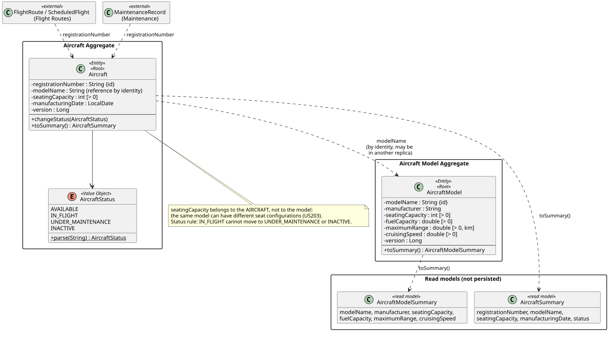
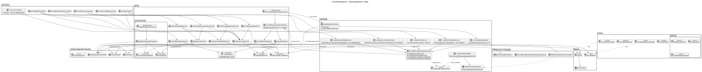

# C4 Level 4 — Aircraft Management Service: Code

> Zoom into the components of [L3](../../3-components/aircraftmanagement/AircraftManagement-Components.md): the significant classes, their relationships and the design patterns. Class names link to the source code.
> Source root: [code/aircraftmanagement/src/main/java/isep/psoft/aisafe](../../../code/aircraftmanagement/src/main/java/isep/psoft/aisafe)

## 1. Domain model

### Aggregates

| Aggregate | Root | Value Objects | Invariants protected by the root |
|---|---|---|---|
| Aircraft Model | [`AircraftModel`](../../../code/aircraftmanagement/src/main/java/isep/psoft/aisafe/aircraftmanagement/domain/AircraftModel.java) | — (primitive attributes) | Model name and manufacturer required; seating capacity, fuel capacity, maximum range (km) and cruising speed strictly positive |
| Aircraft | [`Aircraft`](../../../code/aircraftmanagement/src/main/java/isep/psoft/aisafe/aircraftmanagement/domain/Aircraft.java) | [`AircraftStatus`](../../../code/aircraftmanagement/src/main/java/isep/psoft/aisafe/aircraftmanagement/domain/AircraftStatus.java) | Registration number and model name required; seating capacity positive; status defaults to `AVAILABLE`; an `IN_FLIGHT` aircraft cannot change to `UNDER_MAINTENANCE` or `INACTIVE` (`changeStatus`) |

- **Identity.** The identity of an aircraft is its **registration number** and the identity of a model is its **model name** (`@Id`), not technical ids. Other services reference aircraft and models this way (Flight Routes stores the registration number, Maintenance too), so a lookup on any replica is a primary-key read.
- **`Aircraft` → `AircraftModel` by identity.** `Aircraft` stores only `modelName`. The model may live in **another replica**, so a JPA association (foreign key/JOIN) is impossible. Existence of the model is verified at creation time on the local read model `REPLICATED_AIRCRAFT_MODEL`, which holds the models of every replica.
- **The seating capacity is an attribute of the aircraft**, not only of the model: the same model can have different seat configurations and therefore different capacities (US203). `AircraftModel.seatingCapacity` is the model's reference value.
- **Optimistic locking.** Both roots have `@Version`. Two concurrent updates of the same aircraft in the owner replica → the second fails with `ObjectOptimisticLockingFailureException` → `409`. `saveAndFlush` forces the check inside the request, so the conflict is reported to the caller.
- **State only through behaviour.** `Aircraft` and `AircraftModel` have no setters; `Aircraft.status` changes only through `changeStatus`, which holds the transition rule. Constructors validate, so an invalid aggregate cannot be created.
- **Views** (not persisted, no identity): [`AircraftSummary`](../../../code/aircraftmanagement/src/main/java/isep/psoft/aisafe/aircraftmanagement/domain/AircraftSummary.java) and [`AircraftModelSummary`](../../../code/aircraftmanagement/src/main/java/isep/psoft/aisafe/aircraftmanagement/domain/AircraftModelSummary.java) — immutable records, independent of the replica that owns the record. Assignment 2: the query side builds them from the CQRS read models (`ReplicatedAircraft.toSummary()`, `ReplicatedAircraftModel.toSummary()`), never from peer DTOs.
- **Write model vs read model (Assignment 2).** `Aircraft`/`AircraftModel` are the **write model**: only the owner replica stores and changes a given row. `ReplicatedAircraft`, `ReplicatedAircraftModel` and `AircraftMood` (package `query`) are **read models**: plain JPA entities without behaviour, written only by projections from events, with the owner's `sourceVersion` (not a local `@Version`).
- **Status transitions.** Only the rule "`IN_FLIGHT` → `UNDER_MAINTENANCE`/`INACTIVE` is forbidden" exists (proposal for contract question Q7). Other transitions are accepted; setting the current status again is a no-op.
- **Statuses** are the strings fixed in [Integration-Contracts §2.2](../../2-containers/Integration-Contracts.md): `AVAILABLE`, `IN_FLIGHT`, `UNDER_MAINTENANCE`, `INACTIVE` (the value Flight Routes requires to schedule is exactly `AVAILABLE`). `AircraftStatus.parse` accepts any case and rejects unknown values with `400`.

## 2. Class diagram

## 3. Design rationale (responsibility assignment)

**Register aircraft model / aircraft (US101, US102) — command side**

| Question: which class is responsible for... | Answer | Justification (patterns) |
|---|---|---|
| ...receiving the HTTP request and validating the input format? | `AircraftController` / `AircraftModelController` + `CreateAircraftDTO` / `CreateAircraftModelDTO` (Bean Validation) | **Controller (REST)**, **DTO** |
| ...coordinating the use case and the transaction? | `CreateAircraftService`, `CreateAircraftModelService` (package `command`) | **Application Service** (CQRS command handler) |
| ...checking that the registration/model name is not used in any replica, and that the model exists? | `ReplicatedAircraftRepository.existsById`, `ReplicatedAircraftModelRepository.existsById` | **CQRS read model**: no peer call; eventual consistency window accepted (AP) |
| ...enforcing the domain rules? | `Aircraft`, `AircraftModel` constructors | **Information Expert / Aggregate Root** |
| ...persisting it? | `AircraftRepository`, `AircraftModelRepository` (`saveAndFlush`, so the version is final) | **Repository** — the replica that received the request becomes the owner |
| ...announcing the change? | `AircraftManagementEventEmitter` → one `IntegrationEvent` (`AircraftRegistered` / `AircraftModelCreated`) applied to the local read model in the same transaction, published after commit by `IntegrationEventRelay` | **Domain/integration events**, **Observer** (Spring `@TransactionalEventListener`), **Strategy** for the transport (`IntegrationEventTransport`: RabbitMQ or in-process in tests) |

**Change aircraft status (US105, B3b) and model specifications (US201) — command side, owner only**

| Question | Answer | Justification |
|---|---|---|
| ...parsing and rejecting an unknown status? | `AircraftStatus.parse` | **Information Expert** (`400` before any forwarding) |
| ...executing the write on the right replica? | local `AircraftRepository`/`AircraftModelRepository`, otherwise `PeerClient.forwardToOwner` | **Single owner per entity** — one writer, so one event producer and ordered events |
| ...validating the status transition? | `Aircraft.changeStatus` | **Information Expert** |
| ...avoiding meaningless events? | `UpdateAircraftStatusService` compares the status before/after: same status → no write, no event | Events describe facts that happened |
| ...detecting concurrent updates? | `@Version` + `saveAndFlush` | **Optimistic Locking** → `409` |
| ...keeping other services' copies of the model current? | `AircraftModelUpdated` (new event of Assignment 2) | Flight Routes `KNOWN_AIRCRAFT_MODEL` also applies it |

**Queries (US103, US104, US203–US206, B1, B3, unicorns) — query side**

| Question | Answer | Justification |
|---|---|---|
| ...answering a GET? | `query/*Service` on the local tables only | **CQRS**: no peer aggregation, never partial |
| ...keeping the read models current? | `AircraftManagementEventsListener` → `AircraftManagementEventRouter` → `AircraftProjection` / `AircraftModelProjection` | **Event-driven projection**; router = **Pure Fabrication** that dispatches by `eventType` |
| ...applying an event exactly once? | `IdempotentEventHandler` + `JpaProcessedEventStore` (same transaction) and `isNewerThan(version)` | At-least-once delivery made idempotent |
| ...knowing the flight minutes and the routes (data of Flight Routes)? | `FlightRoutesEventsProjection` → `KnownScheduledFlight`, `KnownRoute`; `FlightMinutesService` sums minutes per registration | **Anti-Corruption Layer** by events (`events.external` payloads with only the fields used) — replaces the HTTP bridges B4b/B6 |
| ...joining fleet and minutes? | `CalculateOperationalHoursService`, `TopUtilizedModelsService` | **Application Service** — the model of an aircraft is Aircraft Management data |
| ...finding compatible routes? | `FindCompatibleRoutesService`: range of the **model**, capacity of the **aircraft**, `KnownRouteRepository.findCompatibleRoutes` (same rule as Flight Routes) | **Information Expert** |
| ...computing the mood of an aircraft? | `AircraftMood.moodOf(status)` in `AircraftProjection` (same transaction as `ReplicatedAircraft`) | Projection computed at write time, the GET only reads |

## 4. Package organization

| Package | Layer / L3 component | DDD / CQRS role |
|---|---|---|
| `aircraftmanagement.controllers`, `dto`, `assemblers` | Controllers, Assembler / DTOs | Published Language (API contract separate from the domain) |
| `aircraftmanagement.command` | Command side, event emitter and relay, startup synchronisation | Command handlers (Application Services) |
| `aircraftmanagement.events` | Event contracts | Published language of the events (owned by this service) |
| `aircraftmanagement.events.external` | Flight Routes event contracts (tolerant reader) | Anti-Corruption Layer |
| `aircraftmanagement.query` | Query side, projections, read models, listener | Query handlers, projections |
| `aircraftmanagement.query.external` | Flight Routes read models | ACL + projection of another bounded context |
| `aircraftmanagement.domain` | Domain model | Aggregate roots, Value Object (`AircraftStatus`), views |
| `aircraftmanagement.repositories` | Write model | One repository per aggregate root (owned rows) |
| `aircraftmanagement.bootstrap` | Demo data | profile `demo` |
| `infrastructure.messaging` | RabbitMQ topology, transport, processed events | Infrastructure |
| `infrastructure.security`, `infrastructure.config`, `exceptions` | Security & config | Authorization rules, OpenAPI, error mapping |

The `clients` and `factories` packages are empty (`.gitkeep`): Aircraft Management no longer calls another service over HTTP, and the aggregates are created through their validating constructors.

## 5. Implementation notes

- **Same structure as Flight Routes.** `AircraftManagementEventEmitter`, `IntegrationEventRelay`, `IntegrationEventTransport`, `OutgoingIntegrationEvent`, `RabbitIntegrationEventTransport`, `JpaProcessedEventStore` and the router/projection split are copies of the Flight Routes classes; the `common` library does the AMQP work (exchange, queues, DLQ, retry, confirms).
- **Queues of each replica:** `<instanceId>.aircraftmanagement` (bound to `aircraft.*`, `aircraft-model.*`) and `<instanceId>.flightroutes` (bound to `route.*`, `scheduled-flight.*`), declared by `AircraftManagementMessagingConfiguration`; both listeners exist only with `aisafe.messaging.enabled=true`.
- **Payloads are state-carrying** and include the entity's `version`; null fields of a payload keep the stored value (tolerant to status-only events).
- **Startup synchronisation (as in Airports):** `DemoDataBootstrap` (`@Order(1)`) inserts the demo rows, then `ReadModelSynchronizer` (`@Order(2)`) republishes the owned state through `AircraftStateRepublisher` and publishes `AircraftSyncRequested`; `AircraftManagementEventsListener` hands a request of another replica to `ReadModelSynchronizer.onSyncRequested`.
- **No `X-Partial-Response`** any more: every GET reads local tables. The peer branch of `GET /api/aircrafts` (plain list for peers) was removed; it always returns a `PageDTO`.
- **Contract values are never null:** `AircraftDTO` (B1a) always carries `registrationNumber`, `modelName`, `seatingCapacity`, `status`; `AircraftModelDTO` (B1b) always carries `maximumRange`.
- **Demo data:** `DemoDataBootstrap` (profile `demo`, `ApplicationReadyEvent`) parses `modelName:manufacturer:seats:fuel:range:speed` and `registration:model:seats:date[:status]`; each replica loads different data, inserted once and published as events.

| Replica | Models | Aircraft |
|---|---|---|
| 1 (`application-instance1.properties`) | `A320` (180 seats, 6100 km), `B737` (189 seats, 5600 km) | `CS-TUA` (A320, `AVAILABLE`), `CS-TUB` (B737, `UNDER_MAINTENANCE`) |
| 2 (`application-instance2.properties`) | `A330` (300 seats, 11750 km) | `CS-TUC` (A330, 300 seats), `CS-TUD` (A330, 290 seats) |
| 3 (`application-instance3.properties`) | `E190` (100 seats, 4500 km) | `CS-TUE` (E190, 100 seats), `CS-TUF` (E190, 96 seats, `INACTIVE`) |

## 6. Configuration files

| File | Content |
|---|---|
| [`application.properties`](../../../code/aircraftmanagement/src/main/resources/application.properties) | Defaults (= replica 1), file database, resilience, security, messaging (RabbitMQ, retries), health probes, logging |
| `application-instance1/2/3.properties` | Port (8081/8181/8281), instance id, database file, peers and demo data of each replica |
| `application-demo.properties` | `aisafe.bootstrap.enabled=true` |
| `application-tls.properties` | HTTPS: server keystore, client truststore, `aisafe.scheme=https` |
| `src/test/resources/config/application.properties` | Tests: messaging off, in-memory database |

## 7. Code-level observations

- **Value Objects:** `registrationNumber`, `maximumRange` (km) and similar are primitives validated in the constructors/DTOs; a `RegistrationNumber` Value Object would centralise the format rule.
- **Optimistic locking for clients:** the `version` is not exposed by the REST API, so the check protects concurrent writes inside the owner replica only.
- **Uniqueness in the consistency window:** two replicas can accept the same registration if the requests arrive before the first event (milliseconds). Accepted price of AP; a fix would be a deterministic owner per registration (hash partitioning) instead of "the replica that received the POST".
- **No transactional outbox:** an event that cannot be published at commit time is lost until the owner republishes its state (its next start, or a sync request of another replica).
- **`IN_FLIGHT` has no producer:** nothing sets it automatically; it is a value set through US105 (open question Q-AM1).
