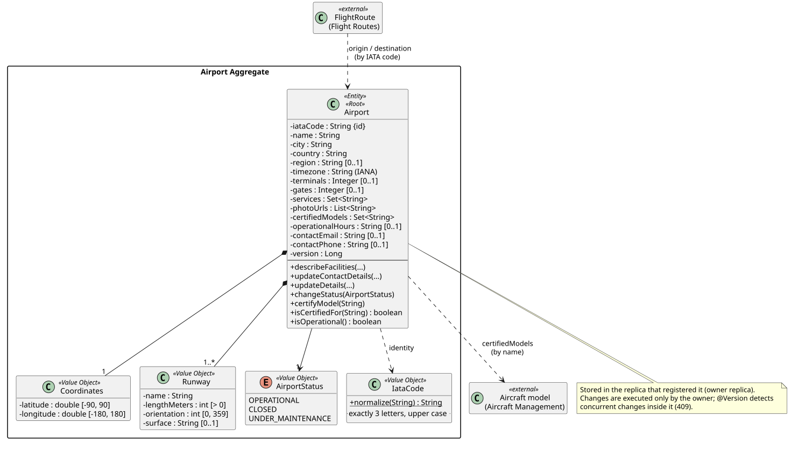
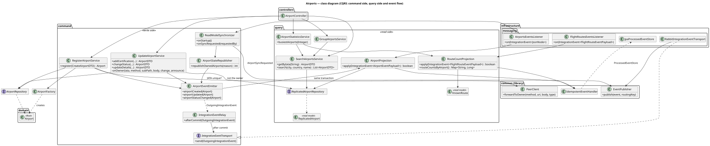

# C4 Level 4 — Airports Service: Code

> Zoom into the components of [L3](../../3-components/airports/Airports-Components.md): the significant classes, their relationships and the design patterns. Class names link to the source code.
> Source root: [code/airports/src/main/java/isep/psoft/aisafe](../../../code/airports/src/main/java/isep/psoft/aisafe)

## 1. Domain model

### Aggregate

| Aggregate | Root | Value Objects | Invariants protected by the root |
|---|---|---|---|
| Airport | [`Airport`](../../../code/airports/src/main/java/isep/psoft/aisafe/airports/domain/Airport.java) | [`Coordinates`](../../../code/airports/src/main/java/isep/psoft/aisafe/airports/domain/Coordinates.java), [`Runway`](../../../code/airports/src/main/java/isep/psoft/aisafe/airports/domain/Runway.java), [`AirportStatus`](../../../code/airports/src/main/java/isep/psoft/aisafe/airports/domain/AirportStatus.java), [`IataCode`](../../../code/airports/src/main/java/isep/psoft/aisafe/airports/domain/IataCode.java) | IATA = 3 letters, upper case; name, city, country required; valid IANA timezone; coordinates in range; at least one runway, unique runway names, positive length, orientation 0–359; non-negative terminals/gates; a model is certified at most once; created `OPERATIONAL` |

- **The IATA code is the identity** (`@Id`), not a technical id: it is how the other services reference an airport (Flight Routes stores only the IATA of origin and destination), and it makes a lookup on any replica a primary-key read.
- `Airport` has no setters: its state changes only through `describeFacilities`, `updateContactDetails`, `updateDetails`, `changeStatus` and `certifyModel`. Value Objects are immutable and self-validating.
- `@Version` (optimistic locking) on the root: two concurrent changes of the same airport in the owner replica → the second fails with `409`.
- **External references by identity only:** certified aircraft models are kept by name (identity in Aircraft Management); Flight Routes references airports by IATA. No JPA association crosses a service or a replica.
- Collections (`runways`, `certifiedModels`, `services`, `photoUrls`) are exposed as unmodifiable views, so they can only change through the root.

## 2. Class diagram

## 3. Design rationale (responsibility assignment)

**Register airport (US106, US207) — command**

| Question: which class is responsible for... | Answer | Justification (patterns) |
|---|---|---|
| ...receiving the HTTP request and validating the input format? | `AirportController` + `CreateAirportDTO` (Bean Validation) | **Controller (REST)**, **DTO** |
| ...coordinating the use case and the transaction? | `command.RegisterAirportService` | **Application Service** (command side of **CQRS**) |
| ...checking that the IATA is not registered in any replica? | `AirportRepository.existsById` + `ReplicatedAirportRepository.existsById` | **Repository** — the read model already holds the airports of every replica, so no HTTP call is needed (best-effort, AP) |
| ...building a valid aggregate? | `AirportFactory` | **Factory / Creator** |
| ...enforcing the business rules (timezone, runways, …)? | `Airport`, `Runway`, `Coordinates` | **Information Expert / Aggregate Root / Value Object** |
| ...persisting it? | `AirportRepository.saveAndFlush` | **Repository** — stored in the replica that received the request (owner); flush so `@Version` is final |
| ...announcing the change? | `AirportEventEmitter.airportCreated` | **Domain/Integration Event**, **state-carrying event** (full state + version) |
| ...making the change visible on this replica at once? | `AirportProjection` called by the emitter in the same transaction | **Read-your-writes** on the owner |
| ...publishing it to the other replicas and services? | `IntegrationEventRelay` (`@TransactionalEventListener(AFTER_COMMIT)`) → `RabbitIntegrationEventTransport` → `EventPublisher` | **Publish after commit** (never announce a rolled-back change), **Strategy** for the transport (RabbitMQ in production, in-process bus in tests) |

**Certify model, change status, update details (US106a, US109, US208) — commands**

| Question | Answer | Justification |
|---|---|---|
| ...deciding whether the airport is local? | `UpdateAirportService.onOwner` | **Application Service** (one template method for the three commands, each with its own event type) |
| ...sending the command to the replica that stores the airport? | `PeerClient.forwardToOwner` | **Indirection** — an airport has a single owner, which is also its single event producer (events ordered per airport) |
| ...applying the change? | `Airport.certifyModel` / `changeStatus` / `updateDetails` | **Information Expert / Aggregate Root** |
| ...validating the status before forwarding? | `AirportStatus.from` | **Pure Fabrication / fail fast** (no network call for a `400`) |
| ...detecting concurrent changes? | `@Version` + `saveAndFlush` | **Optimistic Locking** |
| ...announcing it? | `AirportEventEmitter.airportUpdated` / `airportStatusChanged` | as above |

**Queries (US107, US108, US211, US210) — query side**

| Question | Answer | Justification |
|---|---|---|
| ...answering a GET with the airports of all replicas? | `query.SearchAirportsService` → `ReplicatedAirportRepository` | **CQRS read model** — a local read, no peer calls, no partial responses |
| ...keeping the read model up to date? | `AirportProjection` (fed by `AirportsEventsListener`) | **Projection**, **Idempotent Receiver** (`IdempotentEventHandler` + `JpaProcessedEventStore`), stale versions ignored |
| ...grouping by country/region? | `GroupAirportsService` (on the read model) | **Application Service** |
| ...obtaining the number of routes per airport? | `RouteCountProjection` → `KNOWN_ROUTE` (fed by `FlightRoutesEventsListener`) | **Event-carried state transfer** — routes belong to Flight Routes; Airports keeps only the copy it needs (tolerant reader: `FlightRouteEventPayload` has 5 fields) |
| ...ranking and joining airport details? | `AirportStatisticsService` | **Application Service** — ranking and top-N are Airports' job |
| ...mapping the read model to the API? | `AirportAssembler.toDTO(ReplicatedAirport)` | **Assembler** — same `AirportDTO`, so the REST contract did not change |

**Infrastructure of the event flow**

| Question | Answer | Justification |
|---|---|---|
| ...declaring queues, DLQs and bindings of this replica? | `AirportsMessagingConfiguration` (`MessagingTopology.subscribe`) | **Configuration**; one durable queue per instance and source service |
| ...routing the messages of one queue that carries two payload types? | `AirportsEventsListener` (payload read as `JsonNode`, converted by `eventType`) | **Message Router** |
| ...filling read models that missed events? | `ReadModelSynchronizer` + `AirportStateRepublisher` | **Pure Fabrication**; idempotent and version-checked, so repetitions are harmless |

## 4. Package organization

| Package | Layer / L3 component | DDD / CQRS role |
|---|---|---|
| `airports.controllers` | Airport Controller | Interface (REST) |
| `airports.dto` | Airport Controller | Data Transfer Objects (records) |
| `airports.assemblers` | Airport Controller | Write model / read model → DTO mapping |
| `airports.command` | Command side, Event emitter & relay, Read-model synchronisation | Command handlers, event emission |
| `airports.query` | Query side, Projections | Query handlers, read model `REPLICATED_AIRPORT` |
| `airports.query.external` | Projections | Read model `KNOWN_ROUTE` (data owned by Flight Routes) |
| `airports.events`, `airports.events.external` | Event contracts | Published (`AirportEvents`, `AirportEventPayload`, `AirportSyncRequest`) and consumed (`FlightRouteEventPayload`) events |
| `airports.domain` | Domain model | Aggregate root, Value Objects (write model) |
| `airports.factories` | Domain model | Factory |
| `airports.repositories` | Repositories | Write-model repository (Spring Data JPA) |
| `airports.bootstrap` | Demo data | — |
| `infrastructure.messaging` | Message listeners, transport | AMQP adapters, `PROCESSED_EVENT` store |
| `infrastructure.security`, `infrastructure.config` | Security filters, OpenAPI | Infrastructure |
| `exceptions` | Controller | Exception → HTTP status mapping |

## 5. Implementation notes

- **IATA normalisation** happens in the domain (`IataCode.normalize`), so `lis`, ` LIS ` and `LIS` are the same airport in every endpoint and every replica.
- **Events carry the full state** of the airport and its `version`, so a consumer never calls Airports back, a single event is enough to rebuild a row, and an older event (e.g. replayed from the DLQ) is ignored.
- **One queue per instance** (`airports-1.airports`, `airports-2.airports`): every replica receives every event. The owner also receives its own events, but it applied them in the write transaction, so they are skipped as duplicates (same `eventId`).
- **Startup synchronisation** fixes "a queue only receives events published after it exists": a replica republishes its owned airports and asks the others to do the same (`airport-sync.requested`, a routing key that does not match `airport.*`, so other services never see it).
- **Search filters** are applied in the read-model query; the repository receives values already lower-cased (and the name already as a `LIKE` pattern) to avoid SQL functions on `null` parameters.
- **US210** joins the counts of `KNOWN_ROUTE` with the details of `REPLICATED_AIRPORT`; inactive routes are counted (decision Q6). It keeps working while Flight Routes is down, with the routes it already knows.
- **Partial updates (US208)**: a `null` field is not changed; an empty string or empty list clears the field.
- **No transactional outbox**: if the broker is down at the moment of publishing, the change is committed and visible on the owner but the event is lost for the others (logged as an error). The next change of that airport, or the next startup synchronisation, carries the full state again.
