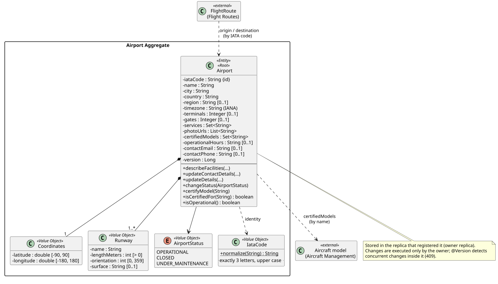
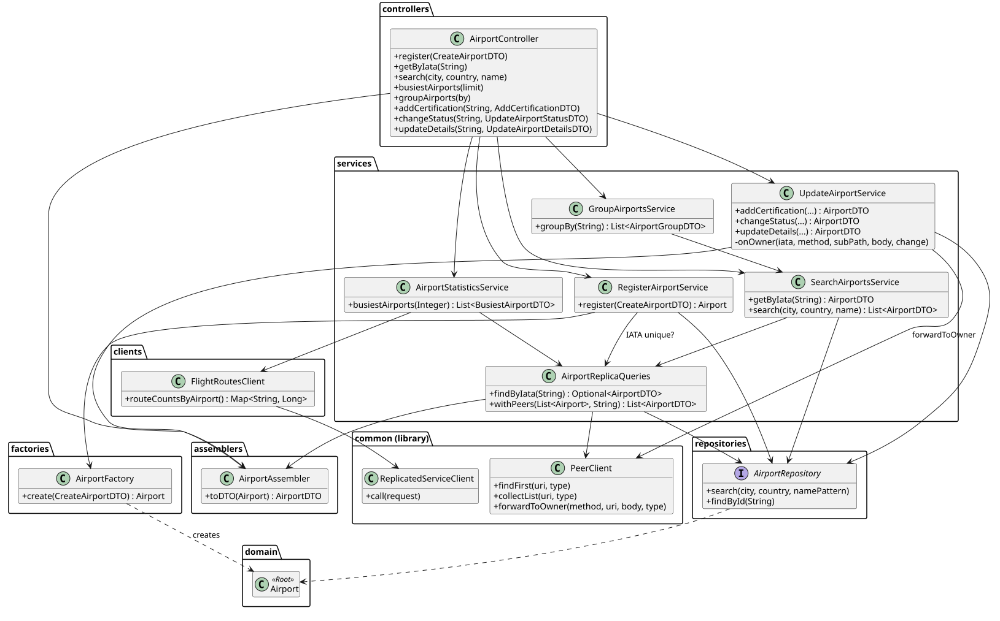

# C4 Level 4 — Airports Service: Code

> Zoom into the components of [L3](../../3-components/airports/Airports-Components.md): the significant classes, their relationships and the design patterns. Class names link to the source code.
> Source root: [code/airports/src/main/java/isep/psoft/aisafe](../../../code/airports/src/main/java/isep/psoft/aisafe)

## 1. Domain model

### Aggregate

| Aggregate | Root | Value Objects | Invariants protected by the root |
|---|---|---|---|
| Airport | [`Airport`](../../../code/airports/src/main/java/isep/psoft/aisafe/airports/domain/Airport.java) | [`Coordinates`](../../../code/airports/src/main/java/isep/psoft/aisafe/airports/domain/Coordinates.java), [`Runway`](../../../code/airports/src/main/java/isep/psoft/aisafe/airports/domain/Runway.java), [`AirportStatus`](../../../code/airports/src/main/java/isep/psoft/aisafe/airports/domain/AirportStatus.java), [`IataCode`](../../../code/airports/src/main/java/isep/psoft/aisafe/airports/domain/IataCode.java) | IATA = 3 letters, upper case; name, city, country required; valid IANA timezone; coordinates in range; at least one runway, unique runway names, positive length, orientation 0–359; non-negative terminals/gates; a model is certified at most once; created `OPERATIONAL` |

- **The IATA code is the identity** (`@Id`), not a technical id: it is how the other services reference an airport (Flight Routes stores only the IATA of origin and destination), and it makes a lookup on any replica a primary-key read.
- `Airport` has no setters: its state changes only through `describeFacilities`, `updateContactDetails`, `updateDetails`, `changeStatus` and `certifyModel`. Value Objects are immutable and self-validating.
- `@Version` (optimistic locking) on the root: two concurrent changes of the same airport in the owner replica → the second fails with `409`.
- **External references by identity only:** certified aircraft models are kept by name (identity in Aircraft Management); Flight Routes references airports by IATA. No JPA association crosses a service or a replica.
- Collections (`runways`, `certifiedModels`, `services`, `photoUrls`) are exposed as unmodifiable views, so they can only change through the root.

## 2. Class diagram

## 3. Design rationale (responsibility assignment)

**Register airport (US106, US207)**

| Question: which class is responsible for... | Answer | Justification (patterns) |
|---|---|---|
| ...receiving the HTTP request and validating the input format? | `AirportController` + `CreateAirportDTO` (Bean Validation) | **Controller (REST)**, **DTO** |
| ...coordinating the use case and the transaction? | `RegisterAirportService` | **Application Service** |
| ...checking that the IATA is not registered in any replica? | `AirportReplicaQueries.findByIata` → `AirportRepository` + `PeerClient` | **Repository** (local) + peer query (other replicas) |
| ...building a valid aggregate? | `AirportFactory` | **Factory / Creator** |
| ...enforcing the business rules (timezone, runways, …)? | `Airport`, `Runway`, `Coordinates` | **Information Expert / Aggregate Root / Value Object** |
| ...persisting it? | `AirportRepository` | **Repository** — stored in the replica that received the request (owner) |
| ...building the response? | `AirportAssembler` | **DTO / Assembler** |

**Certify model, change status, update details (US106a, US109, US208)**

| Question | Answer | Justification |
|---|---|---|
| ...deciding whether the airport is local? | `UpdateAirportService.onOwner` | **Application Service** (one template method for the three commands — no duplication) |
| ...sending the command to the replica that stores the airport? | `PeerClient.forwardToOwner` | **Indirection** — an airport has a single owner |
| ...applying the change? | `Airport.certifyModel` / `changeStatus` / `updateDetails` | **Information Expert / Aggregate Root** |
| ...validating the status before forwarding? | `AirportStatus.from` | **Pure Fabrication / fail fast** (no network call for a `400`) |
| ...detecting concurrent changes? | `@Version` + `saveAndFlush` | **Optimistic Locking** |

**Queries (US107, US108, US211) and statistics (US210)**

| Question | Answer | Justification |
|---|---|---|
| ...combining local data with the peers' data? | `AirportReplicaQueries` | **Pure Fabrication** — the distribution logic lives in one place |
| ...grouping by country/region? | `GroupAirportsService` (after merging all replicas) | **Application Service** |
| ...obtaining the number of routes per airport? | `FlightRoutesClient` | **Anti-Corruption Layer / Indirection** — routes belong to Flight Routes |
| ...ranking and joining airport details? | `AirportStatisticsService` | **Application Service** — ranking and top-N are Airports' job (contract B5) |

## 4. Package organization

| Package | Layer / L3 component | DDD role |
|---|---|---|
| `airports.controllers` | Airport Controller | Interface (REST) |
| `airports.dto` | Airport Controller | Data Transfer Objects (records) |
| `airports.assemblers` | Airport Controller / Replica queries | Domain → DTO mapping |
| `airports.services` | Application services, Replica queries | Application Services |
| `airports.domain` | Domain model | Aggregate root, Value Objects |
| `airports.factories` | Domain model | Factory |
| `airports.repositories` | Repository | Repository (Spring Data JPA) |
| `airports.clients` | Anti-Corruption Layer | Gateway to Flight Routes |
| `airports.bootstrap` | Demo data | — |
| `infrastructure.security`, `infrastructure.config` | Security filters, OpenAPI | Infrastructure |
| `exceptions` | Controller | Exception → HTTP status mapping |

## 5. Implementation notes

- **IATA normalisation** happens in the domain (`IataCode.normalize`), so `lis`, ` LIS ` and `LIS` are the same airport in every endpoint and every replica.
- **Search filters are pushed to the peers**: each replica applies the same `city`/`country`/`name` filters to its own data, so only matching airports travel over the network. The repository receives values already lower-cased (and the name already as a `LIKE` pattern) to avoid applying SQL functions to `null` parameters.
- **US210 looks up the top-N airports by IATA**, not through the US108 search: the user's JWT is forwarded to the peers and the search is ATCC-only, while US210 is for Backoffice Operators.
- **Partial updates (US208)**: a `null` field is not changed; an empty string or empty list clears the field.
- **Demo data** is saved directly in the local repository without asking the peers, because the peers may not be running yet when a replica starts.
