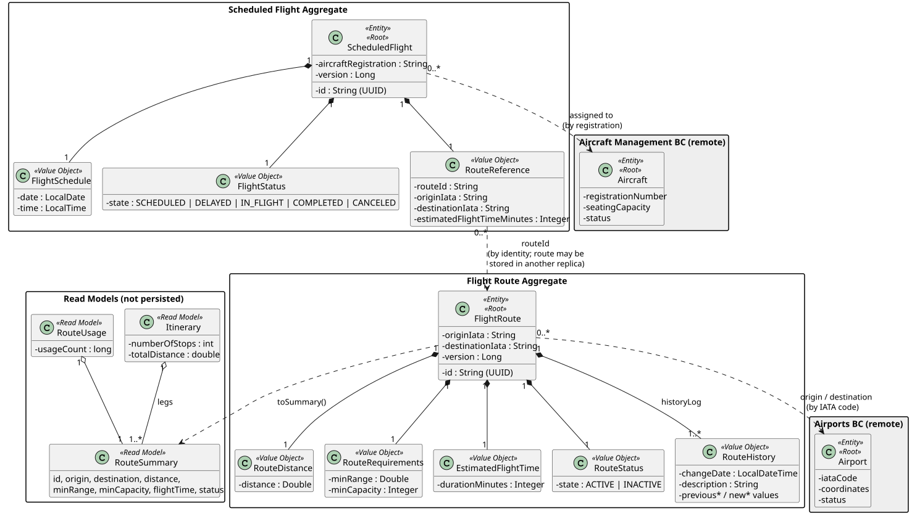
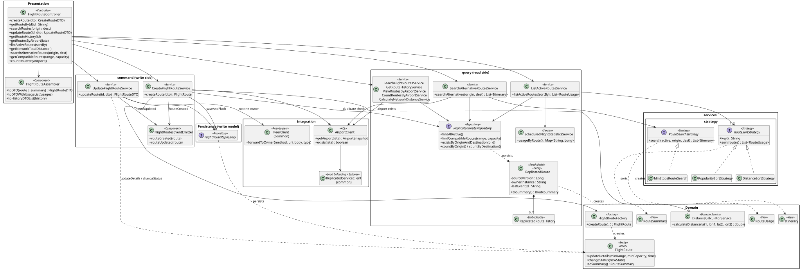
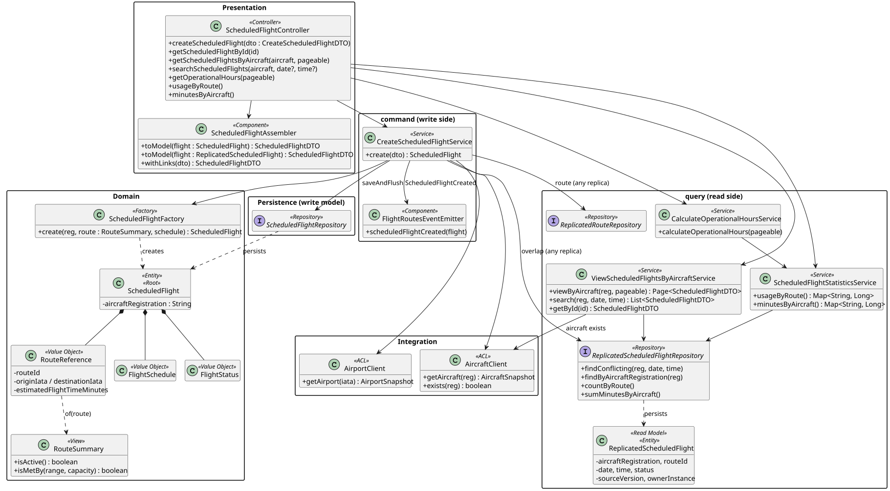
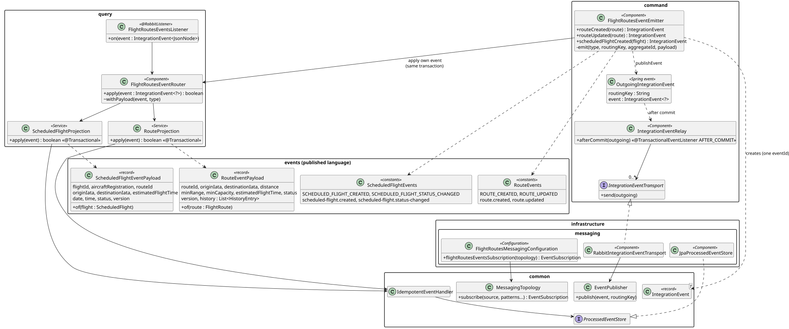

# C4 Level 4 — Flight Routes Service: Code

> Zoom into the components of [L3](../../3-components/flightroutes/FlightRoutes-Components.md): the significant classes, their relationships and the design patterns. Class names link to the source code.
> Source root: [code/flightroutes/src/main/java/isep/psoft/aisafe](../../../code/flightroutes/src/main/java/isep/psoft/aisafe)

## 1. Domain model

### Aggregates

| Aggregate | Root | Value Objects | Invariants protected by the root |
|---|---|---|---|
| Flight Route | [`FlightRoute`](../../../code/flightroutes/src/main/java/isep/psoft/aisafe/flightroutes/domain/FlightRoute.java) | `RouteDistance`, `RouteRequirements`, `EstimatedFlightTime`, `RouteStatus`, `RouteHistory` | Required origin/destination; non-negative distance; positive requirements and flight time; valid status transitions; every change recorded in the history |
| Scheduled Flight | [`ScheduledFlight`](../../../code/flightroutes/src/main/java/isep/psoft/aisafe/flightroutes/domain/ScheduledFlight.java) | [`RouteReference`](../../../code/flightroutes/src/main/java/isep/psoft/aisafe/flightroutes/domain/RouteReference.java), `FlightSchedule`, `FlightStatus` | Required aircraft, route, date and time; created as `SCHEDULED` |

- `FlightRoute` has no setters: its state only changes through `updateDetails` and `changeStatus`, which guarantees a complete history (US111). Value Objects are immutable and self-validating; on update they are **replaced**. Routes are never deleted: deactivation is a status change.
- Both roots have `@Version` (optimistic locking). For `FlightRoute`, two **overlapping** updates on the owner replica give one success and one `409` (`ObjectOptimisticLockingFailureException` in `GlobalExceptionHandler`). The version is not part of `FlightRouteDTO` or `UpdateRouteDTO` (no `ETag`/`If-Match`), so a PATCH built from stale data is not detected: sequential updates are last-writer-wins (known limitation). The version **is** part of every event payload, so consumers drop stale events. A `ScheduledFlight` is never updated after it is created; the "one flight per aircraft and slot" rule is a check on the flight read model before the insert, not a database constraint.
- **`ScheduledFlight` → `FlightRoute` by identity.** The route may be owned by another replica, so a JPA association (foreign key/JOIN) is impossible. `RouteReference` keeps the `routeId` and a snapshot of the data the flight needs (origin, destination, flight time); the snapshot also preserves the flight as scheduled if the route changes later.
- **Views** (not persisted): [`RouteSummary`](../../../code/flightroutes/src/main/java/isep/psoft/aisafe/flightroutes/domain/RouteSummary.java) — a replica-independent view of a route, created from the write model (`FlightRoute.toSummary()`) or from the read model (`ReplicatedRoute.toSummary()`); `Itinerary` (US216); `RouteUsage` (US214).
- **Read models** (persisted, query side): [`ReplicatedRoute`](../../../code/flightroutes/src/main/java/isep/psoft/aisafe/flightroutes/query/ReplicatedRoute.java) (+ `ReplicatedRouteHistory`) and [`ReplicatedScheduledFlight`](../../../code/flightroutes/src/main/java/isep/psoft/aisafe/flightroutes/query/ReplicatedScheduledFlight.java): denormalised copies built only from events, with `sourceVersion`, `ownerInstance`, `lastEventId` and `lastEventAt`. They are not aggregates: nothing but a projection writes them.
- Other aggregates are referenced by identity only: `FlightRoute` → Airport (IATA code), `ScheduledFlight` → Aircraft (registration).

## 2. Class diagrams

**Flight routes (US110–US114, US209, US203, US210, US214–US216): command and query sides**

**Scheduled flights (US212, US213, US206)**

**Events: write → event → projection (Assignment 2)**

## 3. Design rationale (responsibility assignment)

**Create route (US110)**

| Question: which class is responsible for... | Answer | Justification (patterns) |
|---|---|---|
| ...receiving the HTTP request? | `FlightRouteController` | **Controller (REST)** |
| ...coordinating the use case and the transaction? | `command.CreateFlightRouteService` | **Application Service** (command side, CQRS) |
| ...checking for a duplicate route in every replica? | `ReplicatedRouteRepository.existsByOriginAndDestination` | **Repository** on the read model (eventually consistent) |
| ...obtaining the airports' coordinates? | `AirportClient` | **Anti-Corruption Layer / Indirection** (local external read model first, then HTTP) |
| ...calculating the distance? | `DistanceCalculatorService` | **Domain Service** (Haversine) |
| ...building a valid aggregate? | `FlightRouteFactory` | **Factory / Creator** |
| ...recording the creation in the history? | `FlightRoute` | **Information Expert / Aggregate Root** |
| ...persisting it? | `FlightRouteRepository.saveAndFlush` | **Repository** — stored in (and owned by) the replica that received the request; flushed so the version is final |
| ...announcing it? | `FlightRoutesEventEmitter.routeCreated` | **Domain/Integration event**, **Publisher-Subscriber**; applied locally in the transaction, published after the commit |
| ...building the response? | `FlightRouteAssembler` | **DTO / Assembler** |

**Update or deactivate route (US112, US111)**

| Question | Answer | Justification |
|---|---|---|
| ...loading the route? | `FlightRouteRepository` (write model) | **Repository** |
| ...sending the command to the replica that owns the route? | `PeerClient.forwardToOwner` | **Indirection** — a route has a single owner (and a single event producer) |
| ...applying the partial update, recording only changed values? | `FlightRoute.updateDetails` | **Information Expert / Aggregate Root** |
| ...validating the status transition? | `FlightRoute.changeStatus` | **Information Expert** |
| ...detecting concurrent updates? | `@Version` (overlapping updates only; the version is not exposed in the API) | **Optimistic Locking** |
| ...propagating the new state and history to every replica? | `FlightRoutesEventEmitter.routeUpdated` → `RouteProjection` | **State-carrying event**; the history travels in the payload |

**Create scheduled flight (US212)**

| Question | Answer | Justification |
|---|---|---|
| ...coordinating validations and creation? | `command.CreateScheduledFlightService` | **Application Service** |
| ...obtaining aircraft status, capacity and range? | `AircraftClient` → `AircraftSnapshot` | **ACL** — two remote resources (aircraft + model) in one local view |
| ...finding the route of any replica? | `ReplicatedRouteRepository.findById` → `ReplicatedRoute.toSummary` | **Repository** on the read model |
| ...knowing whether the route is active and its requirements are met? | `RouteSummary.isActive`, `RouteSummary.isMetBy` → `RouteRequirements.isMetBy` | **Information Expert** |
| ...knowing whether the aircraft is available / airports operational? | `AircraftSnapshot.isAvailable`, `AirportSnapshot.isOperational` | **Information Expert** |
| ...checking overlapping flights of every replica? | `ReplicatedScheduledFlightRepository.findConflicting` | **Repository** on the read model |
| ...instantiating the flight and its route reference? | `ScheduledFlightFactory`, `RouteReference.of` | **Factory / Creator** |
| ...announcing it? | `FlightRoutesEventEmitter.scheduledFlightCreated` | **Integration event** |
| ...adding HATEOAS links? | `ScheduledFlightAssembler` | **Assembler** (`RepresentationModelAssembler`); links point to the replica that answers, which can serve them from its own read model |

**Network queries (US214, US215, US216)**

| Question | Answer | Justification |
|---|---|---|
| ...obtaining the active routes of every replica? | `ReplicatedRouteRepository.findAllActive` | **Repository** on the read model (CQRS query side) |
| ...computing popularity across replicas? | `ScheduledFlightStatisticsService.usageByRoute` → `ReplicatedScheduledFlightRepository.countByRoute` | One `GROUP BY` on the flight read model |
| ...sorting by the selected criterion? | `RouteSortStrategy` (`PopularitySortStrategy`, `DistanceSortStrategy`) | **Strategy / Protected Variation** — new criterion = new bean |
| ...finding alternative itineraries? | `RouteSearchStrategy` (`MinStopsRouteSearch`, BFS) | **Strategy** (Forum conversation 013) |
| ...summing the network distance? | `CalculateNetworkDistanceService` | Sum over the active routes of the read model |

**Events (Assignment 2)**

| Question | Answer | Justification |
|---|---|---|
| ...building the event once, with one eventId? | `FlightRoutesEventEmitter` | **Pure Fabrication**; the same instance is applied locally and published |
| ...giving the owner read-your-writes without a broker? | `FlightRoutesEventEmitter` → `FlightRoutesEventRouter.apply` inside the write transaction | Same transaction: write model, read model and processed eventId commit together |
| ...publishing only committed changes? | `IntegrationEventRelay` (`@TransactionalEventListener(AFTER_COMMIT)`) → `IntegrationEventTransport` | **Observer**; the transport is an interface (RabbitMQ in production, in-process bus in tests) — **Protected Variation** |
| ...dispatching an incoming event to the right read model? | `FlightRoutesEventRouter` (by `eventType`, JSON payload converted to the record) | **Indirection**; one queue carries several payload types |
| ...ignoring duplicates and stale events? | `IdempotentEventHandler` + `JpaProcessedEventStore`; `ReplicatedRoute.isNewerThan` / `ReplicatedScheduledFlight.isNewerThan` | **Idempotent Receiver** |

## 4. Package organization

| Package | Layer / L3 component | DDD / CQRS role |
|---|---|---|
| `flightroutes.controllers`, `dto`, `assemblers` | Controllers | Published Language (API contract separate from the domain) |
| `flightroutes.command` | Command side, event emitter and relay | Application Services that change state; outbound events |
| `flightroutes.query` | Query side, read models, projections, event listener | Read models + query services + inbound events |
| `flightroutes.query.external` | External read models (off) | Copies of Aircraft Management / Airports data fed by their events |
| `flightroutes.events`, `events.external` | Event contracts | Published Language of the events (own and consumed) |
| `flightroutes.services`, `services.strategy` | Domain service, strategies | `DistanceCalculatorService`; sorting and route-search strategies |
| `flightroutes.domain`, `factories` | Domain model | Entities, Value Objects, Aggregates, Views, Factories |
| `flightroutes.repositories` | Write model | One repository per Aggregate Root (owned data only) |
| `flightroutes.clients` | Anti-Corruption Layer | ACL |
| `flightroutes.bootstrap` | Demo data | profile `demo`, on `ApplicationReadyEvent` |
| `infrastructure.messaging` | Messaging | Queue subscription, Rabbit transport, JPA processed-event store, external subscriptions |
| `infrastructure.security`, `infrastructure.config`, `exceptions` | Security & config | Security rules, OpenAPI, error mapping |

## 5. Implementation notes

- **Remote access:** `RestClientConfig` creates one `ReplicatedServiceClient` per remote service with all its replicas. Clients map responses: `404` → `EntityNotFoundException`, `401/403` → `ResponseStatusException`, no replica available → `RemoteServiceUnavailableException` (`503`). With `aisafe.flightroutes.external-events.enabled=true` they first ask `ExternalReadModels`.
- **Write path:** `saveAndFlush` (so `@Version` is final) → `FlightRoutesEventEmitter` (`Propagation.MANDATORY`: it must run inside the write transaction) → local projection → `OutgoingIntegrationEvent` → after commit `IntegrationEventRelay` → `RabbitIntegrationEventTransport` → `EventPublisher.publish(event, routingKey)` (same `eventId`).
- **Read path:** every query service reads `ReplicatedRouteRepository` / `ReplicatedScheduledFlightRepository` only. No `PeerClient` call, no merging, no `X-Partial-Response`. `Pages.of` paginates the (already complete) list.
- **Partial update:** all `UpdateRouteDTO` fields are optional; `updateDetails` ignores `null`/unchanged values and records nothing if nothing changes.
- **History:** `RouteHistory` is an `@ElementCollection` (`ROUTE_HISTORY_LOG`) of the write model; the whole history travels in `RouteEventPayload.history` and is stored in `REPLICATED_ROUTE_HISTORY` (`@OrderColumn`), so US111 is answered by any replica. `RouteHistoryDTO` uses `@JsonInclude(NON_NULL)`.
- **Statistics without JOINs:** `ReplicatedScheduledFlightRepository.countByRoute` / `sumMinutesByAircraft` group the flights of all replicas (flight time copied from the route at scheduling).
- **Tolerant reader:** event payloads are read with `FAIL_ON_UNKNOWN_PROPERTIES` off; DTOs keep `@JsonIgnoreProperties(ignoreUnknown = true)`.
- **Database:** `jdbc:h2:file:./data/flightRoutesdb-N` (`ddl-auto=update`); tests override it with in-memory H2 (`src/test/resources/config/application.properties`).

## 6. Configuration files

| File | Content |
|---|---|
| [`application.properties`](../../../code/flightroutes/src/main/resources/application.properties) | Defaults (= replica 1), file database, remote URLs, resilience, security (including `aisafe.security.service-only-paths`), messaging, `aisafe.flightroutes.external-events.enabled`, liveness/readiness groups, logging |
| `application-instance1/2/3.properties` | Port, instance id, database file, peers and demo data of each replica |
| `application-demo.properties` / `application-tls.properties` | Demo data / HTTPS |

## 7. Code-level observations

- `FlightStatus` transitions remain future work (conversation 006); `ScheduledFlightStatusChanged` is already handled by the read model.
- No transactional outbox: an event is lost if publishing fails after the commit ([L2 §3.6](../../2-containers/Containers.md#36-known-limitations-of-messaging)).
- Static peer list: adding a replica requires updating the others' configuration (only used to forward commands).

## 8. Tests

| Test | What it proves |
|---|---|
| [`ReplicaCollaborationTest`](../../../code/flightroutes/src/test/java/isep/psoft/aisafe/distributed/ReplicaCollaborationTest.java) | Two real replicas exchanging events through an in-process bus (`support/InProcessEventBus`, JSON like the broker): read-your-writes, convergence, uniqueness on the read model, forwarding to the owner, history from the read model, cross-replica flights and statistics, liveness/readiness, reads with a replica down, `503` for writes owned by it |
| [`ReadModelProjectionsTest`](../../../code/flightroutes/src/test/java/isep/psoft/aisafe/messaging/ReadModelProjectionsTest.java) | Both projections behind the existing GET endpoints: idempotency, stale versions, unknown types, JSON payloads, B5/B6 from the read model, flight queries and statistics |
| [`ExternalEventsScaffoldingTest`](../../../code/flightroutes/src/test/java/isep/psoft/aisafe/messaging/ExternalEventsScaffoldingTest.java) | Aircraft/airport events replace B1/B2 when enabled (route created with Airports down), HTTP fallback on a miss, nothing used when disabled |
| [`RouteEventsBrokerTest`](../../../code/flightroutes/src/test/java/isep/psoft/aisafe/messaging/RouteEventsBrokerTest.java) | Same over a real RabbitMQ (skipped without a broker): routes and flights converge, readiness includes the broker, a poison message reaches each replica's DLQ |
