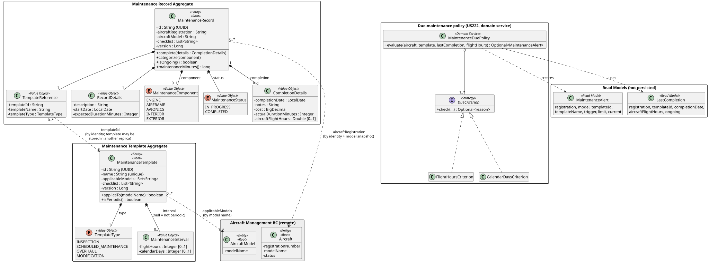
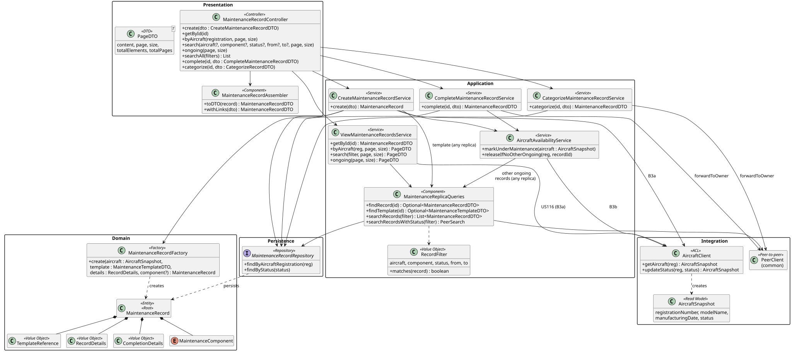
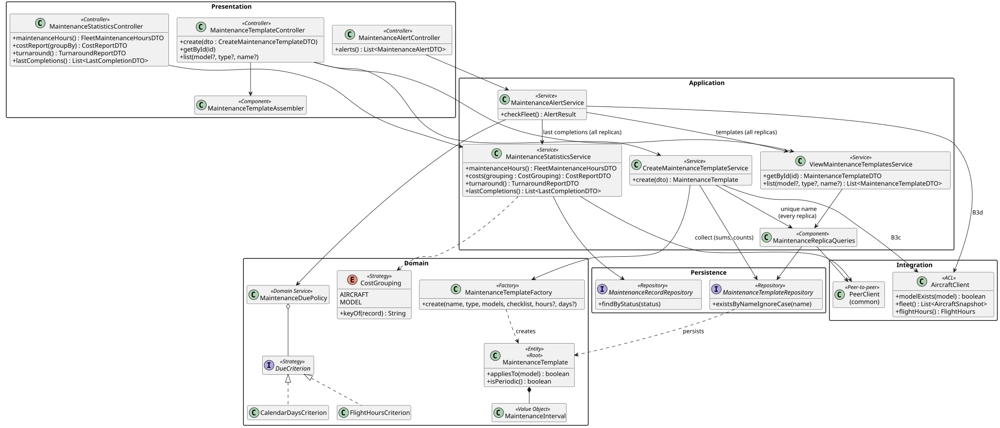

# C4 Level 4 — Maintenance Service: Code

> Zoom into the components of [L3](../../3-components/maintenance/Maintenance-Components.md): the significant classes, their relationships and the design patterns. Class names link to the source code.
> Source root: [code/maintenance/src/main/java/isep/psoft/aisafe](../../../code/maintenance/src/main/java/isep/psoft/aisafe)

## 1. Domain model

### Aggregates

| Aggregate | Root | Value Objects | Invariants protected by the root |
|---|---|---|---|
| Maintenance Template | [`MaintenanceTemplate`](../../../code/maintenance/src/main/java/isep/psoft/aisafe/maintenance/domain/MaintenanceTemplate.java) | `TemplateType`, `MaintenanceInterval` | Required name and type; at least one applicable aircraft model and one checklist item (blank items rejected); interval values positive, at least one of them when an interval is given |
| Maintenance Record | [`MaintenanceRecord`](../../../code/maintenance/src/main/java/isep/psoft/aisafe/maintenance/domain/MaintenanceRecord.java) | [`TemplateReference`](../../../code/maintenance/src/main/java/isep/psoft/aisafe/maintenance/domain/TemplateReference.java), `RecordDetails`, `MaintenanceComponent`, `MaintenanceStatus`, `CompletionDetails` | Required aircraft, template and details; start date not in the future; expected duration positive; created `IN_PROGRESS`; `IN_PROGRESS → COMPLETED` only once; completion date not before the start date nor in the future; cost ≥ 0; actual duration > 0; a completed record cannot be re-categorised |

- **Glossary alignment with PSOFT.** "Maintenance type (according to a maintenance template)" of US115 is the `TemplateReference`; "aircraft type" of US221 is the aircraft model (PSOFT forum, conversation 009); the "fleet" is every aircraft managed in AISafe (conversation 010).
- **`MaintenanceRecord` → `MaintenanceTemplate` by identity.** The template may be stored in another replica, so a JPA association is impossible. `TemplateReference` keeps the `templateId` and a snapshot of the name and type; the **checklist is copied** into the record when it is created (US115: "its checklist, defined by the maintenance template"), so the record keeps the checklist it was performed with even if templates evolve.
- **`MaintenanceRecord` → Aircraft by identity + model snapshot.** The record stores `aircraftRegistration` and the `aircraftModel` returned by B3a at creation time. US220 (cost per model) and US221 (turnaround per model) are then computed **locally in each replica**, without calling Aircraft Management once per record and without a cross-service JOIN (the PSOFT monolith joined `MaintenanceRecord` with `Aircraft` in JPQL, which is impossible after the decomposition).
- **`MaintenanceTemplate` → AircraftModel by model name** (`applicableModels`), validated in Aircraft Management at creation (B3c).
- **`MaintenanceInterval` lives in the template** (conversation 016): `flightHours` and/or `calendarDays`. A template without interval (e.g. a one-off `MODIFICATION`) is not periodic and never raises alerts.
- **Status is explicit** (`IN_PROGRESS`, `COMPLETED`) instead of PSOFT's "completion notes are null", which makes US218 (`status` filter) and US219 (ongoing) simple queries.
- **Turnaround time (US221)** is the `actualDurationMinutes` recorded at completion (the time the aircraft was out of service for that maintenance). US117 uses the actual duration of completed records and the expected duration of ongoing ones (`maintenanceMinutes()`).
- Both roots have `@Version` (optimistic locking). A record is only written by its owner replica (section 5), so `@Version` is enough to detect concurrent updates of the same record (`409`).
- **Read models** (not persisted): `LastCompletion` (latest completion of a template on an aircraft, plus whether one is ongoing) and `MaintenanceAlert` (US222). Statistics DTOs carry **sums and counts**, never averages, so they can be added across replicas.
- **Due-maintenance policy (US222)** — [`MaintenanceDuePolicy`](../../../code/maintenance/src/main/java/isep/psoft/aisafe/maintenance/domain/MaintenanceDuePolicy.java) is a domain service that applies a list of `DueCriterion` strategies:
  - `FlightHoursCriterion`: flight hours since the last completion = current hours (B3d) − `aircraftFlightHours` recorded at that completion; if the technician did not record them, or the template was never performed on the aircraft, all current hours count (safety-first: alert earlier rather than later). Due when ≥ `interval.flightHours`.
  - `CalendarDaysCriterion`: days since the last completion, or since the aircraft's manufacturing date if never performed. Due when ≥ `interval.calendarDays`.
  - An aircraft is checked against every periodic template that applies to its model; `INACTIVE` aircraft and template/aircraft pairs with an ongoing record are skipped.

## 2. Class diagrams

**Maintenance records (US115 records, US116, US119, US217, US218, US219)**

**Templates, statistics and alerts (US115 templates, US117, US220, US221, US222)**

## 3. Design rationale (responsibility assignment)

**Create maintenance template (US115 — templates)**

| Question: which class is responsible for... | Answer | Justification (patterns) |
|---|---|---|
| ...receiving the HTTP request? | `MaintenanceTemplateController` | **Controller (REST)** |
| ...coordinating the use case and the transaction? | `CreateMaintenanceTemplateService` | **Application Service** |
| ...checking that the applicable models exist? | `AircraftClient.modelExists` (B3c) | **Anti-Corruption Layer / Indirection** |
| ...checking that the name is unique? | `MaintenanceTemplateRepository` + `MaintenanceReplicaQueries` | **Repository** (local) + peer query (other replicas, best-effort) |
| ...parsing the type and building a valid aggregate? | `MaintenanceTemplateFactory` | **Factory / Creator** |
| ...persisting it? | `MaintenanceTemplateRepository` | **Repository** — stored in the replica that received the request |

**Create maintenance record (US115 — records)**

| Question | Answer | Justification |
|---|---|---|
| ...knowing that the aircraft exists and its model? | `AircraftClient.getAircraft` → `AircraftSnapshot` (B3a) | **ACL** |
| ...finding the template in any replica? | `MaintenanceReplicaQueries.findTemplate` → `PeerClient.findFirst` | **Pure Fabrication** |
| ...knowing whether the template applies to the model? | `MaintenanceTemplateDTO.appliesTo` / `MaintenanceTemplate.appliesTo` | **Information Expert** |
| ...copying the checklist and the template snapshot into a new record? | `MaintenanceRecordFactory` | **Factory / Creator** |
| ...validating the details (start date, duration, component)? | `RecordDetails`, `MaintenanceComponent.parse` | **Value Objects** (self-validating) |
| ...putting the aircraft `UNDER_MAINTENANCE`? | `AircraftAvailabilityService` → `AircraftClient.updateStatus` (B3b) | **Pure Fabrication** — keeps the cross-service protocol (ordering + compensation) out of the use-case services |
| ...building the response with links? | `MaintenanceRecordAssembler` | **DTO / Assembler** (HATEOAS) |

**Complete a record (US119) / categorise a record (US217)**

| Question | Answer | Justification |
|---|---|---|
| ...sending the command to the replica that stores the record? | `PeerClient.forwardToOwner` | **Indirection** — a record has a single owner |
| ...validating the transition and the completion data? | `MaintenanceRecord.complete` / `categorize`, `CompletionDetails` | **Information Expert / Aggregate Root** |
| ...detecting concurrent updates? | `@Version` | **Optimistic Locking** |
| ...releasing the aircraft to `AVAILABLE`? | `AircraftAvailabilityService.releaseIfNoOtherOngoing` | **Pure Fabrication** — releases only if no other record of the aircraft is ongoing in **any** replica |

**Queries and statistics (US116–US117, US218–US221)**

| Question | Answer | Justification |
|---|---|---|
| ...combining the records of every replica? | `MaintenanceReplicaQueries.searchRecords` | **Pure Fabrication** — local + peers, merged by id |
| ...filtering by aircraft, component, status, date range? | `RecordFilter` | **Value Object** — the same filter is applied locally and sent to the peers as query parameters |
| ...cutting the page? | `Pages` → `PageDTO` | after merging all replicas (a page of one replica is meaningless) |
| ...grouping costs by aircraft or by model? | `CostGrouping` | **Strategy** (enum) / **Protected Variation** — a new grouping is a new constant |
| ...adding partial results? | `MaintenanceStatisticsService` | every replica returns sums/counts of its own records (`PeerClient.collect`); averages computed after the sum |

**Maintenance alerts (US222)**

| Question | Answer | Justification |
|---|---|---|
| ...triggering the check? | `MaintenanceAlertController` (`GET /api/maintenance-alerts`) | **Controller** — manual trigger (conversation 016); a safe, idempotent GET |
| ...obtaining the fleet and the flight hours? | `AircraftClient.fleet` / `flightHours` (B3d) | **ACL** — pages of Aircraft Management read until the end |
| ...obtaining templates and last completions of every replica? | `ViewMaintenanceTemplatesService.list`, `MaintenanceStatisticsService.lastCompletions` | Replica queries; merge by template id / keep the latest completion |
| ...deciding whether maintenance is due? | `MaintenanceDuePolicy` with `DueCriterion` strategies | **Domain Service + Strategy (OCP)** — a new criterion (e.g. cycles) is a new class |

## 4. Package organization

| Package | Layer / L3 component | DDD role |
|---|---|---|
| `maintenance.controllers`, `dto`, `assemblers` | Controllers | Published Language (API contract separate from the domain) |
| `maintenance.services` | Application services, Replica queries, Aircraft availability coordinator | Application Services |
| `maintenance.domain`, `domain.alerts`, `factories` | Domain model | Entities, Value Objects, Aggregates, Read Models, Domain Service, Factories |
| `maintenance.repositories` | Repositories | One repository per Aggregate Root (local data) |
| `maintenance.clients` | Anti-Corruption Layer | ACL (`AircraftClient`, `AircraftSnapshot`) |
| `maintenance.bootstrap` | Reference / demo data | WP#0A templates; profile `demo` |
| `infrastructure`, `exceptions` | Security & config | Security rules, OpenAPI, error mapping |

## 5. Implementation notes

- **Ownership.** A replica owns a record/template iff it is in its local database. `GET` by id: local, else `PeerClient.findFirst`. `PATCH`: local, else `PeerClient.forwardToOwner` (a `404` from a peer means "not mine"; a business `4xx` from the owner is propagated with its status).
- **Ordering with Aircraft Management (B3b).** Inside the local transaction the record is first written and **flushed** (all local validation, constraints and the `@Version` check have passed), then B3b is called, then the transaction commits:
  - B3b fails (`404`/`409`/`503`) → the exception rolls the transaction back → no record and no status change; the client gets the remote status.
  - B3b succeeds but the commit fails afterwards → a `TransactionSynchronization` (`afterCompletion`, rolled back) sends a **compensating PATCH** with the status the aircraft had before (US115) or `UNDER_MAINTENANCE` again (US119).
  - Setting a status to a fixed value is idempotent, so retries of B3b by `ReplicatedServiceClient` are safe.
- **Release only when nothing else is ongoing (US119).** An aircraft may have several records in progress at the same time (e.g. engine and avionics). `AircraftAvailabilityService` asks every replica for other `IN_PROGRESS` records of the aircraft; it sets `AVAILABLE` only if there are none **and every peer answered**. With a peer down it keeps the aircraft `UNDER_MAINTENANCE` (safe side) and logs a warning; the ATCC can change the status with US105.
- **Reference templates (WP#0A).** `ReferenceTemplatesBootstrap` creates the standard templates in **every** replica with ids derived from the name (`UUID.nameUUIDFromBytes`), so the three copies are the same template: merging by id removes the duplicates and any replica can serve it locally. Templates have no update use case, so the copies never diverge.
- **Peer statistics without double counting.** `/statistics/hours`, `/reports/costs` and `/reports/turnaround` return, for a peer request, the local partial result; the entry replica adds the partial results of all replicas (`totalMinutes`, `totalCost`, `completedRecords`) and only then computes hours and averages.
- **Tolerant reader.** DTOs exchanged between replicas use `@JsonIgnoreProperties(ignoreUnknown = true)`; HATEOAS links of records received from peers are rebuilt to point to the entry replica (`MaintenanceRecordAssembler.withLinks`).
- **Pagination after merging.** `Pages.of` sorts (most recent start date first) and cuts the page after merging; `size` 1–100, default 20 (same `PageDTO` format as Aircraft Management).
- **Validation.** Bean Validation on every input DTO; enums parsed case-insensitively with a `400` that lists the allowed values; registration numbers are trimmed and upper-cased before calling B3a.

## 6. Configuration files

| File | Content |
|---|---|
| [`application.properties`](../../../code/maintenance/src/main/resources/application.properties) | Defaults (= replica 1), Aircraft Management URLs, resilience, security, logging, actuator |
| `application-instance1/2/3.properties` | Port, instance id, database and peers of each replica |
| `application-demo.properties` / `application-tls.properties` | Demo records per replica / HTTPS |

## 7. Code-level observations

- Alerts are computed on demand and not stored (conversation 016: manual trigger). Storing them would require deciding which replica owns an alert and de-duplicating alerts raised by several replicas.
- Cross-replica uniqueness of template names is best-effort (AP, [L2 §3.3](../../2-containers/Containers.md#33-consistency-model-cap)).
- US226 (parts inventory) is a bonus use case of the whole team and is not implemented.
