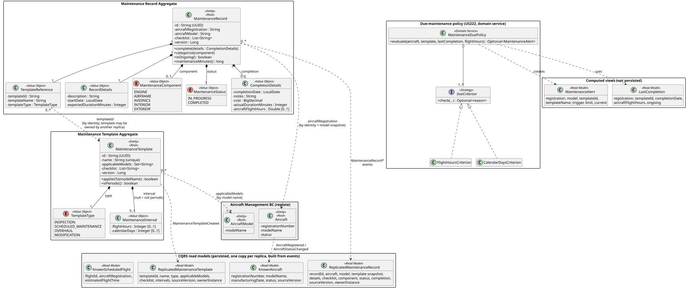
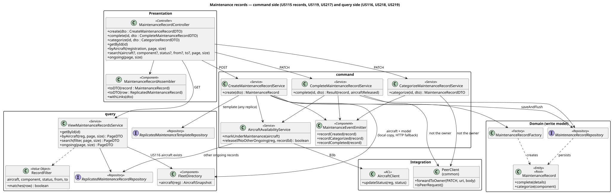
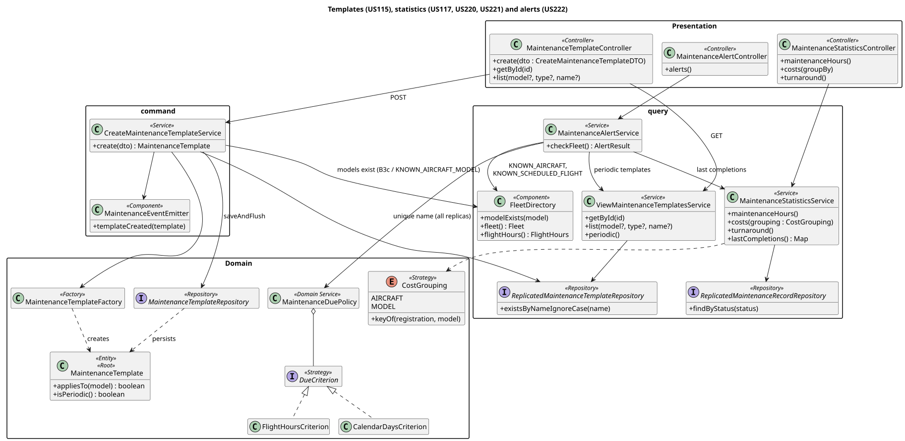
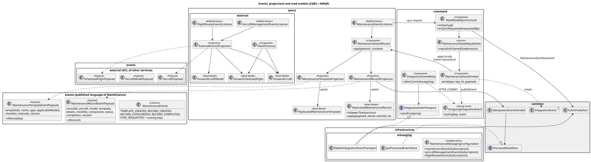

# C4 Level 4 — Maintenance Service: Code

> Zoom into the components of [L3](../../3-components/maintenance/Maintenance-Components.md): the significant classes, their relationships and the design patterns. Class names link to the source code.
> Source root: [code/maintenance/src/main/java/isep/psoft/aisafe](../../../code/maintenance/src/main/java/isep/psoft/aisafe)

## 1. Domain model

### Aggregates

| Aggregate | Root | Value Objects | Invariants protected by the root |
|---|---|---|---|
| Maintenance Template | [`MaintenanceTemplate`](../../../code/maintenance/src/main/java/isep/psoft/aisafe/maintenance/domain/MaintenanceTemplate.java) | `TemplateType`, `MaintenanceInterval` | Required name and type; at least one applicable aircraft model and one checklist item (blank items rejected); interval values positive, at least one of them when an interval is given |
| Maintenance Record | [`MaintenanceRecord`](../../../code/maintenance/src/main/java/isep/psoft/aisafe/maintenance/domain/MaintenanceRecord.java) | [`TemplateReference`](../../../code/maintenance/src/main/java/isep/psoft/aisafe/maintenance/domain/TemplateReference.java), `RecordDetails`, `MaintenanceComponent`, `MaintenanceStatus`, `CompletionDetails` | Required aircraft, template and details; start date not in the future; expected duration positive; created `IN_PROGRESS`; `IN_PROGRESS → COMPLETED` only once; completion date not before the start date nor in the future; cost ≥ 0; actual duration > 0; a completed record cannot be re-categorised |

- **Glossary alignment with PSOFT.** "Maintenance type (according to a maintenance template)" of US115 is the `TemplateReference`; "aircraft type" of US221 is the aircraft model (PSOFT forum, conversation 009); the "fleet" is every aircraft managed in AISafe (conversation 010).
- **`MaintenanceRecord` → `MaintenanceTemplate` by identity.** The template may be owned by another replica, so a JPA association is impossible. `TemplateReference` keeps the `templateId` and a snapshot of the name and type; the **checklist is copied** into the record when it is created (US115: "its checklist, defined by the maintenance template"), so the record keeps the checklist it was performed with even if templates evolve.
- **`MaintenanceRecord` → Aircraft by identity + model snapshot.** The record stores `aircraftRegistration` and the `aircraftModel` known at creation time. US220 (cost per model) and US221 (turnaround per model) are then computed from the read model alone, without a cross-service JOIN (the PSOFT monolith joined `MaintenanceRecord` with `Aircraft` in JPQL, which is impossible after the decomposition).
- **`MaintenanceTemplate` → AircraftModel by model name** (`applicableModels`), validated at creation against `KNOWN_AIRCRAFT_MODEL` (Aircraft Management events), with B3c as fallback.
- **`MaintenanceInterval` lives in the template** (conversation 016): `flightHours` and/or `calendarDays`. A template without interval (e.g. a one-off `MODIFICATION`) is not periodic and never raises alerts.
- **Status is explicit** (`IN_PROGRESS`, `COMPLETED`) instead of PSOFT's "completion notes are null", which makes US218 (`status` filter) and US219 (ongoing) simple queries.
- **Turnaround time (US221)** is the `actualDurationMinutes` recorded at completion. US117 uses the actual duration of completed records and the expected duration of ongoing ones (`maintenanceMinutes()`).
- Both roots have `@Version` (optimistic locking). A record is only written by its owner replica, so `@Version` detects concurrent updates of the same record (`409`); the version also travels in every event, so consumers can ignore stale events.
- **Write model vs read models (CQRS).** The aggregates above are the **write model**: each replica stores only the templates and records it owns. Every replica also keeps **read models** built from events: `ReplicatedMaintenanceTemplate` and `ReplicatedMaintenanceRecord` (data of all replicas, flat, with `sourceVersion` and `ownerInstance`), `KnownAircraft`, `KnownAircraftModel` and `KnownScheduledFlight` (copies of the data of other services). Read models have no behaviour other than "apply an event" and simple predicates (`isOngoing`, `appliesTo`); the business rules stay in the aggregates.
- **Computed views** (not persisted): `LastCompletion` (latest completion of a template on an aircraft, plus whether one is ongoing) and `MaintenanceAlert` (US222).
- **Due-maintenance policy (US222)** — [`MaintenanceDuePolicy`](../../../code/maintenance/src/main/java/isep/psoft/aisafe/maintenance/domain/MaintenanceDuePolicy.java) is a domain service that applies a list of `DueCriterion` strategies:
  - `FlightHoursCriterion`: flight hours since the last completion = current hours − `aircraftFlightHours` recorded at that completion; if the technician did not record them, or the template was never performed on the aircraft, all current hours count (safety-first). Due when ≥ `interval.flightHours`. Current hours = minutes of the aircraft's scheduled flights in `KNOWN_SCHEDULED_FLIGHT` / 60.
  - `CalendarDaysCriterion`: days since the last completion, or since the aircraft's manufacturing date if never performed. Due when ≥ `interval.calendarDays`.
  - An aircraft is checked against every periodic template that applies to its model; `INACTIVE` aircraft and template/aircraft pairs with an ongoing record are skipped.

## 2. Class diagrams

**Maintenance records (US115 records, US116, US119, US217, US218, US219)**

**Templates, statistics and alerts (US115 templates, US117, US220, US221, US222)**

**Events, projections and read models (CQRS + AMQP)**

## 3. Design rationale (responsibility assignment)

**Create maintenance template (US115 — templates, command)**

| Question: which class is responsible for... | Answer | Justification (patterns) |
|---|---|---|
| ...receiving the HTTP request? | `MaintenanceTemplateController` | **Controller (REST)** |
| ...coordinating the use case and the transaction? | `CreateMaintenanceTemplateService` (`command`) | **Application Service** (command side of CQRS) |
| ...checking that the applicable models exist? | `FleetDirectory.modelExists` (`KNOWN_AIRCRAFT_MODEL`, B3c fallback) | **Indirection / ACL** |
| ...checking that the name is unique? | write model + `ReplicatedMaintenanceTemplateRepository` | **Repository** — the read model has the templates of every replica (best-effort inside the consistency window) |
| ...parsing the type and building a valid aggregate? | `MaintenanceTemplateFactory` | **Factory / Creator** |
| ...announcing the change? | `MaintenanceEventEmitter.templateCreated` | **Pure Fabrication** — one event, applied locally and published after the commit |

**Create maintenance record (US115 — records, command)**

| Question | Answer | Justification |
|---|---|---|
| ...knowing that the aircraft exists and its model? | `FleetDirectory.aircraft` → `AircraftSnapshot` (`KNOWN_AIRCRAFT`, B3a fallback) | **ACL + local copy** (no HTTP when the aircraft is already known) |
| ...finding the template of any replica? | `ReplicatedMaintenanceTemplateRepository.findById` | **Read model** — no peer call |
| ...knowing whether the template applies to the model? | `ReplicatedMaintenanceTemplate.appliesTo` | **Information Expert** |
| ...copying the checklist and the template snapshot into a new record? | `MaintenanceRecordFactory` | **Factory / Creator** |
| ...putting the aircraft `UNDER_MAINTENANCE`? | `AircraftAvailabilityService` → `AircraftClient.updateStatus` (B3b) | **Pure Fabrication** — keeps the cross-service protocol (ordering + compensation) out of the use case |
| ...announcing the record? | `MaintenanceEventEmitter.recordCreated` | after B3b succeeded, inside the transaction; published after the commit |

**Complete a record (US119) / categorise a record (US217) (commands)**

| Question | Answer | Justification |
|---|---|---|
| ...sending the command to the replica that owns the record? | `PeerClient.forwardToOwner` | **Indirection** — single writer per record |
| ...validating the transition and the completion data? | `MaintenanceRecord.complete` / `categorize`, `CompletionDetails` | **Information Expert / Aggregate Root** |
| ...detecting concurrent updates? | `@Version` | **Optimistic Locking** |
| ...releasing the aircraft to `AVAILABLE`? | `AircraftAvailabilityService.releaseIfNoOtherOngoing` | **Pure Fabrication** — no other ongoing record of the aircraft in the **read model** (records of every replica) |

**Queries, statistics and alerts (query side)**

| Question | Answer | Justification |
|---|---|---|
| ...answering any GET? | `query/*Service` on `Replicated*Repository` / `Known*Repository` | **CQRS query side** — local tables only |
| ...filtering by aircraft, component, status, date range? | `RecordFilter` | **Value Object** |
| ...cutting the page? | `PageDTO.of` | sorted (most recent first), `size` 1–100 |
| ...grouping costs by aircraft or by model? | `CostGrouping` | **Strategy** (enum) / **Protected Variation** |
| ...the fleet and the flight hours of US222? | `FleetDirectory.fleet` / `flightHours` | **Indirection** — local copies, HTTP only to seed the fleet once or while no flight event was received |
| ...deciding whether maintenance is due? | `MaintenanceDuePolicy` with `DueCriterion` strategies | **Domain Service + Strategy (OCP)** |

**Events and read models**

| Question | Answer | Justification |
|---|---|---|
| ...building one event and applying it locally before publishing? | `MaintenanceEventEmitter` | **Pure Fabrication**; read-your-writes on the owner; the same `eventId` is skipped when the broker delivers it back |
| ...publishing only committed changes? | `IntegrationEventRelay` (`@TransactionalEventListener(AFTER_COMMIT)`) | a rolled-back change is never announced |
| ...routing an incoming event to the right projection? | `MaintenanceEventRouter` | **Indirection** — one queue carries several payload types (JSON tree converted by `eventType`) |
| ...updating a read model exactly once? | `MaintenanceRecordProjection` / `MaintenanceTemplateProjection` / `ExternalEventsProjection` + `IdempotentEventHandler` + `JpaProcessedEventStore` | **Idempotent consumer**; the change and the processed id commit together; older `version` ignored |
| ...translating the events of other services? | records in `events.external` (`AircraftPayload`, `ScheduledFlightPayload`, ...) | **Anti-Corruption Layer / tolerant reader** — only the fields Maintenance needs |
| ...filling a late or new replica? | `ReadModelSynchronizer` + `MaintenanceStateRepublisher` | republish owned state on start + `MaintenanceSyncRequested` |

## 4. Package organization

| Package | Layer / L3 component | DDD / CQRS role |
|---|---|---|
| `maintenance.controllers`, `dto`, `assemblers` | Controllers | Published Language (API contract separate from the domain) |
| `maintenance.command` | Command services, event emitter/relay, availability coordinator, startup sync | Application Services (write side) |
| `maintenance.query` | Query services, projections, read models | Read side |
| `maintenance.query.external` | External read models, fleet directory | Local copies of other bounded contexts |
| `maintenance.events`, `events.external` | Event contracts | Published Language (own events) / ACL (others' events) |
| `maintenance.domain`, `domain.alerts`, `factories` | Domain model | Entities, Value Objects, Aggregates, Domain Service, Factories |
| `maintenance.repositories` | Write model repositories | One repository per Aggregate Root (rows owned by this replica) |
| `maintenance.clients` | Anti-Corruption Layer | `AircraftClient`, `AircraftSnapshot` |
| `maintenance.bootstrap` | Reference / demo data | WP#0A templates; profile `demo` |
| `infrastructure.messaging`, `infrastructure.security`, `infrastructure.config`, `exceptions` | Infrastructure | Broker topology, transport, processed events, security rules, OpenAPI, error mapping |

## 5. Implementation notes

- **Ownership.** A replica owns a record/template iff it is in its write model. `GET` never needs the owner (read model). `PATCH` on a record of another replica is forwarded with `PeerClient.forwardToOwner` (a `404` from a peer means "not mine"; a business `4xx` from the owner is propagated); if the owner is down, `503`.
- **Taking the aircraft out of service (US115, B3b).** Inside the local transaction the record is written and **flushed**, then B3b is called, then the event is emitted (local read model updated), then the transaction commits and the relay publishes the event:
  - B3b fails (`404`/`409`/`503`) → rollback → no record, no read-model row, no event.
  - B3b succeeds but the commit fails afterwards → a `TransactionSynchronization` sends a **compensating PATCH** with the previous status; the event is not published (AFTER_COMMIT).
  - Aircraft Management publishes `AircraftStatusChanged`, which comes back to Maintenance (`KNOWN_AIRCRAFT`) and updates its own `AIRCRAFT_MOOD` (`/api/v2/unicorns`).
- **Returning the aircraft to service (US119).** The owner commits the completion and publishes `MaintenanceRecordCompleted`. The replica that received the client request (the owner itself, or the replica that forwarded the command) then checks its read model for other `IN_PROGRESS` records of the aircraft and, if there are none, calls B3b `AVAILABLE`. If another record is ongoing or Aircraft Management fails, the aircraft stays `UNDER_MAINTENANCE` (safe side) and `X-Aircraft-Released: false`.
- **Read-your-writes.** The response of a command is built from the owner's write model; a GET on the owner right after a command already sees the change (same transaction). On other replicas the change appears when the event arrives (milliseconds).
- **Reference templates (WP#0A).** Created in **every** replica with ids derived from the name (`UUID.nameUUIDFromBytes`) and announced as events; the identical copies converge to one read-model row.
- **Demo data.** Inserted once per replica (file database) and announced as events; the startup synchronisation re-announces it on later starts.
- **Tolerant reader.** Payload records ignore unknown fields (`@JsonIgnoreProperties(ignoreUnknown = true)` on the external payloads; Jackson configuration of `common`). Unknown event types are logged and ignored.
- **Validation.** Bean Validation on every input DTO; enums parsed case-insensitively with a `400` that lists the allowed values; registration numbers are trimmed and upper-cased.

## 6. Configuration files

| File | Content |
|---|---|
| [`application.properties`](../../../code/maintenance/src/main/resources/application.properties) | Defaults (= replica 1): file database, peers (forwarded commands), Aircraft Management URLs (B3b + fallback), resilience, security, **RabbitMQ and messaging retry**, liveness/readiness groups, logging |
| `application-instance1/2/3.properties` | Port, instance id, database file `./data/maintenancedb-N` and peers of each replica; demo records |
| `application-demo.properties` / `application-tls.properties` | Demo records on / HTTPS |
| `src/test/resources/config/application.properties` | Tests: messaging off, in-memory database |

## 7. Code-level observations

- Alerts are computed on demand and not stored (conversation 016: manual trigger), now on local copies only.
- Cross-replica uniqueness of template names is checked on the read model and is best-effort inside the consistency window (AP, [L2 §3.3](../../2-containers/Containers.md#33-consistency-model-cap)).
- The Assignment 1 classes `MaintenanceReplicaQueries` (peer aggregation) and the peer-only endpoints `/search` and `/statistics/last-completions` were removed: with read models no replica needs the data of another over HTTP.
- US226 (parts inventory) is a bonus use case of the whole team and is not implemented.
