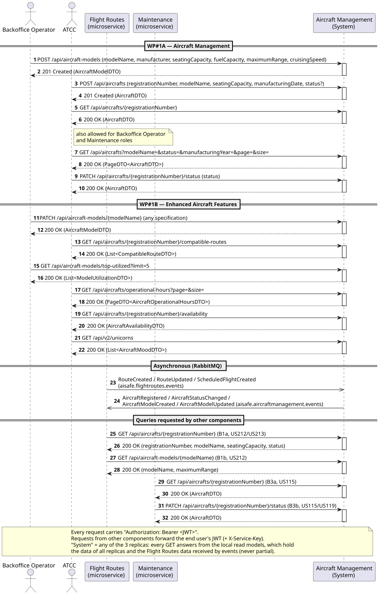
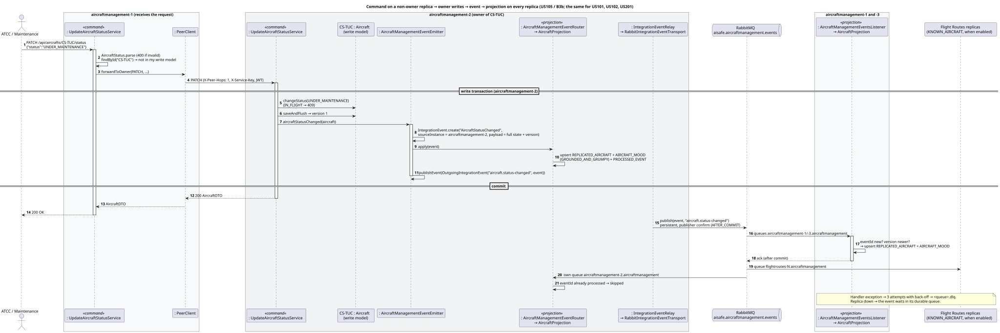
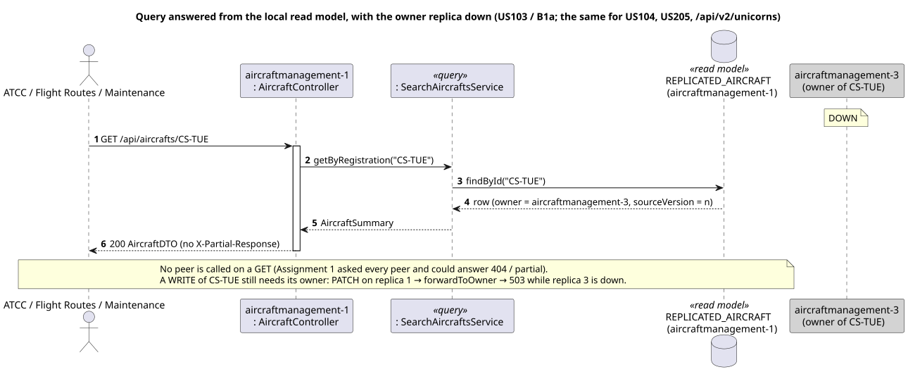
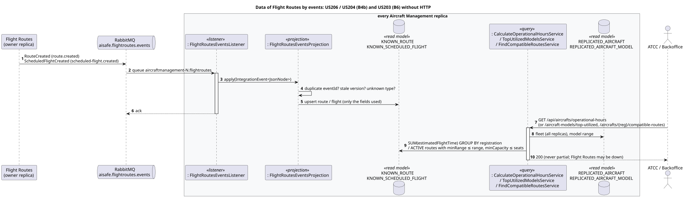
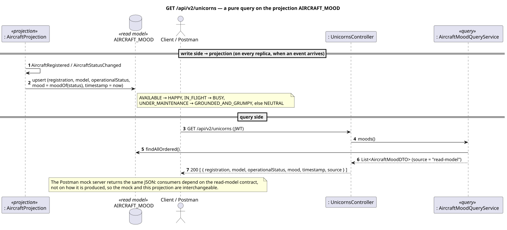
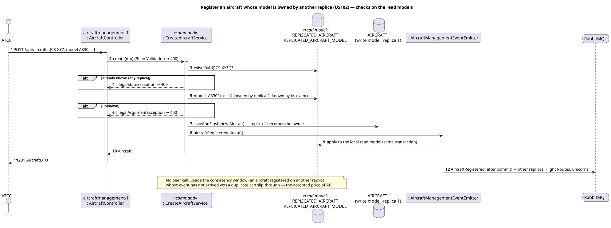
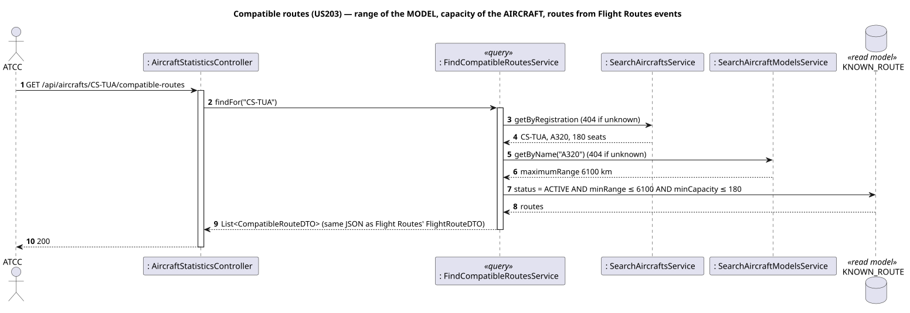

# C4+1 — Aircraft Management Service: Scenarios

> The "+1" view: real use cases and end-to-end behaviour across containers and components. Each scenario validates [L2](../../2-containers/Containers.md), [L3](../../3-components/aircraftmanagement/AircraftManagement-Components.md) and [L4](../../4-code/aircraftmanagement/AircraftManagement-Code.md). Reference: [Flight Routes — Scenarios](../flightroutes/FlightRoutes-Scenarios.md).

## 1. User stories

| WP | US | Description | Actor | Status |
|---|---|---|---|---|
| 1A | US101 | Register an aircraft model (manufacturer, model name, seating capacity, fuel capacity, maximum range, cruising speed) | Backoffice Operator | Implemented |
| 1A | US102 | Register an aircraft (registration number, model, manufacturing date, status) | ATCC | Implemented |
| 1A | US103 | View an aircraft's details given its registration number | Backoffice Operator, ATCC | Implemented |
| 1A | US104 | Search aircraft by model, status or manufacturing year | ATCC | Implemented |
| 1A | US105 | Update an aircraft's operational status | ATCC | Implemented |
| 1B | US201 | Update an aircraft model's specifications | Backoffice Operator | Implemented (A2: publishes `AircraftModelUpdated`) |
| 1B | US202 | Register an aircraft model with an optional image or technical diagram | Backoffice Operator | Planned |
| 1B | US203 | View the routes compatible with an aircraft (range of the model, capacity of the aircraft) | ATCC | Implemented |
| 1B | US204 | Top 5 most utilised aircraft models | Backoffice Operator | Implemented |
| 1B | US205 | Real-time aircraft availability status (available, in-flight, under maintenance, inactive) | ATCC | Implemented (read model) |
| 1B | US206 | Total operational hours of each aircraft of the fleet | ATCC | Implemented |
| A2 | — | `GET /api/v2/unicorns`: mood of every aircraft (SIDIS Assignment 2) | any role | Implemented (projection `AIRCRAFT_MOOD`) |
| Bonus | US223, US224 | Utilisation graphs; search by features (Wi-Fi, engine type) | ATCC | Planned |

**Supplied to other containers** (the consumers depend on them): **US103** is contract **B1a** and **US101/US103** give **B1b** (Flight Routes, US212/US213); **US103** is also **B3a** and **US105** is **B3b** (Maintenance, US115/US119). See [Integration-Contracts §4](../../2-containers/Integration-Contracts.md#4-bridges).

### Decisions on open points

- **Statuses (Integration-Contracts Q1):** `AVAILABLE`, `IN_FLIGHT`, `UNDER_MAINTENANCE`, `INACTIVE`. Only `AVAILABLE` lets Flight Routes schedule flights, so Maintenance returns an aircraft to `AVAILABLE` (not `ACTIVE`).
- **Status transitions (Q7, proposal):** an `IN_FLIGHT` aircraft cannot go to `UNDER_MAINTENANCE` or `INACTIVE` (`409`); every other change is accepted. Optimistic locking (`@Version`) protects concurrent updates in the owner replica; the client does not send a version.
- **Units (Q9):** `maximumRange` in **km**, the same unit as the route distances computed by Flight Routes.
- **Registration format (Q10, proposal):** `PREFIX-SUFFIX`, upper case, e.g. `CS-TUA` (`^[A-Z0-9]{1,2}-[A-Z0-9]{2,5}$`), checked when an aircraft is registered. To be confirmed with the customer.
- **"Most utilised" (Q5):** total **flight time** (minutes) of all the aircraft of the model, from the Flight Routes `ScheduledFlightCreated` events (Assignment 1: contract B4b). Models without flights are not ranked.
- **Pagination (Q8):** a stable `PageDTO` (`content`, `page`, `size`, `totalElements`, `totalPages`) instead of Spring's `Page`; maximum size 100.
- **Roles (Q4):** US102 → ATCC; US101 → Backoffice Operator; reads (US103/US104, B1, B3a) also for the Backoffice and Maintenance roles because the JWT of the consumer's user is forwarded; US105/B3b → ATCC and Maintenance roles; US203/US206 → ATCC; US204 → Backoffice Operator and ATCC; `/api/v2/unicorns` → any AISafe role.
- **Open question Q-AM1 (US205):** what is "in-flight"? Today `IN_FLIGHT` is only a status that can be set through US105. A real-time value would be derived from the scheduled flights of Flight Routes (a flight whose date/time interval contains *now*), which needs a new endpoint there. To be decided with the customer and the Flight Routes owner before implementing.

## 2. Acceptance criteria

**Fleet:** AC1 a model needs a non-blank name and manufacturer and strictly positive seats, fuel, range and speed (else `400`, body = field → message); AC2 a model name found in any replica that answers → `409`; AC3 an aircraft needs a registration in the agreed format, an existing model (in any replica, else `400`), positive seats and a manufacturing date that is not in the future (else `400`); AC4 a registration found in any replica that answers → `409`; AC5 an aircraft is created `AVAILABLE` unless a valid status is sent, `201`; AC6 unknown status → `400`; AC7 `IN_FLIGHT` → `UNDER_MAINTENANCE`/`INACTIVE` → `409`; AC8 concurrent updates of the same aircraft → `409`.

**Queries:** AC9 US104 filters (`modelName`, `status`, `manufacturingYear`) are optional and combinable, results sorted by registration, paginated **after** merging all replicas (`page` ≥ 0, `size` 1–100, else `400`); AC10 US203 uses the model's range and the aircraft's own capacity, only `ACTIVE` compatible routes of all Flight Routes replicas; AC11 US204 ranks models by total flight minutes (ties by model name), `limit` 1–20 (default 5), models without flights are excluded; AC12 US206 lists **every** aircraft of the fleet, with 0 hours when it has no flights.

**Distribution (Assignment 2):** AC13 any replica answers every GET from its local read models, which hold the data of all replicas; `404` only if no replica has announced the record; never `X-Partial-Response`; AC14 a replica answers reads even with its peers (and Flight Routes) down; AC15 an aircraft/model is only modified by its owner replica, a command on another replica is forwarded (`503` if the owner is down); AC16 every committed change is published once, after the commit, as a state-carrying event with the entity's `version`; AC17 consumers apply an event at most once (eventId) and ignore older versions and unknown types; a failing handler is retried and then dead-lettered; AC18 the owner reads its own write immediately, the other replicas after the event (eventual consistency); AC19 US203, US204 and US206 are computed from Flight Routes events (no HTTP call to Flight Routes); AC20 `/api/v2/unicorns` follows the mood rule of the contract and reports `source = "read-model"`; AC21 peer requests without a valid `X-Service-Key` → `401`, JWT + roles on every endpoint; AC22 the contract fields of B1a/B1b are never `null`.

## 3. System sequence diagram

"System" = any of the three replicas.

## 4. Scenarios (sequence diagrams)

### 4.1 Distributed scenarios (Assignment 2: CQRS + RabbitMQ)

**S1 — Command on a non-owner replica: forwarded to the owner, which writes, emits the event and every replica projects it (US105 / B3b; the same for US101, US102, US201)**

**S2 — Query answered from the local read model with the owner replica down (US103 / B1a; the same for US104, US205)**

**S3 — Data of Flight Routes by events (US203, US204, US206; replaces bridges B4b and B6)**

**S4 — `/api/v2/unicorns` and CQRS**

### 4.2 Use-case scenarios

**S5 — Register an aircraft whose model is owned by another replica (US102)**

**S6 — Compatible routes (US203)**

## 5. Tests

From `code/`: `./mvnw -pl aircraftmanagement -am test` (no broker needed: messaging is off in tests).

| Test class | Type | What is verified |
|---|---|---|
| `AircraftManagementApplicationTests` | Context | The service starts with the shared configuration |
| `AircraftTest`, `AircraftModelTest`, `AircraftStatusTest` | Unit (domain) | Invariants, status parsing and the transition rule |
| `command/CreateAircraftServiceTest`, `CreateAircraftModelServiceTest` | Unit (Mockito) | Uniqueness and model existence on the read models (`409`/`400`), write on this replica, one event emitted |
| `command/UpdateAircraftStatusServiceTest`, `UpdateAircraftModelServiceTest` | Unit (Mockito) | Owner write + `AircraftStatusChanged` / `AircraftModelUpdated`; same status → no event; forwarding to the owner (who publishes); `404`, `400`, `409` |
| `query/TopUtilizedModelsServiceTest`, `AircraftAvailabilityServiceTest`, `AircraftMoodTest` | Unit | US204 ranking from flight minutes, US205, the mood rule |
| `messaging/ReadModelProjectionsTest` | Integration (one real replica, events as JSON trees) | Idempotency (eventId recorded), stale versions ignored, status-only events, `AircraftModelUpdated`, unknown types, no AMQP bean with messaging off |
| **`distributed/ReplicaCollaborationTest`** | **Distributed** — two real replicas, events delivered by `support/InProcessEventBus` (JSON, one delivery per replica, like one queue per replica) | S1–S6: owners, read-your-writes, every replica sees everything, duplicates on the read model, forwarding of US105/US201 and propagated `409`, moods converge, US203/US204/US206 from Flight Routes events (with a duplicate delivery), a late replica filled by the sync request of its peers, health probes, replica failure (reads still work, owner writes → `503`) |

**Postman:** [postman/AircraftManagement.postman_collection.json](postman/AircraftManagement.postman_collection.json) + [environment](postman/AircraftManagement.postman_environment.json). Folders: 0 setup (tokens, readiness), 1–2 commands and queries (US101–US105, US201), **3 CQRS read models and owner replicas (polls until the replicas converge)**, 4 US205, **5 Flight Routes data from events**, **6 `/api/v2/unicorns`**, **7 asynchronous integration with Flight Routes and Airports (end to end)**, 8 replica failure (stop replica 3 first). Run in order with the Collection Runner or newman. The Postman mock of the unicorns contract is in [../unicorns/postman](../unicorns/postman).

## 6. Demo

From `code/` (RabbitMQ: `infra/.env`, see [docs/README.md](../../README.md#how-to-build-and-run)):

1. `./mvnw clean install`
2. `./scripts/start-all.sh 3 demo` (Windows: `.\scripts\start-all.ps1 -Profiles demo`). With the `demo` profile each replica loads different data: replica 1 — models A320, B737 and aircraft CS-TUA, CS-TUB; replica 2 — model A330 and aircraft CS-TUC, CS-TUD; replica 3 — model E190 and aircraft CS-TUE, CS-TUF. Each replica publishes its rows, so every read model ends with the 6 aircraft.
3. RabbitMQ UI <http://localhost:15672>: exchange `aisafe.aircraftmanagement.events`, queues `aircraftmanagement-N.aircraftmanagement` and `aircraftmanagement-N.flightroutes` (+ `.dlq`).
4. `POST http://localhost:8081/auth/dev-token` `{"username":"atcc1","roles":["ATCC"]}` (and `BACKOFFICE_OPERATOR`, `MAINTENANCE_TECHNICIAN`) → tokens.
5. Run the Postman collection, or by hand:
   - `GET :8081/api/aircrafts` and `:8281/api/aircrafts` → the same 6 aircraft, answered locally (no peer call in the logs).
   - `PATCH :8081/api/aircrafts/CS-TUC/status` `{"status":"UNDER_MAINTENANCE"}` → forwarded to replica 2 (owner); its log shows `Published AircraftStatusChanged`, the logs of replicas 1 and 3 show `Applied AircraftStatusChanged for aircraft CS-TUC`; `GET :8281/api/v2/unicorns` → CS-TUC `GROUNDED_AND_GRUMPY`.
   - Schedule a flight in Flight Routes (US212) → `GET :8181/api/aircrafts/operational-hours` counts it a few milliseconds later (`ScheduledFlightCreated` consumed); stop Flight Routes and the endpoint still answers.
   - Stop replica 3 → `GET :8081/api/aircrafts/CS-TUE` still `200`; `PATCH …/CS-TUE/status` → `503` (owner down).

H2 console: `http://localhost:8081/h2-console` (JDBC URL `jdbc:h2:file:./data/aircraftManagementdb-1`, from `code/`): tables `AIRCRAFT` (write model), `REPLICATED_AIRCRAFT`, `AIRCRAFT_MOOD`, `KNOWN_ROUTE`, `KNOWN_SCHEDULED_FLIGHT`, `PROCESSED_EVENT`.

## 7. Observations

- Uniqueness of registration and model name is checked on the read model: two simultaneous registrations on different replicas, inside the consistency window, can both succeed (AP, see [L2 §3.3](../../2-containers/Containers.md#33-consistency-model-cap)).
- B3b stays a synchronous command (Maintenance needs the immediate `409`); its effect reaches every consumer as `AircraftStatusChanged`.
- Flight Routes reads aircraft over HTTP (B1) until `AISAFE_EXTERNAL_EVENTS=true` is set there; Aircraft Management already publishes every event its consumer expects, plus `AircraftModelUpdated`.
- Late subscribers and events lost while the broker was down are healed by the startup synchronisation (`ReadModelSynchronizer` republishes the owned state and sends `AircraftSyncRequested`, as Airports does) (see [L3 §6](../../3-components/aircraftmanagement/AircraftManagement-Components.md#6-cqrs-flow-write--event--projection-on-every-replica-and-on-flight-routes)).
