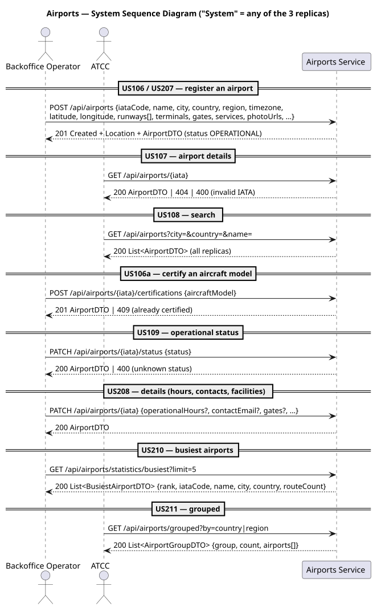
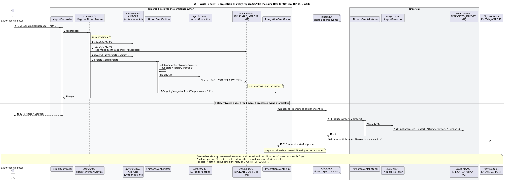
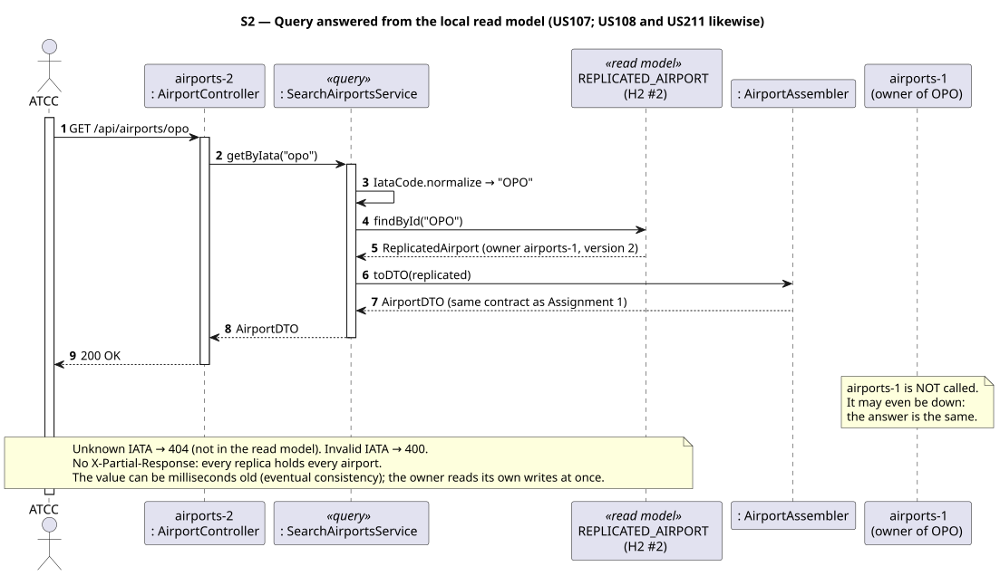
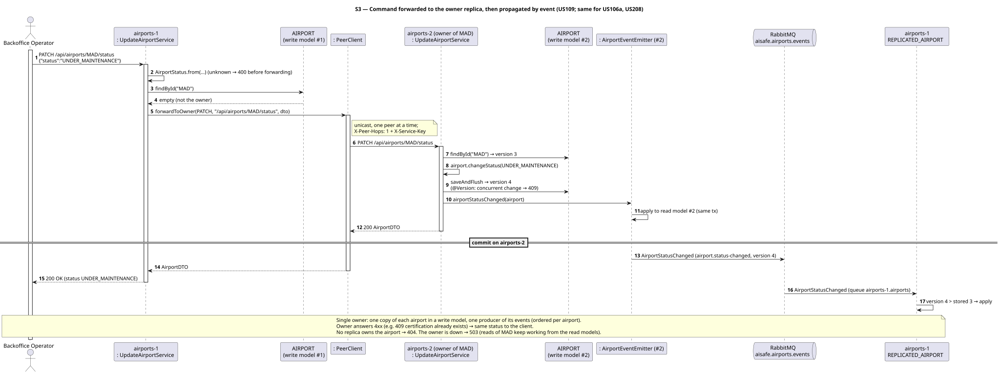
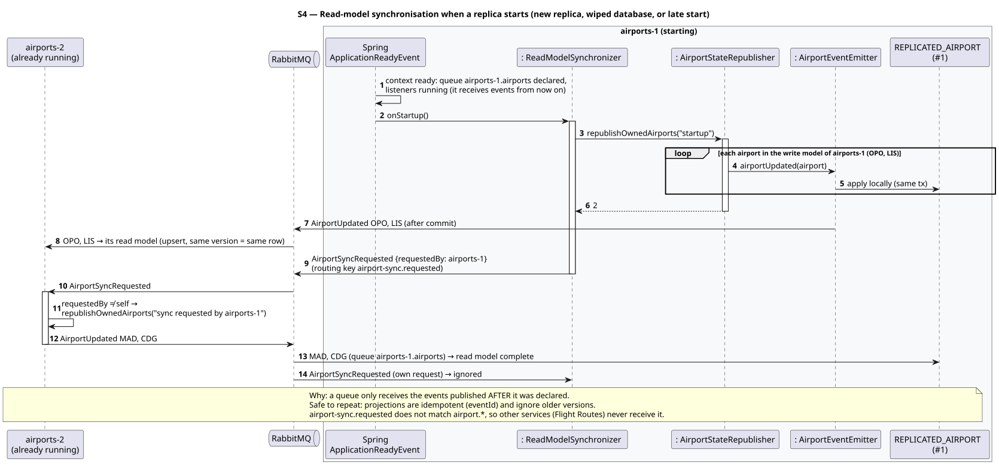
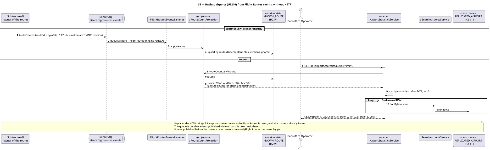

# C4+1 — Airports Service: Scenarios

> The "+1" view: real use cases and end-to-end behaviour across containers and components. Each scenario validates [L2](../../2-containers/Containers.md), [L3](../../3-components/airports/Airports-Components.md) and [L4](../../4-code/airports/Airports-Code.md).

## 1. User stories

| WP | US | Description | Actor |
|---|---|---|---|
| 2A | US106 | Register an airport with IATA code, name, city, country, timezone, coordinates and runways | Backoffice Operator |
| 2A | US106a | Add an aircraft-model certification to an airport | Backoffice Operator, ATCC |
| 2A | US107 | View an airport's details given its IATA code | Backoffice Operator, ATCC |
| 2A | US108 | Search airports by city, country or name | ATCC |
| 2A | US109 | Update an airport's operational status (operational, closed, under maintenance) | Backoffice Operator |
| 2B | US207 | Register an airport with optional photos and facilities (terminals, gates, services) | Backoffice Operator |
| 2B | US208 | Update airport details, including operational hours and contact information | Backoffice Operator |
| 2B | US210 | Statistics on the busiest airports by number of routes | Backoffice Operator |
| 2B | US211 | View airports grouped by region or country | ATCC |

**US209** (routes from/to an airport) belongs to WP#2B but is implemented by Flight Routes, which owns the routes (`GET /api/routes/by-airport/{iata}`). Supplied to other containers: **US107** is contract B2, used by Flight Routes in US110, US209, US212 and US216.

### Decisions on open points

- **Statuses (Integration-Contracts Q2):** `OPERATIONAL`, `CLOSED`, `UNDER_MAINTENANCE`, as listed in US109. Only `OPERATIONAL` lets Flight Routes schedule flights.
- **Region (US211):** an optional attribute of the airport (e.g. `Europe`), not derived from the country; airports without a region are grouped under `Unspecified`.
- **Photos (US207):** stored as URLs; file upload is out of scope.
- **Certifications (US106a, Q3):** stored by model name. They are not validated against Aircraft Management yet (that service has no implementation); Flight Routes does not read them (Q3 still open).

## 2. Acceptance criteria

**Airports:** AC1 IATA exactly 3 letters, normalised to upper case (else `400`); AC2 name, city, country, timezone (IANA), coordinates in range and at least one runway are required (else `400`); AC3 an IATA already known (write model or read model) → `409`; AC4 created `OPERATIONAL`, `201` + `Location`; AC5 unknown status → `400`; AC6 a model certified twice → `409`; AC7 US208 changes only the fields sent; AC8 concurrent changes of the same airport → `409`.

**Queries:** AC9 US108 filters are combinable and case-insensitive, results sorted by IATA; AC10 US211 groups the airports of all replicas, `by` = `country` or `region` (else `400`); AC11 US210 ranks by route count (ties by IATA), `limit` 1–100 (default 5), with the airport details joined.

**Assignment 2 (CQRS, AMQP, Database-per-Service):**

- AC12 every GET is answered from the **local read model** of the replica, with the airports of **all** replicas; no request is forwarded to a peer and there is no partial response.
- AC13 every successful command publishes **one** event on `aisafe.airports.events` (`AirportCreated`, `AirportUpdated`, `AirportStatusChanged`) with the full state and `version`, **after the commit**; a failed command publishes nothing.
- AC14 the owner reads its own write immediately; the other replicas apply the event to their read model (eventual consistency).
- AC15 an event delivered twice is applied once; an event older than the stored version is ignored; an invalid event goes to the DLQ after bounded retries.
- AC16 a replica that starts (or missed events) recovers the airports of the other replicas (startup synchronisation).
- AC17 US210 counts routes from Flight Routes' `route.*` events (no HTTP call).
- AC18 each instance has its own database; at least two instances run.
- AC19 an airport is only modified by its owner replica; if the owner is down, commands on its airports → `503`, reads keep working.
- AC20 peer requests without valid `X-Service-Key` → `401`, `X-Peer-Hops > 1` → `400`; JWT + roles on every endpoint (`401`/`403`), every request audited.

## 3. System sequence diagram

"System" = any of the replicas.

## 4. Scenarios (sequence diagrams)

**S1 — Write → event → projection on every replica (US106; the same for US106a, US109, US208)**

**S2 — Query answered from the local read model (US107; US108 and US211 likewise)**

**S3 — Command forwarded to the owner replica, then propagated by event (US109; same for US106a, US208)**

**S4 — Read-model synchronisation when a replica starts**

**S5 — Busiest airports (US210) from Flight Routes events**

## 5. Tests

From `code/`: `./mvnw -pl airports -am test` (no broker needed: messaging is off in tests; events travel through an in-process bus or are handed to the projections directly).

| Test class | Type | What is verified |
|---|---|---|
| [`AirportTest`](../../../code/airports/src/test/java/isep/psoft/aisafe/airports/domain/AirportTest.java) | Unit (domain) | IATA normalisation/format, coordinates and runway validation, required fields and IANA timezone, unique runways, created `OPERATIONAL`, duplicate certification, status changes, facilities, partial update of details |
| [`AirportsApplicationTests`](../../../code/airports/src/test/java/isep/psoft/aisafe/AirportsApplicationTests.java) | Context | The service starts with the shared configuration |
| **[`AirportCqrsTest`](../../../code/airports/src/test/java/isep/psoft/aisafe/messaging/AirportCqrsTest.java)** | **CQRS, one real replica** | projection (create, idempotency, stale versions, invalid payload, unknown type); read-your-writes and one event per command with the full state; nothing published on rollback; startup synchronisation (own request ignored); listener converts the wire format and routes by `eventType`; US210 counts from route events without double counting; no AMQP bean with messaging off |
| **[`AirportReplicaCollaborationTest`](../../../code/airports/src/test/java/isep/psoft/aisafe/distributed/AirportReplicaCollaborationTest.java)** | **Distributed** — two real replicas + [`InProcessEventBus`](../../../code/airports/src/test/java/isep/psoft/aisafe/support/InProcessEventBus.java) | scenarios below |

`AirportReplicaCollaborationTest`:

1. Each replica stores the airports it receives (`201` + `Location`).
2. GET on A of an airport registered on B → `200` from A's read model, with the B2 fields; unknown → `404`; invalid IATA → `400` (S2).
3. Search on A and on B → the same list, no partial response; filters on the read model.
4. Registering on A an IATA registered on B → `409` (detected in the read model).
5. Invalid registration → `400`.
6. Status, certification and details changed through A for an airport of B → executed by B, the event reaches both read models (S1, S3).
7. Grouping by country/region → airports of both replicas.
8. US210 from `RouteCreated` events delivered to both replicas; duplicate event not counted twice (S5).
9. Peer headers without/wrong service key → `401`; hops 2 → `400`.
10. No token → `401`; wrong role → `403`; unexpected method → `403`; health `UP`.
11. **Eventual consistency:** B disconnected from the bus misses a change made on A; after reconnecting, the next event (full state, newer version) makes it converge.
12. **Replica B stopped:** A still answers **all** airports (no partial response), including B's; a command on an airport of B → `503`.

**Postman:** [postman/Airports.postman_collection.json](postman/Airports.postman_collection.json) + [environment](postman/Airports.postman_environment.json), 2 replicas with the `demo` profile and RabbitMQ — folders: 0 setup (health incl. RabbitMQ, tokens), 1 queries on the read model, 2 command → event → read models (with a 1.5 s wait for the eventual-consistency reads), 3 US210 from Flight Routes events, 4 RabbitMQ evidence through the management API (exchange, queues with consumers and DLX, DLQ, bindings), 5 security, 6 replica failure (stop replica 2 before). The mandatory `/api/v2/unicorns` mock is shared by the group: [unicorns/postman](../unicorns/postman/UnicornsMock.postman_collection.json), explained in [Unicorns-Mock.md](../../2-containers/Unicorns-Mock.md).

## 6. Demo

From `code/` (Windows PowerShell; `.sh` equivalents exist):

1. Docker Desktop running; `copy ..\infra\.env.example ..\infra\.env` and set the RabbitMQ credentials (once).
2. `.\mvnw.cmd clean install -DskipTests` (after any code change: `.\mvnw.cmd -pl airports -am package -DskipTests`, with the replicas stopped).
3. `.\scripts\start-all.ps1 -Replicas 2 -Profiles demo` — starts RabbitMQ (docker compose) and two replicas of each service. Replica 1 loads OPO, LIS; replica 2 MAD, CDG.
4. RabbitMQ UI `http://localhost:15672`: exchange `aisafe.airports.events`; queues `airports-1.airports`, `airports-2.airports`, `airports-N.flightroutes` and their `.dlq`.
5. Logs `code/logs/airports-N.log`: `Published AirportCreated ...`, `Applied AirportUpdated for airport OPO (owner airports-1, ...)` on replica 2, `Republished the state of 2 owned airport(s) (sync requested by ...)`, `Applied RouteCreated for route ... OPO->LIS`.
6. Tokens: `POST :8083/auth/dev-token` `{"username":"atcc1","roles":["ATCC"]}` (and `["BACKOFFICE_OPERATOR"]`).
7. Run the Postman collection, or by hand:
   - `GET :8183/api/airports/OPO` → `200` from replica 2's read model (OPO belongs to replica 1).
   - `PATCH :8183/api/airports/OPO/status` `{"status":"CLOSED"}` → forwarded to replica 1; then `GET :8183/api/airports/OPO` → `CLOSED` (the event arrived).
   - `GET :8083/api/airports/statistics/busiest?limit=3` (Backoffice) → LIS 3, MAD 2, then CDG / FNC / OPO 1.
   - Stop replica 2 (`Stop-Process -Id (Get-Content logs\airports-2.pid)`) → `GET :8083/api/airports` still returns the 4 airports; `PATCH :8083/api/airports/MAD/status` → `503`.
   - Start it again (`.\scripts\run-instance.ps1` or `start-all`) → its log shows the startup synchronisation.

H2 console: `http://localhost:8083/h2-console` (JDBC URL `jdbc:h2:file:./data/airportsdb-1`): tables `AIRPORT` (write model), `REPLICATED_AIRPORT`, `KNOWN_ROUTE`, `PROCESSED_EVENT`.

## 7. Observations and alternatives

- **Consistency model:** AP with eventual consistency on reads; strong per airport on writes (single owner + `@Version`). The window is typically milliseconds; longer while a consumer is down (its events wait in its durable queue).
- **IATA uniqueness is best-effort:** the check runs on the read model, so two registrations of the same IATA on different replicas inside the window (or during a partition) can both succeed. Alternative: deterministic ownership (hash of the IATA → replica, the command is routed there), at the cost of write availability when that replica is down.
- **No transactional outbox:** if the broker is down when the relay publishes, the change is committed but the event is lost for the other replicas (logged). Alternative: an outbox table written in the same transaction and a relay that retries; here the next change of the airport, or the next startup synchronisation, carries the full state again.
- **Flight Routes has no replay:** routes published before `airports-N.flightroutes` existed are not received. A sync request like `airport-sync.requested` on Flight Routes would remove this.
- **Alternatives to one queue per instance:** competing consumers (one queue shared by the replicas) would deliver each event to only one replica, which does not work for replicated read models; Kafka (a log with offsets) would allow replays from the start instead of the synchronisation protocol.
- Certifications are not validated against Aircraft Management; it could consume `AircraftModelCreated` events to keep a local list of models.
