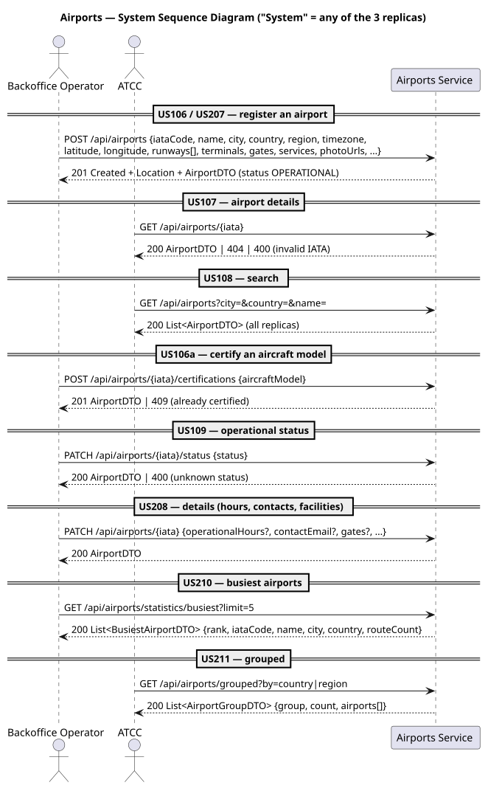
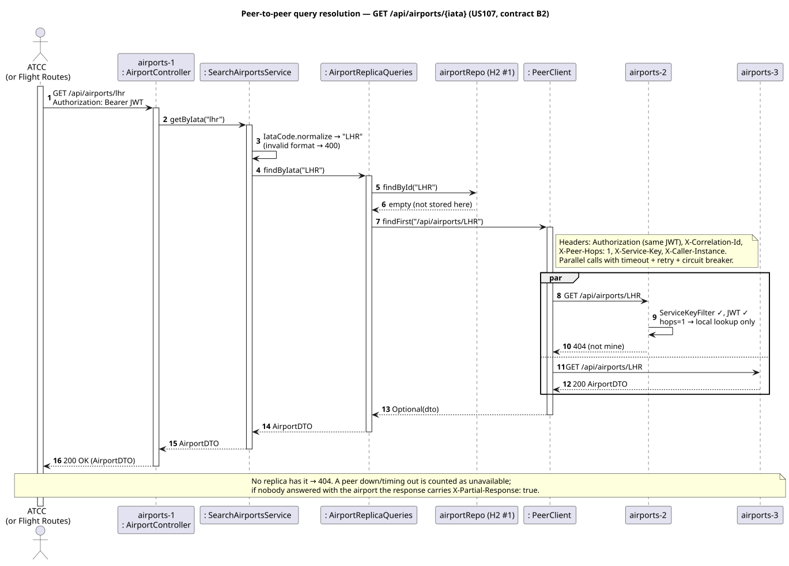
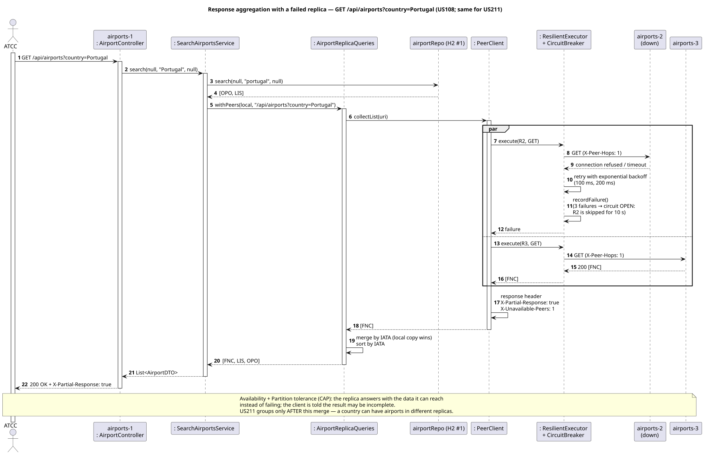
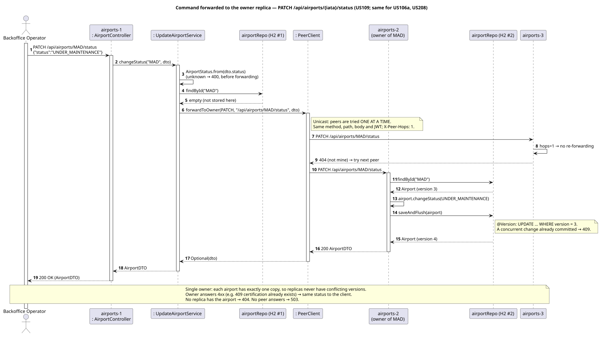
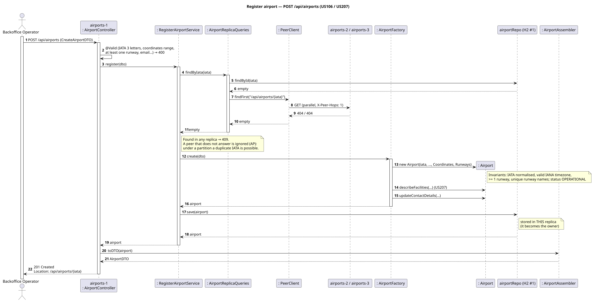
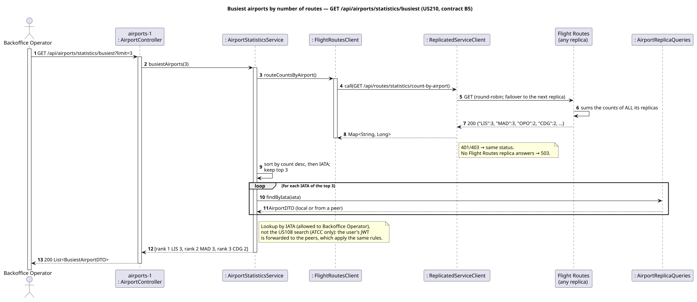

# C4+1 — Airports Service: Scenarios

> The "+1" view: real use cases and end-to-end behaviour across containers and components. Each scenario validates [L2](../../2-containers/Containers.md), [L3](../../3-components/airports/Airports-Components.md) and [L4](../../4-code/airports/Airports-Code.md).

## 1. User stories

| WP | US | Description | Actor |
|---|---|---|---|
| 2A | US106 | Register an airport with IATA code, name, city, country, timezone, coordinates and runways | Backoffice Operator |
| 2A | US106a | Add an aircraft-model certification to an airport | Backoffice Operator, ATCC |
| 2A | US107 | View an airport's details given its IATA code | Backoffice Operator, ATCC |
| 2A | US108 | Search airports by city, country or name | ATCC |
| 2A | US109 | Update an airport's operational status (operational, closed, under maintenance) | Backoffice Operator |
| 2B | US207 | Register an airport with optional photos and facilities (terminals, gates, services) | Backoffice Operator |
| 2B | US208 | Update airport details, including operational hours and contact information | Backoffice Operator |
| 2B | US210 | Statistics on the busiest airports by number of routes | Backoffice Operator |
| 2B | US211 | View airports grouped by region or country | ATCC |

**US209** (routes from/to an airport) belongs to WP#2B but is implemented by Flight Routes, which owns the routes (`GET /api/routes/by-airport/{iata}`). Supplied to other containers: **US107** is contract B2, used by Flight Routes in US110, US209, US212 and US216.

### Decisions on open points

- **Statuses (Integration-Contracts Q2):** `OPERATIONAL`, `CLOSED`, `UNDER_MAINTENANCE`, as listed in US109. Only `OPERATIONAL` lets Flight Routes schedule flights.
- **Region (US211):** an optional attribute of the airport (e.g. `Europe`), not derived from the country; airports without a region are grouped under `Unspecified`.
- **Photos (US207):** stored as URLs; file upload is out of scope.
- **Certifications (US106a, Q3):** stored by model name. They are not validated against Aircraft Management yet (that service has no implementation); Flight Routes does not read them (Q3 still open).

## 2. Acceptance criteria

**Airports:** AC1 IATA exactly 3 letters, normalised to upper case (else `400`); AC2 name, city, country, timezone (IANA), coordinates in range and at least one runway are required (else `400`); AC3 an IATA registered in any replica that answers → `409`; AC4 created `OPERATIONAL`, `201` + `Location`; AC5 unknown status → `400`; AC6 a model certified twice → `409`; AC7 US208 changes only the fields sent; AC8 concurrent changes of the same airport → `409`.

**Queries:** AC9 US108 filters are combinable and case-insensitive, results sorted by IATA; AC10 US211 groups the airports of all replicas, `by` = `country` or `region` (else `400`); AC11 US210 ranks by route count (ties by IATA), `limit` 1–100 (default 5), with the airport details joined.

**Distribution:** AC12 any replica answers with the data of all replicas, `404` if no replica has it; AC13 a failed peer gives a `200` with `X-Partial-Response: true`; AC14 an airport is only modified by its owner replica; AC15 peer requests without valid `X-Service-Key` → `401`, `X-Peer-Hops > 1` → `400`; AC16 JWT + roles on every endpoint (`401`/`403`), every request audited; AC17 `503` when no replica of a remote service (or no peer, for commands) answers.

## 3. System sequence diagram

"System" = any of the three replicas.

## 4. Scenarios (sequence diagrams)

### 4.1 Distributed scenarios

**S1 — Peer-to-peer query resolution: GET an airport stored in another replica (US107, contract B2)**

**S2 — Response aggregation with a failed replica (US108; US211 groups after this merge)**

**S3 — Command forwarded to the owner replica (US109; same for US106a and US208)**

### 4.2 Use-case scenarios

**S4 — Register airport (US106, US207)**

**S5 — Busiest airports (US210, contract B5 with Flight Routes)**

## 5. Tests

From `code/`: `./mvnw -pl airports -am test`.

| Test class | Type | What is verified |
|---|---|---|
| [`AirportTest`](../../../code/airports/src/test/java/isep/psoft/aisafe/airports/domain/AirportTest.java) | Unit (domain) | IATA normalisation/format, coordinates and runway validation, required fields and IANA timezone, unique runways, created `OPERATIONAL`, duplicate certification, status changes, facilities, partial update of details |
| [`AirportsApplicationTests`](../../../code/airports/src/test/java/isep/psoft/aisafe/AirportsApplicationTests.java) | Context | The service starts with the shared configuration (security chain of `common` + `AirportsAuthorizationRules`) |
| **[`AirportReplicaCollaborationTest`](../../../code/airports/src/test/java/isep/psoft/aisafe/distributed/AirportReplicaCollaborationTest.java)** | **Distributed** — two real replicas + a stub of Flight Routes | scenarios below |

`AirportReplicaCollaborationTest`:

1. Each replica stores the airports it receives (`201` + `Location`); local access `200`.
2. GET on A of an airport stored on B → forwarded, `200` with the B2 fields; unknown → `404`; invalid IATA → `400` (S1).
3. Search on A and on B → the same merged, sorted list; filters applied in the peers (S2).
4. Registering on A an IATA stored on B → `409`.
5. Invalid registration (no runways, invalid timezone) → `400`.
6. Status, certification and details changed through A for an airport of B → executed by B; owner's `409` propagated; unknown airport → `404` (S3).
7. Grouping by country/region uses airports of both replicas; invalid grouping → `400`.
8. US210 combines the Flight Routes counts with airport details from both replicas; ties ordered by IATA; invalid limit → `400` (S5).
9. Peer headers without/wrong service key → `401`; hops 2 → `400`; valid peer request → only local data.
10. No token → `401`; wrong role → `403` on each restricted endpoint; unexpected method → `403`; health `UP`.
11. Replica B stopped: A answers `200` with `X-Partial-Response: true`; local airport `200`; airport only in B → `404`; command for an airport of B → `503` (S2).

**Postman:** [postman/Airports.postman_collection.json](postman/Airports.postman_collection.json) + [environment](postman/Airports.postman_environment.json), against the three replicas with the `demo` profile — folders: setup, local access, forwarding, aggregation, owner commands, security, integration with Flight Routes (US210, needs Flight Routes with `demo`), replica failure (stop replica 2 before the last folder). Requests that create data use random values, so the collection can be run more than once.

## 6. Demo

From `code/`:

1. `./mvnw clean install`
2. `./scripts/start-replicas.sh airports demo` (Windows: `.\scripts\start-replicas.ps1 -Service airports -Profiles demo`). Each replica loads different airports: replica 1 OPO, LIS; replica 2 MAD, CDG; replica 3 LHR, FNC (the airports of the Flight Routes demo routes).
3. For US210 and the end-to-end flow also start Flight Routes: `.\scripts\start-replicas.ps1 -Service flightroutes -Profiles demo`.
4. `GET http://localhost:8083/actuator/health` (also 8183, 8283).
5. `POST http://localhost:8083/auth/dev-token` `{"username":"atcc1","roles":["ATCC"]}` (and `["BACKOFFICE_OPERATOR"]`) → tokens for Postman / Swagger *Authorize*.
6. Run the Postman collection, or by hand:
   - `GET :8083/api/airports` and `:8283/...` → the same 6 airports.
   - `GET :8083/api/airports/LHR` → `200`; log of replica 1: `Not found locally: forwarding GET ...`; replica 3: `AUDIT ... source=peer:airports-1` with the same correlation id.
   - `PATCH :8083/api/airports/MAD/status` `{"status":"CLOSED"}` → executed by replica 2; then a US212 flight from/to MAD in Flight Routes → `409` (airport not operational). Set it back to `OPERATIONAL`.
   - `GET :8083/api/airports/statistics/busiest?limit=3` (Backoffice) → LIS 3, MAD 3, CDG 2.
   - `GET :8183/api/airports/grouped?by=country` → Portugal groups OPO and LIS (replica 1) with FNC (replica 3).
   - Close the window of replica 2 → `GET :8083/api/airports` returns 4 airports with `X-Partial-Response: true`.
   - HTTPS: add the `tls` profile (`demo,tls`) and use `https://`.

H2 console: `http://localhost:8083/h2-console` (JDBC URL `jdbc:h2:mem:airportsdb-1`).

## 7. Observations

- Cross-replica uniqueness of the IATA code is best-effort (AP, see [L2 §3.3](../../2-containers/Containers.md#33-consistency-model-cap)): during a partition, or with two simultaneous registrations on different replicas, the same IATA can be stored twice. Deterministic ownership (hash of the IATA → replica) would remove this at the cost of availability for writes when that replica is down.
- US210 depends on Flight Routes being available (`503` otherwise); the route counts are already summed over the Flight Routes replicas.
- Certifications are not validated against Aircraft Management because that service is not implemented yet; adding a call to `GET /api/aircraft-models/{model}` (B1b) would complete US106a.
