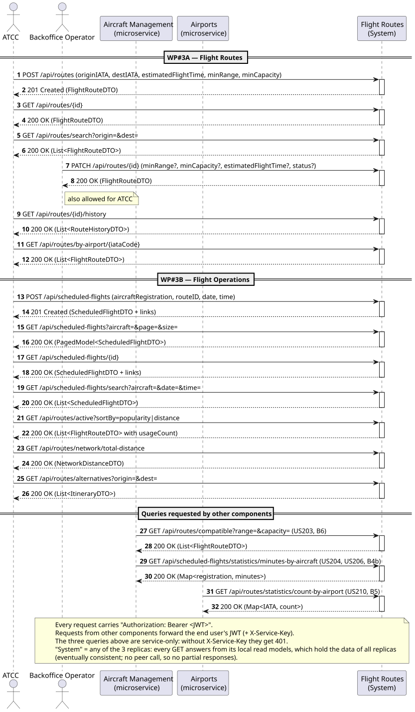
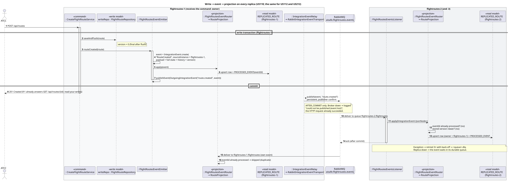
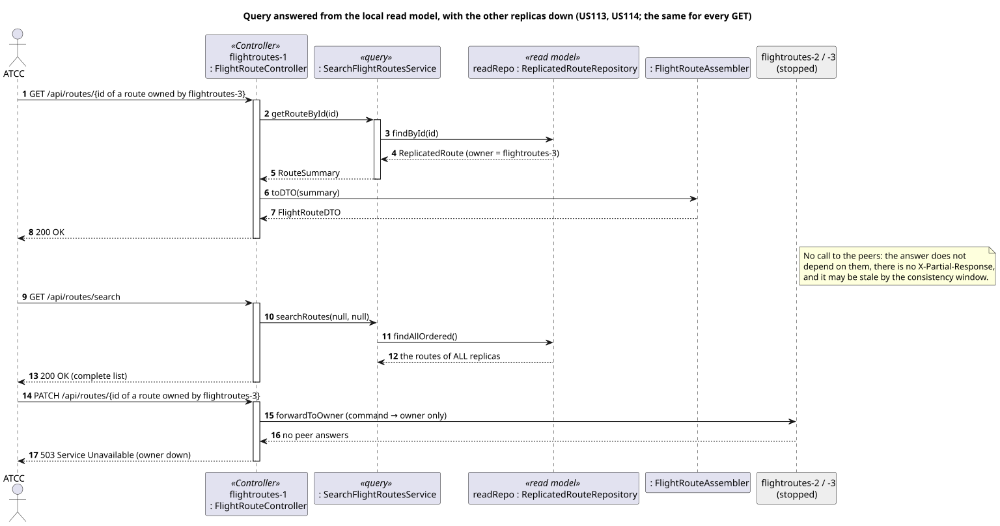
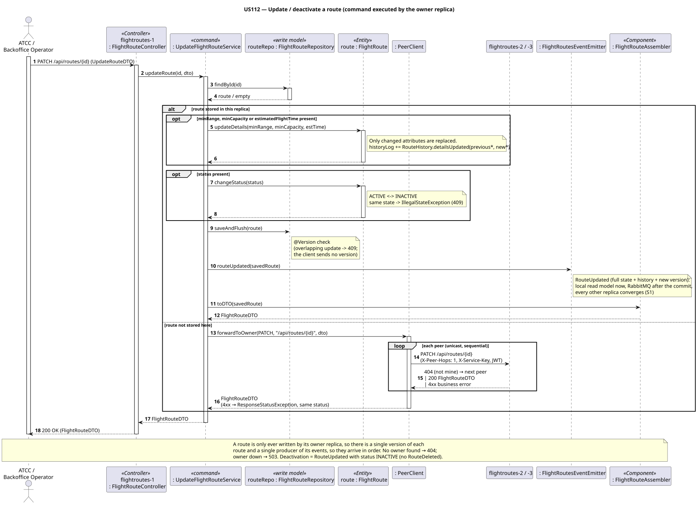
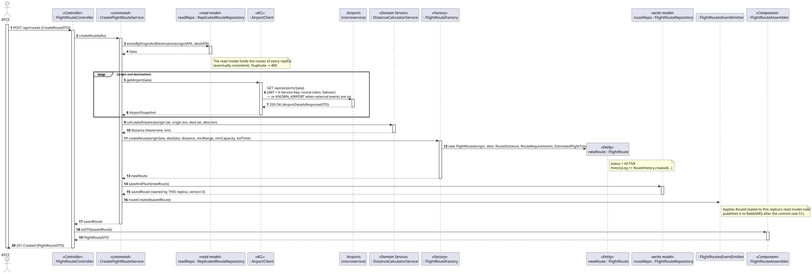
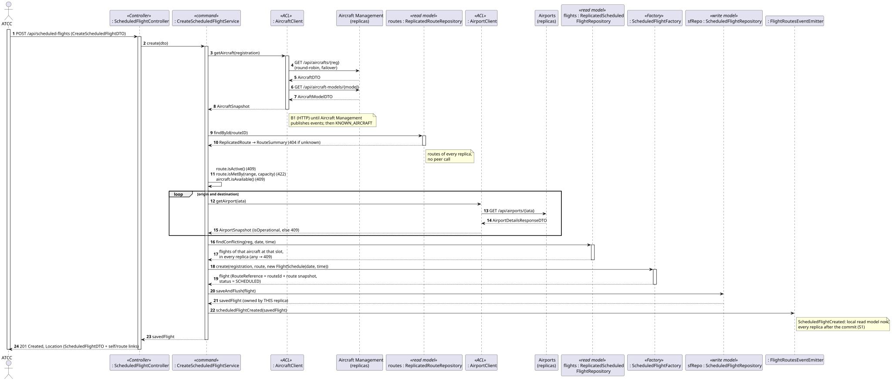
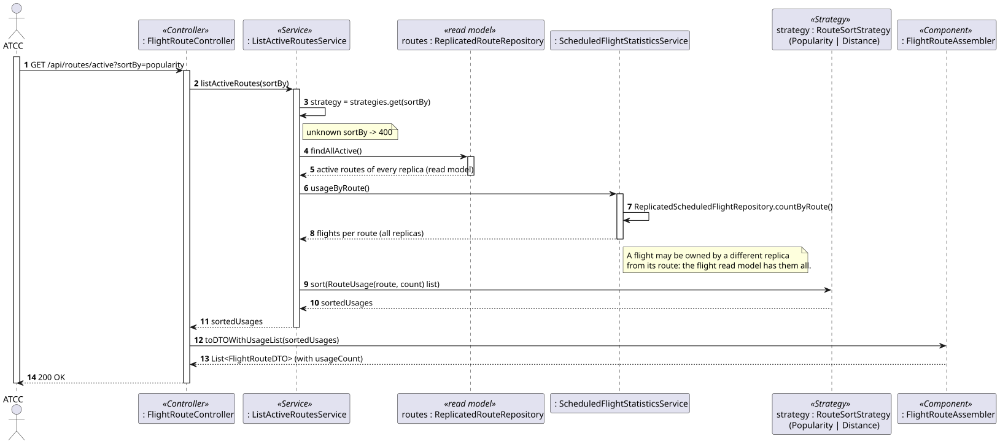
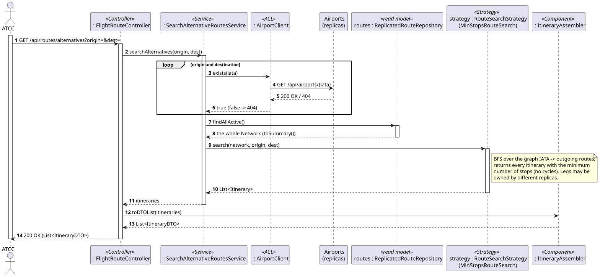

# C4+1 — Flight Routes Service: Scenarios

> The "+1" view: real use cases and end-to-end behaviour across containers and components. Each scenario validates [L2](../../2-containers/Containers.md), [L3](../../3-components/flightroutes/FlightRoutes-Components.md) and [L4](../../4-code/flightroutes/FlightRoutes-Code.md).

## 1. User stories

| WP | US | Description | Actor |
|---|---|---|---|
| 3A | US110 | Create a flight route between two registered airports | ATCC |
| 3A | US111 | View the change history of a route | ATCC |
| 3A | US112 | Update the operational details of a route or deactivate it | ATCC, Backoffice Operator |
| 3A | US113 | View the details of a route given its ID | ATCC |
| 3A | US114 | Search routes by origin and/or destination | ATCC |
| 2B | US209 | View all routes that depart from or arrive at a specific airport | ATCC |
| 3B | US212 | Assign an aircraft to a route for a date/time (create a scheduled flight) | ATCC |
| 3B | US213 | View all scheduled flights of a specific aircraft | ATCC |
| 3B | US214 | List active routes sorted by popularity or distance | ATCC |
| 3B | US215 | Calculate the total distance of the network | ATCC |
| 3B | US216 | Search for alternative routes between two airports | ATCC |

Supplied to other containers (service-only endpoints, `X-Service-Key` required): **US203** compatible routes (B6) and the flight minutes per aircraft used by **US204** and **US206** (B4b) to Aircraft Management; **US210** routes per airport (B5) to Airports. Also published as events: `RouteCreated`, `RouteUpdated`, `ScheduledFlightCreated`.

### Clarifications

- **Conv. 002:** routes exist independently of an airport's state, but scheduled flights can be affected; the distance is fixed at creation.
- **Conv. 006:** flight lifecycle `SCHEDULED`, `DELAYED`, `IN_FLIGHT`, `COMPLETED`, `CANCELED`; transitions are future work.
- **Conv. 007:** the Route ID is system generated. **Conv. 010:** the *Network* is the set of active routes. **Conv. 012:** routes are point-to-point. **Conv. 013:** alternative routes chain existing routes; the algorithm must be replaceable (one is enough).

## 2. Acceptance criteria

**Flight routes:** AC1 airports must exist (else `400`); AC2 one route per origin/destination, checked on the read model of the receiving replica (else `400`); AC3 distance by Haversine, never changes; AC4 `minRange`, `minCapacity`, `estimatedFlightTime` positive; AC5 created `ACTIVE`, changing to the current state → `409`; AC6 history records only the changed attributes; AC7 two **overlapping** updates of a route → one `200` and one `409` (`@Version`). The version is not exposed, so an update from stale data is accepted (last writer wins, known limitation).

**Scheduled flights:** AC8 aircraft and route (of any replica, read model) must exist (else `404`); AC9 range/capacity must meet the requirements (else `422`); AC10 route `ACTIVE`, aircraft `AVAILABLE`, airports `OPERATIONAL`, no other flight of the aircraft at that date/time in the flight read model (else `409`); AC11 `201` + `Location` + HATEOAS links; AC12 per-aircraft list paginated.

**Network:** AC13 US214–US216 use only `ACTIVE` routes of every replica; AC14 sorting and search are strategies; unknown `sortBy` → `400`.

**Distribution (Assignment 2):** AC15 any replica answers every GET from its own read models, with the data of all replicas, and `404` only if the entity is unknown to its read model; AC16 a GET never calls a peer: with all peers down it still answers, with no `X-Partial-Response`; AC17 a route is only modified by its owner replica (other replicas forward the command; owner down → `503`); AC18 every write is published once (`RouteCreated`, `RouteUpdated`, `ScheduledFlightCreated`) after the commit and every replica converges to the same read model (duplicates and stale versions ignored); the owner reads its write at once; AC19 peer requests without valid `X-Service-Key` → `401`, `X-Peer-Hops > 1` → `400`; requests to the service-only endpoints without `X-Service-Key` → `401` even with a valid JWT; AC20 JWT + roles on every endpoint, every request audited; AC21 `503` when no replica of a remote service answers; AC22 broker down: writes succeed and are visible on the owner, liveness `UP`, readiness `DOWN`.

## 3. System sequence diagram

"System" = any of the three replicas.

## 4. Scenarios (sequence diagrams)

### 4.1 Distributed scenarios

**S1 — Write → event → projection on every replica (US110; the same for US112 and US212)**

**S2 — Queries answered from the local read model, with the other replicas down (US113, US114; the same for every GET)**

**S3 — Update / deactivate a route: command forwarded to the owner replica, then `RouteUpdated` (US112)**

### 4.2 Use-case scenarios

**S4 — Create route (US110)**

**S5 — Create scheduled flight (US212)**

**S6 — List active routes by popularity (US214)**

**S7 — Search alternative routes (US216)**

## 5. Tests

From `code/`: `./mvnw -B clean verify`. Flight Routes runs 54 tests (6 of them, `RouteEventsBrokerTest`, are skipped when no RabbitMQ is reachable); `common` runs 48.

| Test class | Type | What is verified |
|---|---|---|
| `FlightRouteTest` | Unit (domain) | Value Object validation, `ACTIVE` with history, history of changed attributes only, status transitions, `isMetBy`, `toSummary` |
| `ScheduledFlightTest` | Unit (domain) | `SCHEDULED`, reference/snapshot of a route owned by another replica, mandatory data |
| `RouteStrategiesTest` | Unit | BFS with fewest stops (no cycles, unreachable), popularity/distance sorting |
| `MessagingTopologyTest`, `EventPublisherTest`, `IdempotentEventHandlerTest`, `ConsumerRetryTest`, `IntegrationEventSerializationTest` (common) | Unit | queue names `<instanceId>.<source>` and DLQs, envelope and AMQP metadata, publishing a pre-built event, duplicates skipped, bounded retry, JSON contract |
| `PeerClientTest`, `CircuitBreakerTest`, `ResilientExecutorTest`, `ServiceKeyFilterTest`, `AuthorizationRulesGuardTest` (common) | Unit / integration | command forwarding and `409` propagation, resilience, service-key and rules guard |
| **`ServiceOnlyEndpointsSecurityTest`** | Integration — one real replica | each of the 5 service-only endpoints → `401` without the key even with a valid JWT; wrong key → `401`; valid key + wrong role → `403` |
| **`ReadModelProjectionsTest`** | Integration — one real replica, no broker | both projections behind the existing GET endpoints: create/update, idempotency, stale versions, unknown types, JSON payloads (as from the broker), B5/B6 from the read model, flight queries and statistics, reserved `ScheduledFlightStatusChanged` |
| **`ExternalEventsScaffoldingTest`** | Integration — two real replicas, no broker | Aircraft Management / Airports events replace B1/B2 when enabled (a route is created with Airports down), HTTP fallback on a miss, local copies never used when disabled |
| **`ReplicaCollaborationTest`** | **Distributed** — two real replicas exchanging events through an in-process bus (JSON, one delivery per replica) + stubs of Airports and Aircraft Management | scenarios below |
| **`RouteEventsBrokerTest`** | **Distributed over RabbitMQ** (skipped without a broker) | two replicas converge through real queues (routes, updates, flights), counts not doubled, readiness includes `rabbit`, a poison message reaches each replica's DLQ |

`ReplicaCollaborationTest`:

1. Each replica owns the routes it receives and reads its own write immediately (read-your-writes).
2. GET on A of a route owned by B → `200` from A's read model (S2).
3. Search on A and on B → both routes, no `X-Partial-Response`.
4. Duplicate route on A while it exists on B → `400` (read model).
5. PATCH on A of a route of B → executed by B; both read models converge to the new version; history from A's read model; owner's `409` propagated (S3).
6. Flight on A for a route of B → `201`; same aircraft/slot on B → `409` (B's flight read model); flight read through B with links to B (S5).
7. Popularity seen from B counts the flight owned by A; operational hours and network distance (S6).
8. Alternative OPO→MAD combines legs owned by B and A (S7).
9. Peer headers without/wrong service key → `401`; hops 2 → `400`; a valid peer request is answered from the read model.
10. No token → `401`; wrong role → `403`; health `UP` with `peers`; liveness and readiness `UP` (no `rabbit` without messaging).
11. Replica B stopped: A still answers every route, including B's, with no partial header; PATCH of B's route → `503`; PATCH of A's route → `200` (S2).

**Postman:** [postman/FlightRoutes.postman_collection.json](postman/FlightRoutes.postman_collection.json) + [environment](postman/FlightRoutes.postman_environment.json), against the three replicas with the `demo` profile and RabbitMQ — folders: 0 setup (health, liveness/readiness, tokens), 1 local access, 2 GET by id from the read model, 3 every replica sees all data, 4 command forwarding, 5 security, 6 replica failure (stop replica 2 first), 7 cross-service, 8 concurrency, **9 Assignment 2** (create on fr1 → poll fr2/fr3 until it appears; update on fr3 forwarded to fr1 → poll every replica until the new version; flight on fr2 → poll queries and statistics on every replica; conflict on the read model; deactivate = `RouteUpdated` INACTIVE), **10 Assignment 2 manual** (stop fr2 and fr3: fr1 still answers everything, writes owned by stopped replicas → `503`). The polling requests repeat themselves (500 ms, up to ~10 s) and report how many retries convergence took.

## 6. Demo

From `code/`:

1. Once: copy `infra/.env.example` to `infra/.env` (repository root) and set the broker credentials; Docker must be running.
2. `./mvnw clean install`
3. `./scripts/start-all.sh 3 demo` (Windows: `.\scripts\start-all.ps1 -Profiles demo`) — starts RabbitMQ if needed. Only Flight Routes: `./scripts/start-replicas.sh flightroutes demo`. Each replica inserts different demo data **and publishes it**: replica 1 OPO-LIS, LIS-MAD; replica 2 MAD-CDG, LIS-FNC; replica 3 CDG-LHR, OPO-MAD (+ flights). Restarting does not duplicate it (file databases in `code/data/`).
4. `GET http://localhost:8084/actuator/health/liveness` and `/readiness` (also 8184, 8284); RabbitMQ UI at <http://localhost:15672>: exchange `aisafe.flightroutes.events`, queues `flightroutes-1/2/3.flightroutes`.
5. `POST http://localhost:8084/auth/dev-token` `{"username":"atcc1","roles":["ATCC"]}` → token for Postman / Swagger *Authorize*.
6. Run the Postman collection (folder 9 shows convergence), or by hand:
   - `GET :8084/api/routes/search` and `:8184/...` → the same 6 routes, each from its own database.
   - `POST :8084/api/routes` then immediately `GET :8284/api/routes/{id}` (a few ms later it is there); the logs show `Published RouteCreated ...` on replica 1 and `Applied RouteCreated ... (owner flightroutes-1, version 0)` on replicas 2 and 3.
   - `PATCH :8084/api/routes/{id of MAD-CDG}` `{"minCapacity":160}` → executed by replica 2, then `RouteUpdated` reaches 1 and 3.
   - Stop replicas 2 and 3 → replica 1 still answers every route and flight; a PATCH of a route owned by replica 2 → `503`.
   - Stop the broker (`docker stop aisafe-rabbitmq`) → POST still `201`, readiness `DOWN`, liveness `UP`, log "could not be published (event lost ...)".

H2 console: `http://localhost:8084/h2-console` (JDBC URL `jdbc:h2:file:./data/flightRoutesdb-1`, while the replica runs from `code/`): tables `FLIGHT_ROUTE` (owned), `REPLICATED_ROUTE`, `REPLICATED_SCHEDULED_FLIGHT`, `PROCESSED_EVENT`.

## 7. Observations

- Uniqueness and the flight overlap are checked on the read model: inside the eventual-consistency window two replicas can accept the same route or slot (AP, see [L2 §3.3](../../2-containers/Containers.md#33-consistency-model-cap)).
- Events are published after the commit without an outbox: if the broker is down at that moment the change exists on the owner only, until a later event of the same entity ([L2 §3.6](../../2-containers/Containers.md#36-known-limitations-of-messaging)).
- A replica that starts with an empty database does not receive past events; demo data is re-published by the replica that inserts it.
- Optimistic locking only catches **overlapping** updates of a route; the version is not returned by GET nor accepted by PATCH (folder 8 of the Postman collection).
- US212 does not check the airport certifications of the aircraft model, and still reads aircraft and airports over HTTP (B1, B2) until Aircraft Management and Airports publish events; the consumer is ready (`AISAFE_EXTERNAL_EVENTS=true`).
- Shared secrets have development defaults; outside development use `JWT_SECRET`, `AISAFE_SERVICE_KEY`, `AISAFE_TLS_PASSWORD`, `AISAFE_DEV_TOKEN=false`, and real broker credentials in `infra/.env`.
