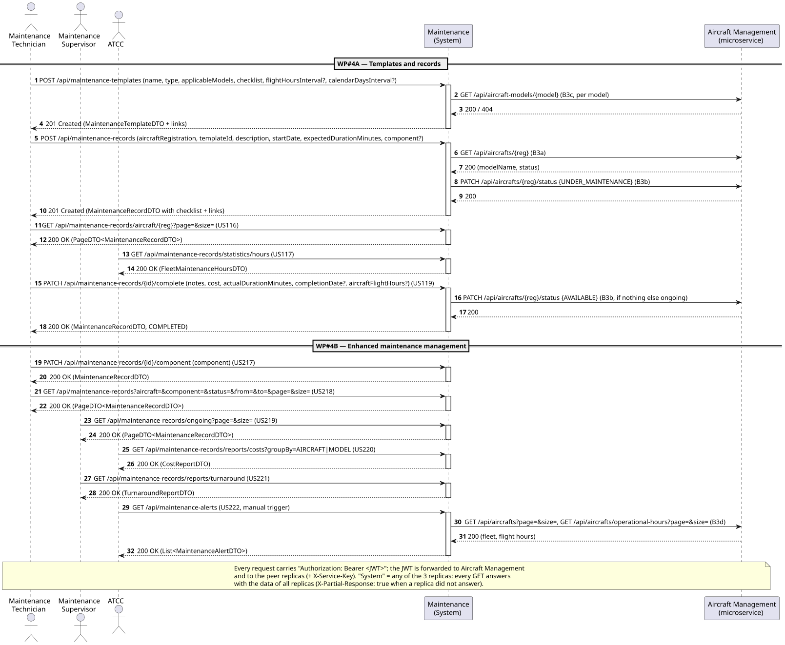

# C4+1 — Maintenance Service: Scenarios

> Casos de utilização e comportamento do contentor Maintenance. Referência: [Flight Routes — Scenarios](../flightroutes/FlightRoutes-Scenarios.md).

## 1. User stories

### US1 — Agendar manutenção de uma aeronave

- **Ator:** Gestor de Manutenção
- **Descrição:** Como Gestor de Manutenção, quero agendar uma intervenção de manutenção para uma aeronave para planear e acompanhar os trabalhos necessários.
- **Critérios de Aceitação:**
  - A aeronave tem de existir no serviço Aircraft Management; não é possível agendar manutenção para uma matrícula desconhecida.
  - A data prevista para a intervenção tem de ser válida e não pode ser anterior à data atual.
  - O registo é criado no estado **Agendada** e fica associado à aeronave e à matrícula indicadas.
  - Não é possível agendar uma intervenção para uma manutenção já concluída ou cancelada.

### US2 — Registar a conclusão de uma intervenção técnica

- **Ator:** Técnico
- **Descrição:** Como Técnico, quero registar a conclusão de uma intervenção técnica para manter atualizado o estado da manutenção e documentar o trabalho realizado.
- **Critérios de Aceitação:**
  - A intervenção tem de existir e estar no estado **Agendada** ou **Em curso**.
  - A intervenção só pode ser concluída para uma aeronave existente.
  - A data de conclusão tem de ser válida e não pode ser anterior à data de início da intervenção.
  - O registo de conclusão inclui a data e a descrição do trabalho realizado, e altera o estado da manutenção para **Concluída**.
  - Uma intervenção concluída não pode ser concluída novamente nem alterada para um estado anterior.

### US3 — Consultar o histórico de manutenções de uma matrícula

- **Ator:** Gestor de Manutenção
- **Descrição:** Como Gestor de Manutenção, quero consultar o histórico de manutenções de uma matrícula para conhecer as intervenções realizadas e o estado atual dos trabalhos associados à aeronave.
- **Critérios de Aceitação:**
  - A matrícula tem de corresponder a uma aeronave existente no serviço Aircraft Management.
  - A consulta apresenta as manutenções associadas à matrícula, incluindo data, descrição e estado de cada intervenção.
  - O histórico inclui intervenções em todos os estados, incluindo **Agendada**, **Em curso**, **Concluída** e **Cancelada**.
  - As intervenções são apresentadas por ordem cronológica, da mais recente para a mais antiga.
  - Uma matrícula inexistente é identificada como não encontrada; não deve ser apresentada como um histórico vazio.

## 2. Acceptance criteria

Para o comportamento distribuído do serviço, qualquer réplica deve poder responder com os dados existentes nas restantes réplicas; respostas parciais devem ser identificadas; atualizações de registos existentes são encaminhadas para a réplica proprietária; pedidos entre réplicas sem chave de serviço são rejeitados com `401`; e é devolvido `503` quando nenhuma réplica de um serviço remoto responde.

## 3. System sequence diagram

## 4. Scenarios (sequence diagrams)

Incluir pelo menos um cenário de **peer-forwarding** e um cenário de **agregação com uma réplica indisponível**.

## 5. Tests

Testes unitários, um teste distribuído com duas réplicas (como `ReplicaCollaborationTest`) e coleção Postman em `postman/`.

## 6. Demo

## 7. Observations
