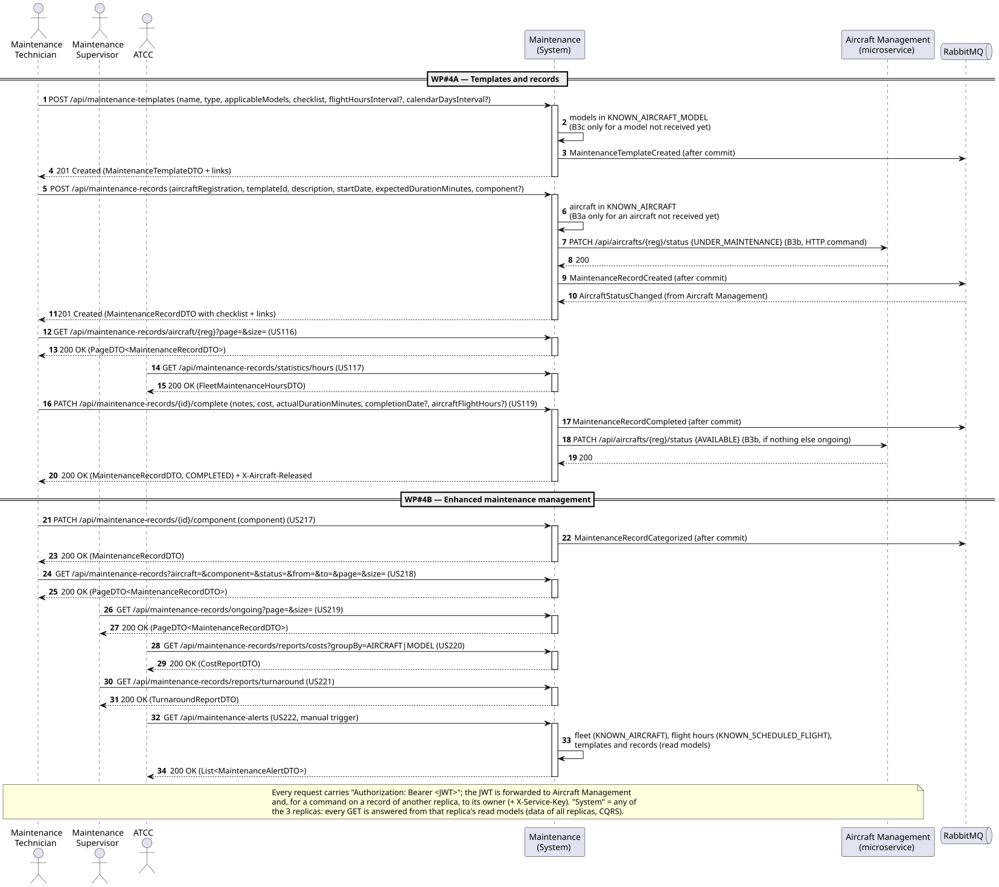
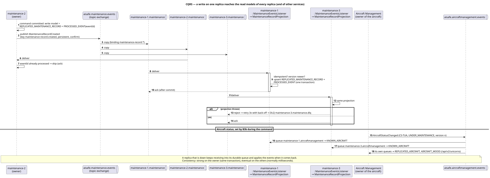
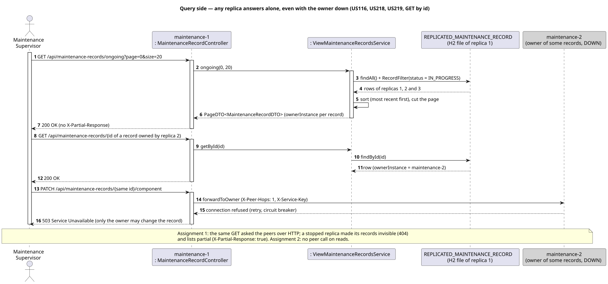
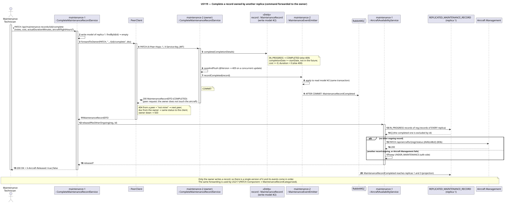
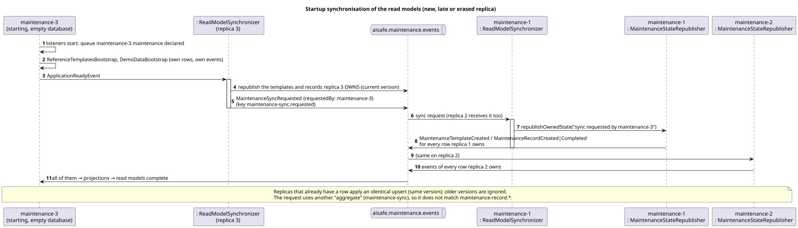
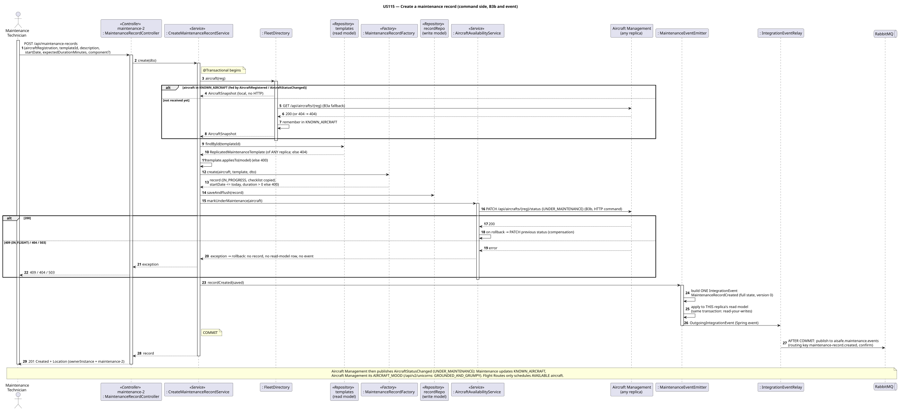
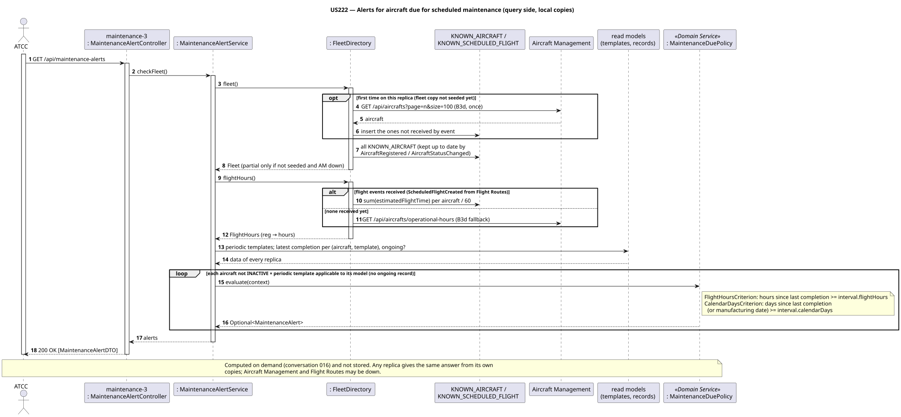

# C4+1 — Maintenance Service: Scenarios

> The "+1" view: real use cases and end-to-end behaviour across containers and components. Each scenario validates [L2](../../2-containers/Containers.md), [L3](../../3-components/maintenance/Maintenance-Components.md) and [L4](../../4-code/maintenance/Maintenance-Code.md).

## 1. User stories

The use cases are the WP#4 user stories of the PSOFT assignment (the monolith that this service replaces), served by three replicas. Assignment 2 does not change them: it changes **how** they are served (CQRS, events through RabbitMQ, a database file per replica).

| WP | US | Description | Actor |
|---|---|---|---|
| 0A | — | Preload maintenance templates (bootstrap of initial data) | — |
| 4A | US115 (templates) | Create a maintenance template: name, type (inspection, scheduled maintenance, overhaul, modification), applicable aircraft models and checklist (+ interval, for US222) | Maintenance Technician |
| 4A | US115 (records) | Create a maintenance record for an aircraft: registration, maintenance type (template), description, start date, expected duration and its checklist (defined by the template) | Maintenance Technician |
| 4A | US116 | View all maintenance records of a specific aircraft | Maintenance Technician (also Supervisor) |
| 4A | US117 | View the total number of maintenance hours of the aircraft of the fleet | ATCC |
| 4A | US119 | Mark a maintenance record as completed and add completion notes | Maintenance Technician |
| 4B | US217 | Categorise maintenance records by component (engine, airframe, avionics, interior, exterior) | Maintenance Technician |
| 4B | US218 | Search maintenance records by aircraft, date range or component | Maintenance Technician (also Supervisor) |
| 4B | US219 | View all ongoing maintenance activities across the fleet | Maintenance Supervisor |
| 4B | US220 | Generate reports on maintenance costs per aircraft or per aircraft model | ATCC |
| 4B | US221 | View the average maintenance turnaround time per aircraft type | Maintenance Supervisor |
| 4B | US222 | Receive alerts when aircraft are due for scheduled maintenance based on flight hours or calendar days | ATCC |

### Clarifications (PSOFT forum)

- **Conv. 009:** "aircraft type" (US221) is the aircraft model.
- **Conv. 010:** the *fleet* is the set of all aircraft managed in AISafe.
- **Conv. 016:** the maintenance interval (flight hours and/or calendar days) is an attribute of the template; the due-maintenance check is **triggered manually** by the user.
- **Operational constraint:** "aircraft under maintenance cannot be assigned to flights" — realised through the aircraft status in Aircraft Management (B3b), which Flight Routes already checks (B1a).
- **Group decisions** (Integration-Contracts §7): after maintenance the aircraft returns to `AVAILABLE` (Q1); B3b is called after the local write was flushed and compensated if the local transaction rolls back (Q7). B3b stays a synchronous HTTP command in Assignment 2 (Integration-Contracts §9.6).

## 2. Acceptance criteria

**Templates:** AC1 name, type, at least one applicable model and one checklist item required (else `400`); AC2 every applicable model exists in Aircraft Management (else `400`); AC3 unique name in every replica that answers (else `400`); AC4 interval values positive; no interval = not periodic; AC5 the standard templates exist in every replica at start-up (WP#0A).

**Records:** AC6 the aircraft exists (else `404`) and the template exists in some replica (else `404`); AC7 the template applies to the aircraft's model (else `400`); AC8 start date not in the future, expected duration > 0, component one of the five values (else `400`); AC9 created `IN_PROGRESS` with the template's checklist, `201` + `Location` + links; AC10 the aircraft becomes `UNDER_MAINTENANCE`; an aircraft in flight cannot (`409`); if Aircraft Management is unavailable nothing is created (`503`).

**Completion and categorisation:** AC11 only `IN_PROGRESS` records can be completed or categorised (else `409`); AC12 notes required, cost ≥ 0, actual duration > 0, completion date between the start date and today (else `400`); AC13 the aircraft returns to `AVAILABLE` only if no other record of it is ongoing in any replica (and every replica answered); otherwise it stays `UNDER_MAINTENANCE` and the response carries `X-Aircraft-Released: false`; AC14 concurrent updates → `409`.

**Queries and reports:** AC15 US116 for an unknown aircraft → `404` (not an empty history); AC16 lists sorted by start date (most recent first) and paginated (`size` 1–100) after merging; AC17 US218 filters combine with AND, `from` ≤ `to`; AC18 US117 counts actual hours of completed records and expected hours of ongoing ones; AC19 US220 only completed records, `groupBy` `AIRCRAFT` or `MODEL` (else `400`); AC20 US221 average = total actual minutes / number of completed records per model, computed after adding the replicas; AC21 US222 lists every aircraft (not `INACTIVE`) × applicable periodic template whose flight-hours or calendar-days limit is reached, without an ongoing record of that template; without flight hours (Flight Routes down) the calendar-day alerts are still returned, flagged partial.

**Distribution (Assignment 2):** AC22 any replica answers every GET from its own read models, with the data of every replica, `404` only if the read model does not have it; no GET calls another replica; AC23 a write on one replica is visible on the others after its event is applied (eventual consistency, normally milliseconds) and immediately on the owner (read-your-writes); AC24 a record is only modified by its owner replica; a command for a record whose owner is down → `503`; AC25 the records of a stopped replica stay readable on the others; AC26 every event is applied once per replica (duplicates ignored by `eventId`, older `version` ignored); AC27 a replica that was down catches up from its durable queue; a new/erased replica catches up through the startup synchronisation; AC28 peer requests without a valid `X-Service-Key` → `401`, `X-Peer-Hops > 1` → `400`; JWT + roles on every endpoint (`401` / `403`), every request audited; AC29 B3b: `503` when no replica of Aircraft Management answers (nothing is saved).

## 3. System sequence diagram

"System" = any of the three replicas.

## 4. Scenarios (sequence diagrams)

### 4.1 CQRS and messaging scenarios

**S1 — Write → event → projection on every replica (and the Aircraft Management event caused by B3b)**

**S2 — Query side: any replica answers alone, even with the owner of the data down (US116, US218, US219, GET by id)**

**S3 — Complete a record owned by another replica: command forwarded to the owner, event, aircraft released (US119; same forwarding for US217)**

**S4 — Startup synchronisation of the read models**

### 4.2 Use-case scenarios

**S5 — Create a maintenance record (US115): command side, B3b with compensation, event after the commit**

**S6 — Maintenance alerts (US222) from local copies of the fleet and of the scheduled flights**

### 4.3 The `/api/v2/unicorns` mock and Maintenance

The assignment asks for a mock `/api/v2/unicorns` (aircraft moods) and for its relation with CQRS ([Unicorns-Mock.md](../../2-containers/Unicorns-Mock.md)). It is a pure **query**: a read-model contract, served by a Postman mock server and, for real, by Aircraft Management's `AIRCRAFT_MOOD` projection. Maintenance is what makes the moods change: starting a record sends the **command** B3b (`UNDER_MAINTENANCE`), Aircraft Management publishes `AircraftStatusChanged`, and its projection turns the mood into `GROUNDED_AND_GRUMPY`; completing the last record makes it `HAPPY` again. The command side (Maintenance + B3b) and the query side (`/api/v2/unicorns`) never talk directly: only the event connects them. Folders 2, 4 and 7 of the Postman collection check this.

## 5. Tests

From `code/`: `./mvnw -pl maintenance -am test` (58 tests, no broker needed).

| Test class | Type | What is verified |
|---|---|---|
| `MaintenanceTemplateTest`, `MaintenanceRecordTest`, `MaintenanceDuePolicyTest` | Unit (domain) | invariants of the aggregates and of the due-maintenance policy |
| `CreateMaintenanceRecordServiceTest`, `CompleteMaintenanceRecordServiceTest`, `AircraftAvailabilityServiceTest` | Unit (command side, mocks) | order lookup → save/flush → B3b → event; no event when B3b fails; forwarding to the owner (no event on the forwarding replica); release only without other ongoing records in the read model |
| `MaintenanceProjectionsTest` | Unit (projections) | event from the broker (JSON) projected with its owner; the same event twice applied once; older version ignored; unknown types ignored |
| `MaintenanceStatisticsServiceTest`, `MaintenanceAlertServiceTest` | Unit (query side) | statistics from the read model (average = total / count), alerts from the local copies, partial only when an external copy is missing |
| `RecordOwnershipTest` | Unit | a forwarded command that no peer executed: `503` if the read model knows the record (its owner is down), `404` otherwise |
| `FleetDirectoryTest` | Unit | local copy first; HTTP fallback remembered; fleet seeded once; hours from flight events, else from Aircraft Management |
| **`MaintenanceReplicaCollaborationTest`** | **Distributed** — two (then three) real replicas, an in-process event bus that serialises every event to JSON as the broker does, and a stub of Aircraft Management | scenarios below |

`MaintenanceReplicaCollaborationTest`:

1. A template created on B reaches A's read model (`MaintenanceTemplateCreated` from `it-maintenance-B`); duplicate name and unknown model → `400`.
2. Records are written by the replica that receives them (`ownerInstance`); the aircraft goes `UNDER_MAINTENANCE`; `409` (in flight), `404`, `400`.
3. An `AircraftStatusChanged` event updates `KNOWN_AIRCRAFT`: later lookups do not call Aircraft Management.
4. Every replica answers GET by id, US116, US218, US219 from its read model (same lists, no `X-Partial-Response`).
5. Commands on A for a record of B are executed by B and their events reach A; `409` from the owner propagated; `400`.
6. The aircraft is released only when its last ongoing record is completed.
7. US117, US220, US221 on any replica.
8. US222 with the fleet seeded once and flight minutes from a `ScheduledFlightCreated` event (flight-hours alert).
9. Peer headers without/wrong service key → `401`; hops 2 → `400`; no token → `401`; wrong role → `403`.
10. A new replica C starts empty and catches up when A and B republish their state (startup synchronisation).
11. Replica B stopped: its records are still readable on A (`200`); a command on one of them → `503`; new records on A still work.

**Postman:** [postman/Maintenance.postman_collection.json](postman/Maintenance.postman_collection.json) + environment (58 requests), against the running system (RabbitMQ, Aircraft Management, Flight Routes, three Maintenance replicas): 0 setup; 1 CQRS templates; 2 records and the asynchronous integration with Aircraft Management (`/api/v2/unicorns` mood); 3 queries from read models; 4 commands executed by the owner; 5 statistics, reports and alerts; 6 security; 7 `/api/v2/unicorns` mock; 8 replica failure (stop `maintenance-2` first); 9 catch-up after restart (start it again). Requests that read another replica right after a write wait 1.5 s (eventual consistency). The databases are files, so the collection can be run again: template names carry a run id.

## 6. Demo

From `code/` (Windows: the `.ps1` scripts):

1. Docker Desktop running; `infra/.env` with the RabbitMQ user and password (template `infra/.env.example`).
2. `./scripts/start-all.sh 3 demo` (`.\scripts\start-all.ps1 -Profiles demo`) — starts RabbitMQ if needed and the 12 replicas.
3. RabbitMQ UI `http://localhost:15672`: exchange `aisafe.maintenance.events`; queues `maintenance-N.maintenance`, `maintenance-N.aircraftmanagement`, `maintenance-N.flightroutes` and their `.dlq`.
4. Tokens: `POST http://localhost:8082/auth/dev-token` with `{"username":"tech1","roles":["MAINTENANCE_TECHNICIAN"]}` (also `MAINTENANCE_SUPERVISOR`, `ATCC`).
5. Run the Postman collection, or by hand:
   - `POST :8182/api/maintenance-records` (CS-TUA) → log of replica 2: `Applied MaintenanceRecordCreated ... owner maintenance-2`; logs of replicas 1 and 3: the same line, a few ms later. `GET :8082/api/maintenance-records/{id}` → `200` with `ownerInstance: maintenance-2`, no peer call.
   - `GET :8081/api/v2/unicorns` → CS-TUA `GROUNDED_AND_GRUMPY`.
   - `PATCH :8282/api/maintenance-records/{id}/complete` → executed by replica 2 (`forwarding PATCH ... to the owner replica`), CS-TUA back to `AVAILABLE`, mood `HAPPY`.
   - Stop replica 2 → `GET :8082/api/maintenance-records/{id}` still `200`; `PATCH .../component` → `503`. Create a record on replica 1, start replica 2 again → it applies the waiting events from `maintenance-2.maintenance` and shows that record.
   - HTTPS: add the `tls` profile (`demo,tls`) and use `https://`.

H2 console: `http://localhost:8082/h2-console` (JDBC URL `jdbc:h2:file:./data/maintenancedb-1`, the replica must be running): tables `MAINTENANCE_RECORD` (write model, owned rows), `REPLICATED_MAINTENANCE_RECORD` (read model, all rows), `KNOWN_AIRCRAFT`, `PROCESSED_EVENT`. To start from scratch, stop everything and delete `code/data/maintenancedb-*`.

## 7. Observations

- Cross-replica uniqueness of template names is checked on the read model: two replicas can accept the same name inside the consistency window (AP, [L2 §3.3](../../2-containers/Containers.md#33-consistency-model-cap)).
- US119 decides the release on the read model of the replica that received the request; a record of the same aircraft started on another replica a few milliseconds earlier may not be visible yet. Accepted risk; the alternative is to let Aircraft Management keep the count of open maintenance records per aircraft.
- No transactional outbox (group-wide limitation, [L2 §3.6](../../2-containers/Containers.md#36-known-limitations-of-messaging)): with the broker down at commit time the change is saved on the owner and its event is lost for the others until the next change of that record or the next startup synchronisation.
- Flight Routes has no replay: flights scheduled before the queue `maintenance-N.flightroutes` existed are not in `KNOWN_SCHEDULED_FLIGHT`. While no flight event was received, US222 asks Aircraft Management for the hours (it has them all).
- US222 alerts are computed on demand (manual trigger) and not stored; "flight hours at completion" are entered by the technician.
