# AISafe Flight Management System — Distributed Architecture (SIDIS 2026/2027, Assignment 1)

**ISEP — Instituto Superior de Engenharia do Porto**

**Generated:** 2026-10-31

| Student | Number | Work package |
|---|---|---|
| Tiago Caetano | 1241945 | WP3 Flight Routes |
| Tiago Moreira | 1240883 | WP1 Aircraft Management |
| Afonso Ribeiro | 1240857 | WP2 Airports |
| Diogo Fernandes | 1240632 | WP4 Maintenance |

<div style="page-break-before: always;"></div>

## Table of contents

- [Part I — System](#sec-part-i-system)
  - [Introduction and conventions](#sec-introduction-and-conventions)
    - [AISafe — Architecture Documentation (C4+1)](#sec-aisafe-architecture-documentation-c4-1)
  - [C4 Level 1 — System Context](#sec-c4-level-1-system-context)
  - [C4 Level 2 — Containers](#sec-c4-level-2-containers)
    - [Port Allocation (C4 Level 2 — deployment configuration)](#sec-port-allocation-c4-level-2-deployment-configuration)
    - [Integration Contracts (L2)](#sec-integration-contracts-l2)
- [Part II — Shared infrastructure (`common`)](#sec-part-ii-shared-infrastructure-common)
  - [C4 Level 3 — Components](#sec-c4-level-3-components)
    - [C4 Level 3 — common library: Components](#sec-c4-level-3-common-library-components)
  - [C4 Level 4 — Code](#sec-c4-level-4-code)
    - [C4 Level 4 — common library: Code](#sec-c4-level-4-common-library-code)
- [Part III — Services](#sec-part-iii-services)
  - [Aircraft Management (WP1)](#sec-aircraft-management-wp1)
    - [C4 Level 3 — Aircraft Management Service: Components](#sec-c4-level-3-aircraft-management-service-components)
    - [C4 Level 4 — Aircraft Management Service: Code](#sec-c4-level-4-aircraft-management-service-code)
    - [C4+1 — Aircraft Management Service: Scenarios](#sec-c4-1-aircraft-management-service-scenarios)
  - [Airports (WP2)](#sec-airports-wp2)
    - [C4 Level 3 — Airports Service: Components](#sec-c4-level-3-airports-service-components)
    - [C4 Level 4 — Airports Service: Code](#sec-c4-level-4-airports-service-code)
    - [C4+1 — Airports Service: Scenarios](#sec-c4-1-airports-service-scenarios)
  - [Flight Routes (WP3)](#sec-flight-routes-wp3)
    - [C4 Level 3 — Flight Routes Service: Components](#sec-c4-level-3-flight-routes-service-components)
    - [C4 Level 4 — Flight Routes Service: Code](#sec-c4-level-4-flight-routes-service-code)
    - [C4+1 — Flight Routes Service: Scenarios](#sec-c4-1-flight-routes-service-scenarios)
  - [Maintenance (WP4)](#sec-maintenance-wp4)
    - [C4 Level 3 — Maintenance Service: Components](#sec-c4-level-3-maintenance-service-components)
    - [C4 Level 4 — Maintenance Service: Code](#sec-c4-level-4-maintenance-service-code)
    - [C4+1 — Maintenance Service: Scenarios](#sec-c4-1-maintenance-service-scenarios)
- [Appendix A — Postman collections](#sec-appendix-a-postman-collections)
  - [AISafe - Aircraft Management (distributed)](#sec-aisafe-aircraft-management-distributed)
  - [AISafe - Airports (distributed)](#sec-aisafe-airports-distributed)
  - [AISafe - Flight Routes (distributed)](#sec-aisafe-flight-routes-distributed)
  - [AISafe - Maintenance Service (WP#4)](#sec-aisafe-maintenance-service-wp-4)
- [Appendix B — Source files](#sec-appendix-b-source-files)

<div style="page-break-before: always;"></div>

<a id="sec-part-i-system"></a>

# Part I — System

<a id="sec-introduction-and-conventions"></a>

## Introduction and conventions

<a id="src-readme"></a>

*Source: docs/README.md*


<a id="sec-aisafe-architecture-documentation-c4-1"></a>

### AISafe — Architecture Documentation (C4+1)

The architecture is documented with the **C4 model** (Simon Brown) plus a fifth view of **scenarios** (C4+1). Each level zooms into the previous one and is written for a different audience.

| Level | Question it answers | Audience | Document |
|---|---|---|---|
| **L1 — Context** | How does AISafe fit into the world? Who uses it? | everyone (business, managers, team) | [1-context/Context.md](#src-1-context-context) |
| **L2 — Containers** | Which separately deployable units make up AISafe, and how do they communicate? Replication, consistency, fault tolerance, security, deployment. | engineers, project manager | [2-containers/Containers.md](#src-2-containers-containers) · [Ports.md](#src-2-containers-ports) · [Integration-Contracts.md](#src-2-containers-integration-contracts) |
| **L3 — Components** | What are the main building blocks inside each container? | developers of that service | [3-components/](3-components/) |
| **L4 — Code** | Which classes implement the components (domain model, class diagrams, patterns)? | developers | [4-code/](4-code/) |
| **+1 — Scenarios** | How do the elements work together in each use case (user stories, sequence diagrams, tests)? | everyone; validates L1–L4 | [5-scenarios/](5-scenarios/) |


<a id="sec-contents-per-container"></a>

#### Contents per container

| Container | Owner | Status | L3 Components | L4 Code | +1 Scenarios |
|---|---|---|---|---|---|
| Aircraft Management (WP#1) | Tiago Moreira | — | [Components](#src-3-components-aircraftmanagement-aircraftmanagement-component) | [Code](#src-4-code-aircraftmanagement-aircraftmanagement-code) | [Scenarios](#src-5-scenarios-aircraftmanagement-aircraftmanagement-scenarios) |
| **Maintenance (WP#4)** | Diogo Fernandes | complete | [Components](#src-3-components-maintenance-maintenance-components) | [Code](#src-4-code-maintenance-maintenance-code) | [Scenarios](#src-5-scenarios-maintenance-maintenance-scenarios) |
| **Airports (WP#2)** | Afonso Ribeiro | complete | [Components](#src-3-components-airports-airports-components) | [Code](#src-4-code-airports-airports-code) | [Scenarios](#src-5-scenarios-airports-airports-scenarios) |
| **Flight Routes (WP#3)** | Tiago Caetano | complete | [Components](#src-3-components-flightroutes-flightroutes-components) | [Code](#src-4-code-flightroutes-flightroutes-code) | [Scenarios](#src-5-scenarios-flightroutes-flightroutes-scenarios) |
| *common library* (shared) | Tiago Caetano | — | [Components](#src-3-components-common-common-components) | [Code](#src-4-code-common-common-code) | (exercised by every scenario) |

L1 and L2 describe the **whole system** and are shared by the team; L3, L4 and +1 are written **per container** by its owner. Flight Routes is the reference example.


<a id="sec-how-to-build-and-run"></a>

#### How to build and run

Requirements: **JDK 21**. Maven is not needed: the wrapper `./mvnw` (`mvnw.cmd` on Windows) is in `code/`. All commands below run from `code/`.

```bash
./mvnw -q -DskipTests package         # build the 4 services and common
./mvnw -q test                        # unit and multi-replica tests

./scripts/start-all.sh [replicas] [profiles] [jvm-options]      # e.g. ./scripts/start-all.sh 3 demo
.\scripts\start-all.ps1 [-Replicas 1-3] [-Profiles demo,tls] [-Memory "-Xmx320m"]
./scripts/stop-all.sh              # or .\scripts\stop-all.ps1
```

- **`start-all`** starts every service with `replicas` (1–3, default 3) replicas, extra Spring `profiles` (default none) and JVM options (default `-Xmx320m`). It builds the jars first if they are missing, writes logs and PID files to `code/logs/`, waits for `/actuator/health` and prints the URL of each replica. **`stop-all`** stops them. 12 JVMs need several GB of RAM; use 1 replica per service on a small machine. One service only: `scripts/start-replicas.*`; one replica: `scripts/run-instance.*`.
- **Profiles:** `demo` loads demonstration data (different in each replica) in Airports, Flight Routes and Maintenance; Aircraft Management always loads its demo fleet. `tls` switches every replica and every inter-service call to HTTPS. Before the first `tls` run, create the development certificate with `./scripts/generate-dev-certs.sh` (or `.\scripts\generate-dev-certs.ps1`) and rebuild; it is not stored in git.
- **Tokens:** `POST /auth/dev-token` on any replica with `{"username": "atcc1", "roles": ["ATCC"]}` returns a JWT for Postman or Swagger (`/swagger-ui.html`).
- **Postman:** one collection and environment per service in `5-scenarios/<container>/postman/` (`AircraftManagement`, `Airports`, `FlightRoutes`, `Maintenance`). Run them in the Postman app or with `npx newman run <collection>.json -e <environment>.json`; each collection's description lists the services and profiles it needs, and the "replica failure" folder needs replica 2 stopped by hand first.
- **Full document:** `Documentation.md` contains all of this documentation in one file (for PDF export). Regenerate it after any change with `powershell -ExecutionPolicy Bypass -File docs\tools\build-full-doc.ps1` or `bash docs/tools/build-full-doc.sh` (from the repository root).


<a id="sec-folder-layout-and-conventions"></a>

#### Folder layout and conventions

```text
docs/
├── README.md                     this index
├── Documentation.md              generated: all the documentation in one file (docs/tools/)
├── 1-context/                    L1 — Context.md + puml/ + svg/
├── 2-containers/                 L2 — Containers.md, Ports.md, Integration-Contracts.md + puml/ + svg/
├── 3-components/<container>/     L3 — <Container>-Components.md + puml/ + svg/
├── 4-code/<container>/           L4 — <Container>-Code.md + puml/ + svg/
├── 5-scenarios/<container>/      +1 — <Container>-Scenarios.md + puml/ + svg/ + postman/
├── tools/                        build-full-doc.ps1 / .sh (generate Documentation.md)
└── _template/                    templates for L3, L4 and +1
```

- **Notation.** L1–L3 use the [C4-PlantUML](https://github.com/plantuml-stdlib/C4-PlantUML) library (`!include <C4/C4_Context>`, `<C4/C4_Container>`, `<C4/C4_Component>`, `<C4/C4_Deployment>`), so persons, systems, containers and components look the same in every diagram. L4 and +1 use UML (class and sequence diagrams).
- **Diagrams as code.** PlantUML sources in `puml/`, rendered SVGs in `svg/`, both committed. To render (from the folder of the level): `java -jar plantuml.jar -tsvg -o ../svg puml/*.puml`. Sequence diagrams and the L4 class/domain diagrams (`!pragma layout smetana`) need no Graphviz. The C4 diagrams (L1–L3 and deployment) are laid out with Graphviz `dot`: the PlantUML jar bundles it on Windows (`java -jar plantuml.jar -testdot` shows the version in use); on Linux/macOS install Graphviz. The VS Code *PlantUML* extension previews them.
- **Keep diagrams in sync with the code.** L3 components and L4 classes use the real class/package names and link to the source files; update them in the same commit as the code.
- **Language:** English for documentation, consistent naming across levels.

<a id="src-1-context-context"></a>

*Source: docs/1-context/Context.md*


<a id="sec-c4-level-1-system-context"></a>

## C4 Level 1 — System Context

> *"How does this system fit into the world?"* — the big picture, for every audience. Only people and software systems; no technology.


<a id="sec-the-system"></a>

#### The system

**AISafe Flight Management System** supports the daily operation of an airline: its fleet, the airports it operates in, the routes it flies, the flights it schedules and the maintenance of its aircraft.

It was originally a monolith (PSOFT). In SIDIS it is redesigned as a distributed system that keeps working when parts of it fail; how it is split is shown in [Level 2](#src-2-containers-containers).


<a id="sec-people-users"></a>

#### People (users)

| Person | What they do with AISafe |
|---|---|
| **Administrator** | Would manage users and their roles. The role exists, but user management is not part of Assignment 1: no AISafe function uses it yet. |
| **Backoffice Operator** | Registers and updates airports (including their status and certified aircraft models) and aircraft models; updates and deactivates routes; consults statistics such as the busiest airports and the most utilised aircraft models. |
| **Air Traffic Control Coordinator (ATCC)** | Registers aircraft and changes their status; looks up and searches airports; defines flight routes, assigns aircraft to routes at a date/time, and queries the route network (popular routes, network distance, alternative itineraries, routes compatible with an aircraft, operational hours); follows maintenance hours and costs of the fleet and checks which aircraft are due for maintenance. |
| **Maintenance Technician / Supervisor** | Defines maintenance templates, records and completes the maintenance of the aircraft (taking them out of service while it lasts), and follows ongoing maintenance and turnaround times. |

Every person authenticates and is given a **role**; each role can only use the functions meant for it.


<a id="sec-external-systems"></a>

#### External systems

AISafe does not depend on external software systems in this assignment. Users are identified with tokens issued for the AISafe roles (in development, by a test endpoint; a real identity provider is future work).


<a id="sec-main-relationships"></a>

#### Main relationships

| From | To | Purpose |
|---|---|---|
| Backoffice Operator | AISafe | Register airports and aircraft models, manage routes, read statistics |
| ATCC | AISafe | Register aircraft, create routes, schedule flights, query airports and the network |
| Maintenance Technician / Supervisor | AISafe | Record maintenance, check aircraft status |


<a id="sec-quality-goals-from-the-assignment"></a>

#### Quality goals (from the assignment)

| Goal | Meaning for AISafe |
|---|---|
| **Availability and fault tolerance** | The system keeps answering when a server or part of the network fails. |
| **Scalability** | More servers can be added to share the load. |
| **Security** | Fleet, route and maintenance data is operationally sensitive: only authorised people see it, it travels encrypted, and every access is recorded. |

<a id="src-2-containers-containers"></a>

*Source: docs/2-containers/Containers.md*


<a id="sec-c4-level-2-containers"></a>

## C4 Level 2 — Containers

> The separately deployable units that make up AISafe, the technology of each one and how they communicate. Zoom of the single box of [Level 1](#src-1-context-context).

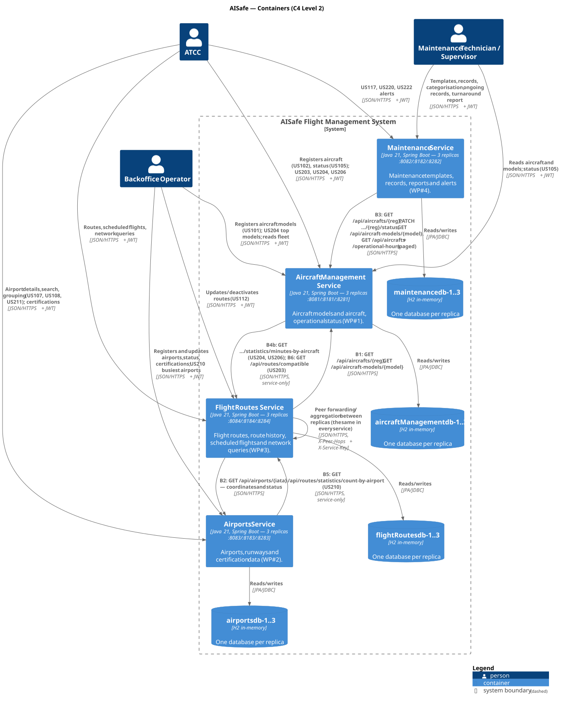


<a id="sec-1-containers"></a>

#### 1. Containers

The monolith was decomposed by **bounded context** (domain-driven segregation). Each service is a separate Spring Boot application, runs as **three replicas**, and each replica owns **its own database**. Data of another service is only reachable through that service's REST API.

| Container | Technology | Replicas (port) | Data | Responsibility (bounded context) | Details |
|---|---|---|---|---|---|
| **Aircraft Management Service** | Java 21, Spring Boot 4 | 8081 / 8181 / 8281 | H2 `aircraftManagementdb-N` | *Fleet*: aircraft models, aircraft, operational status (WP#1) | [L3](#src-3-components-aircraftmanagement-aircraftmanagement-component) |
| **Maintenance Service** | Java 21, Spring Boot 4 | 8082 / 8182 / 8282 | H2 `maintenancedb-N` | *Maintenance*: templates, records, reports and due-maintenance alerts (WP#4) | [L3](#src-3-components-maintenance-maintenance-components) |
| **Airports Service** | Java 21, Spring Boot 4 | 8083 / 8183 / 8283 | H2 `airportsdb-N` | *Airport infrastructure*: airports, runways, certification (WP#2) | [L3](#src-3-components-airports-airports-components) |
| **Flight Routes Service** | Java 21, Spring Boot 4 | 8084 / 8184 / 8284 | H2 `flightRoutesdb-N` | *Flight operations*: routes, history, scheduled flights, network queries (WP#3) | [L3](#src-3-components-flightroutes-flightroutes-components) |
| *common* (library, not a container) | Java library | embedded in every service | — | Security, peer forwarding, resilience, audit — the same distributed behaviour in every container | [L3](#src-3-components-common-common-components) |

Ports, database names and per-replica configuration: [Ports.md](#src-2-containers-ports).


<a id="sec-2-communication-between-containers"></a>

#### 2. Communication between containers

All communication is **synchronous HTTP/REST with JSON** (commands and queries; the assignment does not allow events/message queues).

**Users** call every service's REST API (Swagger at `/swagger-ui.html`) with `Authorization: Bearer <JWT>`. Which role reaches which container is decided by each service's `<Service>AuthorizationRules`:

| Role | Aircraft Management | Airports | Flight Routes | Maintenance |
|---|---|---|---|---|
| Backoffice Operator | registers aircraft models (US101); US204 top models; reads aircraft and models | registers and updates airports, operational status, certifications (US106, US106a, US109, US208); US210 busiest airports | updates / deactivates routes (US112) | — |
| ATCC | registers aircraft (US102); status (US105); US203, US204, US206; reads aircraft and models | airport details, search and grouping (US107, US108, US211); certifications (US106a) | routes, route history, scheduled flights, network queries (US110–US114, US209, US212–US216) | statistics, cost report and alerts (US117, US220, US222) |
| Maintenance Technician / Supervisor | reads aircraft and models; status (US105) | — | — | templates, records, categorisation, ongoing records, turnaround report |

The `ADMIN` role exists in the token, but no endpoint requires it.

Calls **between** containers:

| From | To | Endpoints | Purpose |
|---|---|---|---|
| Flight Routes | Airports | B2: `GET /api/airports/{iata}` | Coordinates (route distance) and operational status (US110, US209, US212, US216) |
| Flight Routes | Aircraft Management | B1: `GET /api/aircrafts/{reg}`, `GET /api/aircraft-models/{model}` | Status, seating capacity and range (US212, US213) |
| Aircraft Management | Flight Routes | B4b: `GET /api/scheduled-flights/statistics/minutes-by-aircraft` | Flight minutes per aircraft for US204 (top models) and US206 (operational hours) |
| Aircraft Management | Flight Routes | B6: `GET /api/routes/compatible?range=&capacity=` | Active routes compatible with an aircraft (US203) |
| Airports | Flight Routes | B5: `GET /api/routes/statistics/count-by-airport` | Route counts per airport, ranked by Airports (US210 busiest airports) |
| Maintenance | Aircraft Management | B3a: `GET /api/aircrafts/{reg}` | Aircraft exists, its model and status (US115 records, US116 history) |
| Maintenance | Aircraft Management | B3b: `PATCH /api/aircrafts/{reg}/status` | `UNDER_MAINTENANCE` when a record starts (US115), `AVAILABLE` when the last ongoing record is completed (US119), compensation on rollback |
| Maintenance | Aircraft Management | B3c: `GET /api/aircraft-models/{model}` | Applicable models of a template exist (US115 templates) |
| Maintenance | Aircraft Management | B3d: `GET /api/aircrafts?page=&size=100`, `GET /api/aircrafts/operational-hours?page=&size=100` (all pages) | Fleet and flight hours for due-maintenance alerts (US222) |
| Replica | other replicas of the **same** service | the same endpoint that was called (or its non-paginated `/search` / statistics variant), with `X-Peer-Hops: 1` | Peer forwarding / aggregation (section 3.2) |

The B4b, B5 and B6 endpoints are **service-only** (section 3.5): a user calling them directly gets `401`, even with a valid JWT. Flight Routes also provides `GET /api/scheduled-flights/operational-hours` (B4a), but no other service calls it.

Maintenance is only a consumer: no other service calls it, and the aircraft status in Aircraft Management is the single source of truth for availability (Flight Routes never calls Maintenance).

Exact request/response schemas, status codes, roles and replica behaviour of each call: [Integration-Contracts.md](#src-2-containers-integration-contracts).

**Context mapping (DDD):** a caller is a *customer* of the called service (*supplier*); each caller translates the remote DTOs into its own model in an **anti-corruption layer** (`clients` package). Aggregates of other services are referenced only **by identity** (IATA code, registration number). The `common` library is a technical *shared kernel* without domain classes.

**HTTP headers used between containers**

| Header | Direction | Meaning |
|---|---|---|
| `Authorization: Bearer <JWT>` | request | End user; forwarded unchanged to peers and remote services |
| `X-Correlation-Id` | request/response | Request id, propagated to every replica/service and written in every log line |
| `X-Peer-Hops` | request | Present only in replica-to-replica calls; the receiver answers with local data only |
| `X-Service-Key` | request | Shared secret that authenticates the calling service. Sent automatically by `common` on every inter-service and peer call; **required** on peer calls and on the service-only Flight Routes endpoints |
| `X-Caller-Instance` | request | Calling replica/service (audit) |
| `X-Partial-Response`, `X-Unavailable-Peers` | response | A replica did not answer; the result may be incomplete |


<a id="sec-3-distribution-design-decisions"></a>

#### 3. Distribution design decisions


<a id="sec-3-1-instance-replication-and-data-partitioning"></a>

##### 3.1 Instance replication and data partitioning

- **Cloning:** the same JAR runs three times with the Spring profiles `instance1`, `instance2`, `instance3` (port, instance id, database, peer list in `application-instanceN.properties`).
- **Database per replica:** no shared database. A record is stored in the replica that received the write (partitioning by write location).
- **Single owner per record:** a write to an existing record is executed by the replica that stores it; other replicas forward the command to it (unicast). Each record has exactly one version, so there are no write conflicts between replicas.
- **Peer discovery:** static peer list per replica (`aisafe.peers.urls`), full mesh, excluding the replica itself.


<a id="sec-3-2-peer-to-peer-query-resolution-and-response-aggregation"></a>

##### 3.2 Peer-to-peer query resolution and response aggregation

When a GET reaches a replica that does not hold all the data, the replica forwards the query to its peers and aggregates the answers (implemented once, in `PeerClient` of the `common` library):

| Kind of GET | Strategy |
|---|---|
| One resource by id | Local lookup; if missing, **parallel** GET to all peers; the first `200` wins; `404` means "not mine"; nobody has it → `404` |
| Collections | Local query + the **same GET** to all peers in parallel; merge **by id** (local copy wins); paginate **after** merging |
| Statistics / counts | Each replica computes over its own data; results are **summed** (each record lives in exactly one replica) |

- **No forwarding loops:** peer calls carry `X-Peer-Hops: 1`; a peer request is answered only with local data and never forwarded again (one hop reaches every replica in a full mesh). `X-Peer-Hops > 1` is rejected.
- **Same endpoint, same authorization:** peers are called on the endpoint the client called, with the user's JWT, so they apply the same access rules.


<a id="sec-3-3-consistency-model-cap"></a>

##### 3.3 Consistency model (CAP)

AISafe favours **Availability and Partition tolerance (AP)** with **eventual consistency**:

- During a failure or partition every reachable replica keeps answering reads (with the data it can reach, flagged with `X-Partial-Response: true`) and accepting writes.
- Data stored in an unreachable replica is temporarily invisible (a GET by id returns `404`, flagged as partial) and reappears as soon as the replica recovers — there is no stale copy to reconcile, because each record has a single owner.
- Cross-replica uniqueness rules (e.g. one route per origin/destination, one flight per aircraft and time slot) are checked against the local data **and the peers that answer**. Under a partition, or with truly simultaneous writes on two replicas, a duplicate can be created — the accepted price of AP.
- Inside the owner replica, optimistic locking (`@Version`) turns two **overlapping** updates of the same record into one success and one `409`. The version is not part of any update request (no `version` field, `ETag` or `If-Match`), so a client that updates from stale data is not detected: sequential updates are last-writer-wins ([Integration-Contracts §8](#sec-8-known-limitations)).
- A strongly consistent alternative (single writer / quorum / consensus) would block writes during partitions and is out of scope for Assignment 1.


<a id="sec-3-4-fault-tolerance"></a>

##### 3.4 Fault tolerance

| Mechanism | Configuration (`aisafe.*`) |
|---|---|
| **Timeouts** on every remote call | `http.connect-timeout=1s`, `http.read-timeout=3s`, `http.aggregation-timeout=5s` |
| **Retry with exponential backoff** (only I/O errors, timeouts, 5xx; never 4xx) | `http.max-retries=2`, `http.initial-backoff=100ms` |
| **Circuit breaker** per target (CLOSED → OPEN after N failures → HALF_OPEN after the open time) | `circuit-breaker.failure-threshold=3`, `circuit-breaker.open-duration=10s` |
| **Load balancing + failover** to other services (round-robin over all their replicas) | `services.<service>.urls` |
| **Graceful degradation** — partial responses instead of errors | `X-Partial-Response` |
| **Health checks** — `/actuator/health` with the circuit state of each peer | public endpoint |
| `503 Service Unavailable` only when **no** replica of a remote service answers | — |


<a id="sec-3-5-security"></a>

##### 3.5 Security

| Concern | Implementation |
|---|---|
| **Access control (RBAC)** | Stateless JWT validated by every replica (shared `jwt.secret`), roles in the token, per-endpoint rules in each service (`<Service>AuthorizationRules`). Unauthenticated → `401`, wrong role → `403`. |
| **Inter-service authentication** | Shared secret `X-Service-Key` (`aisafe.security.service-key`, env `AISAFE_SERVICE_KEY`), compared in constant time, **sent automatically on every inter-service and peer call** by the `common` `RestClient`. It is **required** (otherwise `401`) on replica-to-replica calls (`X-Peer-Hops`) and on the **service-only** endpoints a provider lists in `aisafe.security.service-only-paths` — in Flight Routes: `count-by-airport` (B5), `compatible` (B6), `minutes-by-aircraft` (B4b), `operational-hours` (B4a) and `usage-by-route`. A wrong key is always rejected. The user's JWT and role are still checked. |
| **Encryption in transit** | Profile `tls`: HTTPS (TLS 1.3/1.2) on every replica and on every outgoing call (`aisafe.scheme=https`, truststore `aisafe.tls.trust-store`). The development certificate (CN/SAN `localhost`) is **not in git**: `code/scripts/generate-dev-certs.*` creates it in `code/common/src/main/resources/tls/`, and the jars must be rebuilt afterwards (the start scripts stop with instructions if it is missing). |
| **Audit logging** | Logger `AUDIT`: one line per request with user, roles, method, path, status, source (`client:<ip>`, `peer:<replica>`, `service:<name>`), duration and correlation id; one log file per replica (`code/logs/<service>-N.log`). |
| **Development token** | `POST /auth/dev-token` only while there is no login service; **enabled by default**, disabled with `AISAFE_DEV_TOKEN=false`. `jwt.secret` and the service key also have development defaults in `application.properties` and must be overridden (`JWT_SECRET`, `AISAFE_SERVICE_KEY`) outside development. |
| **Per-service rules** | Each `<Service>AuthorizationRules` lists only its own endpoints and must not call `anyRequest()`: `common` adds `anyRequest().authenticated()` and stops the service at start-up with a message naming the class if a rule calls it. |


<a id="sec-4-deployment"></a>

#### 4. Deployment

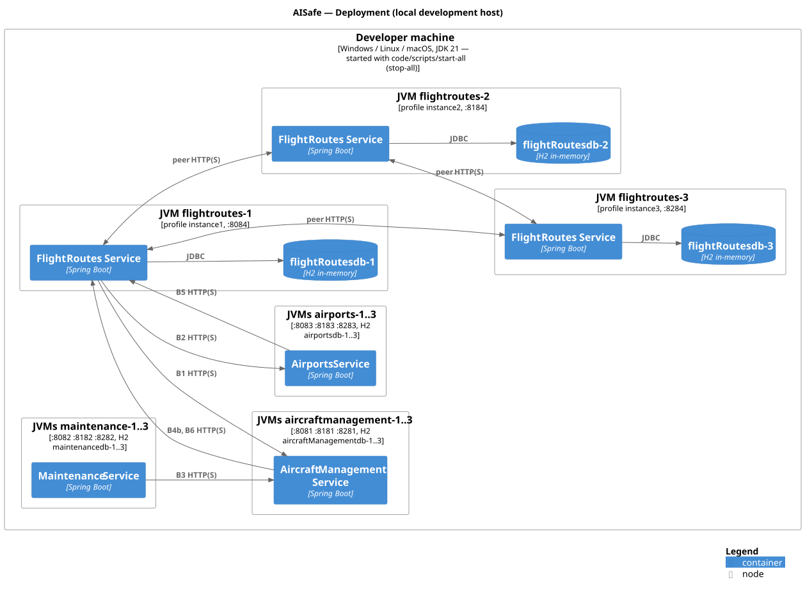

Local deployment: every replica is a JVM on the developer machine (12 JVMs with 3 replicas of each service), started from `code/` with:

```bash
./scripts/start-all.sh [replicas 1-3] [profiles] [jvm-options]                 # all 4 services; defaults: 3, none, -Xmx320m
.\scripts\start-all.ps1 [-Replicas 1-3] [-Profiles demo,tls] [-Memory "-Xmx320m"]   # Windows
./scripts/stop-all.sh            .\scripts\stop-all.ps1                         # stops everything start-all started
./scripts/start-replicas.sh <service> [demo][,tls]                             # the 3 replicas of one service
.\scripts\start-replicas.ps1 -Service <service> [-Profiles demo]
./scripts/run-instance.sh <service> <1|2|3> [profiles]                          # a single replica
```

`start-all` builds the jars once if they are missing (or older than the TLS certificate), starts every replica through `run-instance`, writes `code/logs/<service>-<n>.out` and `.pid` (git-ignored), waits for `/actuator/health` and prints a table of URLs and health. `stop-all` stops every replica listed in `code/logs/*.pid`, including the JVM under each wrapper. Each replica also writes its own log `code/logs/<service>-<n>.log` (including the audit lines). On a machine with little memory, use 1 replica per service.

The diagram details Flight Routes; the other services are deployed the same way (one JVM and one H2 database per replica). Ports and per-replica configuration: [Ports.md](#src-2-containers-ports).

<a id="src-2-containers-ports"></a>

*Source: docs/2-containers/Ports.md*


<a id="sec-port-allocation-c4-level-2-deployment-configuration"></a>

### Port Allocation (C4 Level 2 — deployment configuration)

The last digit identifies the service, the hundreds digit identifies the replica.

| Service | Module | WP | Replica 1 (`instance1`) | Replica 2 (`instance2`) | Replica 3 (`instance3`) | H2 database (one per replica) |
|---|---|---|---|---|---|---|
| Aircraft Management | `aircraftmanagement` | WP#1 | 8081 | 8181 | 8281 | `aircraftManagementdb-N` |
| Maintenance | `maintenance` | WP#4 | 8082 | 8182 | 8282 | `maintenancedb-N` |
| Airports | `airports` | WP#2 | 8083 | 8183 | 8283 | `airportsdb-N` |
| Flight Routes | `flightroutes` | WP#3 | 8084 | 8184 | 8284 | `flightRoutesdb-N` |


<a id="sec-configuration"></a>

#### Configuration

Each module has, in `src/main/resources/`:

| File | Content |
|---|---|
| `application.properties` | Shared configuration; defaults = replica 1 |
| `application-instance1/2/3.properties` | `server.port`, `aisafe.instance-id`, `spring.datasource.url` and `aisafe.peers.urls` (the **other** two replicas) of each replica |
| `application-tls.properties` | HTTPS (`aisafe.scheme=https`, server keystore, client truststore) |
| `application-demo.properties` | Optional demo data, different in each replica (`airports`, `flightroutes`, `maintenance`). Aircraft Management has no `demo` profile: it always loads its demo models and aircraft (`aisafe.bootstrap.enabled=true`); Maintenance always loads its reference templates |

```properties
# application-instance2.properties of airports
server.port=8183
aisafe.instance-id=airports-2
spring.datasource.url=jdbc:h2:mem:airportsdb-2;DB_CLOSE_DELAY=-1
aisafe.peers.urls=${aisafe.scheme}://localhost:8083,${aisafe.scheme}://localhost:8283
```

Calls to **other** services list all their replicas (round-robin + failover):

```properties
services.airports.urls=${aisafe.scheme}://localhost:8083,${aisafe.scheme}://localhost:8183,${aisafe.scheme}://localhost:8283
```

Start a replica with `--spring.profiles.active=instanceN` (or `scripts/run-instance.*`); start everything with `scripts/start-all.*` and stop it with `scripts/stop-all.*` ([Containers §4](#sec-4-deployment)). Without a profile a service starts as replica 1.
Spring Boot defaults to port 8080: without these properties only the first service to start would boot (`Port 8080 was already in use`).

<a id="src-2-containers-integration-contracts"></a>

*Source: docs/2-containers/Integration-Contracts.md*


<a id="sec-integration-contracts-l2"></a>

### Integration Contracts (L2)

This is the reference for the REST calls **between** AISafe services. If you implement a service that another service calls, implement exactly what is written here. If you call another service, expect exactly this.

Every statement about existing code was taken from the code and has a **Source** line. All bridges are implemented on both sides, except B4a, which has no consumer. The decisions are closed (section 7); what the code does not do is listed in **Known limitations** (section 8).

> FR = `code/flightroutes/src/main/java/isep/psoft/aisafe` · COMMON = `code/common/src/main/java/isep/sidis/common`

---


<a id="sec-1-purpose-and-status-legend"></a>

#### 1. Purpose and status legend

| Status | Meaning |
|---|---|
| `IMPLEMENTED` | Provider and consumer both exist in code. |
| `IMPLEMENTED (provider only)` | The provider endpoint exists in code; no other service calls it. |
| `CONSUMER-ONLY` | The consumer exists in code; the **provider must implement exactly this contract**. |
| `PROPOSED` | Agreed design; nothing implemented on either side. |

Requirements that originate in the work order or assignment (US105, US106a, US115, US119, US204, US222) are identified as assignment requirements; bridge status indicates which consumer/provider sides are implemented.

---


<a id="sec-2-global-conventions"></a>

#### 2. Global conventions


<a id="sec-2-1-paths"></a>

##### 2.1 Paths
- Every business endpoint is under **`/api`**, declared in the controller's class-level `@RequestMapping` (there is no context-path or global prefix).
- Resource names are used **exactly as in code**: `/api/routes`, `/api/scheduled-flights`, `/api/aircrafts` (sic), `/api/aircraft-models`, `/api/airports`, `/api/maintenance-templates`, `/api/maintenance-records`, `/api/maintenance-alerts`.
- Paths that are not business endpoints (no `/api`):
  - `POST /auth/dev-token`
  - `/actuator/health`, `/actuator/health/**`, `/actuator/info`
  - `/v3/api-docs/**`, `/swagger-ui/**`, `/swagger-ui.html`
  - `/h2-console/**`, `/error`
- Source: `FR/flightroutes/controllers/FlightRouteController.java`, `FR/flightroutes/controllers/ScheduledFlightController.java`, `COMMON/security/JwtSecurityAutoConfiguration.java`, `FR/flightroutes/clients/AircraftClient.java`, `FR/flightroutes/clients/AirportClient.java`


<a id="sec-2-2-json-dates-and-units"></a>

##### 2.2 JSON, dates and units
- **Field names are camelCase**, exactly as the Java DTO properties (Jackson defaults, no naming strategy configured). Some names keep upper-case acronyms: `originIATA`, `destIATA`, `routeID`.
- **Dates and times use ISO-8601:**
  - date `"2026-11-02"` (`LocalDate`)
  - time `"08:00:00"` (`LocalTime`)
  - query parameters use `@DateTimeFormat(iso = DATE | TIME)`
- **Enums travel as upper-case strings**, not as JSON enums. Values in use:
  - aircraft status: `AVAILABLE`, `IN_FLIGHT`, `UNDER_MAINTENANCE`, `INACTIVE`
  - airport status: `OPERATIONAL` (the only value Flight Routes checks)
  - route status: `ACTIVE`, `INACTIVE`
  - scheduled-flight status: `SCHEDULED` (future states: `DELAYED`, `IN_FLIGHT`, `COMPLETED`, `CANCELED`)
- **Units:**
  - distances in km (Haversine)
  - flight times in minutes
  - `maximumRange` / `minRange` are compared directly, so they use the same unit as the route distance: kilometres (Q9)
- **Unknown fields are ignored** by the Flight Routes clients (`@JsonIgnoreProperties(ignoreUnknown = true)`). Providers may add fields, including HATEOAS `_links`, but must not rename or remove the ones listed here.
- Source: `FR/flightroutes/dto/ScheduledFlightDTO.java`, `FR/flightroutes/dto/FlightRouteDTO.java`, `FR/flightroutes/controllers/ScheduledFlightController.java`, `FR/flightroutes/services/CreateScheduledFlightService.java` (aircraft status comment), `FR/flightroutes/clients/AircraftSnapshot.java`, `FR/flightroutes/clients/AirportSnapshot.java`, `FR/flightroutes/domain/RouteStatus.java`, `FR/flightroutes/domain/FlightStatus.java`, `FR/flightroutes/domain/RouteDistance.java`


<a id="sec-2-3-identifiers"></a>

##### 2.3 Identifiers

| Identifier | Format in code | Notes |
|---|---|---|
| IATA code | 3 characters (`@Size(min=3,max=3)` on `CreateRouteDTO`). Flight Routes **upper-cases** it before calling Airports | No letters-only regex exists. Providers should accept and return upper case |
| Aircraft registration (`registrationNumber`) | Validated by Aircraft Management on creation (`^[A-Z0-9]{1,2}-[A-Z0-9]{2,5}$`, upper case), e.g. `CS-TUA`. Flight Routes sends it **as received** (`@NotBlank` only); Maintenance trims and upper-cases it | Lookups are exact and case-sensitive (Q10, section 8) |
| Aircraft model (`modelName`) | Free string, e.g. `A320`. Taken from the aircraft response and used as a path variable | |
| Route ID, scheduled-flight ID | UUID string (`@GeneratedValue(strategy = UUID)`) | Generated by the replica that stores the entity, so it is globally unique across replicas |

Path variables are expanded with URI templates, so they are URL-encoded (e.g. a space in a model name).

Source: `FR/flightroutes/dto/CreateRouteDTO.java`, `FR/flightroutes/dto/CreateScheduledFlightDTO.java`, `FR/flightroutes/clients/AirportClient.java`, `FR/flightroutes/domain/FlightRoute.java`, `FR/flightroutes/domain/ScheduledFlight.java`


<a id="sec-2-4-error-body-and-status-codes"></a>

##### 2.4 Error body and status codes
Every service has a `GlobalExceptionHandler` (each skeleton already contains one), which returns:

```json
{ "error": "Aircraft not found: CS-XYZ" }
```

Exceptions to this shape:
- **Bean Validation failures** (`@Valid`) return a map from field to message, with no `error` key: `{"minRange": "Minimum range must be positive"}`.
- **401 for a missing or invalid JWT** has an **empty body** (`HttpStatusEntryPoint`). A **401 from `ServiceKeyFilter`** (missing or wrong `X-Service-Key`, section 2.8) does use `{"error": "..."}`.
- **403 (wrong role)** and **errors without a handler** (e.g. a missing required query parameter) use Spring Boot's default error body, not `{"error": ...}`.

Consumers should therefore decide on the **status code**, not on the body.

| Status | Meaning (exception → status in `GlobalExceptionHandler`) |
|---|---|
| 200 | OK |
| 201 | Created. `POST /api/scheduled-flights` also sets `Location`; `POST /api/routes` does not |
| 400 | `IllegalArgumentException`, validation failure, invalid `X-Peer-Hops` |
| 401 | No or invalid JWT; peer request without `X-Service-Key`; request to a service-only endpoint without `X-Service-Key` (section 2.8); wrong `X-Service-Key` |
| 403 | Authenticated, but the role is not allowed |
| 404 | `EntityNotFoundException` (local entity, or remote aircraft/airport not found) |
| 409 | `IllegalStateException` (business conflict) or `ObjectOptimisticLockingFailureException` (`@Version` clash; message `"The resource was updated by another user. Please refresh and try again."`) |
| 422 | `RouteRequirementsNotMetException` (Flight Routes only; not in the skeleton handlers) |
| 503 | `RemoteServiceUnavailableException`: no replica of a remote service answered. Message `"<Service> service is unavailable."` |
| 500 | Any exception without a handler, e.g. an unexpected 4xx from a remote service (see B1/B2) |

Source: `FR/exceptions/GlobalExceptionHandler.java`, `code/aircraftmanagement/src/main/java/isep/psoft/aisafe/exceptions/GlobalExceptionHandler.java` (same as Flight Routes, without the 422 handler; airports and maintenance likewise), `COMMON/security/JwtSecurityAutoConfiguration.java`, `COMMON/security/ServiceKeyFilter.java`, `COMMON/remote/RemoteServiceUnavailableException.java`


<a id="sec-2-5-headers-authentication-and-correlation-id"></a>

##### 2.5 Headers, authentication and correlation ID

| Header | Direction | Set by | Checked by |
|---|---|---|---|
| `Authorization: Bearer <JWT>` | request | End user. On every inter-service and peer call it is **copied from the incoming request** (`OutboundHeaders.capture`, added by `InterServiceHeadersInterceptor`) | `JwtAuthenticationFilter`, then the service's `AuthorizationRules` |
| `X-Service-Key` | request | `OutboundHeaders` (value of `aisafe.security.service-key`) on every inter-service and peer call | `ServiceKeyFilter`: **mandatory on peer calls** (`X-Peer-Hops` present) **and on the service-only paths** of the provider (`aisafe.security.service-only-paths`, section 2.8); if sent on any other request it must match, otherwise 401 |
| `X-Peer-Hops` | request | `PeerClient` only (replica → replica of the same service), value `1` | `ServiceKeyFilter` (must be 1..`MAX_PEER_HOPS`=1, otherwise 400); `PeerClient.isPeerRequest()` makes the receiver answer with local data only |
| `X-Correlation-Id` | request and response | `CorrelationIdFilter` (reuses the incoming id if it matches `[A-Za-z0-9._-]{1,64}`, otherwise a new UUID), echoed in the response and propagated by `OutboundHeaders` | Written to every log line (MDC) and to the audit log |
| `X-Caller-Instance` | request | `OutboundHeaders` (`aisafe.instance-id`) | Informational only |
| `X-Partial-Response: true` | response | `PeerClient.markPartial` when at least one peer did not answer | Consumers (optional) |
| `X-Unavailable-Peers: <n>` | response | Same as above | Consumers (optional) |

**Authentication between services:**
1. The caller's **JWT is propagated**, so the provider authorises the **end user's roles**, not the calling service. When you implement a provider endpoint, allow the roles of the users whose use cases trigger the call (listed in each bridge).
2. All services share `jwt.secret`. The roles go in the `roles` claim as `ROLE_<NAME>`. The roles that exist are `ADMIN`, `BACKOFFICE_OPERATOR`, `ATCC`, `MAINTENANCE_TECHNICIAN` and `MAINTENANCE_SUPERVISOR`.
3. `X-Service-Key` is **sent automatically on every inter-service and peer call** (the `common` `RestClient` adds it; service code never sets it). It is **required** on peer calls and on the endpoints a provider declares as service-only (section 2.8); on other endpoints a call without it is accepted if the JWT is valid (Q11, decided).

Source: `COMMON/http/AisafeHeaders.java`, `COMMON/http/OutboundHeaders.java`, `COMMON/http/InterServiceHeadersInterceptor.java`, `COMMON/security/ServiceKeyFilter.java`, `COMMON/observability/CorrelationIdFilter.java`, `COMMON/peers/PeerClient.java`, `COMMON/security/JwtTokenProvider.java`, `COMMON/security/JwtAuthenticationFilter.java`, `COMMON/security/DevTokenController.java`


<a id="sec-2-6-pagination"></a>

##### 2.6 Pagination
Every paginated endpoint paginates **in memory, after merging every replica's data**, with `page` (0-based) and `size`. There are three page formats (Q8):

| Service | Endpoints | Format | Limits |
|---|---|---|---|
| Flight Routes | `GET /api/scheduled-flights?aircraft=…` (US213) | HAL `PagedModel` (Spring HATEOAS): `_embedded` (key derived from the DTO class name; no `@Relation` declared), `_links`, `page {size, totalElements, totalPages, number}` | Spring defaults: size 20, maximum 2000 |
| Flight Routes | `GET /api/scheduled-flights/operational-hours` (B4a, US206) | Spring Data `Page` serialised **directly** (`spring.data.web.pageable.serialization-mode` default `direct` in Spring Boot 4.0.6): `content`, `totalElements`, `totalPages`, `size`, `number`, `numberOfElements`, `first`, `last`, `empty`, `sort`, `pageable` | Spring defaults: size 20, maximum 2000 |
| Aircraft Management | `GET /api/aircrafts` (US104), `GET /api/aircrafts/operational-hours` (US206) | `PageDTO`: `{ "content": [...], "page", "size", "totalElements", "totalPages" }` | size 1–100 (default 20), otherwise 400 |
| Maintenance | `GET /api/maintenance-records` (US218), `GET /api/maintenance-records/aircraft/{registration}` (US116), `GET /api/maintenance-records/ongoing` (US219) | `PageDTO`, same fields as Aircraft Management | size 1–100 (default 20), otherwise 400 |

Things to know:
- In Flight Routes, `sort` is **ignored** by `Pages.of`. Operational hours are always sorted by `registrationNumber`.
- A **peer** request to `GET /api/aircrafts` gets the plain local list (no page), which the receiving replica merges and pages. Maintenance uses separate non-paginated endpoints for peers (`GET /api/maintenance-records/search`).
- No other endpoint paginates; collections are plain JSON arrays or objects.

Source: `FR/flightroutes/controllers/ScheduledFlightController.java`, `FR/flightroutes/services/Pages.java`, `FR/flightroutes/services/CalculateOperationalHoursService.java`, `code/aircraftmanagement/.../controllers/AircraftController.java`, `AircraftStatisticsController.java`, `dto/PageDTO.java`, `code/maintenance/.../controllers/MaintenanceRecordController.java`, `dto/PageDTO.java`, `spring-boot-data-commons-4.0.6.jar` configuration metadata (default `direct`)


<a id="sec-2-7-configuration-properties"></a>

##### 2.7 Configuration properties
| Property | Purpose | Defaults (in `AisafeProperties`, repeated in each `application.properties`) |
|---|---|---|
| `services.<name>.urls` | Base URLs of **all replicas** of another service, comma-separated. Names in use: `services.aircraft.urls`, `services.airports.urls`, `services.maintenance.urls`, `services.flightroutes.urls` | — |
| `aisafe.peers.urls` | Base URLs of the **other** replicas of the same service (excluding itself). One per instance profile | — |
| `aisafe.instance-id` | Replica name in logs and audit | `unknown` → `spring.application.name:server.port` |
| `aisafe.security.service-key` | Shared inter-service secret (`AISAFE_SERVICE_KEY`) | empty |
| `aisafe.security.service-only-paths` | Paths (Ant patterns) that only other AISafe services may call: without a valid `X-Service-Key` → 401 (section 2.8). Set only by Flight Routes | empty |
| `jwt.secret` | Shared JWT signing key (`JWT_SECRET`) | — |
| `aisafe.http.connect-timeout` | Connect timeout of every inter-service call | `1s` |
| `aisafe.http.read-timeout` | Read timeout of every inter-service call | `3s` |
| `aisafe.http.max-retries` | Extra attempts after a transient failure | `2` |
| `aisafe.http.initial-backoff` | Wait before the first retry; doubles on each attempt | `100ms` |
| `aisafe.http.aggregation-timeout` | Maximum wait for all peers in an aggregation | `5s` |
| `aisafe.circuit-breaker.failure-threshold` | Consecutive failures before the circuit (per base URL) opens | `3` |
| `aisafe.circuit-breaker.open-duration` | Time OPEN before HALF_OPEN | `10s` |

**Transient failures** are timeouts, refused connections (`ResourceAccessException`), any 5xx (`HttpServerErrorException`) and an open circuit (`CircuitOpenException`). They are retried, count towards the circuit breaker and trigger failover to the next replica. **A 4xx is not transient**: the target is alive, so the 4xx counts as a success for the circuit breaker and is passed to the caller as-is, with no retry and no failover.

Source: `COMMON/config/AisafeProperties.java`, `COMMON/resilience/ResilientExecutor.java`, `COMMON/resilience/CircuitBreaker.java`, `COMMON/remote/ReplicatedServiceClient.java`, `FR/flightroutes/clients/RestClientConfig.java`, `code/*/src/main/resources/application.properties`


<a id="sec-2-8-service-only-endpoints"></a>

##### 2.8 Service-only endpoints
Some provider endpoints return raw data that only another service uses (counts, minutes, compatible routes). They are listed in the provider's `aisafe.security.service-only-paths`, and `ServiceKeyFilter` rejects any request to them that has **no** `X-Service-Key`, **even with a valid JWT**:

```json
{"error":"This endpoint is only available to AISafe services."}
```

A wrong key gets `401 {"error":"Invalid service key."}`. With a valid key the request continues to the JWT and role checks as usual (the key does not replace the JWT). Paths are matched after removing the context path and decoding the segments, so an encoded variant (`/api/routes/%63ompatible`) is also rejected.

Configured in Flight Routes (`code/flightroutes/src/main/resources/application.properties`); no other service declares service-only paths:

| Path | Bridge | Called by |
|---|---|---|
| `/api/routes/statistics/count-by-airport` | B5 | Airports |
| `/api/routes/compatible` | B6 | Aircraft Management |
| `/api/scheduled-flights/statistics/minutes-by-aircraft` | B4b | Aircraft Management |
| `/api/scheduled-flights/operational-hours` | B4a | no consumer (Flight Routes replicas only) |
| `/api/scheduled-flights/statistics/usage-by-route` | — | Flight Routes replicas (US214 aggregation) |

Consumers need no code for this: the key is added by `common` to every outgoing call.

Source: `COMMON/security/ServiceKeyFilter.java`, `COMMON/config/AisafeProperties.java` (`Security.serviceOnlyPaths`), `COMMON/security/JwtSecurityAutoConfiguration.java`, `code/flightroutes/src/test/java/isep/psoft/aisafe/distributed/ServiceOnlyEndpointsSecurityTest.java`, `code/common/src/test/java/isep/sidis/common/security/ServiceKeyFilterTest.java`

---


<a id="sec-3-bridge-catalogue"></a>

#### 3. Bridge catalogue

| ID | Consumer → Provider | Purpose (US) | Endpoint | Status |
|---|---|---|---|---|
| B1a | Flight Routes → Aircraft Management | Aircraft status, capacity and model (US212, US213) | `GET /api/aircrafts/{registrationNumber}` | `IMPLEMENTED` |
| B1b | Flight Routes → Aircraft Management | Maximum range of the aircraft model (US212) | `GET /api/aircraft-models/{modelName}` | `IMPLEMENTED` |
| B2 | Flight Routes → Airports | Coordinates, existence, operational status (US110, US209, US212, US216) | `GET /api/airports/{iataCode}` | `IMPLEMENTED` |
| B3a | Maintenance → Aircraft Management | Aircraft exists and its model, for template applicability (US115, US116) | reuse B1a (`GET /api/aircrafts/{registrationNumber}`) | `IMPLEMENTED` |
| B3b | Maintenance → Aircraft Management | Set the status to `UNDER_MAINTENANCE` / back to `AVAILABLE` (US115, US119) | `PATCH /api/aircrafts/{registrationNumber}/status` (US105) | `IMPLEMENTED` |
| B3c | Maintenance → Aircraft Management | Applicable models of a template exist (US115 templates) | reuse B1b (`GET /api/aircraft-models/{modelName}`) | `IMPLEMENTED` |
| B3d | Maintenance → Aircraft Management | Fleet and flight hours per aircraft (US222) | `GET /api/aircrafts?page=&size=` (US104), `GET /api/aircrafts/operational-hours?page=&size=` (US206) | `IMPLEMENTED` |
| B4a | (none) → Flight Routes | Paged operational hours per aircraft | `GET /api/scheduled-flights/operational-hours` (service-only) | `IMPLEMENTED (provider only)`: no service calls it; Aircraft Management computes US206 from B4b |
| B4b | Aircraft Management → Flight Routes | Flight minutes per aircraft: US204 (top models) and US206 (operational hours) | `GET /api/scheduled-flights/statistics/minutes-by-aircraft` (service-only) | `IMPLEMENTED` |
| B5 | Airports → Flight Routes | Number of routes per airport (US210) | `GET /api/routes/statistics/count-by-airport` (service-only) | `IMPLEMENTED` |
| B6 | Aircraft Management → Flight Routes | Active routes compatible with an aircraft (US203) | `GET /api/routes/compatible?range=&capacity=` (service-only) | `IMPLEMENTED` |

**Design rule:** Aircraft Management's aircraft `status` is the **single source of truth for availability**. Maintenance changes it through B3b. **Flight Routes never calls Maintenance**; it only reads the status through B1a.

---


<a id="sec-4-bridges"></a>

#### 4. Bridges


<a id="sec-b1-flight-routes-aircraft-management-implemented"></a>

##### B1: Flight Routes → Aircraft Management (`IMPLEMENTED`)

**Consumer:** `AircraftClient` (Flight Routes). **Provider:** Aircraft Management — `AircraftController.getByRegistration` (B1a) and `AircraftModelController.getByName` (B1b), which look the entity up in any replica (`AircraftReplicaQueries`). The provider returns more fields than listed below (e.g. `manufacturingDate`, `manufacturer`); Flight Routes ignores them.

**Use cases that trigger the calls:**

| Use case | Service | Call | What it does with the result |
|---|---|---|---|
| US212 create scheduled flight | `CreateScheduledFlightService` | `getAircraft` → B1a then B1b | `registrationNumber`, `seatingCapacity`, `maximumRange`, `status` |
| US213 scheduled flights of an aircraft | `ViewScheduledFlightsByAircraftService` | `exists` → B1a only | existence only |


<a id="sec-b1a-get-api-aircrafts-registrationnumber"></a>

###### B1a: `GET /api/aircrafts/{registrationNumber}`
- **Request:** path variable `registrationNumber`, as typed by the user (not normalised). No body or query parameters.
- **Response 200**, a JSON object. Fields Flight Routes reads (all others, including `_links`, are ignored):

| Field | JSON type (Java) | Required | Description |
|---|---|---|---|
| `registrationNumber` | string (`String`) | **yes** | Stored in the new scheduled flight and used for the overlap check |
| `modelName` | string (`String`) | **yes** | Used as the path variable of B1b |
| `seatingCapacity` | integer (`Integer`) | **yes** | Compared with the route's `minCapacity`. Null causes a 500 (unboxed into `int`) |
| `status` | string (`String`) | **yes** | One of `AVAILABLE`, `IN_FLIGHT`, `UNDER_MAINTENANCE`, `INACTIVE`. **Only `"AVAILABLE"`** (exact, case-sensitive) lets a flight be scheduled |

```json
{ "registrationNumber": "CS-TUA", "modelName": "A320", "seatingCapacity": 180, "status": "AVAILABLE" }
```


<a id="sec-b1b-get-api-aircraft-models-modelname"></a>

###### B1b: `GET /api/aircraft-models/{modelName}`
- **Request:** path variable `modelName` (value from B1a).
- **Response 200:**

| Field | JSON type (Java) | Required | Description |
|---|---|---|---|
| `modelName` | string (`String`) | no (deserialised, not used) | Model name |
| `maximumRange` | number (`Double`) | **yes** | Compared with the route's `minRange` (same unit as route distances, km). Null causes a 500 (unboxed into `double`) |

```json
{ "modelName": "A320", "maximumRange": 6100 }
```


<a id="sec-status-codes-and-how-flight-routes-handles-them-b1a-and-b1b"></a>

###### Status codes and how Flight Routes handles them (B1a and B1b)

| Provider answers | Flight Routes does | Flight Routes' client gets |
|---|---|---|
| 200 | uses the fields above | — |
| 404 on B1a | `EntityNotFoundException("Aircraft not found: <reg>")`; `exists()` returns `false` | **404** (US212, US213) |
| 404 on B1b | `EntityNotFoundException("Aircraft model not found: <model>")` | **404** (US212) |
| 401 / 403 | `ResponseStatusException(<same status>, "Aircraft Management rejected the request.")` | **same 401/403**, `{"error": "Aircraft Management rejected the request."}` |
| other 4xx (e.g. 400) | not handled: the `HttpClientErrorException` propagates | **500**. Providers should return only 200/404/401/403 here |
| 5xx, timeout, connection refused | retried (`max-retries`, exponential backoff), then the next replica (round-robin start, failover) | **503** `{"error": "Aircraft Management service is unavailable."}` if no replica succeeds |
| circuit open on a replica | that replica is skipped (next replica) | 503 if all are open or failing |

US212 then applies its own rules to the data:
- range or capacity too low → **422**
- aircraft not `AVAILABLE` → **409** `"Aircraft <reg> is not available (status: <status>)."`

**Required role on the provider:** the JWT forwarded is the end user's. Flight Routes' rules require **`ATCC`** for `POST /api/scheduled-flights` (US212) and `GET /api/scheduled-flights/**` (US213). Aircraft Management allows `ATCC`, `BACKOFFICE_OPERATOR`, `MAINTENANCE_TECHNICIAN` and `MAINTENANCE_SUPERVISOR` on `GET /api/aircrafts/**` and `GET /api/aircraft-models/**`.

**Replica behaviour:**
- **Consumer:** load balancing across all replicas listed in `services.aircraft.urls`, with failover (`ReplicatedServiceClient`).
- **Provider:** the replica that receives the GET finds the aircraft (or model) in any replica: local first, then `PeerClient.findFirst` (section 5).

**Source:** `FR/flightroutes/clients/AircraftClient.java`, `FR/flightroutes/clients/AircraftSnapshot.java`, `FR/flightroutes/clients/RestClientConfig.java`, `FR/flightroutes/services/CreateScheduledFlightService.java`, `FR/flightroutes/services/ViewScheduledFlightsByAircraftService.java`, `FR/flightroutes/domain/RouteRequirements.java`, `FR/exceptions/GlobalExceptionHandler.java`, `FR/infrastructure/security/FlightRoutesAuthorizationRules.java`, `COMMON/remote/ReplicatedServiceClient.java`, `COMMON/resilience/ResilientExecutor.java`; example values from the stub in `code/flightroutes/src/test/java/isep/psoft/aisafe/distributed/ReplicaCollaborationTest.java`

---


<a id="sec-b2-flight-routes-airports-implemented"></a>

##### B2: Flight Routes → Airports (`IMPLEMENTED`)

**Consumer:** `AirportClient` (Flight Routes). **Provider:** Airports — `AirportController.getByIata` (US107), any replica, case-insensitive IATA.

**Use cases that trigger the call:**

| Use case | Service | Call | What it does with the result |
|---|---|---|---|
| US110 create route | `CreateFlightRouteService` | `getAirport` (origin and destination) | `iataCode`, `latitude`, `longitude` (distance) |
| US209 routes by airport | `ViewRoutesByAirportService` | `exists` (only on the replica that received the client request, not on peer requests) | existence |
| US212 create scheduled flight | `CreateScheduledFlightService` | `getAirport` (origin and destination) | `status` |
| US216 alternative routes | `SearchAlternativeRoutesService` | `exists` (origin and destination) | existence |


<a id="sec-get-api-airports-iatacode"></a>

###### `GET /api/airports/{iataCode}`
- **Request:** path variable `iataCode`, **upper-cased** by the consumer. No body or query parameters.
- **Response 200:**

| Field | JSON type (Java) | Required | Description |
|---|---|---|---|
| `iataCode` | string (`String`) | **yes** | Stored as the route's origin/destination (US110) |
| `latitude` | number (`Double`) | **yes** | Decimal degrees. Null causes a 500 (unboxed into `double`) |
| `longitude` | number (`Double`) | **yes** | Decimal degrees. Null causes a 500 |
| `status` | string (`String`) | **yes** | **Only `"OPERATIONAL"`** (exact) counts as operational. Any other value blocks US212 |

```json
{ "iataCode": "OPO", "latitude": 41.2481, "longitude": -8.6814, "status": "OPERATIONAL" }
```

**Certifications (US106a):** Flight Routes does **not** read any aircraft-model certification of the airport. No field is consumed and no check exists in US212. Airports returns `certifiedModels` in the response, but nothing depends on it (Q3; known limitation, section 8).


<a id="sec-status-codes-and-how-flight-routes-handles-them"></a>

###### Status codes and how Flight Routes handles them

| Provider answers | Flight Routes does | Flight Routes' client gets |
|---|---|---|
| 200 | uses the fields above | — |
| 404 | `EntityNotFoundException("Airport not found: <IATA>")`; `exists()` returns `false` | US110: **400** `"Origin airport not found: <IATA>"` / `"Destination airport not found: <IATA>"`. US209, US212, US216: **404** |
| 400 | `IllegalArgumentException("Invalid IATA code: <IATA>")` | **400** |
| 401 / 403 | `ResponseStatusException(<same status>, "Airports rejected the request.")` | **same 401/403** |
| other 4xx | not handled | **500** |
| 5xx, timeout, connection refused, circuit open | retry, then failover to the next replica | **503** `{"error": "Airports service is unavailable."}` |

US212 then answers **409** `"Origin airport <IATA> is not operational."` (or Destination) when the status is not `OPERATIONAL`.

**Required role on the provider:** **`ATCC`**. US110, US212 and US216 are `ATCC`-only in Flight Routes, and so is US209 (`GET /api/routes/**`).

**Replica behaviour:**
- **Consumer:** load balancing and failover over `services.airports.urls`.
- **Provider:** must find the airport in any replica (`PeerClient.findFirst`), as in B1.

**Source:** `FR/flightroutes/clients/AirportClient.java`, `FR/flightroutes/clients/AirportSnapshot.java`, `FR/flightroutes/services/CreateFlightRouteService.java`, `FR/flightroutes/services/ViewRoutesByAirportService.java`, `FR/flightroutes/services/CreateScheduledFlightService.java`, `FR/flightroutes/services/SearchAlternativeRoutesService.java`, `FR/flightroutes/services/DistanceCalculatorService.java`, `FR/infrastructure/security/FlightRoutesAuthorizationRules.java`; example values from `ReplicaCollaborationTest.java`

---


<a id="sec-b3-maintenance-aircraft-management-implemented"></a>

##### B3: Maintenance → Aircraft Management (`IMPLEMENTED`)

**Consumer:** Maintenance — `AircraftClient` (`code/maintenance/.../maintenance/clients/AircraftClient.java`), translated into `AircraftSnapshot`. **Provider:** Aircraft Management (B3a reuses B1a, B3b is US105, B3c reuses B1b, B3d reuses US104 and US206).

**Use cases that trigger the calls:**

| Use case | Maintenance service | Call | What it does with the result |
|---|---|---|---|
| US115 create template | `CreateMaintenanceTemplateService` | B3c per applicable model | existence (404 → template rejected with 400) |
| US115 create record | `CreateMaintenanceRecordService` | B3a, then B3b `UNDER_MAINTENANCE` | `modelName` (template applicability, model snapshot), `status` (previous status, for compensation) |
| US116 records of an aircraft | `ViewMaintenanceRecordsService` | B3a (only on the replica that received the client request) | existence (404 → 404, not an empty history) |
| US119 complete record | `CompleteMaintenanceRecordService` → `AircraftAvailabilityService` (replica that received the client request) | B3b `AVAILABLE` (only if no other record of the aircraft is ongoing in any replica and every replica answered) | — (failure keeps the aircraft `UNDER_MAINTENANCE`; header `X-Aircraft-Released: false`) |
| US222 alerts | `MaintenanceAlertService` | B3d (all pages) | fleet (`registrationNumber`, `modelName`, `manufacturingDate`, `status`) and `totalHours` per aircraft |


<a id="sec-b3a-get-api-aircrafts-registrationnumber-reuses-b1a"></a>

###### B3a: `GET /api/aircrafts/{registrationNumber}` (reuses B1a)
- Same request and response as **B1a**. Maintenance reads `registrationNumber`, `modelName` and `status` (and `manufacturingDate` in B3d). The registration is trimmed and upper-cased by Maintenance before the call.
- **404** → `EntityNotFoundException("Aircraft not found: <reg>")` → Maintenance answers **404** and creates nothing (group decision: 404, consistent with Flight Routes).
- Roles allowed by the provider (already in `AircraftManagementAuthorizationRules`): `MAINTENANCE_TECHNICIAN`, `MAINTENANCE_SUPERVISOR` (plus `ATCC`, `BACKOFFICE_OPERATOR`).


<a id="sec-b3b-patch-api-aircrafts-registrationnumber-status-us105"></a>

###### B3b: `PATCH /api/aircrafts/{registrationNumber}/status` (US105)
- **Request body:**

| Field | Type | Required | Description |
|---|---|---|---|
| `status` | string | yes | New status: `AVAILABLE`, `IN_FLIGHT`, `UNDER_MAINTENANCE`, `INACTIVE` |

```json
{ "status": "UNDER_MAINTENANCE" }
```

- **Usage:**
  - US115 (record starts): `{"status": "UNDER_MAINTENANCE"}`. If the aircraft is already `UNDER_MAINTENANCE` (another record in progress) the provider accepts it as a no-op.
  - US119 (last ongoing record completed): `{"status": "AVAILABLE"}`. **Not `"ACTIVE"`**: Flight Routes only schedules aircraft whose status is exactly `AVAILABLE` (Q1, decided).
  - Compensation (US115): the previous status, when the local transaction rolls back after B3b succeeded.
- **Response 200:** the updated aircraft, with the same schema as B1a.
- **Status codes and how Maintenance handles them:**

| Status | When | Maintenance does | Maintenance's client gets |
|---|---|---|---|
| 200 | updated (or already in that status) | commits the record | 201 (US115) / 200 (US119) |
| 400 | invalid status value | not expected (Maintenance only sends fixed values) → rollback | 400 |
| 401/403 | role not allowed | `ResponseStatusException`, rollback | same 401/403 |
| 404 | aircraft not found | `EntityNotFoundException`, rollback | 404 |
| 409 | aircraft `IN_FLIGHT` cannot go `UNDER_MAINTENANCE` (Q7, decided by Aircraft Management) or `@Version` clash | `ResponseStatusException(409)`, rollback | 409 |
| 5xx, timeout, connection refused, circuit open | retry, then failover to the next replica | `RemoteServiceUnavailableException`, rollback | **503** `{"error": "Aircraft Management service is unavailable."}` |

- **Ordering (decided, Q7):** US115 — Maintenance writes and **flushes** its record first (local validation, constraints and `@Version` already checked), then calls B3b, then commits. B3b failing → the local transaction rolls back (nothing changed anywhere). Commit failing after B3b → a `TransactionSynchronization` sends the **compensating PATCH**. US119 — the record is completed first; the release is a separate step whose failure leaves the aircraft `UNDER_MAINTENANCE` (safe side) without failing the completion. The server-side `@Version` of the aircraft is enough; no `If-Match` is sent.
- **Retries:** setting a status to a fixed value is idempotent, so the retries of `ReplicatedServiceClient` are safe.
- **Replica behaviour (provider):** the write runs on the replica that owns the aircraft (`UpdateAircraftStatusService` → `PeerClient.forwardToOwner`).


<a id="sec-b3c-get-api-aircraft-models-modelname-reuses-b1b"></a>

###### B3c: `GET /api/aircraft-models/{modelName}` (reuses B1b)
- Called once per applicable model of a new template. Only the status code matters: **200** → the model exists; **404** → template rejected with **400** `"Unknown aircraft model: <model>"`; other errors as in B3b (401/403 propagated, 503).
- Role: `MAINTENANCE_TECHNICIAN` (allowed by `GET /api/aircraft-models/**`).


<a id="sec-b3d-fleet-and-flight-hours-us222"></a>

###### B3d: fleet and flight hours (US222)
- `GET /api/aircrafts?page=n&size=100` (US104, no filters) — read page by page until `page = totalPages - 1`. Fields used from each `content` element: `registrationNumber`, `modelName`, `manufacturingDate`, `status`.
- `GET /api/aircrafts/operational-hours?page=n&size=100` (US206) — fields used: `registrationNumber`, `totalHours`. Aircraft without flights have `0`.
- Page format (both): `{ "content": [...], "page": 0, "size": 100, "totalElements": 6, "totalPages": 1 }` (`PageDTO` of Aircraft Management).
- `X-Partial-Response: true` on either response → Maintenance flags its own response as partial.
- `operational-hours` depends on Flight Routes (B4). If it fails (`503`, or any error other than a 404 of the fleet), Maintenance still returns the calendar-day alerts, flagged `X-Partial-Response: true`.
- Role: **`ATCC`** (the US222 actor; `operational-hours` is `ATCC`-only).

**Source:** `code/maintenance/.../maintenance/clients/AircraftClient.java`, `code/aircraftmanagement/.../controllers/AircraftController.java`, `AircraftStatisticsController.java`, `AircraftModelController.java`, `UpdateAircraftStatusService.java`, `domain/Aircraft.java` (`changeStatus`), `dto/PageDTO.java`, `infrastructure/security/AircraftManagementAuthorizationRules.java`, `FR/flightroutes/clients/AircraftSnapshot.java` (`isAvailable` checks `"AVAILABLE"`), `COMMON/remote/ReplicatedServiceClient.java`

---


<a id="sec-b4-aircraft-management-flight-routes-usage-statistics"></a>

##### B4: Aircraft Management → Flight Routes (usage statistics)

**Consumer:** Aircraft Management — `FlightRoutesClient.minutesByAircraft` (B4b only). **Provider:** Flight Routes.

**Use cases:**
- US206: total operational hours per aircraft — `GET /api/aircrafts/operational-hours` (Aircraft Management, `CalculateOperationalHoursService`).
- US204: top most utilised aircraft models — `GET /api/aircraft-models/top-utilized?limit=` (default 5, 1–20; Aircraft Management, `TopUtilizedModelsService`).

Flight Routes only knows **registrations**, not models. Aircraft Management therefore maps registration → model itself, using its own fleet from all its replicas.


<a id="sec-b4a-get-api-scheduled-flights-operational-hours-implemented"></a>

###### B4a: `GET /api/scheduled-flights/operational-hours`, `IMPLEMENTED (provider only)`
No service calls this endpoint: Aircraft Management computes US206 from B4b and its own fleet. It is service-only (section 2.8), so a user calling it directly gets 401.
- **Request:** optional `page` (0-based) and `size` (default 20, maximum 2000). `sort` is ignored.
- **Response 200:** Spring Data `Page` (format in section 2.6). Each element of `content`:

| Field | Type | Required | Description |
|---|---|---|---|
| `registrationNumber` | string | yes | Aircraft registration |
| `totalMinutes` | integer (`Long`) | yes | Sum of `estimatedFlightTime` of all its scheduled flights, in **all replicas and all flight statuses** |
| `totalHours` | number (`Double`) | yes | `totalMinutes / 60` rounded to 2 decimals (computed getter) |

```json
{ "content": [ { "registrationNumber": "CS-TUA", "totalMinutes": 55, "totalHours": 0.92 } ],
  "totalElements": 1, "totalPages": 1, "size": 20, "number": 0, "first": true, "last": true,
  "numberOfElements": 1, "empty": false, "sort": { "...": "..." }, "pageable": { "...": "..." } }
```

- Only aircraft **with at least one flight** appear.
- Content is sorted by `registrationNumber`.


<a id="sec-b4b-get-api-scheduled-flights-statistics-minutes-by-aircraft"></a>

###### B4b: `GET /api/scheduled-flights/statistics/minutes-by-aircraft` (US204, US206), `IMPLEMENTED`
- **Request:** no parameters.
- **Response 200:** a JSON object whose keys are registrations and whose values are minutes (`Map<String, Long>`). The minutes are the same as `totalMinutes` in B4a, but the whole result comes at once without pagination, which is simpler for a top-5 ranking.

```json
{ "CS-TUA": 55, "CS-TUB": 140 }
```

- **US204 recipe (consumer, as implemented):** call B4b, map each registration of the fleet to its `modelName`, sum the minutes per model, drop models with 0 minutes, sort by minutes descending (ties by model name) and take `limit`. Each row: `modelName`, `totalMinutes`, `totalHours`, `aircraftCount`.
- **US206 recipe (consumer, as implemented):** every aircraft of the fleet (sorted by registration) with the minutes from B4b, **0** when absent; paginated with Aircraft Management's `PageDTO`. Each row: `registrationNumber`, `modelName`, `totalMinutes`, `totalHours`.
- "Most utilised" means **flight time** (Q5).


<a id="sec-status-codes-role-and-replicas-b4a-and-b4b"></a>

###### Status codes, role and replicas (B4a and B4b)

| Status | When |
|---|---|
| 200 | always, when authorised. The result may be incomplete (see below) |
| 401 | missing or invalid JWT, or **no `X-Service-Key`** (service-only, section 2.8) |
| 403 | the user's role is not allowed (below) |

- **Roles (Q4):** B4b (`minutes-by-aircraft`) allows **`ATCC` and `BACKOFFICE_OPERATOR`**, so US204 works for both roles that Aircraft Management allows on `top-utilized`. B4a and the rest of `GET /api/scheduled-flights/**` are `ATCC` only, which matches US206 (`GET /api/aircrafts/operational-hours` is `ATCC` only in Aircraft Management).
- **Partial results:** the receiving Flight Routes replica adds its own figures to the figures of every peer (`PeerClient.collect`). If a peer doesn't answer within `aggregation-timeout`, the result is still 200 but **incomplete**, with `X-Partial-Response: true` and `X-Unavailable-Peers: <n>`. Aircraft Management reads the header (`.retrieve().toEntity(...)`) and sets `X-Partial-Response: true` on its own US204/US206 response.
- **Consumer failure handling:** the same as B1 (retry, then failover, then 503). A 401/403 from Flight Routes becomes the same status with `{"error": "Flight Routes rejected the request."}`.

**Source:** `code/aircraftmanagement/.../clients/FlightRoutesClient.java`, `services/CalculateOperationalHoursService.java`, `services/TopUtilizedModelsService.java`, `FR/flightroutes/controllers/ScheduledFlightController.java`, `FR/flightroutes/services/CalculateOperationalHoursService.java`, `FR/flightroutes/services/ScheduledFlightStatisticsService.java`, `FR/flightroutes/repositories/ScheduledFlightRepository.java` (`sumMinutesByAircraft`), `FR/flightroutes/dto/AircraftOperationalHoursDTO.java`, `FR/flightroutes/services/Pages.java`, `FR/infrastructure/security/FlightRoutesAuthorizationRules.java`, `COMMON/peers/PeerClient.java`, `ReplicaCollaborationTest.java` (operational hours aggregated across replicas)

---


<a id="sec-b5-airports-flight-routes-route-counts-per-airport-implement"></a>

##### B5: Airports → Flight Routes (route counts per airport), `IMPLEMENTED`

**Consumer:** Airports — `FlightRoutesClient`, used by `AirportStatisticsService`. **Provider:** Flight Routes. **Use case:** US210, busiest airports by number of routes.

**Who owns which endpoint:**
- **Airports owns the user-facing endpoint** `GET /api/airports/statistics/busiest` (US210). Implemented by `AirportController.busiestAirports` (`?limit=`, 1–100, default 5).
- **Flight Routes only provides the raw counts.** Ranking, the top-N cut and the airport details are Airports' job.


<a id="sec-get-api-routes-statistics-count-by-airport"></a>

###### `GET /api/routes/statistics/count-by-airport`
- **Request:** no parameters.
- **Response 200:** a JSON object whose keys are IATA codes and whose values are numbers of routes (`Map<String, Long>`):

```json
{ "OPO": 2, "LIS": 1, "MAD": 1 }
```

- A route counts **once for its origin and once for its destination**.
- **All routes are counted, `ACTIVE` and `INACTIVE` alike** (no status filter in `countByOrigin`/`countByDestination`). See Q6.
- Airports with no routes are **absent**; the consumer assumes 0.
- Counts from every replica are summed (each route lives in exactly one replica).


<a id="sec-status-codes-role-and-replicas"></a>

###### Status codes, role and replicas

| Status | When |
|---|---|
| 200 | authorised (possibly partial: `X-Partial-Response: true`) |
| 401 | missing or invalid JWT, or **no `X-Service-Key`** (service-only, section 2.8) |
| 403 | the role is not `BACKOFFICE_OPERATOR` |

- **Required role:** **`BACKOFFICE_OPERATOR`** (explicit rule), the same role Airports requires on `GET /api/airports/statistics/**`.
- **Replica behaviour:** aggregated (`PeerClient.collect`), as in B4. Airports' `FlightRoutesClient` reads only the body, so a partial count from Flight Routes is **not** flagged in the US210 response (known limitation, section 8).
- **Consumer failure handling:** retry, failover, then 503; a 401/403 from Flight Routes becomes the same status with `{"error": "Flight Routes rejected the request."}`.

**Source:** `FR/flightroutes/controllers/FlightRouteController.java`, `FR/flightroutes/services/CountRoutesByAirportService.java`, `FR/flightroutes/repositories/FlightRouteRepository.java`, `FR/infrastructure/security/FlightRoutesAuthorizationRules.java` (rule plus the `US210 — GET /api/airports/statistics/busiest (Airports)` comment)

---


<a id="sec-b6-aircraft-management-flight-routes-compatible-routes-imple"></a>

##### B6: Aircraft Management → Flight Routes (compatible routes), `IMPLEMENTED`

This bridge was not in the work order; it is included because it exists in code and in [Containers.md](#src-2-containers-containers).

**Consumer:** Aircraft Management — `FindCompatibleRoutesService` behind `GET /api/aircrafts/{registrationNumber}/compatible-routes` (`ATCC` only). It finds the aircraft and its model in any of its replicas (404 if either is missing), calls B6 with the model's `maximumRange` and the aircraft's `seatingCapacity`, and passes `X-Partial-Response` on. **Provider:** Flight Routes. **Use case:** US203, routes an aircraft can operate.


<a id="sec-get-api-routes-compatible-range-double-capacity-integer"></a>

###### `GET /api/routes/compatible?range={Double}&capacity={Integer}`
- **Request:** both query parameters are **required**: the aircraft's model `maximumRange` and its `seatingCapacity`. A missing parameter returns a 400 with Spring's default body.
- **Response 200:** a JSON array of `FlightRouteDTO`. It contains only **`ACTIVE`** routes whose `minRange <= range` and `minCapacity <= capacity`, from all replicas.

| Field | Type | Description |
|---|---|---|
| `id` | string (UUID) | Route ID |
| `originIATA`, `destIATA` | string | Airports |
| `distance` | number | km |
| `minRange` | number | Same unit as `maximumRange` |
| `minCapacity` | integer | seats |
| `estimatedFlightTime` | integer | minutes |
| `status` | string | `ACTIVE` |
| `usageCount` | integer or null | null here (only filled in by US214) |

- **Roles:** `ATCC`, `MAINTENANCE_SUPERVISOR` or `MAINTENANCE_TECHNICIAN` on the provider; in practice only `ATCC`, because the consumer endpoint is `ATCC` only.
- **Service-only:** without `X-Service-Key` → 401 (section 2.8).
- **Replica behaviour:** aggregated, possibly partial.

**Source:** `FR/flightroutes/controllers/FlightRouteController.java`, `FR/flightroutes/services/SearchFlightRoutesService.java`, `FR/flightroutes/repositories/FlightRouteRepository.java` (`findCompatibleRoutes`), `FR/flightroutes/dto/FlightRouteDTO.java`, `FR/infrastructure/security/FlightRoutesAuthorizationRules.java`

---


<a id="sec-5-intra-service-peer-protocol-replicas-of-the-same-service"></a>

#### 5. Intra-service peer protocol (replicas of the same service)

Every service runs 3 replicas, and **each replica has its own database**. Data is partitioned by the replica that received the write. Every service must behave as below, **reusing `common`**; do not write your own HTTP code. The auto-configuration provides `PeerClient`, `ReplicatedServiceClientFactory`, `ResilientExecutor`, the filters and the security chain, so you only need to inject the beans.

| Situation | What to do | `common` API | Reference implementation |
|---|---|---|---|
| **GET by ID** | Look locally; if not found, ask the peers in parallel and use the first 200 (a 404 from a peer means "not mine"). Throw `EntityNotFoundException` if no replica has it | `peerClient.findFirst(uri, Type.class)` | `RouteReplicaQueries.findById`, `ViewScheduledFlightsByAircraftService.getById` |
| **GET collection / search** | Local results, plus the same GET on every peer, merged **by ID** (no duplicates) | `peerClient.collectList(uri, new ParameterizedTypeReference<List<T>>(){})` or `collect(...)` | `RouteReplicaQueries.withPeers`, `ViewScheduledFlightsByAircraftService.search` |
| **Counts / sums** | Local partial values plus the peers' partial values, summed (valid because each entity lives in one replica) | `peerClient.collect(uri, MAP_TYPE).responses()` | `CountRoutesByAirportService`, `ScheduledFlightStatisticsService` |
| **Pagination** | Merge everything first, then cut the page in memory | — | `Pages.of` (Flight Routes) |
| **Write to an existing entity** (PATCH/PUT/DELETE) | If it is local, update locally (`@Version` → 409 on a clash). Otherwise **forward the command to the owner**: peers are tried one by one, a 404 means "not mine", and a business 4xx from the owner (400/409/422) is propagated with its status and message | `peerClient.forwardToOwner(HttpMethod.PATCH, uri, body, Type.class)` | `UpdateFlightRouteService` |
| **Create** | Store it in the replica that received the POST (IDs are UUIDs). Uniqueness checks query the peers and are **best-effort**: if a peer is down, creation continues | `collectList` | `CreateFlightRouteService` |
| **Validate a remote entity once** | Only on the replica that received the client's request, not again on peer requests | `peerClient.isPeerRequest()` | `ViewRoutesByAirportService` |

**Ownership rule:** a replica **owns** an entity if and only if the entity is in its local database. That is the replica that received the creating POST, and no other replica has a copy.

**Mechanics (automatic):**
- Peer calls carry `X-Peer-Hops: 1`, the user's JWT, `X-Service-Key` and `X-Correlation-Id`.
- A replica receiving `X-Peer-Hops` answers **with local data only** (`shouldForward()` is false), so no request travels A → B → A.
- When a peer fails or times out (`aisafe.http.aggregation-timeout`), the response gets `X-Partial-Response: true` and `X-Unavailable-Peers: n`. The request does **not** fail.
- Always build `uri` with encoded path segments and query values. See `RouteReplicaQueries.uri(...)` and `RouteReplicaQueries.pathSegment(...)` in Flight Routes; copy them if you need them.
- Configure `aisafe.peers.urls` per instance profile (`application-instance{1,2,3}.properties`), listing the **other two** replicas.

**Source:** `COMMON/peers/PeerClient.java`, `COMMON/peers/PeerResult.java`, `COMMON/DistributedInfrastructureAutoConfiguration.java`, `COMMON/http/AisafeHeaders.java`, `FR/flightroutes/services/RouteReplicaQueries.java`, `FR/flightroutes/services/UpdateFlightRouteService.java`, `FR/flightroutes/services/CreateFlightRouteService.java`, `FR/flightroutes/services/ViewRoutesByAirportService.java`, `FR/flightroutes/services/Pages.java`, `code/*/src/main/resources/application-instance*.properties`

---


<a id="sec-6-checklist-for-a-provider-implementing-a-contract"></a>

#### 6. Checklist for a provider implementing a contract

- [ ] **Path:** exactly as in this document, under `/api`, declared in the class-level `@RequestMapping`.
- [ ] **Field names:** exactly as in the field tables (camelCase, same spelling). Extra fields are fine; renamed or missing ones are not.
- [ ] **Types and nulls:** numbers as JSON numbers; **no null** in required fields (a null in a field the consumer unboxes causes a 500 on the consumer).
- [ ] **Enum strings:** upper case and exact (`AVAILABLE`, `UNDER_MAINTENANCE`, `OPERATIONAL`, …).
- [ ] **Status codes:** only the ones listed for the bridge (200/404/401/403, plus 409/400 where stated). Body `{"error": "..."}` from your `GlobalExceptionHandler`.
- [ ] **Roles:** your `<Service>AuthorizationRules` allows the roles of the **end users** of the consumer's use cases (the JWT is forwarded).
- [ ] **Peer behaviour:** a GET by ID finds entities stored in any replica (`findFirst`), collections are aggregated (`collectList`), and writes go to the owner (`forwardToOwner`).
- [ ] **Configuration:** `aisafe.peers.urls` per instance; the same `jwt.secret` and `aisafe.security.service-key` as every other service.
- [ ] **Service-only endpoints:** if an endpoint is only for other services, add it to `aisafe.security.service-only-paths` (section 2.8); in Postman, call it with `X-Service-Key: {{serviceKey}}` and add a request without the key that expects 401.
- [ ] **`AuthorizationRules`:** list only your own endpoints and never call `anyRequest()` (the `common` chain adds `anyRequest().authenticated()`; a service that calls it does not start).
- [ ] **Postman:** one request per provided endpoint in your service's collection (`docs/5-scenarios/<service>/postman/`), including a 404 case and a request to a replica that does not own the entity.
- [ ] **Contract test:** call the consumer against your real service (or update the consumer's stub, e.g. the stub in `ReplicaCollaborationTest`) with the example JSON from this document.

---


<a id="sec-7-decisions-closed"></a>

#### 7. Decisions (closed)

Every question that was open is now closed. Each entry records the outcome **as implemented in the code**.

- **Q1. Status after maintenance (US119).** `AVAILABLE` (not `ACTIVE`), the only value Flight Routes accepts for scheduling. Maintenance sets it only when the aircraft has no other ongoing record in any replica **and** every replica answered; otherwise the aircraft stays `UNDER_MAINTENANCE` (`AircraftAvailabilityService.releaseIfNoOtherOngoing`).
- **Q2. Airport status values.** `OPERATIONAL`, `CLOSED`, `UNDER_MAINTENANCE` (Airports, US109). Flight Routes treats any value other than `OPERATIONAL` as "not operational" (`AirportSnapshot.isOperational`).
- **Q3. Airport certifications in US212.** **Not checked.** Airports stores and returns `certifiedModels` (US106a), but Flight Routes does not read the field and US212 does not check it. See the known limitations (section 8).
- **Q4. Roles.** The JWT of the end user is forwarded, so each provider allows the roles of the consumer's use case. As implemented:
  - **Aircraft Management:** `POST /api/aircraft-models` (US101) `BACKOFFICE_OPERATOR`; `POST /api/aircrafts` (US102) `ATCC`; `PATCH /api/aircrafts/*/status` (US105, B3b) `ATCC`, `MAINTENANCE_TECHNICIAN`, `MAINTENANCE_SUPERVISOR`; `GET /api/aircrafts/operational-hours` (US206) and `GET /api/aircrafts/*/compatible-routes` (US203) `ATCC`; `GET /api/aircraft-models/top-utilized` (US204) `BACKOFFICE_OPERATOR`, `ATCC`; other `GET /api/aircrafts/**` and `GET /api/aircraft-models/**` (US103, US104, B1, B3a, B3c, B3d) `ATCC`, `BACKOFFICE_OPERATOR`, `MAINTENANCE_TECHNICIAN`, `MAINTENANCE_SUPERVISOR`.
  - **Airports:** `POST /api/airports`, `PATCH /api/airports/*`, `PATCH /api/airports/*/status` and `GET /api/airports/statistics/**` (US210) `BACKOFFICE_OPERATOR`; `GET /api/airports` (US108) and `GET /api/airports/grouped` (US211) `ATCC`; `GET /api/airports/*` (US107, B2) `BACKOFFICE_OPERATOR`, `ATCC`; `POST /api/airports/*/certifications` (US106a) `BACKOFFICE_OPERATOR`, `ATCC`; anything else under `/api/airports` is denied.
  - **Flight Routes:** `POST /api/routes`, `GET /api/routes/**`, `POST /api/scheduled-flights` and `GET /api/scheduled-flights/**` `ATCC`; `PATCH /api/routes/*` `ATCC`, `BACKOFFICE_OPERATOR`; `GET /api/routes/statistics/count-by-airport` (B5) `BACKOFFICE_OPERATOR`; `GET /api/routes/compatible` (B6) `ATCC`, `MAINTENANCE_SUPERVISOR`, `MAINTENANCE_TECHNICIAN`; **`GET /api/scheduled-flights/statistics/minutes-by-aircraft` (B4b) `ATCC`, `BACKOFFICE_OPERATOR`**, so US204 also works for the Backoffice Operator.
  - **Maintenance** *(decided by Maintenance)*: US115/US119/US217 `MAINTENANCE_TECHNICIAN`; US116/US218 technician and supervisor; US219/US221 `MAINTENANCE_SUPERVISOR`; US117/US220/US222 `ATCC` — see [Maintenance L3 §3](#sec-3-provided-interfaces-rest-api-4).
- **Q5. "Most utilised" (US204).** Flight time: the minutes from B4b summed per model. No flights-by-aircraft endpoint exists.
- **Q6. INACTIVE routes in US210.** Counted. `count-by-airport` has no status filter (`FlightRouteRepository.countByOrigin`/`countByDestination`).
- **Q7. B3b transitions and ordering.** `IN_FLIGHT` → `UNDER_MAINTENANCE`/`INACTIVE` is rejected with 409 (`Aircraft.changeStatus`); the server-side `@Version` check is enough (no `If-Match`). US115: Maintenance flushes its record, then calls B3b, then commits, and sends a compensating PATCH if the transaction rolls back after B3b. US119: the record is completed first and the release is a separate step (section B3b).
- **Q8. Page formats.** Each service keeps its own format (section 2.6): Aircraft Management and Maintenance return `PageDTO` (`content`, `page`, `size`, `totalElements`, `totalPages`); Flight Routes returns a HAL `PagedModel` for US213 and the Spring Data `Page` JSON (`direct` mode) for B4a. Because B4a has no consumer, no service depends on the `direct` format; the only cross-service page consumer (Maintenance, B3d) reads Aircraft Management's `PageDTO`.
- **Q9. Units of range.** Kilometres. Route distances are Haversine distances with an Earth radius of 6371 km (`DistanceCalculatorService`), and `minRange`/`maximumRange` are compared directly in the same unit.
- **Q10. Registration format.** Aircraft Management validates `^[A-Z0-9]{1,2}-[A-Z0-9]{2,5}$` on `POST /api/aircrafts` (US102), so stored registrations are upper case (e.g. `CS-TUA`). Maintenance trims and upper-cases the registration before calling B3a; Flight Routes sends it as typed (see section 8).
- **Q11. Inter-service authentication.** `X-Service-Key` is sent on every inter-service call. It is required on **peer calls** and on the **service-only endpoints** declared in `aisafe.security.service-only-paths` (Flight Routes: B4a, B4b, B5, B6 and `usage-by-route`, section 2.8). Endpoints that also serve end users (B1, B2, B3) accept a valid JWT without the key.


<a id="sec-8-known-limitations"></a>

#### 8. Known limitations

What the contracts or the decisions above promise, but the code does not do (or does only partly):

- **Certifications not checked in US212 (Q3).** A flight can be scheduled to or from an airport that is not certified for the aircraft model.
- **No stale-version detection in the API.** Entities have `@Version` and a write clash returns 409, but no update endpoint accepts a version: `PATCH /api/routes/{id}` (Flight Routes), `PATCH /api/aircrafts/{reg}/status` (Aircraft Management), `PATCH /api/airports/{iata}` (Airports) and the Maintenance record commands take no `version`, `ETag` or `If-Match`, and only Maintenance returns `version` in its DTO. A client that updates from stale data is not told (last writer wins). A 409 only happens when two updates overlap on the owner replica (demonstrated by folder 8 of the Flight Routes Postman collection).
- **Registrations are not normalised by Flight Routes.** Aircraft Management looks registrations up exactly (case-sensitive), so a lower-case registration typed in US212/US213 gives 404, while Maintenance normalises it.
- **Partial counts in US210 are not flagged.** Airports reads only the body of B5, so `X-Partial-Response` from Flight Routes is lost.
- **B4a has no consumer** and still uses the Spring Data `direct` page JSON, which Spring does not guarantee to keep stable.
- **Cross-replica uniqueness is best-effort** (AP, see [Containers §3.3](#sec-3-3-consistency-model-cap)): during a partition two replicas can accept the same route, airport or aircraft.
- **Development defaults.** `POST /auth/dev-token` is enabled by default (`AISAFE_DEV_TOKEN`, default `true`) and `application.properties` contains default values for `jwt.secret` and `aisafe.security.service-key`; they must be overridden by environment variables outside development.

<div style="page-break-before: always;"></div>

<a id="sec-part-ii-shared-infrastructure-common"></a>

# Part II — Shared infrastructure (`common`)

<a id="sec-c4-level-3-components"></a>

## C4 Level 3 — Components

<a id="src-3-components-common-common-components"></a>

*Source: docs/3-components/common/Common-Components.md*


<a id="sec-c4-level-3-common-library-components"></a>

### C4 Level 3 — common library: Components

> The `common` library is **not a container**: it is embedded in every service container and auto-configured by Spring Boot (`META-INF/spring/...AutoConfiguration.imports`). It gives every service the same security, peer forwarding and resilience behaviour ([L2 §3](#sec-3-distribution-design-decisions)).
> Lower level: [L4 Code](#src-4-code-common-common-code)


<a id="sec-components"></a>

#### Components

| Component | Classes | Responsibility | How a service uses it |
|---|---|---|---|
| **CorrelationIdFilter** | `observability.CorrelationIdFilter` | Assigns/propagates `X-Correlation-Id`; puts it and the instance id in the log MDC | automatic |
| **AuditLogFilter** | `observability.AuditLogFilter` | One `AUDIT` log line per request (user, roles, method, path, status, source, duration) | automatic |
| **ServiceKeyFilter** | `security.ServiceKeyFilter` | Inter-service authentication with `X-Service-Key`: `401` for a peer request (`X-Peer-Hops`) without key, for a request to a **service-only path** without key (`{"error":"This endpoint is only available to AISafe services."}`) and for any wrong key; `400` for `X-Peer-Hops > 1`. With a valid key the request continues to the JWT and role checks | set `aisafe.security.service-key` (same in every service); list the endpoints that only other services may call in `aisafe.security.service-only-paths` (Ant patterns, default empty) |
| **JWT security** | `security.JwtAuthenticationFilter`, `JwtTokenProvider`, `JwtSecurityAutoConfiguration`, `AuthorizationRules` | Stateless JWT authentication; security filter chain (public `/actuator/health`, Swagger, `/h2-console`, `/auth/dev-token`); per-service access rules, then `anyRequest().authenticated()` | implement a `<Service>AuthorizationRules` bean that lists **only its own endpoints** and **never calls `anyRequest()`** (`common` adds it; if a rule calls it, the service does not start and the message names the class) |
| **DevTokenController** | `security.DevTokenController` | `POST /auth/dev-token` for tests (dev only) | `aisafe.security.dev-token.enabled=true` |
| **PeerClient** | `peers.PeerClient`, `PeerResult` | `findFirst`, `collect`/`collectList`, `forwardToOwner` on the replicas of the same service | inject `PeerClient`; set `aisafe.peers.urls` |
| **ReplicatedServiceClient** | `remote.ReplicatedServiceClient(Factory)`, `RemoteServiceUnavailableException` | Round-robin + failover over the replicas of another service; `503` if none answers | `factory.create("Airports", urls)` |
| **ResilientExecutor** | `resilience.ResilientExecutor`, `CircuitBreaker`, `CircuitBreakerRegistry` | Retry with exponential backoff; circuit breaker per target | used by the two clients above |
| **Inter-service RestClient** | `http.HttpClientFactory`, `InterServiceHeadersInterceptor`, `OutboundHeaders`, `AisafeHeaders` | Timeouts, TLS truststore, propagation of JWT / correlation id; adds `X-Service-Key` to **every** inter-service and peer call | bean `interServiceRestClient` (used by `PeerClient` and every `ReplicatedServiceClient`) |
| **PeersHealthIndicator** | `peers.PeersHealthIndicator` | `peers` component of `/actuator/health` with the circuit state of each target | automatic |
| **Configuration** | `config.AisafeProperties` | All `aisafe.*` properties (peers, timeouts, retry, circuit breaker, security — `service-key`, `service-only-paths`, `dev-token.enabled` —, TLS) | `application*.properties` |


<a id="sec-request-pipeline-order-of-the-filters"></a>

#### Request pipeline (order of the filters)

`CorrelationIdFilter` → `AuditLogFilter` → `ServiceKeyFilter` → `JwtAuthenticationFilter` → authorization rules → controller.


<a id="sec-usage-examples"></a>

#### Usage examples

How to call another service, answer with the data of all replicas and forward commands to the owner (which `common` API to use in each situation, with the reference implementation in Flight Routes): [Integration-Contracts §5](#sec-5-intra-service-peer-protocol-replicas-of-the-same-service). Checklist for a service that provides an endpoint (including service-only paths and the `AuthorizationRules` rule): [Integration-Contracts §6](#sec-6-checklist-for-a-provider-implementing-a-contract).

Example of the per-service configuration (Flight Routes, `application.properties`):

```properties
aisafe.security.service-key=${AISAFE_SERVICE_KEY:dev-only-service-key-aisafe-2026}
aisafe.security.service-only-paths=/api/routes/statistics/count-by-airport,\
  /api/routes/compatible,\
  /api/scheduled-flights/statistics/minutes-by-aircraft,\
  /api/scheduled-flights/operational-hours,\
  /api/scheduled-flights/statistics/usage-by-route
```

<a id="sec-c4-level-4-code"></a>

## C4 Level 4 — Code

<a id="src-4-code-common-common-code"></a>

*Source: docs/4-code/common/Common-Code.md*


<a id="sec-c4-level-4-common-library-code"></a>

### C4 Level 4 — common library: Code

> Classes behind the [common components](#src-3-components-common-common-components). Source: [code/common/src/main/java/isep/sidis/common](../code/common/src/main/java/isep/sidis/common)

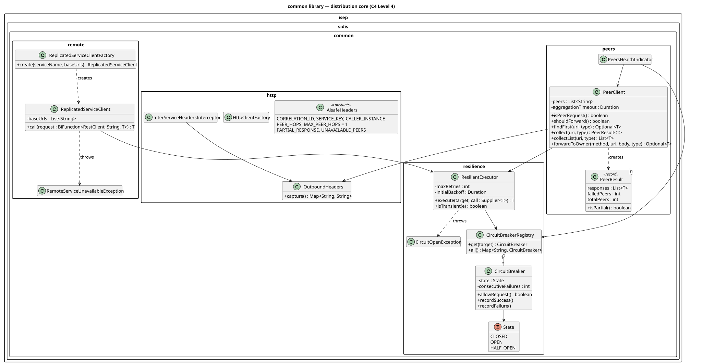


<a id="sec-key-classes"></a>

#### Key classes

| Class | Key behaviour |
|---|---|
| [`PeerClient`](../code/common/src/main/java/isep/sidis/common/peers/PeerClient.java) | `shouldForward()` is false when there are no peers or the current request has `X-Peer-Hops`. `findFirst` sends the GET to all peers on virtual threads and completes with the first `200` (404 = "not mine"). `collect` waits for every peer (bounded by `aggregation-timeout`) and counts failures. `forwardToOwner` tries the peers one by one until one accepts the command; a 4xx from the owner becomes a `ResponseStatusException` with the same status. On any failed peer it sets `X-Partial-Response` / `X-Unavailable-Peers`. Copies the MDC (correlation id) to the worker threads. |
| [`ResilientExecutor`](../code/common/src/main/java/isep/sidis/common/resilience/ResilientExecutor.java) | `execute(target, call)`: fails fast with `CircuitOpenException` when the circuit is open; retries transient failures (`ResourceAccessException`, `HttpServerErrorException`) with exponential backoff; a 4xx counts as success for the breaker and is not retried. |
| [`CircuitBreaker`](../code/common/src/main/java/isep/sidis/common/resilience/CircuitBreaker.java) | CLOSED → OPEN after `failureThreshold` consecutive failures; OPEN → HALF_OPEN after `openDuration`; HALF_OPEN → CLOSED on success, → OPEN on failure. Thread-safe, clock injected for tests. |
| [`ReplicatedServiceClient`](../code/common/src/main/java/isep/sidis/common/remote/ReplicatedServiceClient.java) | `call((restClient, baseUrl) -> ...)`: round-robin start replica, failover to the next on transient failure, `RemoteServiceUnavailableException` when all fail. |
| [`ServiceKeyFilter`](../code/common/src/main/java/isep/sidis/common/security/ServiceKeyFilter.java) | Peer requests must carry a valid key (`401`); hop count must be 1 (`400`); requests to the **service-only paths** (`aisafe.security.service-only-paths`, parsed once with `PathPatternParser`; an invalid pattern fails at start-up) must carry the key (`401`). Paths are matched without the context path and with decoded segments, so encoded variants are also caught. Any key sent must match (constant-time comparison). |
| [`OutboundHeaders`](../code/common/src/main/java/isep/sidis/common/http/OutboundHeaders.java) | Captures `Authorization`, correlation id, service key and caller instance from the current request. |
| [`JwtSecurityAutoConfiguration`](../code/common/src/main/java/isep/sidis/common/security/JwtSecurityAutoConfiguration.java) | Security filter chain; public `/actuator/health`, `/swagger-ui/**`, `/h2-console/**`, `/auth/dev-token`; applies every `AuthorizationRules` bean and then `anyRequest().authenticated()`. After each bean it checks (with a matcher that never matches) that the bean did not call `anyRequest()`; if it did, start-up fails with `<class> must not call anyRequest(): ...`. |
| [`AuthorizationRules`](../code/common/src/main/java/isep/sidis/common/security/AuthorizationRules.java) | Interface implemented once per service (`<Service>AuthorizationRules`). Its Javadoc states the rule: list only the service's own endpoints, never call `anyRequest()`. |
| [`DistributedInfrastructureAutoConfiguration`](../code/common/src/main/java/isep/sidis/common/DistributedInfrastructureAutoConfiguration.java) | Creates the beans: registry, executor, RestClient, `PeerClient`, factory, correlation filter, health indicator. |
| [`AisafeProperties`](../code/common/src/main/java/isep/sidis/common/config/AisafeProperties.java) | All `aisafe.*` settings with defaults. |


<a id="sec-patterns"></a>

#### Patterns

Circuit Breaker, Retry with Exponential Backoff, Timeout, Scatter-Gather (aggregation), Load Balancer (client-side round-robin), Chain of Responsibility (servlet filters), Auto-configuration / Dependency Injection.


<a id="sec-tests"></a>

#### Tests

`CircuitBreakerTest`, `ResilientExecutorTest`, `PeerClientTest` (against fake HTTP replicas), `ServiceKeyFilterTest` (peer and service-only requests, wrong key, encoded paths, context path) and `AuthorizationRulesGuardTest` (a rules bean that calls `anyRequest()` stops the start-up with its class name) — 29 tests, see [Flight Routes scenarios §5](#sec-5-tests-3).

<div style="page-break-before: always;"></div>

<a id="sec-part-iii-services"></a>

# Part III — Services

<a id="sec-aircraft-management-wp1"></a>

## Aircraft Management (WP1)

**Owner:** Tiago Moreira (1240883) — WP1 Aircraft Management

<a id="src-3-components-aircraftmanagement-aircraftmanagement-component"></a>

*Source: docs/3-components/aircraftmanagement/AircraftManagement-Components.md*


<a id="sec-c4-level-3-aircraft-management-service-components"></a>

### C4 Level 3 — Aircraft Management Service: Components

> Zoom into the **Aircraft Management Service** container of [Level 2](#src-2-containers-containers): its major building blocks and how they collaborate. One replica is shown; the three replicas are identical.
> Lower levels: [L4 Code](#src-4-code-aircraftmanagement-aircraftmanagement-code) · [+1 Scenarios](#src-5-scenarios-aircraftmanagement-aircraftmanagement-scenarios)


<a id="sec-1-container-summary"></a>

#### 1. Container summary

| Property | Value |
|---|---|
| Bounded context | *Fleet* — owns the `AircraftModel` and `Aircraft` aggregates (WP#1: US101–US105, US201–US206) |
| Replicas | `aircraftmanagement-1` :8081, `aircraftmanagement-2` :8181, `aircraftmanagement-3` :8281 |
| Database | H2 in-memory per replica: `aircraftManagementdb-1/2/3` |
| Source code | [code/aircraftmanagement](../code/aircraftmanagement) |
| API | `http://localhost:8081/swagger-ui.html` (any replica) |
| Supplies to other containers | Flight Routes: aircraft status/capacity/model and model range (B1a, B1b); Maintenance: aircraft lookup and status update (B3a, B3b) — see [Integration-Contracts](#src-2-containers-integration-contracts) |
| Consumes from other containers | Flight Routes: flight minutes per aircraft (B4b) and compatible routes (B6) |


<a id="sec-2-components"></a>

#### 2. Components

| Component | Technology / classes | Responsibility |
|---|---|---|
| **Security & Observability filters** | `common` filters + [`AircraftManagementAuthorizationRules`](../code/aircraftmanagement/src/main/java/isep/psoft/aisafe/infrastructure/security/AircraftManagementAuthorizationRules.java) | Correlation id, audit log, `X-Service-Key` check, JWT authentication, role rules per endpoint. The rules accept the roles of the **end users of the consumer services**, because the JWT is forwarded on inter-service calls |
| **Aircraft controllers** | [`AircraftController`](../code/aircraftmanagement/src/main/java/isep/psoft/aisafe/aircraftmanagement/controllers/AircraftController.java), [`AircraftStatisticsController`](../code/aircraftmanagement/src/main/java/isep/psoft/aisafe/aircraftmanagement/controllers/AircraftStatisticsController.java) (Spring REST) | `/api/aircrafts` — US102, US103, US104, US105 and the queries that combine Flight Routes data (US203, US206) |
| **Aircraft model controllers** | [`AircraftModelController`](../code/aircraftmanagement/src/main/java/isep/psoft/aisafe/aircraftmanagement/controllers/AircraftModelController.java), [`AircraftModelStatisticsController`](../code/aircraftmanagement/src/main/java/isep/psoft/aisafe/aircraftmanagement/controllers/AircraftModelStatisticsController.java) (Spring REST) | `/api/aircraft-models` — US101, contract B1b, US204 |
| **Application services** | `CreateAircraftModelService`, `CreateAircraftService`, `SearchAircraftsService`, `SearchAircraftModelsService`, `UpdateAircraftStatusService`, `CalculateOperationalHoursService`, `TopUtilizedModelsService`, `FindCompatibleRoutesService` | One service per use case: transactions, orchestration, cross-replica uniqueness checks |
| **Replica queries** | [`AircraftReplicaQueries`](../code/aircraftmanagement/src/main/java/isep/psoft/aisafe/aircraftmanagement/services/AircraftReplicaQueries.java) | Combines the local data with the data of the peer replicas: find an aircraft/model in any replica, merge collections by registration number, encode peer URIs |
| **Domain model** | `domain` package: `Aircraft`, `AircraftModel`, `AircraftStatus`, read models `AircraftSummary`, `AircraftModelSummary` | Aggregates `Aircraft` and `AircraftModel` and their invariants; status transition rule — see [L4](#src-4-code-aircraftmanagement-aircraftmanagement-code) |
| **Repositories** | `AircraftRepository`, `AircraftModelRepository` (Spring Data JPA) | Access to the data of **this** replica only |
| **Anti-Corruption Layer** | [`FlightRoutesClient`](../code/aircraftmanagement/src/main/java/isep/psoft/aisafe/aircraftmanagement/clients/FlightRoutesClient.java), `CompatibleRouteDTO`, `RestClientConfig` | Translates the Flight Routes API into local results and reports partial answers (`X-Partial-Response`) |
| **Assembler / DTOs** | `AircraftAssembler`, `dto` package, `PageDTO` | Published language: API contract separate from the domain; stable page format |
| **PeerClient** *(common)* | `PeerClient` | GET to the peer replicas (first answer / aggregation) and command forwarding to the owner replica |
| **ReplicatedServiceClient** *(common)* | `ReplicatedServiceClient`, `ReplicatedServiceClientFactory` | Round-robin + failover over the replicas of Flight Routes |
| **ResilientExecutor** *(common)* | `ResilientExecutor`, `CircuitBreaker` | Timeouts, retry with exponential backoff, circuit breaker per target |
| **Error mapping / OpenAPI** | `GlobalExceptionHandler`, `OpenApiConfig` | Exception → HTTP status; Swagger UI with the JWT *Authorize* button |
| *Demo data* | `DemoDataBootstrap` (properties `aisafe.bootstrap.*`) | Loads **different** models and aircraft in each replica, to demonstrate peer-to-peer behaviour |

The `common` components are described in [common — Components](#src-3-components-common-common-components).


<a id="sec-3-provided-interfaces-rest-api"></a>

#### 3. Provided interfaces (REST API)

Every endpoint is served by every replica; **every GET returns the data of all replicas**.

**Aircraft — `/api/aircrafts`**

| Method | Endpoint | US | Input | Output | Roles | Status |
|---|---|---|---|---|---|---|
| POST | `/api/aircrafts` | US102 | `CreateAircraftDTO` (registrationNumber, modelName, seatingCapacity, manufacturingDate, status?) | `201` `AircraftDTO` | ATCC | Implemented |
| GET | `/api/aircrafts?modelName=&status=&manufacturingYear=&page=&size=` | US104 | optional filters (combined with AND), `page` ≥ 0, `size` 1–100 (default 20) | `200` `PageDTO<AircraftDTO>` | ATCC, BACKOFFICE_OPERATOR, MAINTENANCE_TECHNICIAN, MAINTENANCE_SUPERVISOR | Implemented |
| GET | `/api/aircrafts/{registrationNumber}` | US103, **B1a**, B3a | registration number | `200` `AircraftDTO` | ATCC, BACKOFFICE_OPERATOR, MAINTENANCE_TECHNICIAN, MAINTENANCE_SUPERVISOR | Implemented |
| PATCH | `/api/aircrafts/{registrationNumber}/status` | US105, **B3b** | `UpdateAircraftStatusDTO` (`status`) | `200` `AircraftDTO` | ATCC, MAINTENANCE_TECHNICIAN, MAINTENANCE_SUPERVISOR | Implemented |
| GET | `/api/aircrafts/operational-hours?page=&size=` | US206 | pagination | `200` `PageDTO<AircraftOperationalHoursDTO>` (+ `X-Partial-Response`) | ATCC | Implemented |
| GET | `/api/aircrafts/{registrationNumber}/compatible-routes` | US203 | registration number | `200` `List<CompatibleRouteDTO>` (+ `X-Partial-Response`) | ATCC | Implemented |

**Aircraft models — `/api/aircraft-models`**

| Method | Endpoint | US | Input | Output | Roles | Status |
|---|---|---|---|---|---|---|
| POST | `/api/aircraft-models` | US101 | `CreateAircraftModelDTO` (modelName, manufacturer, seatingCapacity, fuelCapacity, maximumRange, cruisingSpeed) | `201` `AircraftModelDTO` | BACKOFFICE_OPERATOR | Implemented |
| GET | `/api/aircraft-models/{modelName}` | **B1b** | model name | `200` `AircraftModelDTO` | ATCC, BACKOFFICE_OPERATOR, MAINTENANCE_TECHNICIAN, MAINTENANCE_SUPERVISOR | Implemented |
| GET | `/api/aircraft-models/top-utilized?limit=` | US204 | `limit` 1–20 (default 5) | `200` `List<ModelUtilizationDTO>` (+ `X-Partial-Response`) | BACKOFFICE_OPERATOR, ATCC | Implemented (see observation O1) |

**Planned (not implemented yet — proposed design, to be confirmed with the customer)**

| Method | Endpoint | US | Idea | Roles |
|---|---|---|---|---|
| PATCH | `/api/aircraft-models/{modelName}` | US201 | Partial update of the specifications; executed by the owner replica (`PeerClient.forwardToOwner`); `@Version` → `409` on a clash | BACKOFFICE_OPERATOR |
| POST / PATCH | `/api/aircraft-models` (+ optional `imageUrl`) | US202 | Optional image/diagram stored as a **URL** (same decision as the photos of Airports); no file upload | BACKOFFICE_OPERATOR |
| GET | `/api/aircrafts/{registrationNumber}/availability` | US205 | Real-time availability: the stored status (`AVAILABLE`, `UNDER_MAINTENANCE`, `INACTIVE`) and `IN_FLIGHT` — needs a decision on who sets `IN_FLIGHT` (open question Q-AM1) | ATCC |
| GET | `/api/aircrafts?feature=…` | US224 (bonus) | Search by features (Wi-Fi, engine type): new optional attributes of the model | ATCC |

Infrastructure endpoints (from `common`): `GET /actuator/health`, `POST /auth/dev-token` (development only), `/swagger-ui.html`, `/v3/api-docs`.

**Errors** — body `{ "error": "<message>" }` (Bean Validation: `{ "<field>": "<message>" }`):

| Exception | HTTP | Example in this service |
|---|---|---|
| `IllegalArgumentException`, `MethodArgumentNotValidException` | 400 | invalid status string, unknown model when registering an aircraft, `size` out of range, bad registration format |
| `EntityNotFoundException` | 404 | aircraft or model not found in any replica |
| `IllegalStateException`, `ObjectOptimisticLockingFailureException` | 409 | model/aircraft already exists; `IN_FLIGHT` → `UNDER_MAINTENANCE`/`INACTIVE`; concurrent update (`@Version`) |
| `RemoteServiceUnavailableException` | 503 | no Flight Routes replica answered (US203, US204, US206), or no peer reachable to execute a command |
| `ResponseStatusException` | same status | Flight Routes rejected the forwarded JWT (`401`/`403`); business error of the owner replica |


<a id="sec-4-required-interfaces"></a>

#### 4. Required interfaces

| Component | Calls | Endpoint | Contract | US |
|---|---|---|---|---|
| `FlightRoutesClient.minutesByAircraft` | Flight Routes (all replicas) | `GET /api/scheduled-flights/statistics/minutes-by-aircraft` | B4b | US204, US206 |
| `FlightRoutesClient.compatibleRoutes` | Flight Routes (all replicas) | `GET /api/routes/compatible?range=&capacity=` | B6 | US203 |
| `PeerClient` | Aircraft Management peer replicas | the same endpoint as the incoming request (`GET /api/aircrafts/{reg}`, `GET /api/aircrafts?…`, `GET /api/aircraft-models/{name}`, `PATCH /api/aircrafts/{reg}/status`), `X-Peer-Hops: 1` | — | US102–US105 |


<a id="sec-5-how-the-components-realise-the-distribution-requirements"></a>

#### 5. How the components realise the distribution requirements

| Requirement | Components involved |
|---|---|
| Peer forwarding of GET by id (US103/B1a, B1b, uniqueness checks of US101/US102) | services → `AircraftReplicaQueries.findAircraft` / `findModel` → `PeerClient.findFirst` |
| Aggregation of collections (US104; the fleet used by US203, US204, US206) | `SearchAircraftsService.search` → `AircraftReplicaQueries.withPeers` → `PeerClient.collectList`, merged by registration number; `AircraftController` paginates **after** merging |
| Aggregated statistics (US204, US206) | `CalculateOperationalHoursService`, `TopUtilizedModelsService`: fleet of all replicas (above) × flight minutes of all Flight Routes replicas (`FlightRoutesClient` → `ReplicatedServiceClient`) |
| Single owner per record (US105) | `UpdateAircraftStatusService` → local update, otherwise `PeerClient.forwardToOwner` |
| Concurrent updates | `@Version` on `Aircraft` and `AircraftModel` → `ObjectOptimisticLockingFailureException` → `409` |
| Calls to other services with failover | ACL (`FlightRoutesClient`) → `ReplicatedServiceClient` → `ResilientExecutor` |
| Partial answers | `PeerClient` marks `X-Partial-Response` when a peer fails; the statistics controllers also mark it when **Flight Routes** answered partially |
| Security and audit | filter chain of `common` + `AircraftManagementAuthorizationRules` (JWT, roles, `X-Service-Key` on peer calls, audit log, TLS with profile `tls`) |

The system-wide decisions (consistency model, fault tolerance, security) are in [L2 §3](#sec-3-distribution-design-decisions).


<a id="sec-6-observations"></a>

#### 6. Observations

- **O1 — US204 for Backoffice Operators.** The US says the *Backoffice Operator* sees the Top 5, and `AircraftManagementAuthorizationRules` allows `BACKOFFICE_OPERATOR` and `ATCC`. But the JWT is forwarded to Flight Routes, whose rule for `/api/scheduled-flights/**` accepts only `ATCC` ([Integration-Contracts Q4](#src-2-containers-integration-contracts)). A Backoffice token is therefore expected to end in `403` ("Flight Routes rejected the request.") until that rule is widened. The Postman collection has a request that documents this.
- **O2 — HATEOAS.** The PSOFT non-functional requirements ask for links in the representations. The starter is a dependency, but `AircraftAssembler` returns plain DTOs (no `_links`) and `springdoc.enable-hateoas=false`. To be added (the contract allows extra fields such as `_links`).
- **O3 — Implementation status.** US101–US105, US203, US204, US206 are implemented. US201, US202, US205 and the bonus US223/US224 are planned only.

<a id="src-4-code-aircraftmanagement-aircraftmanagement-code"></a>

*Source: docs/4-code/aircraftmanagement/AircraftManagement-Code.md*


<a id="sec-c4-level-4-aircraft-management-service-code"></a>

### C4 Level 4 — Aircraft Management Service: Code

> Zoom into the components of [L3](#src-3-components-aircraftmanagement-aircraftmanagement-component): the significant classes, their relationships and the design patterns. Class names link to the source code.
> Source root: [code/aircraftmanagement/src/main/java/isep/psoft/aisafe](../code/aircraftmanagement/src/main/java/isep/psoft/aisafe)


<a id="sec-1-domain-model"></a>

#### 1. Domain model


<a id="sec-aggregates"></a>

##### Aggregates

| Aggregate | Root | Value Objects | Invariants protected by the root |
|---|---|---|---|
| Aircraft Model | [`AircraftModel`](../code/aircraftmanagement/src/main/java/isep/psoft/aisafe/aircraftmanagement/domain/AircraftModel.java) | — (primitive attributes) | Model name and manufacturer required; seating capacity, fuel capacity, maximum range (km) and cruising speed strictly positive |
| Aircraft | [`Aircraft`](../code/aircraftmanagement/src/main/java/isep/psoft/aisafe/aircraftmanagement/domain/Aircraft.java) | [`AircraftStatus`](../code/aircraftmanagement/src/main/java/isep/psoft/aisafe/aircraftmanagement/domain/AircraftStatus.java) | Registration number and model name required; seating capacity positive; status defaults to `AVAILABLE`; an `IN_FLIGHT` aircraft cannot change to `UNDER_MAINTENANCE` or `INACTIVE` (`changeStatus`) |

- **Identity.** The identity of an aircraft is its **registration number** and the identity of a model is its **model name** (`@Id`), not technical ids. Other services reference aircraft and models this way (Flight Routes stores the registration number, Maintenance too), so a lookup on any replica is a primary-key read.
- **`Aircraft` → `AircraftModel` by identity.** `Aircraft` stores only `modelName`. The model may live in **another replica**, so a JPA association (foreign key/JOIN) is impossible. Existence of the model is verified at creation time through `AircraftReplicaQueries.findModel`.
- **The seating capacity is an attribute of the aircraft**, not only of the model: the same model can have different seat configurations and therefore different capacities (US203). `AircraftModel.seatingCapacity` is the model's reference value.
- **Optimistic locking.** Both roots have `@Version`. Two concurrent updates of the same aircraft in the owner replica → the second fails with `ObjectOptimisticLockingFailureException` → `409`. `saveAndFlush` forces the check inside the request, so the conflict is reported to the caller.
- **State only through behaviour.** `Aircraft` and `AircraftModel` have no setters; `Aircraft.status` changes only through `changeStatus`, which holds the transition rule. Constructors validate, so an invalid aggregate cannot be created.
- **Read models** (not persisted, no identity): [`AircraftSummary`](../code/aircraftmanagement/src/main/java/isep/psoft/aisafe/aircraftmanagement/domain/AircraftSummary.java) and [`AircraftModelSummary`](../code/aircraftmanagement/src/main/java/isep/psoft/aisafe/aircraftmanagement/domain/AircraftModelSummary.java) — immutable records, independent of the replica where the record is stored. They are created from local entities (`toSummary()`) and from DTOs received from peers (`AircraftAssembler.toSummary`), so the services treat local and remote records in the same way.
- **Status transitions.** Only the rule "`IN_FLIGHT` → `UNDER_MAINTENANCE`/`INACTIVE` is forbidden" exists (proposal for contract question Q7). Other transitions are accepted; setting the current status again is a no-op.
- **Statuses** are the strings fixed in [Integration-Contracts §2.2](#src-2-containers-integration-contracts): `AVAILABLE`, `IN_FLIGHT`, `UNDER_MAINTENANCE`, `INACTIVE` (the value Flight Routes requires to schedule is exactly `AVAILABLE`). `AircraftStatus.parse` accepts any case and rejects unknown values with `400`.


<a id="sec-2-class-diagram"></a>

#### 2. Class diagram


<a id="sec-3-design-rationale-responsibility-assignment"></a>

#### 3. Design rationale (responsibility assignment)

**Register aircraft model / aircraft (US101, US102)**

| Question: which class is responsible for... | Answer | Justification (patterns) |
|---|---|---|
| ...receiving the HTTP request and validating the input format? | `AircraftController` / `AircraftModelController` + `CreateAircraftDTO` / `CreateAircraftModelDTO` (Bean Validation: required fields, positive numbers, registration pattern `^[A-Z0-9]{1,2}-[A-Z0-9]{2,5}$`, date not in the future) | **Controller (REST)**, **DTO** |
| ...coordinating the use case and the transaction? | `CreateAircraftService`, `CreateAircraftModelService` | **Application Service** |
| ...checking that the registration/model name is not used in any replica? | `AircraftReplicaQueries.findAircraft` / `findModel` → repository + `PeerClient.findFirst` | **Repository** (local) + peer query. Best-effort (AP): a peer that is down is skipped |
| ...checking that the aircraft's model exists (in any replica)? | `AircraftReplicaQueries.findModel` | **Indirection** — the model may be remote, so there is no association |
| ...enforcing the domain rules? | `Aircraft`, `AircraftModel` constructors | **Information Expert / Aggregate Root** |
| ...persisting it? | `AircraftRepository`, `AircraftModelRepository` | **Repository** — stored in the replica that received the request (it becomes the owner) |
| ...building the response? | `AircraftAssembler` | **DTO / Assembler** |

**Change aircraft status (US105, contract B3b)**

| Question | Answer | Justification |
|---|---|---|
| ...parsing and rejecting an unknown status? | `AircraftStatus.parse` | **Information Expert** (`400` before any forwarding) |
| ...finding the replica that stores the aircraft? | `AircraftRepository` (local), otherwise `PeerClient.forwardToOwner` | **Indirection** — a record has a single owner (unicast to the peers, `404` = "not mine") |
| ...validating the status transition? | `Aircraft.changeStatus` | **Information Expert** — the rule lives with the data it protects |
| ...detecting concurrent updates? | `@Version` + `saveAndFlush` | **Optimistic Locking** |
| ...translating a business conflict into HTTP? | `GlobalExceptionHandler` | `IllegalStateException` → `409`, optimistic-lock failure → `409` |

**Search and view aircraft (US103, US104, contract B1a/B1b)**

| Question | Answer | Justification |
|---|---|---|
| ...finding one aircraft/model in any replica? | `AircraftReplicaQueries.findAircraft` / `findModel` | **Pure Fabrication** — local first, then `PeerClient.findFirst` |
| ...filtering by model, status and year? | `SearchAircraftsService.search` | **Application Service** — filters combined with AND, status parsed once |
| ...obtaining the data of the other replicas? | `AircraftReplicaQueries.withPeers` → `PeerClient.collectList`, merged by registration (local copy wins) | **Pure Fabrication** |
| ...avoiding forwarding loops? | `PeerClient.isPeerRequest` (`X-Peer-Hops`) — a peer request is answered with local data only | `common` library; services do not decide whether to forward |
| ...paginating? | `AircraftController` → `PageDTO.of` **after** merging; a peer request gets the complete, unpaginated local list | **Pure Fabrication**; stable JSON instead of Spring's `Page` (contract Q8) |

**Statistics that combine two services (US203, US204, US206)**

| Question | Answer | Justification |
|---|---|---|
| ...obtaining the fleet of all replicas? | `SearchAircraftsService.search(null, null, null)` | Reuse of the US104 aggregation |
| ...obtaining flight minutes per aircraft? | `FlightRoutesClient.minutesByAircraft` (B4b) | **Anti-Corruption Layer** — Flight Routes only knows registrations, never models |
| ...joining fleet and minutes? | `CalculateOperationalHoursService` (per aircraft, 0 when it has no flights), `TopUtilizedModelsService` (sum per model, descending, ties by model name, models without minutes excluded, top *N*) | **Application Service** — the join happens here because the model of an aircraft is Aircraft Management data |
| ...finding compatible routes? | `FindCompatibleRoutesService`: range = `maximumRange` of the **model**, capacity = `seatingCapacity` of the **aircraft**, then B6 | **Information Expert** — the two values live in two different aggregates |
| ...knowing the answer is incomplete? | `FlightRoutesClient.isPartial` → `X-Partial-Response` on the response | Graceful degradation (AP) |
| ...failing when Flight Routes is down? | `ReplicatedServiceClient` → `RemoteServiceUnavailableException` → `503` | Retry + failover + circuit breaker in `common` |


<a id="sec-4-package-organization"></a>

#### 4. Package organization

| Package | Layer / L3 component | DDD role |
|---|---|---|
| `aircraftmanagement.controllers`, `dto`, `assemblers` | Controllers, Assembler / DTOs | Published Language (API contract separate from the domain) |
| `aircraftmanagement.services` | Application services, Replica queries | Application Services (`AircraftReplicaQueries`: pure fabrication) |
| `aircraftmanagement.domain` | Domain model | Entities (aggregate roots), Value Object (`AircraftStatus`), Read Models |
| `aircraftmanagement.repositories` | Repositories | One repository per aggregate root (local data) |
| `aircraftmanagement.clients` | Anti-Corruption Layer | ACL towards Flight Routes |
| `aircraftmanagement.bootstrap` | Demo data | properties `aisafe.bootstrap.*` |
| `infrastructure.security`, `infrastructure.config`, `exceptions` | Security & config | Authorization rules, OpenAPI, error mapping |

The `factories` package is empty (`.gitkeep`): the aggregates are created through their validating constructors, which is enough while there is no complex construction logic.


<a id="sec-5-implementation-notes"></a>

#### 5. Implementation notes

- **Remote access:** `RestClientConfig` creates one `ReplicatedServiceClient` bean (`flightRoutesService`) with all replicas of Flight Routes (`services.flightroutes.urls`). `FlightRoutesClient` maps `401`/`403` to `ResponseStatusException` (same status); no replica available → `RemoteServiceUnavailableException` (`503`). Any other `4xx` is not mapped (it would end as `500`, as the contract documents for the consumers).
- **Services never decide whether to forward:** `PeerClient` does nothing when the current request already came from a peer, so the same service code answers clients (all replicas) and peers (local only).
- **URIs sent to peers** are built with encoded path segments and query values (`AircraftReplicaQueries.uri`, `pathSegment`); null/blank filters are omitted.
- **Tolerant reader:** DTOs exchanged between replicas use `@JsonIgnoreProperties(ignoreUnknown = true)`, so a future `_links` or new field does not break the peers or the consumers (contract §2.2).
- **Pagination after merging:** `PageDTO.of` cuts the page after merging and sorting by registration; maximum page size 100 (`400` otherwise).
- **Contract values are never null:** `AircraftDTO` (B1a) always carries `registrationNumber`, `modelName`, `seatingCapacity`, `status`; `AircraftModelDTO` (B1b) always carries `maximumRange` — Flight Routes unboxes them.
- **Demo data:** `DemoDataBootstrap` parses `modelName:manufacturer:seats:fuel:range:speed` and `registration:model:seats:date[:status]` from `aisafe.bootstrap.*`; each replica loads different data.

| Replica | Models | Aircraft |
|---|---|---|
| 1 (`application.properties`) | `A320` (180 seats, 6100 km), `B737` (189 seats, 5600 km) | `CS-TUA` (A320, `AVAILABLE`), `CS-TUB` (B737, `UNDER_MAINTENANCE`) |
| 2 (`application-instance2.properties`) | `A330` (300 seats, 11750 km) | `CS-TUC` (A330, 300 seats), `CS-TUD` (A330, 290 seats) |
| 3 (`application-instance3.properties`) | `E190` (100 seats, 4500 km) | `CS-TUE` (E190, 100 seats), `CS-TUF` (E190, 96 seats, `INACTIVE`) |


<a id="sec-6-configuration-files"></a>

#### 6. Configuration files

| File | Content |
|---|---|
| [`application.properties`](../code/aircraftmanagement/src/main/resources/application.properties) | Defaults (= replica 1), remote URLs, resilience, security (`jwt.secret`, `aisafe.security.service-key`), logging, actuator, demo data of replica 1 |
| `application-instance1/2/3.properties` | Port (8081/8181/8281), instance id, database, peers and demo data of each replica |
| `application-tls.properties` | HTTPS: server keystore, client truststore, `aisafe.scheme=https` |


<a id="sec-7-code-level-observations"></a>

#### 7. Code-level observations

- **Value Objects:** `registrationNumber`, `maximumRange` (km) and similar are primitives validated in the constructors/DTOs. Value Objects such as `RegistrationNumber` would centralise the format rule (today only `CreateAircraftDTO` checks it; the demo data and peer DTOs bypass it).
- **Registration normalisation (Q10):** the registration is stored as received and the pattern forces upper case at creation time; lookups are case-sensitive.
- **Aircraft vs model capacity:** no rule relates `Aircraft.seatingCapacity` to `AircraftModel.seatingCapacity` (e.g. an upper bound). To be agreed with the customer.
- **Remote calls inside a transaction:** `CreateAircraftService`, `CreateAircraftModelService` and `UpdateAircraftStatusService` are `@Transactional` and call peers (HTTP) inside the transaction. Short timeouts (`read-timeout=3s`) limit the impact; moving the remote lookups before the transaction would remove it.
- **Optimistic locking for clients:** the `version` is not exposed, so a client cannot send the version it read (contract Q7); the check protects concurrent writes inside the owner replica only.
- **`GET /api/aircrafts` return type** is `Object` (page for clients, list for peers), so the generated OpenAPI schema is generic. Documenting both shapes with `@ApiResponse`, or a separate internal endpoint for peers, would make the specification exact.
- **`IN_FLIGHT` has no producer:** nothing sets it automatically; it is only a value that can be set through US105. See open question Q-AM1.
- `bootstrap-instance1.snippet.properties` is a leftover of the migration (its content is already in `application.properties`); it can be deleted.

<a id="src-5-scenarios-aircraftmanagement-aircraftmanagement-scenarios"></a>

*Source: docs/5-scenarios/aircraftmanagement/AircraftManagement-Scenarios.md*


<a id="sec-c4-1-aircraft-management-service-scenarios"></a>

### C4+1 — Aircraft Management Service: Scenarios

> The "+1" view: real use cases and end-to-end behaviour across containers and components. Each scenario validates [L2](#src-2-containers-containers), [L3](#src-3-components-aircraftmanagement-aircraftmanagement-component) and [L4](#src-4-code-aircraftmanagement-aircraftmanagement-code). Reference: [Flight Routes — Scenarios](#src-5-scenarios-flightroutes-flightroutes-scenarios).


<a id="sec-1-user-stories"></a>

#### 1. User stories

| WP | US | Description | Actor | Status |
|---|---|---|---|---|
| 1A | US101 | Register an aircraft model (manufacturer, model name, seating capacity, fuel capacity, maximum range, cruising speed) | Backoffice Operator | Implemented |
| 1A | US102 | Register an aircraft (registration number, model, manufacturing date, status) | ATCC | Implemented |
| 1A | US103 | View an aircraft's details given its registration number | Backoffice Operator, ATCC | Implemented |
| 1A | US104 | Search aircraft by model, status or manufacturing year | ATCC | Implemented |
| 1A | US105 | Update an aircraft's operational status | ATCC | Implemented |
| 1B | US201 | Update an aircraft model's specifications | Backoffice Operator | Planned |
| 1B | US202 | Register an aircraft model with an optional image or technical diagram | Backoffice Operator | Planned |
| 1B | US203 | View the routes compatible with an aircraft (range of the model, capacity of the aircraft) | ATCC | Implemented |
| 1B | US204 | Top 5 most utilised aircraft models | Backoffice Operator | Implemented (see O1 in [L3](#sec-6-observations)) |
| 1B | US205 | Real-time aircraft availability status (available, in-flight, under maintenance, inactive) | ATCC | Planned |
| 1B | US206 | Total operational hours of each aircraft of the fleet | ATCC | Implemented |
| Bonus | US223, US224 | Utilisation graphs; search by features (Wi-Fi, engine type) | ATCC | Planned |

**Supplied to other containers** (the consumers depend on them): **US103** is contract **B1a** and **US101/US103** give **B1b** (Flight Routes, US212/US213); **US103** is also **B3a** and **US105** is **B3b** (Maintenance, US115/US119). See [Integration-Contracts §4](#sec-4-bridges).


<a id="sec-decisions-on-open-points"></a>

##### Decisions on open points

- **Statuses (Integration-Contracts Q1):** `AVAILABLE`, `IN_FLIGHT`, `UNDER_MAINTENANCE`, `INACTIVE`. Only `AVAILABLE` lets Flight Routes schedule flights, so Maintenance returns an aircraft to `AVAILABLE` (not `ACTIVE`).
- **Status transitions (Q7, proposal):** an `IN_FLIGHT` aircraft cannot go to `UNDER_MAINTENANCE` or `INACTIVE` (`409`); every other change is accepted. Optimistic locking (`@Version`) protects concurrent updates in the owner replica; the client does not send a version.
- **Units (Q9):** `maximumRange` in **km**, the same unit as the route distances computed by Flight Routes.
- **Registration format (Q10, proposal):** `PREFIX-SUFFIX`, upper case, e.g. `CS-TUA` (`^[A-Z0-9]{1,2}-[A-Z0-9]{2,5}$`), checked when an aircraft is registered. To be confirmed with the customer.
- **"Most utilised" (Q5):** total **flight time** (minutes) of all the aircraft of the model, from contract B4b. Models without flights are not ranked.
- **Pagination (Q8):** a stable `PageDTO` (`content`, `page`, `size`, `totalElements`, `totalPages`) instead of Spring's `Page`; maximum size 100.
- **Roles (Q4):** US102 → ATCC; US101 → Backoffice Operator; reads (US103/US104, B1, B3a) also for the Backoffice and Maintenance roles because the JWT of the consumer's user is forwarded; US105/B3b → ATCC and Maintenance roles; US203/US206 → ATCC; US204 → Backoffice Operator and ATCC (Backoffice is rejected by Flight Routes today — see O1).
- **Open question Q-AM1 (US205):** what is "in-flight"? Today `IN_FLIGHT` is only a status that can be set through US105. A real-time value would be derived from the scheduled flights of Flight Routes (a flight whose date/time interval contains *now*), which needs a new endpoint there. To be decided with the customer and the Flight Routes owner before implementing.


<a id="sec-2-acceptance-criteria"></a>

#### 2. Acceptance criteria

**Fleet:** AC1 a model needs a non-blank name and manufacturer and strictly positive seats, fuel, range and speed (else `400`, body = field → message); AC2 a model name found in any replica that answers → `409`; AC3 an aircraft needs a registration in the agreed format, an existing model (in any replica, else `400`), positive seats and a manufacturing date that is not in the future (else `400`); AC4 a registration found in any replica that answers → `409`; AC5 an aircraft is created `AVAILABLE` unless a valid status is sent, `201`; AC6 unknown status → `400`; AC7 `IN_FLIGHT` → `UNDER_MAINTENANCE`/`INACTIVE` → `409`; AC8 concurrent updates of the same aircraft → `409`.

**Queries:** AC9 US104 filters (`modelName`, `status`, `manufacturingYear`) are optional and combinable, results sorted by registration, paginated **after** merging all replicas (`page` ≥ 0, `size` 1–100, else `400`); AC10 US203 uses the model's range and the aircraft's own capacity, only `ACTIVE` compatible routes of all Flight Routes replicas; AC11 US204 ranks models by total flight minutes (ties by model name), `limit` 1–20 (default 5), models without flights are excluded; AC12 US206 lists **every** aircraft of the fleet, with 0 hours when it has no flights.

**Distribution:** AC13 any replica answers with the data of all replicas, `404` if no replica has the record; AC14 a failed peer gives a `200` with `X-Partial-Response: true`; AC15 an aircraft/model is only modified by its owner replica (the one that stored it); AC16 peer requests without a valid `X-Service-Key` → `401`, `X-Peer-Hops > 1` → `400`; AC17 JWT + roles on every endpoint (`401`/`403`), every request audited with the correlation id; AC18 `503` when no Flight Routes replica answers (US203, US204, US206) or no peer is reachable to execute a command; AC19 if Flight Routes answers partially, so does the statistics response (`X-Partial-Response: true`); AC20 the contract fields of B1a/B1b are never `null`.


<a id="sec-3-system-sequence-diagram"></a>

#### 3. System sequence diagram

"System" = any of the three replicas.

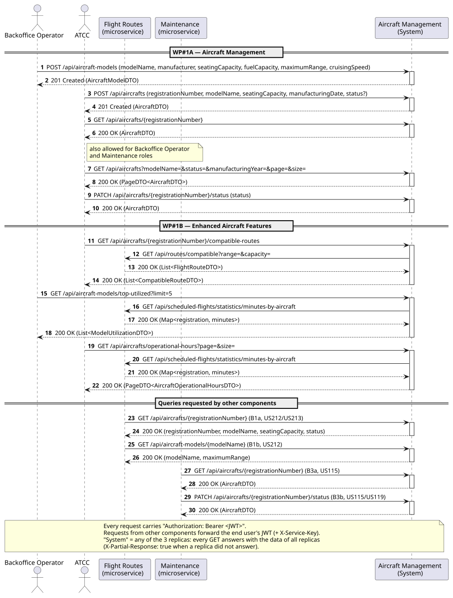


<a id="sec-4-scenarios-sequence-diagrams"></a>

#### 4. Scenarios (sequence diagrams)


<a id="sec-4-1-distributed-scenarios"></a>

##### 4.1 Distributed scenarios

**S1 — Peer-to-peer query resolution: GET an aircraft stored in another replica (US103, contract B1a; the same for B1b)**

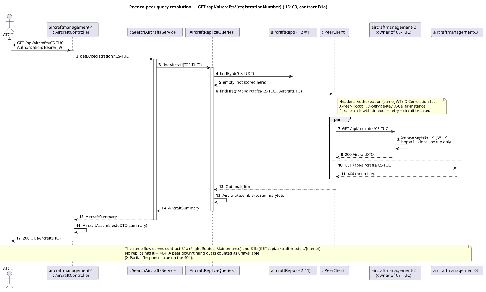

**S2 — Response aggregation with a failed replica (US104; the fleet of US203/US204/US206 is built the same way)**

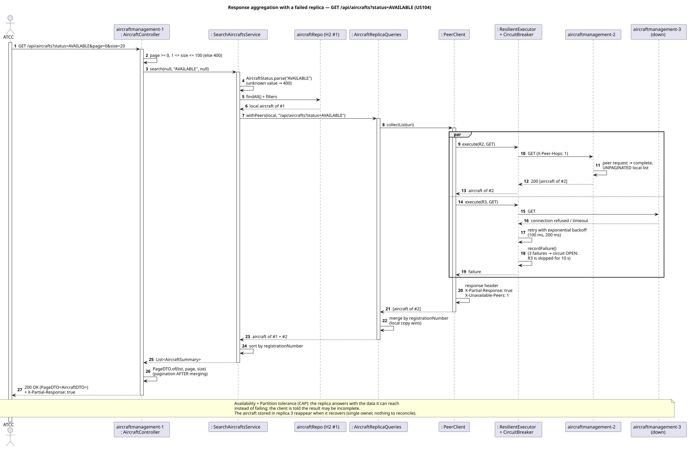

**S3 — Command forwarded to the owner replica (US105, contract B3b)**

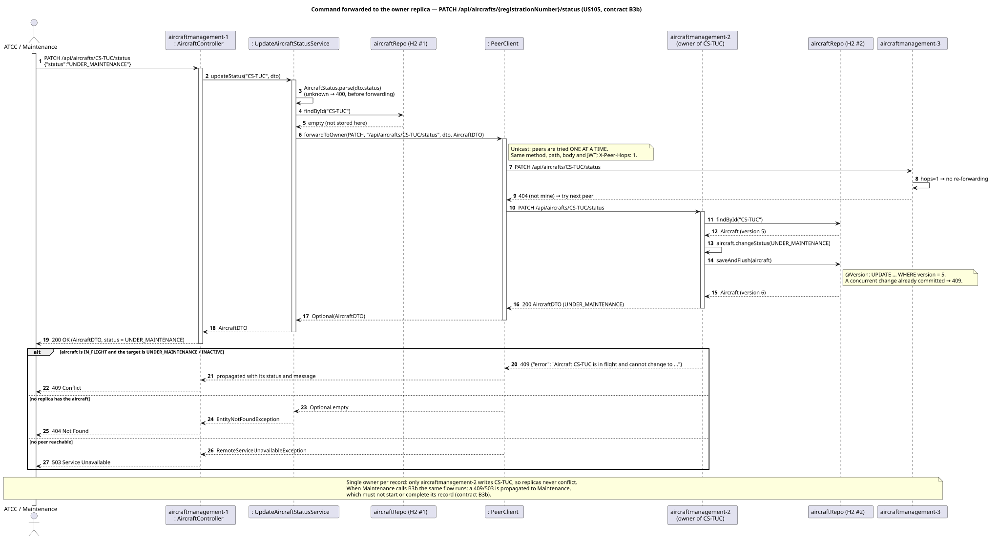


<a id="sec-4-2-use-case-scenarios"></a>

##### 4.2 Use-case scenarios

**S4 — Register aircraft whose model is stored in another replica (US102)**

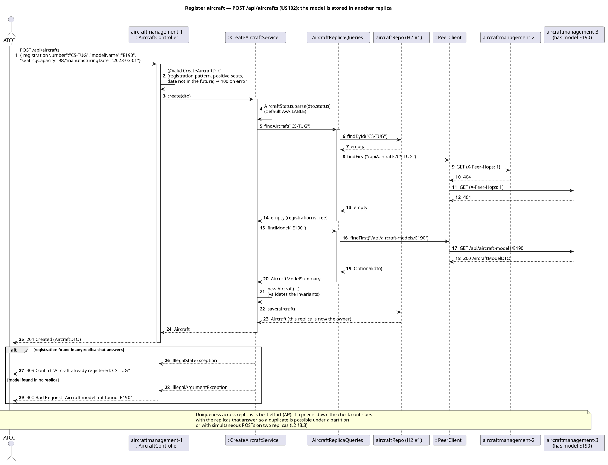

**S5 — Operational hours of the fleet (US206, contract B4b with Flight Routes)**

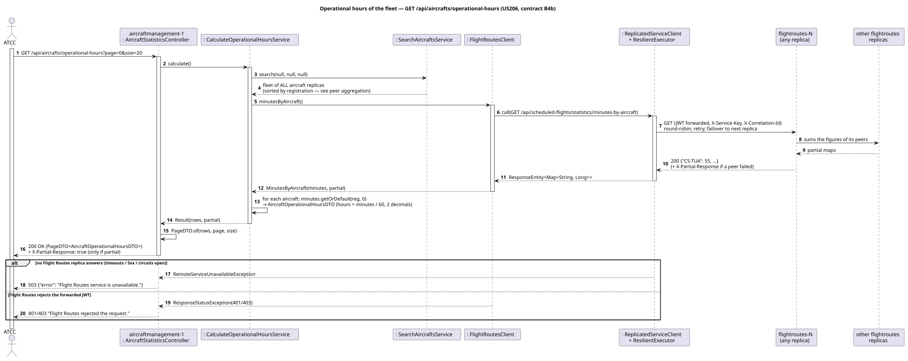

**S6 — Top utilised models (US204, contract B4b)**

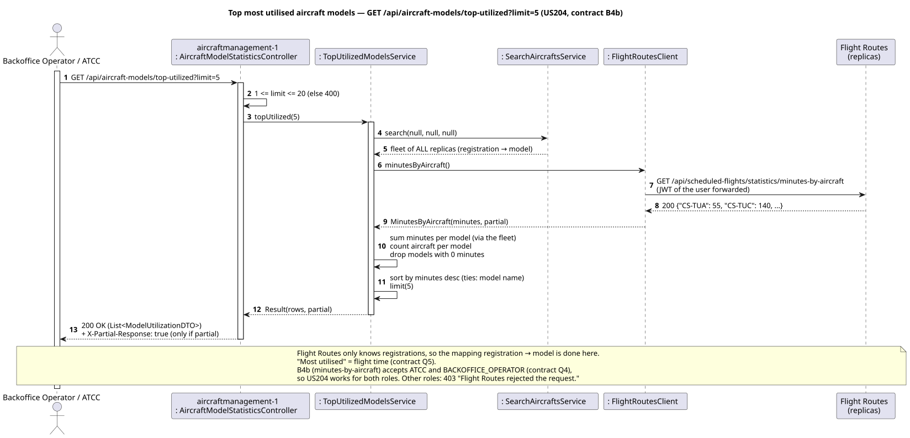

**S7 — Compatible routes (US203, contract B6)**

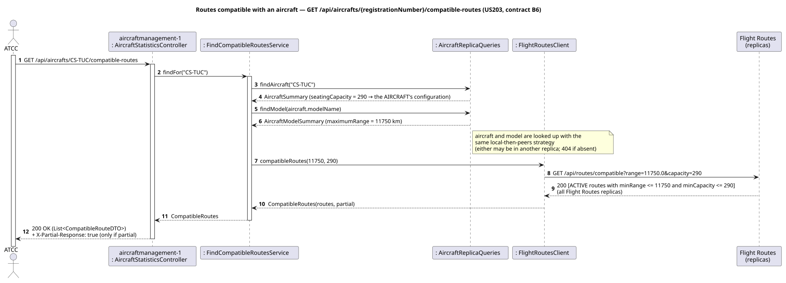


<a id="sec-5-tests"></a>

#### 5. Tests

From `code/`: `./mvnw -pl aircraftmanagement -am test`.

**Existing**

| Test class | Type | What is verified |
|---|---|---|
| [`AircraftManagementApplicationTests`](../code/aircraftmanagement/src/test/java/isep/psoft/aisafe/AircraftManagementApplicationTests.java) | Context | The service starts with the shared configuration (security chain of `common` + `AircraftManagementAuthorizationRules`) |

**To implement** (proposed plan; the list follows the acceptance criteria above and the pattern of the other services)

| Test class | Type | What should be verified |
|---|---|---|
| `AircraftTest` | Unit (domain) | Constructor validation (blank registration/model, non-positive seats), default status `AVAILABLE`, `changeStatus`: allowed transitions, `IN_FLIGHT` → `UNDER_MAINTENANCE`/`INACTIVE` rejected, same status is a no-op |
| `AircraftModelTest` | Unit (domain) | Required fields; seats, fuel, range and speed must be positive |
| `AircraftStatusTest` | Unit | `parse` accepts any case, trims, rejects blank/unknown with the allowed values in the message |
| `PageDTOTest` | Unit | First/middle/last/out-of-range page, empty list, `totalPages` |
| `TopUtilizedModelsServiceTest`, `CalculateOperationalHoursServiceTest` | Unit (Mockito: `SearchAircraftsService`, `FlightRoutesClient`) | Sum per model, descending order, tie-break by name, exclusion of models with 0 minutes, 0 hours for aircraft without flights, propagation of `partial` |
| `UpdateAircraftStatusServiceTest` | Unit (Mockito) | Local update; not local → `forwardToOwner`; nothing found → `404`; unknown status → `400` before any call |
| `AircraftManagementAuthorizationRulesTest` | Slice (MockMvc + JWT) | `401` without token; `403` for the wrong role on each restricted endpoint (US101, US102, US105, US203, US206); allowed roles of B1/B3 |
| **`AircraftReplicaCollaborationTest`** | **Distributed** — two real replicas + a stub of Flight Routes (like `ReplicaCollaborationTest`) | Scenarios S1–S7: forwarding by id, merged and sorted search (S2), owner command and propagated `409` (S3), registration and model uniqueness across replicas, `400` for a model stored nowhere, peer headers (`401`/`400`), replica stopped → `X-Partial-Response`, B1a/B1b example JSON from the contract |

**Postman:** [postman/AircraftManagement.postman_collection.json](5-scenarios/aircraftmanagement/postman/AircraftManagement.postman_collection.json) + [environment](5-scenarios/aircraftmanagement/postman/AircraftManagement.postman_environment.json), against the three replicas — folders: setup, local access, forwarding, aggregation, commands (US101, US102, US105), security, integration with Flight Routes (US203, US204, US206, needs Flight Routes), replica failure (stop replica 2 before the last folder). Requests that create data use random values, so the collection can be run more than once.


<a id="sec-6-demo"></a>

#### 6. Demo

From `code/`:

1. `./mvnw clean install`
2. `./scripts/start-replicas.sh aircraftmanagement` (Windows: `.\scripts\start-replicas.ps1 -Service aircraftmanagement`). Each replica loads different data (the `aisafe.bootstrap.*` properties; no `demo` profile is needed): replica 1 — models A320, B737 and aircraft CS-TUA, CS-TUB; replica 2 — model A330 and aircraft CS-TUC, CS-TUD; replica 3 — model E190 and aircraft CS-TUE, CS-TUF.
3. For US203, US204 and US206 also start Flight Routes: `.\scripts\start-replicas.ps1 -Service flightroutes -Profiles demo`.
4. `GET http://localhost:8081/actuator/health` (also 8181, 8281).
5. `POST http://localhost:8081/auth/dev-token` `{"username":"atcc1","roles":["ATCC"]}` (and `["BACKOFFICE_OPERATOR"]`, `["MAINTENANCE_TECHNICIAN"]`) → tokens for Postman / Swagger *Authorize*.
6. Run the Postman collection, or by hand:
   - `GET :8081/api/aircrafts` and `:8281/api/aircrafts` → the same 6 aircraft (`CS-TUA` … `CS-TUF`).
   - `GET :8081/api/aircrafts/CS-TUC` → `200`; log of replica 1: `Not found locally: forwarding GET ...`; replica 2: `AUDIT ... source=peer:aircraftmanagement-1` with the same correlation id.
   - `GET :8081/api/aircrafts?modelName=A330` → CS-TUC, CS-TUD (stored in replica 2); `?status=INACTIVE` → CS-TUF; `?manufacturingYear=2022` → CS-TUE, CS-TUF.
   - `POST :8081/api/aircrafts` with `modelName` `E190` (model stored in replica 3) → `201`; an unknown model → `400`; the registration `CS-TUC` → `409`.
   - `PATCH :8081/api/aircrafts/CS-TUC/status` `{"status":"UNDER_MAINTENANCE"}` → executed by replica 2; a US212 flight for CS-TUC in Flight Routes now gets `409` (aircraft not available). Set it back to `AVAILABLE`.
   - `PATCH …/CS-TUA/status` `{"status":"IN_FLIGHT"}` and then `{"status":"UNDER_MAINTENANCE"}` → `409` (transition rule). Set it back to `AVAILABLE`.
   - `GET :8081/api/aircrafts/operational-hours`, `…/CS-TUC/compatible-routes`, `GET :8081/api/aircraft-models/top-utilized?limit=5` (ATCC) → Flight Routes figures joined with the fleet.
   - Close the window of replica 2 → `GET :8081/api/aircrafts` returns 4 aircraft with `X-Partial-Response: true`; `GET …/CS-TUC` → `404`; `PATCH …/CS-TUC/status` → `503`.
   - HTTPS: add the `tls` profile (`instance1,tls`) and use `https://`.

H2 console: `http://localhost:8081/h2-console` (JDBC URL `jdbc:h2:mem:aircraftManagementdb-1`).


<a id="sec-7-observations"></a>

#### 7. Observations

- Cross-replica uniqueness of the registration number and of the model name is best-effort (AP, see [L2 §3.3](#sec-3-3-consistency-model-cap)): during a partition, or with two simultaneous registrations on different replicas, the same value can be stored twice. Deterministic ownership (hash of the registration → replica) would remove this at the cost of availability for writes when that replica is down.
- US203, US204 and US206 depend on Flight Routes being available (`503` otherwise); the figures are already summed over the Flight Routes replicas and a partial answer is passed on with `X-Partial-Response`.
- **US204 for the Backoffice Operator** is expected to fail with `403` today (Flight Routes accepts only `ATCC` on `/api/scheduled-flights/**`). Options: widen that rule in Flight Routes (contract Q4), or let Aircraft Management obtain the minutes with a service identity. The Postman request *US204 as Backoffice* documents the current behaviour.
- US205 depends on the answer to Q-AM1. US201 and US202 reuse the owner-forwarding pattern of S3 and need an `update` behaviour on `AircraftModel`.
- The PSOFT requirement of HATEOAS links is not implemented yet (see O2 in L3).

<div style="page-break-before: always;"></div>

<a id="sec-airports-wp2"></a>

## Airports (WP2)

**Owner:** Afonso Ribeiro (1240857) — WP2 Airports

<a id="src-3-components-airports-airports-components"></a>

*Source: docs/3-components/airports/Airports-Components.md*


<a id="sec-c4-level-3-airports-service-components"></a>

### C4 Level 3 — Airports Service: Components

> Zoom into the **Airports Service** container of [Level 2](#src-2-containers-containers): its major building blocks and how they collaborate. One replica is shown; the three replicas are identical.
> Lower levels: [L4 Code](#src-4-code-airports-airports-code) · [+1 Scenarios](#src-5-scenarios-airports-airports-scenarios)

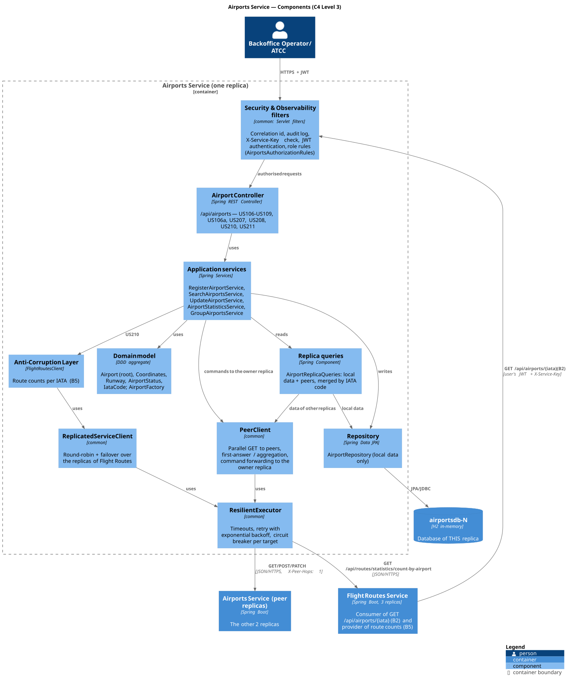


<a id="sec-1-container-summary-2"></a>

#### 1. Container summary

| Property | Value |
|---|---|
| Bounded context | Airport infrastructure — owns `Airport` (runways, certifications, facilities, status) |
| Replicas | `airports-1` :8083, `airports-2` :8183, `airports-3` :8283 |
| Database | H2 in-memory per replica: `airportsdb-1/2/3` |
| Source code | [code/airports](../code/airports) |
| API | `http://localhost:8083/swagger-ui.html` (any replica) |


<a id="sec-2-components-2"></a>

#### 2. Components

| Component | Technology / classes | Responsibility |
|---|---|---|
| **Security & Observability filters** | `common` filters + [`AirportsAuthorizationRules`](../code/airports/src/main/java/isep/psoft/aisafe/infrastructure/security/AirportsAuthorizationRules.java) | Correlation id, audit log, `X-Service-Key` check, JWT authentication, role rules per endpoint; any other request to `/api/airports` is denied |
| **Airport Controller** | [`AirportController`](../code/airports/src/main/java/isep/psoft/aisafe/airports/controllers/AirportController.java) (Spring REST) | `/api/airports` — US106–US109, US106a, US207, US208, US210, US211 |
| **Application services** | [`RegisterAirportService`](../code/airports/src/main/java/isep/psoft/aisafe/airports/services/RegisterAirportService.java), [`SearchAirportsService`](../code/airports/src/main/java/isep/psoft/aisafe/airports/services/SearchAirportsService.java), [`UpdateAirportService`](../code/airports/src/main/java/isep/psoft/aisafe/airports/services/UpdateAirportService.java), [`AirportStatisticsService`](../code/airports/src/main/java/isep/psoft/aisafe/airports/services/AirportStatisticsService.java), [`GroupAirportsService`](../code/airports/src/main/java/isep/psoft/aisafe/airports/services/GroupAirportsService.java) | One service per group of use cases; transactions; orchestration |
| **Replica queries** | [`AirportReplicaQueries`](../code/airports/src/main/java/isep/psoft/aisafe/airports/services/AirportReplicaQueries.java) | Combine local data with the data of the peer replicas: first answer by IATA, merge by IATA code (local copy wins), sort |
| **Domain model** | `domain` + `factories` packages | Aggregate `Airport`, Value Objects `Coordinates`, `Runway`, `AirportStatus`, `IataCode`; `AirportFactory` — see [L4](#src-4-code-airports-airports-code) |
| **Repository** | [`AirportRepository`](../code/airports/src/main/java/isep/psoft/aisafe/airports/repositories/AirportRepository.java) (Spring Data JPA) | Access to the data of **this** replica only |
| **Anti-Corruption Layer** | [`FlightRoutesClient`](../code/airports/src/main/java/isep/psoft/aisafe/airports/clients/FlightRoutesClient.java), `RestClientConfig` | Route counts per IATA from Flight Routes (contract B5) |
| **PeerClient** *(common)* | [`PeerClient`](../code/common/src/main/java/isep/sidis/common/peers/PeerClient.java) | GET to the peer replicas (first answer / aggregation) and command forwarding to the owner replica |
| **ReplicatedServiceClient** *(common)* | `ReplicatedServiceClient` | Round-robin + failover over the replicas of Flight Routes |
| **ResilientExecutor** *(common)* | `ResilientExecutor`, `CircuitBreaker` | Timeouts, retry with exponential backoff, circuit breaker per target |
| *Demo data* | [`DemoDataBootstrap`](../code/airports/src/main/java/isep/psoft/aisafe/airports/bootstrap/DemoDataBootstrap.java) (profile `demo`) | Loads a different set of airports in each replica |

The `common` components are described in [common — Components](#src-3-components-common-common-components).


<a id="sec-3-provided-interfaces-rest-api-2"></a>

#### 3. Provided interfaces (REST API)

Every endpoint is served by every replica; **every GET returns the data of all replicas**. IATA codes in paths are case-insensitive (normalised to upper case); an invalid code gives `400`.

| Method | Endpoint | US | Input | Output | Roles |
|---|---|---|---|---|---|
| POST | `/api/airports` | US106, US207 | `CreateAirportDTO` (iataCode, name, city, country, region?, timezone, latitude, longitude, runways[], terminals?, gates?, services?, photoUrls?, operationalHours?, contactEmail?, contactPhone?) | `201` `AirportDTO` + `Location` | BACKOFFICE_OPERATOR |
| GET | `/api/airports/{iataCode}` | US107 (contract B2) | IATA code | `200` `AirportDTO` | BACKOFFICE_OPERATOR, ATCC |
| GET | `/api/airports?city=&country=&name=` | US108 | optional filters (city/country exact, name contains; case-insensitive) | `200` `List<AirportDTO>` sorted by IATA | ATCC |
| POST | `/api/airports/{iataCode}/certifications` | US106a | `AddCertificationDTO` (aircraftModel) | `201` `AirportDTO` | BACKOFFICE_OPERATOR, ATCC |
| PATCH | `/api/airports/{iataCode}/status` | US109 | `UpdateAirportStatusDTO` (`OPERATIONAL` / `CLOSED` / `UNDER_MAINTENANCE`) | `200` `AirportDTO` | BACKOFFICE_OPERATOR |
| PATCH | `/api/airports/{iataCode}` | US208 | `UpdateAirportDetailsDTO` (any of operationalHours, contactEmail, contactPhone, terminals, gates, services, photoUrls) | `200` `AirportDTO` | BACKOFFICE_OPERATOR |
| GET | `/api/airports/statistics/busiest?limit=` | US210 | `limit` 1–100 (default 5) | `200` `List<BusiestAirportDTO>` (rank, iataCode, name, city, country, routeCount) | BACKOFFICE_OPERATOR |
| GET | `/api/airports/grouped?by=` | US211 | `country` (default) / `region` | `200` `List<AirportGroupDTO>` (group, count, airports) | ATCC |

US209 (routes from/to an airport) is served by Flight Routes: `GET /api/routes/by-airport/{iataCode}`.

Infrastructure endpoints (from `common`): `GET /actuator/health`, `POST /auth/dev-token` (development only), `/swagger-ui.html`.

**Errors** — body `{ "error": "<message>" }` (Bean Validation: `{ "<field>": "<message>" }`):

| Exception | HTTP |
|---|---|
| `IllegalArgumentException` (invalid IATA, timezone, status, grouping, limit…), `MethodArgumentNotValidException` | 400 |
| `EntityNotFoundException` (no replica has the airport) | 404 |
| `IllegalStateException` (IATA already registered, model already certified), `ObjectOptimisticLockingFailureException` | 409 |
| `RemoteServiceUnavailableException` (no peer / no Flight Routes replica answered) | 503 |
| `ResponseStatusException` (remote 401/403, business error of the owner replica) | same status |


<a id="sec-4-required-interfaces-2"></a>

#### 4. Required interfaces

| Component | Calls | Endpoint |
|---|---|---|
| `FlightRoutesClient` | Flight Routes (all replicas) | `GET /api/routes/statistics/count-by-airport` (B5) |
| `PeerClient` | Airports peer replicas | the same endpoint as the incoming request, `X-Peer-Hops: 1` |


<a id="sec-5-how-the-components-realise-the-distribution-requirements-2"></a>

#### 5. How the components realise the distribution requirements

| Requirement | Components involved |
|---|---|
| Peer forwarding of GET by IATA (US107, B2, uniqueness check of US106, details of US210) | services → `AirportReplicaQueries.findByIata` → `PeerClient.findFirst` |
| Aggregation of collections (US108, US211) | `SearchAirportsService` → `AirportReplicaQueries.withPeers` → `PeerClient.collectList`, merged by IATA; US211 groups after merging |
| Statistics from another service (US210) | `AirportStatisticsService` → `FlightRoutesClient` → `ReplicatedServiceClient` (Flight Routes already sums its replicas) |
| Single owner per airport (US106a, US109, US208) | `UpdateAirportService.onOwner` → `PeerClient.forwardToOwner` (unicast, one peer at a time) |
| Concurrency inside the owner | `@Version` on `Airport` + `saveAndFlush` → `409` |
| Calls to other services with failover | ACL → `ReplicatedServiceClient` → `ResilientExecutor` |
| Security and audit | filter chain of `common` + `AirportsAuthorizationRules` |

The system-wide decisions (consistency model, fault tolerance, security) are in [L2 §3](#sec-3-distribution-design-decisions).

<a id="src-4-code-airports-airports-code"></a>

*Source: docs/4-code/airports/Airports-Code.md*


<a id="sec-c4-level-4-airports-service-code"></a>

### C4 Level 4 — Airports Service: Code

> Zoom into the components of [L3](#src-3-components-airports-airports-components): the significant classes, their relationships and the design patterns. Class names link to the source code.
> Source root: [code/airports/src/main/java/isep/psoft/aisafe](../code/airports/src/main/java/isep/psoft/aisafe)


<a id="sec-1-domain-model-2"></a>

#### 1. Domain model


<a id="sec-aggregate"></a>

##### Aggregate

| Aggregate | Root | Value Objects | Invariants protected by the root |
|---|---|---|---|
| Airport | [`Airport`](../code/airports/src/main/java/isep/psoft/aisafe/airports/domain/Airport.java) | [`Coordinates`](../code/airports/src/main/java/isep/psoft/aisafe/airports/domain/Coordinates.java), [`Runway`](../code/airports/src/main/java/isep/psoft/aisafe/airports/domain/Runway.java), [`AirportStatus`](../code/airports/src/main/java/isep/psoft/aisafe/airports/domain/AirportStatus.java), [`IataCode`](../code/airports/src/main/java/isep/psoft/aisafe/airports/domain/IataCode.java) | IATA = 3 letters, upper case; name, city, country required; valid IANA timezone; coordinates in range; at least one runway, unique runway names, positive length, orientation 0–359; non-negative terminals/gates; a model is certified at most once; created `OPERATIONAL` |

- **The IATA code is the identity** (`@Id`), not a technical id: it is how the other services reference an airport (Flight Routes stores only the IATA of origin and destination), and it makes a lookup on any replica a primary-key read.
- `Airport` has no setters: its state changes only through `describeFacilities`, `updateContactDetails`, `updateDetails`, `changeStatus` and `certifyModel`. Value Objects are immutable and self-validating.
- `@Version` (optimistic locking) on the root: two concurrent changes of the same airport in the owner replica → the second fails with `409`.
- **External references by identity only:** certified aircraft models are kept by name (identity in Aircraft Management); Flight Routes references airports by IATA. No JPA association crosses a service or a replica.
- Collections (`runways`, `certifiedModels`, `services`, `photoUrls`) are exposed as unmodifiable views, so they can only change through the root.


<a id="sec-2-class-diagram-2"></a>

#### 2. Class diagram


<a id="sec-3-design-rationale-responsibility-assignment-2"></a>

#### 3. Design rationale (responsibility assignment)

**Register airport (US106, US207)**

| Question: which class is responsible for... | Answer | Justification (patterns) |
|---|---|---|
| ...receiving the HTTP request and validating the input format? | `AirportController` + `CreateAirportDTO` (Bean Validation) | **Controller (REST)**, **DTO** |
| ...coordinating the use case and the transaction? | `RegisterAirportService` | **Application Service** |
| ...checking that the IATA is not registered in any replica? | `AirportReplicaQueries.findByIata` → `AirportRepository` + `PeerClient` | **Repository** (local) + peer query (other replicas) |
| ...building a valid aggregate? | `AirportFactory` | **Factory / Creator** |
| ...enforcing the business rules (timezone, runways, …)? | `Airport`, `Runway`, `Coordinates` | **Information Expert / Aggregate Root / Value Object** |
| ...persisting it? | `AirportRepository` | **Repository** — stored in the replica that received the request (owner) |
| ...building the response? | `AirportAssembler` | **DTO / Assembler** |

**Certify model, change status, update details (US106a, US109, US208)**

| Question | Answer | Justification |
|---|---|---|
| ...deciding whether the airport is local? | `UpdateAirportService.onOwner` | **Application Service** (one template method for the three commands — no duplication) |
| ...sending the command to the replica that stores the airport? | `PeerClient.forwardToOwner` | **Indirection** — an airport has a single owner |
| ...applying the change? | `Airport.certifyModel` / `changeStatus` / `updateDetails` | **Information Expert / Aggregate Root** |
| ...validating the status before forwarding? | `AirportStatus.from` | **Pure Fabrication / fail fast** (no network call for a `400`) |
| ...detecting concurrent changes? | `@Version` + `saveAndFlush` | **Optimistic Locking** |

**Queries (US107, US108, US211) and statistics (US210)**

| Question | Answer | Justification |
|---|---|---|
| ...combining local data with the peers' data? | `AirportReplicaQueries` | **Pure Fabrication** — the distribution logic lives in one place |
| ...grouping by country/region? | `GroupAirportsService` (after merging all replicas) | **Application Service** |
| ...obtaining the number of routes per airport? | `FlightRoutesClient` | **Anti-Corruption Layer / Indirection** — routes belong to Flight Routes |
| ...ranking and joining airport details? | `AirportStatisticsService` | **Application Service** — ranking and top-N are Airports' job (contract B5) |


<a id="sec-4-package-organization-2"></a>

#### 4. Package organization

| Package | Layer / L3 component | DDD role |
|---|---|---|
| `airports.controllers` | Airport Controller | Interface (REST) |
| `airports.dto` | Airport Controller | Data Transfer Objects (records) |
| `airports.assemblers` | Airport Controller / Replica queries | Domain → DTO mapping |
| `airports.services` | Application services, Replica queries | Application Services |
| `airports.domain` | Domain model | Aggregate root, Value Objects |
| `airports.factories` | Domain model | Factory |
| `airports.repositories` | Repository | Repository (Spring Data JPA) |
| `airports.clients` | Anti-Corruption Layer | Gateway to Flight Routes |
| `airports.bootstrap` | Demo data | — |
| `infrastructure.security`, `infrastructure.config` | Security filters, OpenAPI | Infrastructure |
| `exceptions` | Controller | Exception → HTTP status mapping |


<a id="sec-5-implementation-notes-2"></a>

#### 5. Implementation notes

- **IATA normalisation** happens in the domain (`IataCode.normalize`), so `lis`, ` LIS ` and `LIS` are the same airport in every endpoint and every replica.
- **Search filters are pushed to the peers**: each replica applies the same `city`/`country`/`name` filters to its own data, so only matching airports travel over the network. The repository receives values already lower-cased (and the name already as a `LIKE` pattern) to avoid applying SQL functions to `null` parameters.
- **US210 looks up the top-N airports by IATA**, not through the US108 search: the user's JWT is forwarded to the peers and the search is ATCC-only, while US210 is for Backoffice Operators.
- **Partial updates (US208)**: a `null` field is not changed; an empty string or empty list clears the field.
- **Demo data** is saved directly in the local repository without asking the peers, because the peers may not be running yet when a replica starts.

<a id="src-5-scenarios-airports-airports-scenarios"></a>

*Source: docs/5-scenarios/airports/Airports-Scenarios.md*


<a id="sec-c4-1-airports-service-scenarios"></a>

### C4+1 — Airports Service: Scenarios

> The "+1" view: real use cases and end-to-end behaviour across containers and components. Each scenario validates [L2](#src-2-containers-containers), [L3](#src-3-components-airports-airports-components) and [L4](#src-4-code-airports-airports-code).


<a id="sec-1-user-stories-2"></a>

#### 1. User stories

| WP | US | Description | Actor |
|---|---|---|---|
| 2A | US106 | Register an airport with IATA code, name, city, country, timezone, coordinates and runways | Backoffice Operator |
| 2A | US106a | Add an aircraft-model certification to an airport | Backoffice Operator, ATCC |
| 2A | US107 | View an airport's details given its IATA code | Backoffice Operator, ATCC |
| 2A | US108 | Search airports by city, country or name | ATCC |
| 2A | US109 | Update an airport's operational status (operational, closed, under maintenance) | Backoffice Operator |
| 2B | US207 | Register an airport with optional photos and facilities (terminals, gates, services) | Backoffice Operator |
| 2B | US208 | Update airport details, including operational hours and contact information | Backoffice Operator |
| 2B | US210 | Statistics on the busiest airports by number of routes | Backoffice Operator |
| 2B | US211 | View airports grouped by region or country | ATCC |

**US209** (routes from/to an airport) belongs to WP#2B but is implemented by Flight Routes, which owns the routes (`GET /api/routes/by-airport/{iata}`). Supplied to other containers: **US107** is contract B2, used by Flight Routes in US110, US209, US212 and US216.


<a id="sec-decisions-on-open-points-2"></a>

##### Decisions on open points

- **Statuses (Integration-Contracts Q2):** `OPERATIONAL`, `CLOSED`, `UNDER_MAINTENANCE`, as listed in US109. Only `OPERATIONAL` lets Flight Routes schedule flights.
- **Region (US211):** an optional attribute of the airport (e.g. `Europe`), not derived from the country; airports without a region are grouped under `Unspecified`.
- **Photos (US207):** stored as URLs; file upload is out of scope.
- **Certifications (US106a, Q3):** stored by model name. They are not validated against Aircraft Management yet (that service has no implementation); Flight Routes does not read them (Q3 still open).


<a id="sec-2-acceptance-criteria-2"></a>

#### 2. Acceptance criteria

**Airports:** AC1 IATA exactly 3 letters, normalised to upper case (else `400`); AC2 name, city, country, timezone (IANA), coordinates in range and at least one runway are required (else `400`); AC3 an IATA registered in any replica that answers → `409`; AC4 created `OPERATIONAL`, `201` + `Location`; AC5 unknown status → `400`; AC6 a model certified twice → `409`; AC7 US208 changes only the fields sent; AC8 concurrent changes of the same airport → `409`.

**Queries:** AC9 US108 filters are combinable and case-insensitive, results sorted by IATA; AC10 US211 groups the airports of all replicas, `by` = `country` or `region` (else `400`); AC11 US210 ranks by route count (ties by IATA), `limit` 1–100 (default 5), with the airport details joined.

**Distribution:** AC12 any replica answers with the data of all replicas, `404` if no replica has it; AC13 a failed peer gives a `200` with `X-Partial-Response: true`; AC14 an airport is only modified by its owner replica; AC15 peer requests without valid `X-Service-Key` → `401`, `X-Peer-Hops > 1` → `400`; AC16 JWT + roles on every endpoint (`401`/`403`), every request audited; AC17 `503` when no replica of a remote service (or no peer, for commands) answers.


<a id="sec-3-system-sequence-diagram-2"></a>

#### 3. System sequence diagram

"System" = any of the three replicas.


<a id="sec-4-scenarios-sequence-diagrams-2"></a>

#### 4. Scenarios (sequence diagrams)


<a id="sec-4-1-distributed-scenarios-2"></a>

##### 4.1 Distributed scenarios

**S1 — Peer-to-peer query resolution: GET an airport stored in another replica (US107, contract B2)**


**S2 — Response aggregation with a failed replica (US108; US211 groups after this merge)**


**S3 — Command forwarded to the owner replica (US109; same for US106a and US208)**


<a id="sec-4-2-use-case-scenarios-2"></a>

##### 4.2 Use-case scenarios

**S4 — Register airport (US106, US207)**


**S5 — Busiest airports (US210, contract B5 with Flight Routes)**


<a id="sec-5-tests-2"></a>

#### 5. Tests

From `code/`: `./mvnw -pl airports -am test`.

| Test class | Type | What is verified |
|---|---|---|
| [`AirportTest`](../code/airports/src/test/java/isep/psoft/aisafe/airports/domain/AirportTest.java) | Unit (domain) | IATA normalisation/format, coordinates and runway validation, required fields and IANA timezone, unique runways, created `OPERATIONAL`, duplicate certification, status changes, facilities, partial update of details |
| [`AirportsApplicationTests`](../code/airports/src/test/java/isep/psoft/aisafe/AirportsApplicationTests.java) | Context | The service starts with the shared configuration (security chain of `common` + `AirportsAuthorizationRules`) |
| **[`AirportReplicaCollaborationTest`](../code/airports/src/test/java/isep/psoft/aisafe/distributed/AirportReplicaCollaborationTest.java)** | **Distributed** — two real replicas + a stub of Flight Routes | scenarios below |

`AirportReplicaCollaborationTest`:

1. Each replica stores the airports it receives (`201` + `Location`); local access `200`.
2. GET on A of an airport stored on B → forwarded, `200` with the B2 fields; unknown → `404`; invalid IATA → `400` (S1).
3. Search on A and on B → the same merged, sorted list; filters applied in the peers (S2).
4. Registering on A an IATA stored on B → `409`.
5. Invalid registration (no runways, invalid timezone) → `400`.
6. Status, certification and details changed through A for an airport of B → executed by B; owner's `409` propagated; unknown airport → `404` (S3).
7. Grouping by country/region uses airports of both replicas; invalid grouping → `400`.
8. US210 combines the Flight Routes counts with airport details from both replicas; ties ordered by IATA; invalid limit → `400` (S5).
9. Peer headers without/wrong service key → `401`; hops 2 → `400`; valid peer request → only local data.
10. No token → `401`; wrong role → `403` on each restricted endpoint; unexpected method → `403`; health `UP`.
11. Replica B stopped: A answers `200` with `X-Partial-Response: true`; local airport `200`; airport only in B → `404`; command for an airport of B → `503` (S2).

**Postman:** [postman/Airports.postman_collection.json](5-scenarios/airports/postman/Airports.postman_collection.json) + [environment](5-scenarios/airports/postman/Airports.postman_environment.json), against the three replicas with the `demo` profile — folders: setup, local access, forwarding, aggregation, owner commands, security, integration with Flight Routes (US210, needs Flight Routes with `demo`), replica failure (stop replica 2 before the last folder). Requests that create data use random values, so the collection can be run more than once.


<a id="sec-6-demo-2"></a>

#### 6. Demo

From `code/`:

1. `./mvnw clean install`
2. `./scripts/start-replicas.sh airports demo` (Windows: `.\scripts\start-replicas.ps1 -Service airports -Profiles demo`). Each replica loads different airports: replica 1 OPO, LIS; replica 2 MAD, CDG; replica 3 LHR, FNC (the airports of the Flight Routes demo routes).
3. For US210 and the end-to-end flow also start Flight Routes: `.\scripts\start-replicas.ps1 -Service flightroutes -Profiles demo`.
4. `GET http://localhost:8083/actuator/health` (also 8183, 8283).
5. `POST http://localhost:8083/auth/dev-token` `{"username":"atcc1","roles":["ATCC"]}` (and `["BACKOFFICE_OPERATOR"]`) → tokens for Postman / Swagger *Authorize*.
6. Run the Postman collection, or by hand:
   - `GET :8083/api/airports` and `:8283/...` → the same 6 airports.
   - `GET :8083/api/airports/LHR` → `200`; log of replica 1: `Not found locally: forwarding GET ...`; replica 3: `AUDIT ... source=peer:airports-1` with the same correlation id.
   - `PATCH :8083/api/airports/MAD/status` `{"status":"CLOSED"}` → executed by replica 2; then a US212 flight from/to MAD in Flight Routes → `409` (airport not operational). Set it back to `OPERATIONAL`.
   - `GET :8083/api/airports/statistics/busiest?limit=3` (Backoffice) → LIS 3, MAD 3, CDG 2.
   - `GET :8183/api/airports/grouped?by=country` → Portugal groups OPO and LIS (replica 1) with FNC (replica 3).
   - Close the window of replica 2 → `GET :8083/api/airports` returns 4 airports with `X-Partial-Response: true`.
   - HTTPS: add the `tls` profile (`demo,tls`) and use `https://`.

H2 console: `http://localhost:8083/h2-console` (JDBC URL `jdbc:h2:mem:airportsdb-1`).


<a id="sec-7-observations-2"></a>

#### 7. Observations

- Cross-replica uniqueness of the IATA code is best-effort (AP, see [L2 §3.3](#sec-3-3-consistency-model-cap)): during a partition, or with two simultaneous registrations on different replicas, the same IATA can be stored twice. Deterministic ownership (hash of the IATA → replica) would remove this at the cost of availability for writes when that replica is down.
- US210 depends on Flight Routes being available (`503` otherwise); the route counts are already summed over the Flight Routes replicas.
- Certifications are not validated against Aircraft Management because that service is not implemented yet; adding a call to `GET /api/aircraft-models/{model}` (B1b) would complete US106a.

<div style="page-break-before: always;"></div>

<a id="sec-flight-routes-wp3"></a>

## Flight Routes (WP3)

**Owner:** Tiago Caetano (1241945) — WP3 Flight Routes

<a id="src-3-components-flightroutes-flightroutes-components"></a>

*Source: docs/3-components/flightroutes/FlightRoutes-Components.md*


<a id="sec-c4-level-3-flight-routes-service-components"></a>

### C4 Level 3 — Flight Routes Service: Components

> Zoom into the **Flight Routes Service** container of [Level 2](#src-2-containers-containers): its major building blocks and how they collaborate. One replica is shown; the three replicas are identical.
> Lower levels: [L4 Code](#src-4-code-flightroutes-flightroutes-code) · [+1 Scenarios](#src-5-scenarios-flightroutes-flightroutes-scenarios)

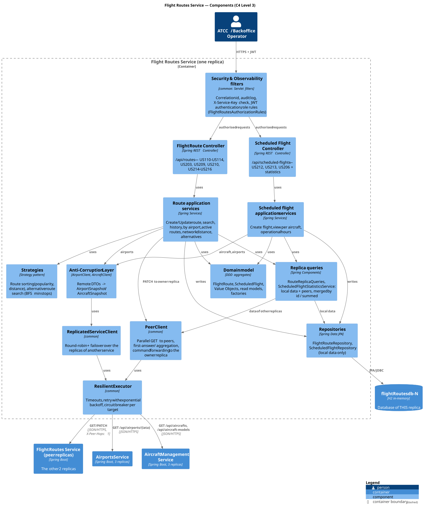


<a id="sec-1-container-summary-3"></a>

#### 1. Container summary

| Property | Value |
|---|---|
| Bounded context | Flight Operations — owns `FlightRoute` and `ScheduledFlight` |
| Replicas | `flightroutes-1` :8084, `flightroutes-2` :8184, `flightroutes-3` :8284 |
| Database | H2 in-memory per replica: `flightRoutesdb-1/2/3` |
| Source code | [code/flightroutes](../code/flightroutes) |
| API | `http://localhost:8084/swagger-ui.html` (any replica) |
| Supplies to other containers | Aircraft Management: B4b minutes per aircraft (US204, US206), B6 compatible routes (US203); Airports: B5 route counts per airport (US210) — all **service-only** ([Integration-Contracts §2.8](#sec-2-8-service-only-endpoints)) |
| Consumes from other containers | Airports: B2 airport by IATA; Aircraft Management: B1 aircraft and aircraft model |


<a id="sec-2-components-3"></a>

#### 2. Components

| Component | Technology / classes | Responsibility |
|---|---|---|
| **Security & Observability filters** | `common` filters + [`FlightRoutesAuthorizationRules`](../code/flightroutes/src/main/java/isep/psoft/aisafe/infrastructure/security/FlightRoutesAuthorizationRules.java) | Correlation id, audit log, `X-Service-Key` check (required on peer calls and on the service-only paths listed in `aisafe.security.service-only-paths`), JWT authentication, role rules per endpoint |
| **Flight Route Controller** | [`FlightRouteController`](../code/flightroutes/src/main/java/isep/psoft/aisafe/flightroutes/controllers/FlightRouteController.java) (Spring REST) | `/api/routes` — US110–US114, US203, US209, US210, US214–US216 |
| **Scheduled Flight Controller** | [`ScheduledFlightController`](../code/flightroutes/src/main/java/isep/psoft/aisafe/flightroutes/controllers/ScheduledFlightController.java) (Spring REST) | `/api/scheduled-flights` — US212, US213, US206 and statistics used for aggregation |
| **Route application services** | `CreateFlightRouteService`, `UpdateFlightRouteService`, `SearchFlightRoutesService`, `GetRouteHistoryService`, `ViewRoutesByAirportService`, `CountRoutesByAirportService`, `ListActiveRoutesService`, `CalculateNetworkDistanceService`, `SearchAlternativeRoutesService` | One service per use case; transactions; orchestration |
| **Scheduled flight application services** | `CreateScheduledFlightService`, `ViewScheduledFlightsByAircraftService`, `CalculateOperationalHoursService` | Business rules of scheduling, flights per aircraft, operational hours |
| **Replica queries** | [`RouteReplicaQueries`](../code/flightroutes/src/main/java/isep/psoft/aisafe/flightroutes/services/RouteReplicaQueries.java), `ScheduledFlightStatisticsService`, `Pages` | Combine local data with the data of the peer replicas: merge by id, sum statistics, paginate after merging |
| **Strategies** | `RouteSortStrategy` (`PopularitySortStrategy`, `DistanceSortStrategy`), `RouteSearchStrategy` (`MinStopsRouteSearch`) | Interchangeable sorting (US214) and alternative-route algorithm (US216) |
| **Domain model** | `domain` + `factories` packages | Aggregates `FlightRoute` and `ScheduledFlight`, Value Objects, read models (`RouteSummary`, `Itinerary`, `RouteUsage`) — see [L4](#src-4-code-flightroutes-flightroutes-code) |
| **Repositories** | `FlightRouteRepository`, `ScheduledFlightRepository` (Spring Data JPA) | Access to the data of **this** replica only |
| **Anti-Corruption Layer** | `AirportClient`, `AircraftClient` → `AirportSnapshot`, `AircraftSnapshot`; `RestClientConfig` | Translate the Airports / Aircraft Management APIs into local read-only views |
| **PeerClient** *(common)* | [`PeerClient`](../code/common/src/main/java/isep/sidis/common/peers/PeerClient.java) | GET to the peer replicas (first answer / aggregation) and command forwarding to the owner replica |
| **ReplicatedServiceClient** *(common)* | `ReplicatedServiceClient` | Round-robin + failover over the replicas of Airports / Aircraft Management |
| **ResilientExecutor** *(common)* | `ResilientExecutor`, `CircuitBreaker` | Timeouts, retry with exponential backoff, circuit breaker per target |
| *Demo data* | `DemoDataBootstrap` (profile `demo`) | Loads a different set of routes/flights in each replica |

The `common` components are described in [common — Components](#src-3-components-common-common-components).


<a id="sec-3-provided-interfaces-rest-api-3"></a>

#### 3. Provided interfaces (REST API)

Every endpoint is served by every replica; **every GET returns the data of all replicas**.

Endpoints marked **service-only** are listed in `aisafe.security.service-only-paths` (`application.properties`): they are called by other AISafe services (or by the Flight Routes replicas), which send `X-Service-Key` automatically. A request without the key gets `401 {"error":"This endpoint is only available to AISafe services."}` even with a valid JWT; with the key, the role rule below still applies.

**Flight routes — `/api/routes`**

| Method | Endpoint | US | Input | Output | Roles |
|---|---|---|---|---|---|
| POST | `/api/routes` | US110 | `CreateRouteDTO` (originIATA, destIATA, estimatedFlightTime, minRange, minCapacity) | `201` `FlightRouteDTO` | ATCC |
| GET | `/api/routes/{id}` | US113 | route ID | `200` `FlightRouteDTO` | ATCC |
| GET | `/api/routes/search?origin=&dest=` | US114 | optional IATA codes | `200` `List<FlightRouteDTO>` | ATCC |
| PATCH | `/api/routes/{id}` | US112 | `UpdateRouteDTO` (any of minRange, minCapacity, estimatedFlightTime, status) | `200` `FlightRouteDTO` | ATCC, BACKOFFICE_OPERATOR |
| GET | `/api/routes/{id}/history` | US111 | route ID | `200` `List<RouteHistoryDTO>` | ATCC |
| GET | `/api/routes/by-airport/{iataCode}` | US209 | IATA code | `200` `List<FlightRouteDTO>` | ATCC |
| GET | `/api/routes/active?sortBy=` | US214 | `popularity` (default) / `distance` | `200` `List<FlightRouteDTO>` with `usageCount` | ATCC |
| GET | `/api/routes/network/total-distance` | US215 | — | `200` `NetworkDistanceDTO` | ATCC |
| GET | `/api/routes/alternatives?origin=&dest=` | US216 | IATA codes | `200` `List<ItineraryDTO>` | ATCC |
| GET | `/api/routes/compatible?range=&capacity=` | US203 (B6, Aircraft Management) — **service-only** | aircraft range and capacity | `200` `List<FlightRouteDTO>` | ATCC, MAINTENANCE_SUPERVISOR, MAINTENANCE_TECHNICIAN |
| GET | `/api/routes/statistics/count-by-airport` | US210 (B5, Airports) — **service-only** | — | `200` `Map<IATA, Long>` | BACKOFFICE_OPERATOR |

**Scheduled flights — `/api/scheduled-flights`**

| Method | Endpoint | US | Input | Output | Roles |
|---|---|---|---|---|---|
| POST | `/api/scheduled-flights` | US212 | `CreateScheduledFlightDTO` (aircraftRegistration, routeID, date, time) | `201` `ScheduledFlightDTO` + links | ATCC |
| GET | `/api/scheduled-flights/{id}` | — | flight ID | `200` `ScheduledFlightDTO` | ATCC |
| GET | `/api/scheduled-flights?aircraft=&page=&size=` | US213 | registration + pagination | `200` `PagedModel<ScheduledFlightDTO>` | ATCC |
| GET | `/api/scheduled-flights/search?aircraft=&date=&time=` | US213/US212 | registration, optional date/time | `200` `List<ScheduledFlightDTO>` | ATCC |
| GET | `/api/scheduled-flights/operational-hours` | B4a (no consumer: Aircraft Management computes US206 from B4b) — **service-only** | pagination | `200` `Page<AircraftOperationalHoursDTO>` | ATCC |
| GET | `/api/scheduled-flights/statistics/usage-by-route` | US214 (peer aggregation) — **service-only** | — | `200` `Map<routeId, Long>` | ATCC |
| GET | `/api/scheduled-flights/statistics/minutes-by-aircraft` | US204, US206 (B4b, Aircraft Management) — **service-only** | — | `200` `Map<registration, Long>` | ATCC, BACKOFFICE_OPERATOR |

Infrastructure endpoints (from `common`): `GET /actuator/health`, `POST /auth/dev-token` (development only), `/swagger-ui.html`.

**Errors** — body `{ "error": "<message>" }` (Bean Validation: `{ "<field>": "<message>" }`):

| Exception | HTTP |
|---|---|
| `IllegalArgumentException`, `MethodArgumentNotValidException` | 400 |
| `EntityNotFoundException` | 404 |
| `IllegalStateException`, `ObjectOptimisticLockingFailureException` (overlapping updates, see §5) | 409 |
| missing `X-Service-Key` on a service-only endpoint, missing/invalid JWT (empty body) | 401 |
| `RouteRequirementsNotMetException` | 422 |
| `RemoteServiceUnavailableException` (no replica of a remote service answered) | 503 |
| `ResponseStatusException` (remote 401/403, business error of the owner replica) | same status |


<a id="sec-4-required-interfaces-3"></a>

#### 4. Required interfaces

| Component | Calls | Endpoint |
|---|---|---|
| `AirportClient` | Airports (all replicas) | `GET /api/airports/{iata}` |
| `AircraftClient` | Aircraft Management (all replicas) | `GET /api/aircrafts/{reg}`, `GET /api/aircraft-models/{model}` |
| `PeerClient` | Flight Routes peer replicas | the same endpoint as the incoming request, `X-Peer-Hops: 1` |


<a id="sec-5-how-the-components-realise-the-distribution-requirements-3"></a>

#### 5. How the components realise the distribution requirements

| Requirement | Components involved |
|---|---|
| Peer forwarding of GET by id (US113, US111, flight by id) | Route/flight services → `RouteReplicaQueries.findById` / `PeerClient.findFirst` |
| Aggregation of collections (US114, US203, US209, US213) | services → `RouteReplicaQueries.withPeers` / `PeerClient.collectList`, merged by id |
| Aggregated statistics (US206, US210, US214) | `ScheduledFlightStatisticsService`, `CountRoutesByAirportService` → `PeerClient.collect`, summed |
| Whole-network queries (US214, US215, US216) | `RouteReplicaQueries.activeNetwork` → strategies |
| Single owner per route (US112) | `UpdateFlightRouteService` → `PeerClient.forwardToOwner` |
| Concurrent updates of a route (US112) | `FlightRoute` `@Version` on the owner replica: two **overlapping** PATCHes give one `200` and one `409` (`GlobalExceptionHandler`). **Known limitation:** the version is not returned by GET nor accepted by PATCH (no `ETag`/`If-Match`), so an update from stale data is not detected and sequential updates are last-writer-wins ([Integration-Contracts §8](#sec-8-known-limitations)) |
| Calls to other services with failover | ACL → `ReplicatedServiceClient` → `ResilientExecutor` |
| Security and audit | filter chain of `common` + `FlightRoutesAuthorizationRules`; service-only endpoints via `aisafe.security.service-only-paths` |

The system-wide decisions (consistency model, fault tolerance, security) are in [L2 §3](#sec-3-distribution-design-decisions).

<a id="src-4-code-flightroutes-flightroutes-code"></a>

*Source: docs/4-code/flightroutes/FlightRoutes-Code.md*


<a id="sec-c4-level-4-flight-routes-service-code"></a>

### C4 Level 4 — Flight Routes Service: Code

> Zoom into the components of [L3](#src-3-components-flightroutes-flightroutes-components): the significant classes, their relationships and the design patterns. Class names link to the source code.
> Source root: [code/flightroutes/src/main/java/isep/psoft/aisafe](../code/flightroutes/src/main/java/isep/psoft/aisafe)


<a id="sec-1-domain-model-3"></a>

#### 1. Domain model

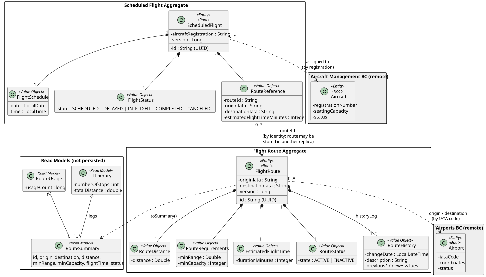


<a id="sec-aggregates-2"></a>

##### Aggregates

| Aggregate | Root | Value Objects | Invariants protected by the root |
|---|---|---|---|
| Flight Route | [`FlightRoute`](../code/flightroutes/src/main/java/isep/psoft/aisafe/flightroutes/domain/FlightRoute.java) | `RouteDistance`, `RouteRequirements`, `EstimatedFlightTime`, `RouteStatus`, `RouteHistory` | Required origin/destination; non-negative distance; positive requirements and flight time; valid status transitions; every change recorded in the history |
| Scheduled Flight | [`ScheduledFlight`](../code/flightroutes/src/main/java/isep/psoft/aisafe/flightroutes/domain/ScheduledFlight.java) | [`RouteReference`](../code/flightroutes/src/main/java/isep/psoft/aisafe/flightroutes/domain/RouteReference.java), `FlightSchedule`, `FlightStatus` | Required aircraft, route, date and time; created as `SCHEDULED` |

- `FlightRoute` has no setters: its state only changes through `updateDetails` and `changeStatus`, which guarantees a complete history (US111). Value Objects are immutable and self-validating; on update they are **replaced**.
- Both roots have `@Version` (optimistic locking). For `FlightRoute`, two **overlapping** updates on the owner replica give one success and one `409` (`ObjectOptimisticLockingFailureException` in `GlobalExceptionHandler`). The version is not part of `FlightRouteDTO` or `UpdateRouteDTO` (no `ETag`/`If-Match`), so a PATCH built from stale data is not detected: sequential updates are last-writer-wins (known limitation). A `ScheduledFlight` is never updated after it is created, so its `@Version` is not exercised; the "one flight per aircraft and slot" rule is a check before the insert (`search` on every replica that answers), not a database constraint, so two truly simultaneous bookings of the same slot are not excluded.
- **`ScheduledFlight` → `FlightRoute` by identity.** The route may be stored in another replica, so a JPA association (foreign key/JOIN) is impossible. `RouteReference` keeps the `routeId` and a snapshot of the data the flight needs (origin, destination, flight time); the snapshot also preserves the flight as scheduled if the route changes later.
- **Read models** (not persisted, no identity): [`RouteSummary`](../code/flightroutes/src/main/java/isep/psoft/aisafe/flightroutes/domain/RouteSummary.java) — a replica-independent view of a route, created from local routes (`FlightRoute.toSummary()`) and from routes received from peers (`FlightRouteDTO`); `Itinerary` (US216); `RouteUsage` (US214).
- Other aggregates are referenced by identity only: `FlightRoute` → Airport (IATA code), `ScheduledFlight` → Aircraft (registration).


<a id="sec-2-class-diagrams"></a>

#### 2. Class diagrams

**Flight routes (US110–US114, US209, US203, US210, US214–US216)**

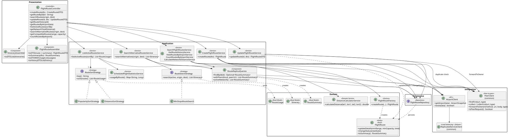

**Scheduled flights (US212, US213, US206)**

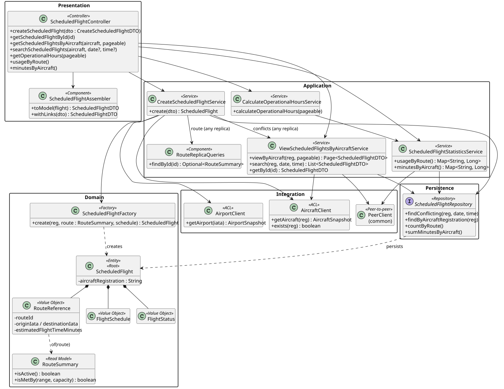


<a id="sec-3-design-rationale-responsibility-assignment-3"></a>

#### 3. Design rationale (responsibility assignment)

**Create route (US110)**

| Question: which class is responsible for... | Answer | Justification (patterns) |
|---|---|---|
| ...receiving the HTTP request? | `FlightRouteController` | **Controller (REST)** |
| ...coordinating the use case and the transaction? | `CreateFlightRouteService` | **Application Service** |
| ...checking for a duplicate route? | `FlightRouteRepository` + `PeerClient` | **Repository** (local) + peer query (other replicas) |
| ...obtaining the airports' coordinates? | `AirportClient` | **Anti-Corruption Layer / Indirection** |
| ...calculating the distance? | `DistanceCalculatorService` | **Domain Service** (Haversine) |
| ...building a valid aggregate? | `FlightRouteFactory` | **Factory / Creator** |
| ...recording the creation in the history? | `FlightRoute` | **Information Expert / Aggregate Root** |
| ...persisting it? | `FlightRouteRepository` | **Repository** — stored in the replica that received the request |
| ...building the response? | `FlightRouteAssembler` | **DTO / Assembler** |

**Update or deactivate route (US112, US111)**

| Question | Answer | Justification |
|---|---|---|
| ...loading the route? | `FlightRouteRepository` | **Repository** |
| ...sending the command to the replica that stores the route? | `PeerClient.forwardToOwner` | **Indirection** — a route has a single owner |
| ...applying the partial update, recording only changed values? | `FlightRoute.updateDetails` | **Information Expert / Aggregate Root** |
| ...validating the status transition? | `FlightRoute.changeStatus` | **Information Expert** |
| ...detecting concurrent updates? | `@Version` (overlapping updates only; the version is not exposed in the API) | **Optimistic Locking** |

**Create scheduled flight (US212)**

| Question | Answer | Justification |
|---|---|---|
| ...coordinating validations and creation? | `CreateScheduledFlightService` | **Application Service** |
| ...obtaining aircraft status, capacity and range? | `AircraftClient` → `AircraftSnapshot` | **ACL** — two remote resources (aircraft + model) in one local view |
| ...finding the route in any replica? | `RouteReplicaQueries.findById` | **Pure Fabrication** |
| ...knowing whether the route is active and its requirements are met? | `RouteSummary.isActive`, `RouteSummary.isMetBy` → `RouteRequirements.isMetBy` | **Information Expert** |
| ...knowing whether the aircraft is available / airports operational? | `AircraftSnapshot.isAvailable`, `AirportSnapshot.isOperational` | **Information Expert** |
| ...checking overlapping flights in every replica? | `ViewScheduledFlightsByAircraftService.search` | Repository + peer query |
| ...instantiating the flight and its route reference? | `ScheduledFlightFactory`, `RouteReference.of` | **Factory / Creator** |
| ...adding HATEOAS links (also to flights received from peers)? | `ScheduledFlightAssembler` | **Assembler** (`RepresentationModelAssembler`) |

**Network queries (US214, US215, US216)**

| Question | Answer | Justification |
|---|---|---|
| ...obtaining the active routes of every replica? | `RouteReplicaQueries.activeNetwork` | **Pure Fabrication** — local + peers, merged by id |
| ...computing popularity across replicas? | `ScheduledFlightStatisticsService.usageByRoute` | Counts per `routeId` in each replica, summed |
| ...sorting by the selected criterion? | `RouteSortStrategy` (`PopularitySortStrategy`, `DistanceSortStrategy`) | **Strategy / Protected Variation** — new criterion = new bean |
| ...finding alternative itineraries? | `RouteSearchStrategy` (`MinStopsRouteSearch`, BFS) | **Strategy** (Forum conversation 013) |
| ...summing the network distance? | `CalculateNetworkDistanceService` | Sum over the merged network |


<a id="sec-4-package-organization-3"></a>

#### 4. Package organization

| Package | Layer / L3 component | DDD role |
|---|---|---|
| `flightroutes.controllers`, `dto`, `assemblers` | Controllers | Published Language (API contract separate from the domain) |
| `flightroutes.services`, `services.strategy` | Application services, Replica queries, Strategies | Application Services + Domain Service |
| `flightroutes.domain`, `factories` | Domain model | Entities, Value Objects, Aggregates, Read Models, Factories |
| `flightroutes.repositories` | Repositories | One repository per Aggregate Root (local data) |
| `flightroutes.clients` | Anti-Corruption Layer | ACL |
| `flightroutes.bootstrap` | Demo data | profile `demo` |
| `infrastructure`, `exceptions` | Security & config | Security rules, OpenAPI, error mapping |


<a id="sec-5-implementation-notes-3"></a>

#### 5. Implementation notes

- **Remote access:** `RestClientConfig` creates one `ReplicatedServiceClient` per remote service with all its replicas. Clients map responses: `404` → `EntityNotFoundException`, `401/403` → `ResponseStatusException`, no replica available → `RemoteServiceUnavailableException` (`503`).
- **Services never decide whether to forward:** `PeerClient` does nothing when the current request already came from a peer, so the same service code answers clients (all replicas) and peers (local only).
- **Partial update:** all `UpdateRouteDTO` fields are optional; `updateDetails` ignores `null`/unchanged values and records nothing if nothing changes.
- **History:** `RouteHistory` is an `@ElementCollection` (`ROUTE_HISTORY_LOG`) with factory methods `created`, `detailsUpdated`, `statusChanged`; `RouteHistoryDTO` uses `@JsonInclude(NON_NULL)`.
- **Statistics without JOINs:** `ScheduledFlightRepository.countByRoute` / `sumMinutesByAircraft` group local flights (flight time from `RouteReference`); `ScheduledFlightStatisticsService` sums all replicas.
- **Tolerant reader:** DTOs exchanged between replicas use `@JsonIgnoreProperties(ignoreUnknown = true)`; HATEOAS links of flights received from peers are rebuilt to point to the entry replica (`ScheduledFlightAssembler.withLinks`).
- **Pagination after merging:** `Pages.of` cuts the page after merging and sorting the data of all replicas.


<a id="sec-6-configuration-files-2"></a>

#### 6. Configuration files

| File | Content |
|---|---|
| [`application.properties`](../code/flightroutes/src/main/resources/application.properties) | Defaults (= replica 1), remote URLs, resilience, security (including `aisafe.security.service-only-paths`), logging, actuator |
| `application-instance1/2/3.properties` | Port, instance id, database, peers and demo data of each replica |
| `application-demo.properties` / `application-tls.properties` | Demo data / HTTPS |


<a id="sec-7-code-level-observations-2"></a>

#### 7. Code-level observations

- `FlightStatus` transitions remain future work (conversation 006).
- No caching of aggregated results; the circuit breaker avoids waiting for replicas known to be down.
- Static peer list: adding a replica requires updating the others' configuration.

<a id="src-5-scenarios-flightroutes-flightroutes-scenarios"></a>

*Source: docs/5-scenarios/flightroutes/FlightRoutes-Scenarios.md*


<a id="sec-c4-1-flight-routes-service-scenarios"></a>

### C4+1 — Flight Routes Service: Scenarios

> The "+1" view: real use cases and end-to-end behaviour across containers and components. Each scenario validates [L2](#src-2-containers-containers), [L3](#src-3-components-flightroutes-flightroutes-components) and [L4](#src-4-code-flightroutes-flightroutes-code).


<a id="sec-1-user-stories-3"></a>

#### 1. User stories

| WP | US | Description | Actor |
|---|---|---|---|
| 3A | US110 | Create a flight route between two registered airports | ATCC |
| 3A | US111 | View the change history of a route | ATCC |
| 3A | US112 | Update the operational details of a route or deactivate it | ATCC, Backoffice Operator |
| 3A | US113 | View the details of a route given its ID | ATCC |
| 3A | US114 | Search routes by origin and/or destination | ATCC |
| 2B | US209 | View all routes that depart from or arrive at a specific airport | ATCC |
| 3B | US212 | Assign an aircraft to a route for a date/time (create a scheduled flight) | ATCC |
| 3B | US213 | View all scheduled flights of a specific aircraft | ATCC |
| 3B | US214 | List active routes sorted by popularity or distance | ATCC |
| 3B | US215 | Calculate the total distance of the network | ATCC |
| 3B | US216 | Search for alternative routes between two airports | ATCC |

Supplied to other containers (service-only endpoints, `X-Service-Key` required): **US203** compatible routes (B6) and the flight minutes per aircraft used by **US204** and **US206** (B4b) to Aircraft Management; **US210** routes per airport (B5) to Airports.


<a id="sec-clarifications"></a>

##### Clarifications

- **Conv. 002:** routes exist independently of an airport's state, but scheduled flights can be affected; the distance is fixed at creation.
- **Conv. 006:** flight lifecycle `SCHEDULED`, `DELAYED`, `IN_FLIGHT`, `COMPLETED`, `CANCELED`; transitions are future work.
- **Conv. 007:** the Route ID is system generated. **Conv. 010:** the *Network* is the set of active routes. **Conv. 012:** routes are point-to-point. **Conv. 013:** alternative routes chain existing routes; the algorithm must be replaceable (one is enough).


<a id="sec-2-acceptance-criteria-3"></a>

#### 2. Acceptance criteria

**Flight routes:** AC1 airports must exist (else `400`); AC2 one route per origin/destination in every replica that answers (else `400`); AC3 distance by Haversine, never changes; AC4 `minRange`, `minCapacity`, `estimatedFlightTime` positive; AC5 created `ACTIVE`, changing to the current state → `409`; AC6 history records only the changed attributes; AC7 two **overlapping** updates of a route → one `200` and one `409` (`@Version`). The version is not exposed, so an update from stale data is accepted (last writer wins, known limitation).

**Scheduled flights:** AC8 aircraft and route (any replica) must exist (else `404`); AC9 range/capacity must meet the requirements (else `422`); AC10 route `ACTIVE`, aircraft `AVAILABLE`, airports `OPERATIONAL`, no other flight of the aircraft at that date/time in any replica that answers (else `409`); AC11 `201` + `Location` + HATEOAS links; AC12 per-aircraft list paginated after merging the replicas.

**Network:** AC13 US214–US216 use only `ACTIVE` routes of every replica; AC14 sorting and search are strategies; unknown `sortBy` → `400`.

**Distribution:** AC15 any replica answers with the data of all replicas, `404` if no replica has it; AC16 a failed peer gives a `200` with `X-Partial-Response: true`; AC17 a route is only modified by its owner replica; AC18 peer requests without valid `X-Service-Key` → `401`, `X-Peer-Hops > 1` → `400`; requests to the service-only endpoints (`count-by-airport`, `compatible`, `minutes-by-aircraft`, `operational-hours`, `usage-by-route`) without `X-Service-Key` → `401` even with a valid JWT, with the key the role rules still apply (`minutes-by-aircraft`: ATCC or Backoffice Operator); AC19 JWT + roles on every endpoint, every request audited; AC20 `503` when no replica of a remote service answers.


<a id="sec-3-system-sequence-diagram-3"></a>

#### 3. System sequence diagram

"System" = any of the three replicas.

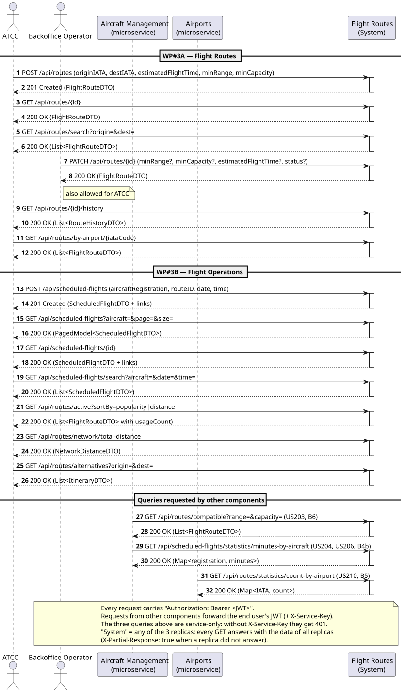


<a id="sec-4-scenarios-sequence-diagrams-3"></a>

#### 4. Scenarios (sequence diagrams)


<a id="sec-4-1-distributed-scenarios-3"></a>

##### 4.1 Distributed scenarios

**S1 — Peer-to-peer query resolution: GET a route stored in another replica (US113; same for US111 and flight by id)**

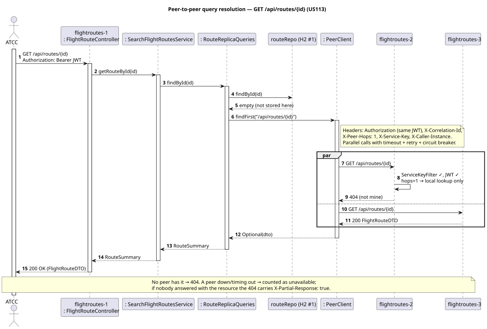

**S2 — Response aggregation with a failed replica (US114; same for US203, US209, US210, US213)**

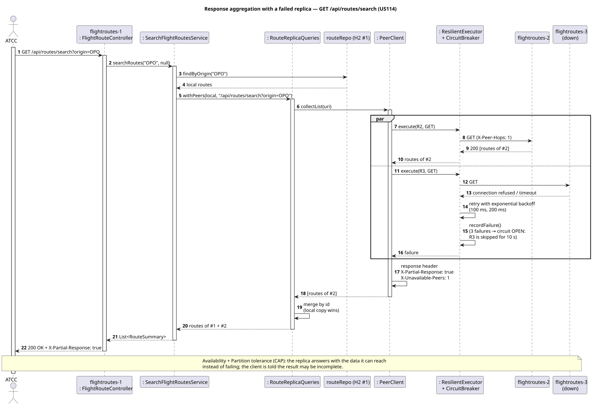

**S3 — Update / deactivate a route: command forwarded to the owner replica (US112)**

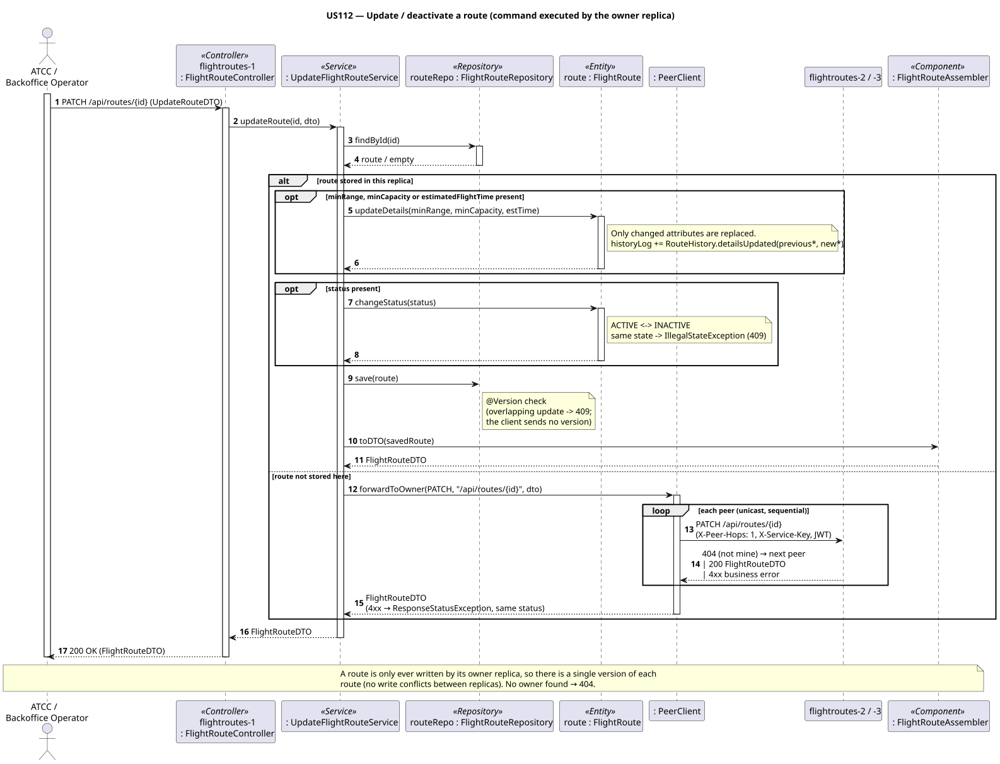


<a id="sec-4-2-use-case-scenarios-3"></a>

##### 4.2 Use-case scenarios

**S4 — Create route (US110)**

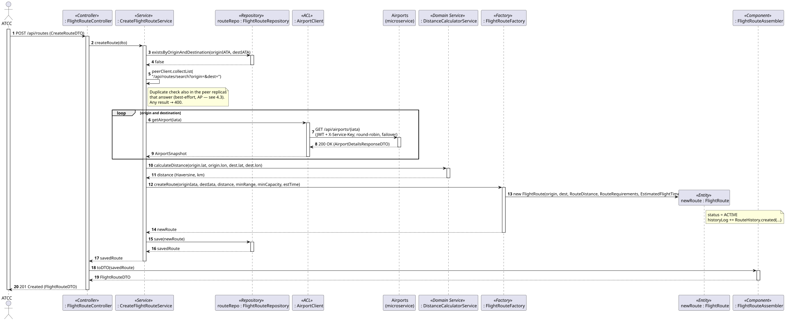

**S5 — Create scheduled flight (US212)**

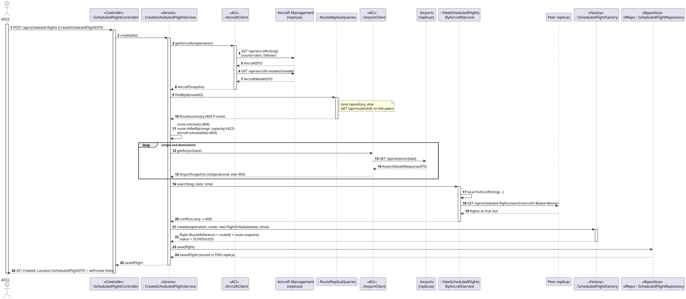

**S6 — List active routes by popularity (US214)**

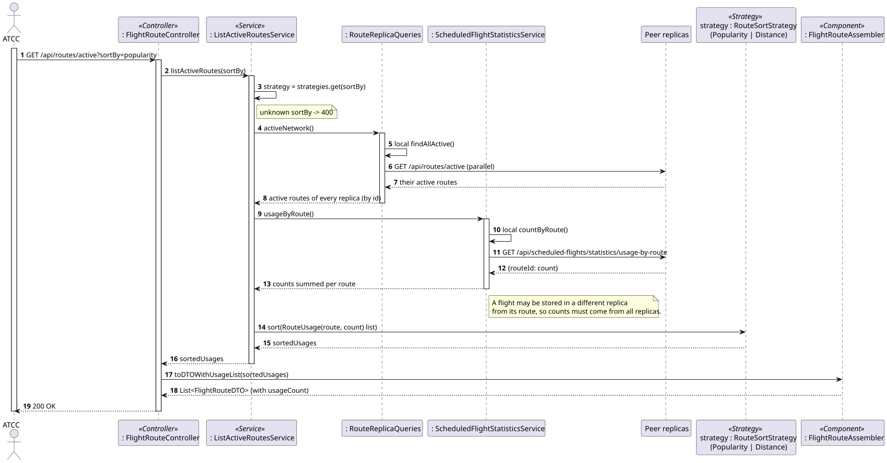

**S7 — Search alternative routes (US216)**

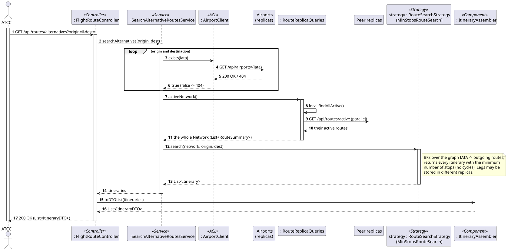


<a id="sec-5-tests-3"></a>

#### 5. Tests

From `code/`: `./mvnw test` — `flightroutes` 34 tests and `common` 29 tests, all passing.

| Test class | Type | What is verified |
|---|---|---|
| `FlightRouteTest` | Unit (domain) | Value Object validation, `ACTIVE` with history, history of changed attributes only, status transitions, `isMetBy`, `toSummary` |
| `ScheduledFlightTest` | Unit (domain) | `SCHEDULED`, reference/snapshot of a route stored in another replica, mandatory data |
| `RouteStrategiesTest` | Unit | BFS with fewest stops (no cycles, unreachable), popularity/distance sorting |
| `PeerClientTest` (common) | Integration with fake HTTP replicas | first answer, nobody has it, headers sent, aggregation with a dead peer, slow peer timeout, no re-forwarding, command forwarding and `409` propagation |
| `CircuitBreakerTest`, `ResilientExecutorTest` (common) | Unit | open/half-open/close; retry, give-up, no retry on 4xx, fail fast |
| `ServiceKeyFilterTest`, `AuthorizationRulesGuardTest` (common) | Unit / context | peer and service-only requests without or with a wrong key → `401`, valid key passes, encoded paths caught; a service whose rules call `anyRequest()` fails to start with the class name |
| **`ServiceOnlyEndpointsSecurityTest`** | Integration — one real replica | each of the 5 service-only endpoints → `401` without the key even with a valid JWT; wrong key → `401`; valid key + wrong role → `403`; `minutes-by-aircraft` allowed for ATCC and Backoffice Operator; user endpoints need no key |
| **`ReplicaCollaborationTest`** | **Distributed** — two real replicas + stubs of Airports and Aircraft Management | scenarios below |

`ReplicaCollaborationTest` (week 4 scenarios 1–3 and the replica-failure test):

1. Each replica stores the routes it receives; local access `200`.
2. GET on A of a route stored on B → forwarded, `200` (S1).
3. Search on A and on B → same merged list (S2).
4. Duplicate route on A while it exists on B → `400`.
5. PATCH on A of a route of B → executed by B; history via A; owner's `409` propagated (S3).
6. Flight on A for a route on B → `201`; same aircraft/slot on B → `409`; flight read through B (S5).
7. Popularity seen from B counts the flight in A; operational hours and network distance aggregated (S6).
8. Alternative OPO→MAD combines legs stored in B and A (S7).
9. Peer headers without/wrong service key → `401`; hops 2 → `400`; valid peer request → only local data.
10. No token → `401`; wrong role → `403`; health `UP` with `peers`.
11. Replica B stopped: A answers `200` with `X-Partial-Response: true`; local route `200`; route only in B → `404` (S2).

**Postman:** [postman/FlightRoutes.postman_collection.json](5-scenarios/flightroutes/postman/FlightRoutes.postman_collection.json) + [environment](5-scenarios/flightroutes/postman/FlightRoutes.postman_environment.json), against the three replicas with the `demo` profile — folders: 0 setup, 1 local access, 2 forwarding, 3 aggregation (the service-only statistics are called with `X-Service-Key`, as Airports and Aircraft Management do), 4 command forwarding, 5 security (including the service-only endpoints without `X-Service-Key` → `401`), 6 replica failure (stop replica 2 before this folder), 7 cross-service (Airports and Aircraft Management must also be running: routes, scheduled flights, `400`/`404`/`409` from the remote data), 8 concurrency (last-writer-wins without a version in the API; parallel updates answered with `200` or `409`). 52 requests. Verified with Newman, all folders except 6: 55 requests (including 7 sent from test scripts), 99 assertions, 0 failures.


<a id="sec-6-demo-3"></a>

#### 6. Demo

From `code/`:

1. `./mvnw clean install`
2. `./scripts/start-replicas.sh flightroutes demo` (Windows: `.\scripts\start-replicas.ps1 -Service flightroutes -Profiles demo`). Each replica loads different data: replica 1 OPO-LIS, LIS-MAD; replica 2 MAD-CDG, LIS-FNC; replica 3 CDG-LHR, OPO-MAD (+ flights).
3. `GET http://localhost:8084/actuator/health` (also 8184, 8284).
4. `POST http://localhost:8084/auth/dev-token` `{"username":"atcc1","roles":["ATCC"]}` → token for Postman / Swagger *Authorize*.
5. Run the Postman collection, or by hand:
   - `GET :8084/api/routes/search` and `:8184/...` → the same 6 routes.
   - `GET :8084/api/routes/{id of CDG-LHR}` → `200`; log of replica 1: `Not found locally: forwarding GET ...`; replica 3: `AUDIT ... source=peer:flightroutes-1` with the same correlation id.
   - `GET :8184/api/scheduled-flights/operational-hours` with header `X-Service-Key: dev-only-service-key-aisafe-2026` → CS-TUA = 240 min (flights in 3 replicas); without the header → `401` (service-only endpoint).
   - `PATCH :8084/api/routes/{id of MAD-CDG}` `{"minCapacity":160}` → executed by replica 2.
   - Stop replica 2 → search returns 4 routes with `X-Partial-Response: true`; `/actuator/health` shows `8184` `OPEN`.
   - HTTPS: add the `tls` profile (`demo,tls`) and use `https://`.

H2 console: `http://localhost:8084/h2-console` (JDBC URL `jdbc:h2:mem:flightRoutesdb-1`).


<a id="sec-7-observations-3"></a>

#### 7. Observations

- Cross-replica uniqueness is best-effort (AP, see [L2 §3.3](#sec-3-3-consistency-model-cap)); deterministic ownership (hash → replica) is a possible improvement. The "one flight per aircraft and slot" rule is also a check before the insert, so two truly simultaneous bookings are not excluded.
- Optimistic locking only catches **overlapping** updates of a route. The version is not returned by GET nor accepted by PATCH, so a client updating from stale data is not detected; folder 8 of the Postman collection shows both behaviours. Exposing the version (`ETag`/`If-Match` or a `version` field) is the fix.
- US212 does not check the airport certifications of the aircraft model (Airports stores them, Flight Routes does not read them).
- The folders 7 (cross-service) and 8 (concurrency) of the Postman collection also need Aircraft Management and Airports: `./scripts/start-all.sh 1 demo` plus the flightroutes replicas 2 and 3, or `./scripts/start-all.sh 3 demo` (`.\scripts\start-all.ps1 -Profiles demo`).
- Shared secrets have development defaults; outside development use `JWT_SECRET`, `AISAFE_SERVICE_KEY`, `AISAFE_TLS_PASSWORD`, `AISAFE_DEV_TOKEN=false`.
- No events/message queues (Assignment 1 allows HTTP/REST commands only): popularity and operational hours are computed on demand from all replicas.

<div style="page-break-before: always;"></div>

<a id="sec-maintenance-wp4"></a>

## Maintenance (WP4)

**Owner:** Diogo Fernandes (1240632) — WP4 Maintenance

<a id="src-3-components-maintenance-maintenance-components"></a>

*Source: docs/3-components/maintenance/Maintenance-Components.md*


<a id="sec-c4-level-3-maintenance-service-components"></a>

### C4 Level 3 — Maintenance Service: Components

> Zoom into the **Maintenance Service** container of [Level 2](#src-2-containers-containers): its major building blocks and how they collaborate. One replica is shown; the three replicas are identical.
> Lower levels: [L4 Code](#src-4-code-maintenance-maintenance-code) · [+1 Scenarios](#src-5-scenarios-maintenance-maintenance-scenarios)


<a id="sec-1-container-summary-4"></a>

#### 1. Container summary

| Property | Value |
|---|---|
| Bounded context | *Maintenance* — owns the `MaintenanceTemplate` and `MaintenanceRecord` aggregates (WP#4: US115, US116, US117, US119, US217–US222; WP#0A: preloaded templates) |
| Replicas | `maintenance-1` :8082, `maintenance-2` :8182, `maintenance-3` :8282 |
| Database | H2 in-memory per replica: `maintenancedb-1/2/3` |
| Source code | [code/maintenance](../code/maintenance) |
| API | `http://localhost:8082/swagger-ui.html` (any replica) |
| Supplies to other containers | Nothing — no other service calls Maintenance (*Flight Routes never calls Maintenance*, [Integration-Contracts §3](#sec-3-bridge-catalogue)) |
| Consumes from other containers | Aircraft Management: aircraft lookup (B3a), aircraft status update (B3b), aircraft model lookup (B3c), fleet and operational hours (B3d) |


<a id="sec-2-components-4"></a>

#### 2. Components

| Component | Technology / classes | Responsibility |
|---|---|---|
| **Security & Observability filters** | `common` filters + [`MaintenanceAuthorizationRules`](../code/maintenance/src/main/java/isep/psoft/aisafe/infrastructure/security/MaintenanceAuthorizationRules.java) | Correlation id, audit log, `X-Service-Key` check, JWT authentication, role rules per endpoint (section 3). The rules also accept the roles whose requests reach this replica **as peer calls** (the user's JWT is forwarded) |
| **Template controller** | [`MaintenanceTemplateController`](../code/maintenance/src/main/java/isep/psoft/aisafe/maintenance/controllers/MaintenanceTemplateController.java) (Spring REST) | `/api/maintenance-templates` — US115 (templates), template lookup and listing |
| **Record controller** | [`MaintenanceRecordController`](../code/maintenance/src/main/java/isep/psoft/aisafe/maintenance/controllers/MaintenanceRecordController.java) (Spring REST) | `/api/maintenance-records` — US115 (records), US116, US119, US217, US218, US219 |
| **Statistics controller** | [`MaintenanceStatisticsController`](../code/maintenance/src/main/java/isep/psoft/aisafe/maintenance/controllers/MaintenanceStatisticsController.java) (Spring REST) | `/api/maintenance-records/statistics/**`, `/reports/**` — US117, US220, US221 and the per-replica summary used by US222 |
| **Alert controller** | [`MaintenanceAlertController`](../code/maintenance/src/main/java/isep/psoft/aisafe/maintenance/controllers/MaintenanceAlertController.java) (Spring REST) | `/api/maintenance-alerts` — US222 (check triggered manually by the user, conversation 016) |
| **Template application services** | `CreateMaintenanceTemplateService`, `ViewMaintenanceTemplatesService` | Create a template (models validated in Aircraft Management, unique name in every replica that answers), get/list templates of all replicas |
| **Record application services** | `CreateMaintenanceRecordService`, `CompleteMaintenanceRecordService`, `CategorizeMaintenanceRecordService`, `ViewMaintenanceRecordsService` | One service per use case: transactions, orchestration, forwarding of commands to the owner replica |
| **Aircraft availability coordinator** | [`AircraftAvailabilityService`](../code/maintenance/src/main/java/isep/psoft/aisafe/maintenance/services/AircraftAvailabilityService.java) | US115: puts the aircraft `UNDER_MAINTENANCE` through B3b **after the record was flushed and before the commit** (B3b fails → nothing saved; commit fails afterwards → **compensating PATCH**). US119: releases it to `AVAILABLE` only when **no other record of the aircraft is ongoing in any replica** and every replica answered; otherwise the aircraft stays `UNDER_MAINTENANCE` (safe side) |
| **Statistics and alerts services** | `MaintenanceStatisticsService`, `MaintenanceAlertService` | Partial results per replica (sums and counts) combined into a fleet-wide result; due-maintenance check (US222), which still answers with calendar-day alerts (flagged partial) when flight hours are unavailable |
| **Replica queries** | [`MaintenanceReplicaQueries`](../code/maintenance/src/main/java/isep/psoft/aisafe/maintenance/services/MaintenanceReplicaQueries.java), `Pages` | Combine local data with the peer replicas: find a record/template in any replica, merge collections **by id**, paginate **after** merging, encode peer URIs |
| **Domain model** | `domain` + `factories` packages | Aggregates `MaintenanceTemplate` and `MaintenanceRecord`, Value Objects, read models, the due-maintenance policy (`MaintenanceDuePolicy` + `DueCriterion` strategies) — see [L4](#src-4-code-maintenance-maintenance-code) |
| **Repositories** | `MaintenanceTemplateRepository`, `MaintenanceRecordRepository` (Spring Data JPA) | Access to the data of **this** replica only; local grouping queries for statistics |
| **Anti-Corruption Layer** | [`AircraftClient`](../code/maintenance/src/main/java/isep/psoft/aisafe/maintenance/clients/AircraftClient.java) → `AircraftSnapshot`; `RestClientConfig` | Translates the Aircraft Management API (B3a–B3d) into local read-only views; `404` → `EntityNotFoundException`, `401/403/409` → same status, no replica → `503` |
| **Assemblers / DTOs** | `MaintenanceRecordAssembler`, `MaintenanceTemplateAssembler`, `dto` package, `PageDTO` | Published language: API contract separate from the domain; HATEOAS links (also on records received from peers); stable page format |
| **PeerClient** *(common)* | `PeerClient` | GET to the peer replicas (first answer / aggregation) and command forwarding to the owner replica |
| **ReplicatedServiceClient** *(common)* | `ReplicatedServiceClient`, `ReplicatedServiceClientFactory` | Round-robin + failover over the replicas of Aircraft Management |
| **ResilientExecutor** *(common)* | `ResilientExecutor`, `CircuitBreaker` | Timeouts, retry with exponential backoff, circuit breaker per target |
| **Error mapping / OpenAPI** | `GlobalExceptionHandler`, `OpenApiConfig` | Exception → HTTP status; Swagger UI with the JWT *Authorize* button |
| *Reference data* | `ReferenceTemplatesBootstrap` (every replica) | WP#0A: preloads the standard maintenance templates **with deterministic ids**, so the copies in the three replicas are the same template |
| *Demo data* | `DemoDataBootstrap` (profile `demo`) | Loads **different** maintenance records in each replica, to demonstrate peer-to-peer behaviour |

The `common` components are described in [common — Components](#src-3-components-common-common-components).


<a id="sec-3-provided-interfaces-rest-api-4"></a>

#### 3. Provided interfaces (REST API)

Every endpoint is served by every replica; **every GET returns the data of all replicas** (flagged with `X-Partial-Response: true` when a replica did not answer).

**Maintenance templates — `/api/maintenance-templates`**

| Method | Endpoint | US | Input | Output | Roles |
|---|---|---|---|---|---|
| POST | `/api/maintenance-templates` | US115 (templates) | `CreateMaintenanceTemplateDTO` (name, type, applicableModels, checklist, flightHoursInterval?, calendarDaysInterval?) | `201` `MaintenanceTemplateDTO` + `Location` + links | MAINTENANCE_TECHNICIAN |
| GET | `/api/maintenance-templates/{id}` | — | template id | `200` `MaintenanceTemplateDTO` | MAINTENANCE_TECHNICIAN, MAINTENANCE_SUPERVISOR, ATCC |
| GET | `/api/maintenance-templates?model=&type=&name=` | — (also peer queries of US115/US222) | optional filters | `200` `List<MaintenanceTemplateDTO>` | MAINTENANCE_TECHNICIAN, MAINTENANCE_SUPERVISOR, ATCC |

**Maintenance records — `/api/maintenance-records`**

| Method | Endpoint | US | Input | Output | Roles |
|---|---|---|---|---|---|
| POST | `/api/maintenance-records` | US115 (records) | `CreateMaintenanceRecordDTO` (aircraftRegistration, templateId, description, startDate, expectedDurationMinutes, component?) | `201` `MaintenanceRecordDTO` (with the template's checklist) + `Location` + links | MAINTENANCE_TECHNICIAN |
| GET | `/api/maintenance-records/{id}` | — | record id | `200` `MaintenanceRecordDTO` | MAINTENANCE_TECHNICIAN, MAINTENANCE_SUPERVISOR, ATCC |
| GET | `/api/maintenance-records/aircraft/{registration}?page=&size=` | US116 | registration + pagination | `200` `PageDTO<MaintenanceRecordDTO>` | MAINTENANCE_TECHNICIAN, MAINTENANCE_SUPERVISOR |
| GET | `/api/maintenance-records?aircraft=&component=&status=&from=&to=&page=&size=` | US218 | optional filters (AND); `from`/`to` = range of the start date | `200` `PageDTO<MaintenanceRecordDTO>` | MAINTENANCE_TECHNICIAN, MAINTENANCE_SUPERVISOR |
| GET | `/api/maintenance-records/ongoing?page=&size=` | US219 | pagination | `200` `PageDTO<MaintenanceRecordDTO>` | MAINTENANCE_SUPERVISOR |
| GET | `/api/maintenance-records/search?aircraft=&component=&status=&from=&to=` | — (replica query) | same filters, **not paginated** | `200` `List<MaintenanceRecordDTO>` | MAINTENANCE_TECHNICIAN, MAINTENANCE_SUPERVISOR, ATCC |
| PATCH | `/api/maintenance-records/{id}/complete` | US119 | `CompleteMaintenanceRecordDTO` (notes, cost, actualDurationMinutes, completionDate?, aircraftFlightHours?) | `200` `MaintenanceRecordDTO` + header `X-Aircraft-Released: true\|false` | MAINTENANCE_TECHNICIAN |
| PATCH | `/api/maintenance-records/{id}/component` | US217 | `CategorizeRecordDTO` (component: ENGINE, AIRFRAME, AVIONICS, INTERIOR, EXTERIOR) | `200` `MaintenanceRecordDTO` | MAINTENANCE_TECHNICIAN |

**Statistics and reports — `/api/maintenance-records/statistics`, `/api/maintenance-records/reports`**

| Method | Endpoint | US | Input | Output | Roles |
|---|---|---|---|---|---|
| GET | `/api/maintenance-records/statistics/hours` | US117 | — | `200` `FleetMaintenanceHoursDTO` (total + per aircraft) | ATCC |
| GET | `/api/maintenance-records/reports/costs?groupBy=AIRCRAFT\|MODEL` | US220 | grouping (default `AIRCRAFT`) | `200` `CostReportDTO` | ATCC |
| GET | `/api/maintenance-records/reports/turnaround` | US221 | — | `200` `TurnaroundReportDTO` (per aircraft model) | MAINTENANCE_SUPERVISOR |
| GET | `/api/maintenance-records/statistics/last-completions` | — (replica query of US222) | — | `200` `List<LastCompletionDTO>` | ATCC |

**Alerts — `/api/maintenance-alerts`**

| Method | Endpoint | US | Input | Output | Roles |
|---|---|---|---|---|---|
| GET | `/api/maintenance-alerts` | US222 | — | `200` `List<MaintenanceAlertDTO>` (+ `X-Partial-Response`) | ATCC |

Infrastructure endpoints (from `common`): `GET /actuator/health`, `POST /auth/dev-token` (development only), `/swagger-ui.html`.

**Why the replica queries are separate endpoints.** The client-facing lists are paginated, but a page can only be cut after the data of every replica has been merged. Peers are therefore asked through `/search` (complete local list, no pagination) and `/statistics/last-completions` (local partial result), exactly as Flight Routes does with `/api/scheduled-flights/search`. These endpoints are also usable by clients, with the same JWT rules.

**Errors** — body `{ "error": "<message>" }` (Bean Validation: `{ "<field>": "<message>" }`):

| Exception | HTTP | Examples |
|---|---|---|
| `IllegalArgumentException`, `MethodArgumentNotValidException`, type mismatch | 400 | invalid component/type/status, template not applicable to the aircraft model, start date in the future, unknown aircraft model in a template, duplicate template name |
| `EntityNotFoundException` | 404 | record/template not found in any replica, aircraft not found (B3a) |
| `IllegalStateException`, `ObjectOptimisticLockingFailureException` | 409 | record already completed, categorising a completed record, concurrent update (`@Version`), aircraft in flight (B3b answered 409) |
| `RemoteServiceUnavailableException` | 503 | no replica of Aircraft Management answered; no peer answered a forwarded command |
| `ResponseStatusException` | same status | remote 401/403/409; business error of the owner replica |


<a id="sec-4-required-interfaces-4"></a>

#### 4. Required interfaces

| Component | Calls | Endpoint | Bridge |
|---|---|---|---|
| `AircraftClient` | Aircraft Management (all replicas) | `GET /api/aircrafts/{registrationNumber}` | B3a |
| `AircraftClient` | Aircraft Management | `PATCH /api/aircrafts/{registrationNumber}/status` | B3b |
| `AircraftClient` | Aircraft Management | `GET /api/aircraft-models/{modelName}` | B3c |
| `AircraftClient` | Aircraft Management | `GET /api/aircrafts?page=&size=`, `GET /api/aircrafts/operational-hours?page=&size=` | B3d |
| `PeerClient` | Maintenance peer replicas | the replica queries above, `X-Peer-Hops: 1` | — |

Exact schemas, status codes and roles: [Integration-Contracts §4 — B3](#sec-b3-maintenance-aircraft-management-implemented).


<a id="sec-5-how-the-components-realise-the-distribution-requirements-4"></a>

#### 5. How the components realise the distribution requirements

| Requirement | Components involved |
|---|---|
| Peer forwarding of GET by id (record, template) | `ViewMaintenanceRecordsService` / `ViewMaintenanceTemplatesService` → `MaintenanceReplicaQueries` → `PeerClient.findFirst` |
| Aggregation of collections (US116, US218, US219, template list) | services → `MaintenanceReplicaQueries.searchRecords` / `PeerClient.collectList` (merged **by id**) → `Pages` (page cut after merging) |
| Aggregated statistics (US117, US220, US221) | `MaintenanceStatisticsService` → `PeerClient.collect`: every replica returns **sums and counts** of its own records, the entry replica adds them (averages are computed only after adding, never averaged twice) |
| Fleet-wide check (US222) | `MaintenanceAlertService` → templates and last completions of every replica + fleet and flight hours from Aircraft Management → `MaintenanceDuePolicy` |
| Single owner per record (US119, US217) | `CompleteMaintenanceRecordService`, `CategorizeMaintenanceRecordService` → `PeerClient.forwardToOwner` |
| Cross-service consistency of the aircraft status (US115, US119) | `AircraftAvailabilityService` → `AircraftClient` (B3b): US115 inside the local transaction with compensation on rollback; US119 by the replica that received the client request, after the owner completed the record |
| Calls to Aircraft Management with failover | `AircraftClient` → `ReplicatedServiceClient` → `ResilientExecutor` |
| Security and audit | filter chain of `common` + `MaintenanceAuthorizationRules` |

The system-wide decisions (consistency model, fault tolerance, security) are in [L2 §3](#sec-3-distribution-design-decisions).

<a id="src-4-code-maintenance-maintenance-code"></a>

*Source: docs/4-code/maintenance/Maintenance-Code.md*


<a id="sec-c4-level-4-maintenance-service-code"></a>

### C4 Level 4 — Maintenance Service: Code

> Zoom into the components of [L3](#src-3-components-maintenance-maintenance-components): the significant classes, their relationships and the design patterns. Class names link to the source code.
> Source root: [code/maintenance/src/main/java/isep/psoft/aisafe](../code/maintenance/src/main/java/isep/psoft/aisafe)


<a id="sec-1-domain-model-4"></a>

#### 1. Domain model


<a id="sec-aggregates-3"></a>

##### Aggregates

| Aggregate | Root | Value Objects | Invariants protected by the root |
|---|---|---|---|
| Maintenance Template | [`MaintenanceTemplate`](../code/maintenance/src/main/java/isep/psoft/aisafe/maintenance/domain/MaintenanceTemplate.java) | `TemplateType`, `MaintenanceInterval` | Required name and type; at least one applicable aircraft model and one checklist item (blank items rejected); interval values positive, at least one of them when an interval is given |
| Maintenance Record | [`MaintenanceRecord`](../code/maintenance/src/main/java/isep/psoft/aisafe/maintenance/domain/MaintenanceRecord.java) | [`TemplateReference`](../code/maintenance/src/main/java/isep/psoft/aisafe/maintenance/domain/TemplateReference.java), `RecordDetails`, `MaintenanceComponent`, `MaintenanceStatus`, `CompletionDetails` | Required aircraft, template and details; start date not in the future; expected duration positive; created `IN_PROGRESS`; `IN_PROGRESS → COMPLETED` only once; completion date not before the start date nor in the future; cost ≥ 0; actual duration > 0; a completed record cannot be re-categorised |

- **Glossary alignment with PSOFT.** "Maintenance type (according to a maintenance template)" of US115 is the `TemplateReference`; "aircraft type" of US221 is the aircraft model (PSOFT forum, conversation 009); the "fleet" is every aircraft managed in AISafe (conversation 010).
- **`MaintenanceRecord` → `MaintenanceTemplate` by identity.** The template may be stored in another replica, so a JPA association is impossible. `TemplateReference` keeps the `templateId` and a snapshot of the name and type; the **checklist is copied** into the record when it is created (US115: "its checklist, defined by the maintenance template"), so the record keeps the checklist it was performed with even if templates evolve.
- **`MaintenanceRecord` → Aircraft by identity + model snapshot.** The record stores `aircraftRegistration` and the `aircraftModel` returned by B3a at creation time. US220 (cost per model) and US221 (turnaround per model) are then computed **locally in each replica**, without calling Aircraft Management once per record and without a cross-service JOIN (the PSOFT monolith joined `MaintenanceRecord` with `Aircraft` in JPQL, which is impossible after the decomposition).
- **`MaintenanceTemplate` → AircraftModel by model name** (`applicableModels`), validated in Aircraft Management at creation (B3c).
- **`MaintenanceInterval` lives in the template** (conversation 016): `flightHours` and/or `calendarDays`. A template without interval (e.g. a one-off `MODIFICATION`) is not periodic and never raises alerts.
- **Status is explicit** (`IN_PROGRESS`, `COMPLETED`) instead of PSOFT's "completion notes are null", which makes US218 (`status` filter) and US219 (ongoing) simple queries.
- **Turnaround time (US221)** is the `actualDurationMinutes` recorded at completion (the time the aircraft was out of service for that maintenance). US117 uses the actual duration of completed records and the expected duration of ongoing ones (`maintenanceMinutes()`).
- Both roots have `@Version` (optimistic locking). A record is only written by its owner replica (section 5), so `@Version` is enough to detect concurrent updates of the same record (`409`).
- **Read models** (not persisted): `LastCompletion` (latest completion of a template on an aircraft, plus whether one is ongoing) and `MaintenanceAlert` (US222). Statistics DTOs carry **sums and counts**, never averages, so they can be added across replicas.
- **Due-maintenance policy (US222)** — [`MaintenanceDuePolicy`](../code/maintenance/src/main/java/isep/psoft/aisafe/maintenance/domain/MaintenanceDuePolicy.java) is a domain service that applies a list of `DueCriterion` strategies:
  - `FlightHoursCriterion`: flight hours since the last completion = current hours (B3d) − `aircraftFlightHours` recorded at that completion; if the technician did not record them, or the template was never performed on the aircraft, all current hours count (safety-first: alert earlier rather than later). Due when ≥ `interval.flightHours`.
  - `CalendarDaysCriterion`: days since the last completion, or since the aircraft's manufacturing date if never performed. Due when ≥ `interval.calendarDays`.
  - An aircraft is checked against every periodic template that applies to its model; `INACTIVE` aircraft and template/aircraft pairs with an ongoing record are skipped.


<a id="sec-2-class-diagrams-2"></a>

#### 2. Class diagrams

**Maintenance records (US115 records, US116, US119, US217, US218, US219)**


**Templates, statistics and alerts (US115 templates, US117, US220, US221, US222)**


<a id="sec-3-design-rationale-responsibility-assignment-4"></a>

#### 3. Design rationale (responsibility assignment)

**Create maintenance template (US115 — templates)**

| Question: which class is responsible for... | Answer | Justification (patterns) |
|---|---|---|
| ...receiving the HTTP request? | `MaintenanceTemplateController` | **Controller (REST)** |
| ...coordinating the use case and the transaction? | `CreateMaintenanceTemplateService` | **Application Service** |
| ...checking that the applicable models exist? | `AircraftClient.modelExists` (B3c) | **Anti-Corruption Layer / Indirection** |
| ...checking that the name is unique? | `MaintenanceTemplateRepository` + `MaintenanceReplicaQueries` | **Repository** (local) + peer query (other replicas, best-effort) |
| ...parsing the type and building a valid aggregate? | `MaintenanceTemplateFactory` | **Factory / Creator** |
| ...persisting it? | `MaintenanceTemplateRepository` | **Repository** — stored in the replica that received the request |

**Create maintenance record (US115 — records)**

| Question | Answer | Justification |
|---|---|---|
| ...knowing that the aircraft exists and its model? | `AircraftClient.getAircraft` → `AircraftSnapshot` (B3a) | **ACL** |
| ...finding the template in any replica? | `MaintenanceReplicaQueries.findTemplate` → `PeerClient.findFirst` | **Pure Fabrication** |
| ...knowing whether the template applies to the model? | `MaintenanceTemplateDTO.appliesTo` / `MaintenanceTemplate.appliesTo` | **Information Expert** |
| ...copying the checklist and the template snapshot into a new record? | `MaintenanceRecordFactory` | **Factory / Creator** |
| ...validating the details (start date, duration, component)? | `RecordDetails`, `MaintenanceComponent.parse` | **Value Objects** (self-validating) |
| ...putting the aircraft `UNDER_MAINTENANCE`? | `AircraftAvailabilityService` → `AircraftClient.updateStatus` (B3b) | **Pure Fabrication** — keeps the cross-service protocol (ordering + compensation) out of the use-case services |
| ...building the response with links? | `MaintenanceRecordAssembler` | **DTO / Assembler** (HATEOAS) |

**Complete a record (US119) / categorise a record (US217)**

| Question | Answer | Justification |
|---|---|---|
| ...sending the command to the replica that stores the record? | `PeerClient.forwardToOwner` | **Indirection** — a record has a single owner |
| ...validating the transition and the completion data? | `MaintenanceRecord.complete` / `categorize`, `CompletionDetails` | **Information Expert / Aggregate Root** |
| ...detecting concurrent updates? | `@Version` | **Optimistic Locking** |
| ...releasing the aircraft to `AVAILABLE`? | `AircraftAvailabilityService.releaseIfNoOtherOngoing` | **Pure Fabrication** — releases only if no other record of the aircraft is ongoing in **any** replica |

**Queries and statistics (US116–US117, US218–US221)**

| Question | Answer | Justification |
|---|---|---|
| ...combining the records of every replica? | `MaintenanceReplicaQueries.searchRecords` | **Pure Fabrication** — local + peers, merged by id |
| ...filtering by aircraft, component, status, date range? | `RecordFilter` | **Value Object** — the same filter is applied locally and sent to the peers as query parameters |
| ...cutting the page? | `Pages` → `PageDTO` | after merging all replicas (a page of one replica is meaningless) |
| ...grouping costs by aircraft or by model? | `CostGrouping` | **Strategy** (enum) / **Protected Variation** — a new grouping is a new constant |
| ...adding partial results? | `MaintenanceStatisticsService` | every replica returns sums/counts of its own records (`PeerClient.collect`); averages computed after the sum |

**Maintenance alerts (US222)**

| Question | Answer | Justification |
|---|---|---|
| ...triggering the check? | `MaintenanceAlertController` (`GET /api/maintenance-alerts`) | **Controller** — manual trigger (conversation 016); a safe, idempotent GET |
| ...obtaining the fleet and the flight hours? | `AircraftClient.fleet` / `flightHours` (B3d) | **ACL** — pages of Aircraft Management read until the end |
| ...obtaining templates and last completions of every replica? | `ViewMaintenanceTemplatesService.list`, `MaintenanceStatisticsService.lastCompletions` | Replica queries; merge by template id / keep the latest completion |
| ...deciding whether maintenance is due? | `MaintenanceDuePolicy` with `DueCriterion` strategies | **Domain Service + Strategy (OCP)** — a new criterion (e.g. cycles) is a new class |


<a id="sec-4-package-organization-4"></a>

#### 4. Package organization

| Package | Layer / L3 component | DDD role |
|---|---|---|
| `maintenance.controllers`, `dto`, `assemblers` | Controllers | Published Language (API contract separate from the domain) |
| `maintenance.services` | Application services, Replica queries, Aircraft availability coordinator | Application Services |
| `maintenance.domain`, `domain.alerts`, `factories` | Domain model | Entities, Value Objects, Aggregates, Read Models, Domain Service, Factories |
| `maintenance.repositories` | Repositories | One repository per Aggregate Root (local data) |
| `maintenance.clients` | Anti-Corruption Layer | ACL (`AircraftClient`, `AircraftSnapshot`) |
| `maintenance.bootstrap` | Reference / demo data | WP#0A templates; profile `demo` |
| `infrastructure`, `exceptions` | Security & config | Security rules, OpenAPI, error mapping |


<a id="sec-5-implementation-notes-4"></a>

#### 5. Implementation notes

- **Ownership.** A replica owns a record/template iff it is in its local database. `GET` by id: local, else `PeerClient.findFirst`. `PATCH`: local, else `PeerClient.forwardToOwner` (a `404` from a peer means "not mine"; a business `4xx` from the owner is propagated with its status).
- **Taking the aircraft out of service (US115, B3b).** Inside the local transaction the record is first written and **flushed** (all local validation, constraints and the `@Version` check have passed), then B3b is called, then the transaction commits:
  - B3b fails (`404`/`409`/`503`) → the exception rolls the transaction back → no record and no status change; the client gets the remote status.
  - B3b succeeds but the commit fails afterwards → a `TransactionSynchronization` (`afterCompletion`, rolled back) sends a **compensating PATCH** with the status the aircraft had before.
  - Setting a status to a fixed value is idempotent, so retries of B3b by `ReplicatedServiceClient` are safe.
- **Returning the aircraft to service (US119).** The completion is the fact that matters, so it is committed first by the owner replica; releasing the aircraft is a separate, safe step:
  - An aircraft may have several records in progress at the same time (e.g. engine and avionics). `AircraftAvailabilityService` asks every replica for other `IN_PROGRESS` records of the aircraft and sets `AVAILABLE` only if there are none **and every replica answered**.
  - The release is done by the replica that **received the client request**: when the command was forwarded, the owner answers a peer request (`X-Peer-Hops: 1`) and cannot query the other replicas, so it only completes the record.
  - If another record is ongoing, a replica did not answer or Aircraft Management fails, the aircraft stays `UNDER_MAINTENANCE` (the safe side: no flight can be scheduled), the completion still succeeds and the response says so with `X-Aircraft-Released: false`. The ATCC can change the status with US105.
- **Graceful degradation of US222.** Flight hours come from Flight Routes through Aircraft Management (US206). If they are unavailable, the calendar-day alerts are still computed and the response is flagged `X-Partial-Response: true` instead of failing.
- **Reference templates (WP#0A).** `ReferenceTemplatesBootstrap` creates the standard templates in **every** replica with ids derived from the name (`UUID.nameUUIDFromBytes`), so the three copies are the same template: merging by id removes the duplicates and any replica can serve it locally. Templates have no update use case, so the copies never diverge.
- **Peer statistics without double counting.** `/statistics/hours`, `/reports/costs` and `/reports/turnaround` return, for a peer request, the local partial result; the entry replica adds the partial results of all replicas (`totalMinutes`, `totalCost`, `completedRecords`) and only then computes hours and averages.
- **Tolerant reader.** DTOs exchanged between replicas use `@JsonIgnoreProperties(ignoreUnknown = true)`; HATEOAS links of records received from peers are rebuilt to point to the entry replica (`MaintenanceRecordAssembler.withLinks`).
- **Pagination after merging.** `Pages.of` sorts (most recent start date first) and cuts the page after merging; `size` 1–100, default 20 (same `PageDTO` format as Aircraft Management).
- **Validation.** Bean Validation on every input DTO; enums parsed case-insensitively with a `400` that lists the allowed values; registration numbers are trimmed and upper-cased before calling B3a.


<a id="sec-6-configuration-files-3"></a>

#### 6. Configuration files

| File | Content |
|---|---|
| [`application.properties`](../code/maintenance/src/main/resources/application.properties) | Defaults (= replica 1), Aircraft Management URLs, resilience, security, logging, actuator |
| `application-instance1/2/3.properties` | Port, instance id, database and peers of each replica |
| `application-demo.properties` / `application-tls.properties` | Demo records per replica / HTTPS |


<a id="sec-7-code-level-observations-3"></a>

#### 7. Code-level observations

- Alerts are computed on demand and not stored (conversation 016: manual trigger). Storing them would require deciding which replica owns an alert and de-duplicating alerts raised by several replicas.
- Cross-replica uniqueness of template names is best-effort (AP, [L2 §3.3](#sec-3-3-consistency-model-cap)).
- US226 (parts inventory) is a bonus use case of the whole team and is not implemented.

<a id="src-5-scenarios-maintenance-maintenance-scenarios"></a>

*Source: docs/5-scenarios/maintenance/Maintenance-Scenarios.md*


<a id="sec-c4-1-maintenance-service-scenarios"></a>

### C4+1 — Maintenance Service: Scenarios

> The "+1" view: real use cases and end-to-end behaviour across containers and components. Each scenario validates [L2](#src-2-containers-containers), [L3](#src-3-components-maintenance-maintenance-components) and [L4](#src-4-code-maintenance-maintenance-code).


<a id="sec-1-user-stories-4"></a>

#### 1. User stories

The use cases are the WP#4 user stories of the PSOFT assignment (the monolith that this service replaces), now served by three replicas.

| WP | US | Description | Actor |
|---|---|---|---|
| 0A | — | Preload maintenance templates (bootstrap of initial data) | — |
| 4A | US115 (templates) | Create a maintenance template: name, type (inspection, scheduled maintenance, overhaul, modification), applicable aircraft models and checklist (+ interval, for US222) | Maintenance Technician |
| 4A | US115 (records) | Create a maintenance record for an aircraft: registration, maintenance type (template), description, start date, expected duration and its checklist (defined by the template) | Maintenance Technician |
| 4A | US116 | View all maintenance records of a specific aircraft | Maintenance Technician (also Supervisor) |
| 4A | US117 | View the total number of maintenance hours of the aircraft of the fleet | ATCC |
| 4A | US119 | Mark a maintenance record as completed and add completion notes | Maintenance Technician |
| 4B | US217 | Categorise maintenance records by component (engine, airframe, avionics, interior, exterior) | Maintenance Technician |
| 4B | US218 | Search maintenance records by aircraft, date range or component | Maintenance Technician (also Supervisor) |
| 4B | US219 | View all ongoing maintenance activities across the fleet | Maintenance Supervisor |
| 4B | US220 | Generate reports on maintenance costs per aircraft or per aircraft model | ATCC |
| 4B | US221 | View the average maintenance turnaround time per aircraft type | Maintenance Supervisor |
| 4B | US222 | Receive alerts when aircraft are due for scheduled maintenance based on flight hours or calendar days | ATCC |


<a id="sec-clarifications-psoft-forum"></a>

##### Clarifications (PSOFT forum)

- **Conv. 009:** "aircraft type" (US221) is the aircraft model.
- **Conv. 010:** the *fleet* is the set of all aircraft managed in AISafe.
- **Conv. 016:** the maintenance interval (flight hours and/or calendar days) is an attribute of the template; the due-maintenance check is **triggered manually** by the user.
- **Operational constraint:** "aircraft under maintenance cannot be assigned to flights" — realised through the aircraft status in Aircraft Management (B3b), which Flight Routes already checks (B1a).
- **Group decisions** (Integration-Contracts §7): after maintenance the aircraft returns to `AVAILABLE` (Q1); B3b is called after the local write was flushed and compensated if the local transaction rolls back (Q7).


<a id="sec-2-acceptance-criteria-4"></a>

#### 2. Acceptance criteria

**Templates:** AC1 name, type, at least one applicable model and one checklist item required (else `400`); AC2 every applicable model exists in Aircraft Management (else `400`); AC3 unique name in every replica that answers (else `400`); AC4 interval values positive; no interval = not periodic; AC5 the standard templates exist in every replica at start-up (WP#0A).

**Records:** AC6 the aircraft exists (else `404`) and the template exists in some replica (else `404`); AC7 the template applies to the aircraft's model (else `400`); AC8 start date not in the future, expected duration > 0, component one of the five values (else `400`); AC9 created `IN_PROGRESS` with the template's checklist, `201` + `Location` + links; AC10 the aircraft becomes `UNDER_MAINTENANCE`; an aircraft in flight cannot (`409`); if Aircraft Management is unavailable nothing is created (`503`).

**Completion and categorisation:** AC11 only `IN_PROGRESS` records can be completed or categorised (else `409`); AC12 notes required, cost ≥ 0, actual duration > 0, completion date between the start date and today (else `400`); AC13 the aircraft returns to `AVAILABLE` only if no other record of it is ongoing in any replica (and every replica answered); otherwise it stays `UNDER_MAINTENANCE` and the response carries `X-Aircraft-Released: false`; AC14 concurrent updates → `409`.

**Queries and reports:** AC15 US116 for an unknown aircraft → `404` (not an empty history); AC16 lists sorted by start date (most recent first) and paginated (`size` 1–100) after merging; AC17 US218 filters combine with AND, `from` ≤ `to`; AC18 US117 counts actual hours of completed records and expected hours of ongoing ones; AC19 US220 only completed records, `groupBy` `AIRCRAFT` or `MODEL` (else `400`); AC20 US221 average = total actual minutes / number of completed records per model, computed after adding the replicas; AC21 US222 lists every aircraft (not `INACTIVE`) × applicable periodic template whose flight-hours or calendar-days limit is reached, without an ongoing record of that template; without flight hours (Flight Routes down) the calendar-day alerts are still returned, flagged partial.

**Distribution:** AC22 any replica answers with the data of all replicas, `404` only if no replica has it; AC23 a failed peer gives a `200` with `X-Partial-Response: true`; AC24 a record is only modified by its owner replica; AC25 peer requests without a valid `X-Service-Key` → `401`, `X-Peer-Hops > 1` → `400`; AC26 JWT + roles on every endpoint (`401` / `403`), every request audited; AC27 `503` when no replica of Aircraft Management answers.


<a id="sec-3-system-sequence-diagram-4"></a>

#### 3. System sequence diagram

"System" = any of the three replicas.


<a id="sec-4-scenarios-sequence-diagrams-4"></a>

#### 4. Scenarios (sequence diagrams)


<a id="sec-4-1-distributed-scenarios-4"></a>

##### 4.1 Distributed scenarios

**S1 — Peer-to-peer query resolution: GET a record stored in another replica (same for templates and the template lookup of US115)**

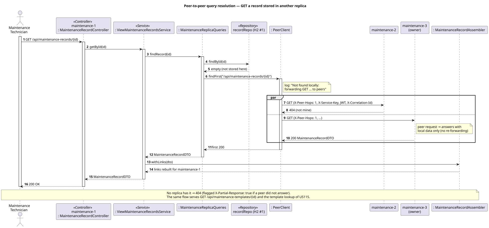

**S2 — Response aggregation with a failed replica (US219; same for US116, US218 and the template list)**

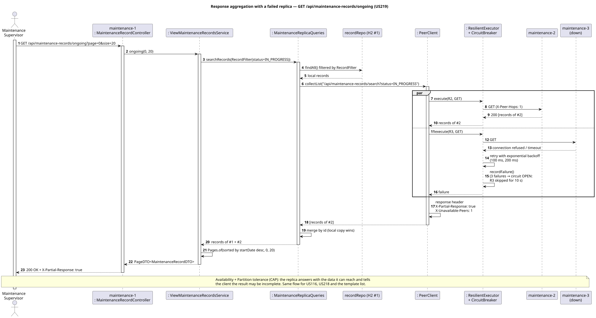

**S3 — Complete a record: command forwarded to the owner replica, aircraft released (US119; same forwarding for US217)**

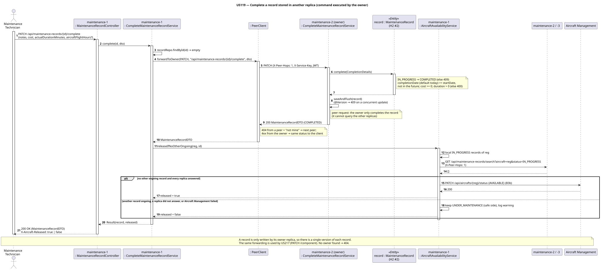

**S4 — Statistics aggregated with sums and counts (US221; same pattern for US117 and US220)**

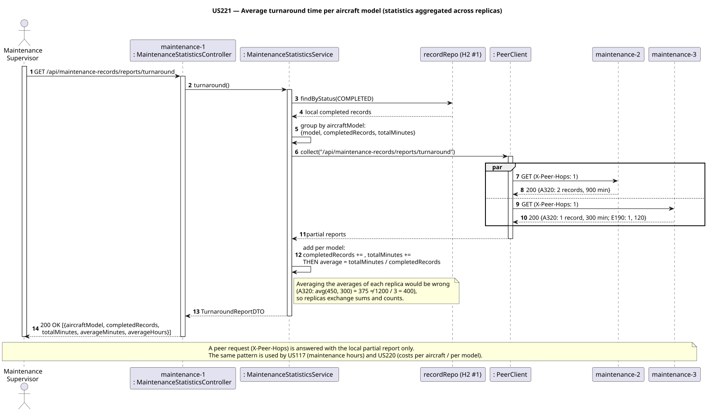


<a id="sec-4-2-use-case-scenarios-4"></a>

##### 4.2 Use-case scenarios

**S5 — Create a maintenance record (US115) — cross-service consistency with Aircraft Management**

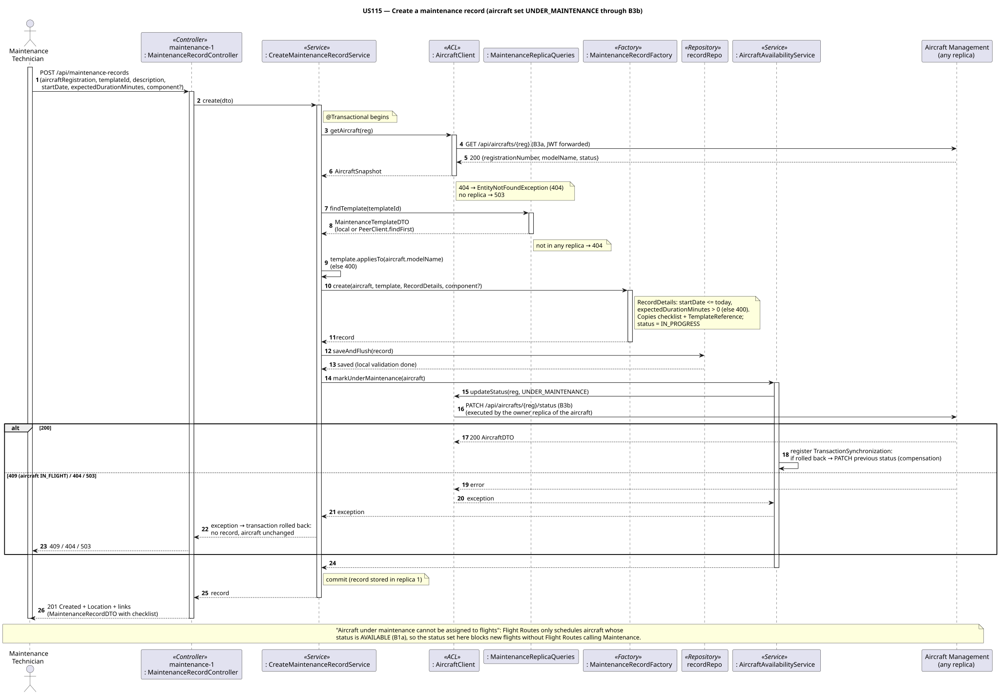

**S6 — Maintenance alerts (US222)**

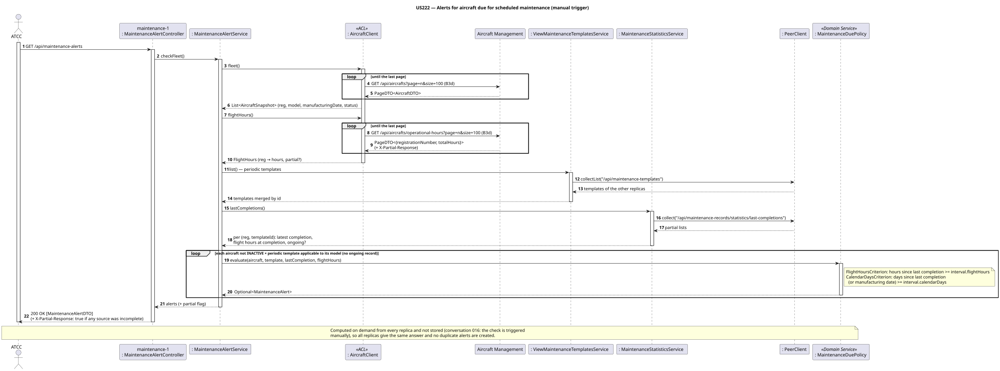


<a id="sec-5-tests-4"></a>

#### 5. Tests

From `code/`: `./mvnw -pl maintenance -am test` — 45 tests in the maintenance module (plus the 20 of `common`), all passing.

| Test class | Type | What is verified |
|---|---|---|
| `MaintenanceTemplateTest` | Unit (domain) | required data and normalisation, interval rules, `appliesTo`, `isPeriodic`, same id for reference templates, enum parsing with `400` |
| `MaintenanceRecordTest` | Unit (domain) | created `IN_PROGRESS` with checklist and template snapshot, start date rules, completion rules (once, dates, cost, duration), categorisation only while in progress, `maintenanceMinutes` |
| `MaintenanceDuePolicyTest` | Unit (domain) | flight-hours and calendar-days criteria, never performed, hours not recorded at completion, non-periodic templates |
| `CreateMaintenanceRecordServiceTest` | Unit (mocks) | order B3a → template → save/flush → B3b; nothing saved for unknown aircraft/template, template not applicable, invalid component; B3b failure propagates (rollback) |
| `CompleteMaintenanceRecordServiceTest` | Unit (mocks) | local completion + release, forwarding to the owner, owner does not touch the aircraft on a peer request, `404` / `409` |
| `AircraftAvailabilityServiceTest` | Unit (mocks) | release only without other ongoing records and with every replica answering; failed release does not fail the completion |
| `MaintenanceStatisticsServiceTest` | Unit (mocks) | partial results added correctly: turnaround average after the sum (400, not 375), costs per model, hours, latest completion + ongoing flag |
| `MaintenanceAlertServiceTest` | Unit (mocks) | applicable templates only, `INACTIVE` and ongoing skipped, calendar-only alerts flagged partial without flight hours |
| `MaintenanceApplicationTests` | Context | the service starts with the real security configuration of `common` |
| **`MaintenanceReplicaCollaborationTest`** | **Distributed** — two real replicas + a stateful stub of Aircraft Management | scenarios below |

`MaintenanceReplicaCollaborationTest`:

1. Templates: reference templates listed once; template created on B found from A (S1); duplicate name and unknown model → `400`.
2. Records stored where created, the aircraft goes `UNDER_MAINTENANCE` in the stub; aircraft in flight → `409` (nothing stored); unknown aircraft → `404`; template not applicable / future start date → `400`.
3. GET on A of a record of B → forwarded, links rebuilt for A; US219 from A and B → same list; US116 paginated after merging, unknown aircraft → `404`; US218 filters (S2).
4. US217 and US119 on A for a record of B → executed by B; completing again → owner's `409` propagated (S3).
5. The aircraft is released only when its last ongoing record is completed (`X-Aircraft-Released`).
6. US117/US220/US221 add the records of both replicas (S4).
7. US222 with the stub's fleet and flight hours → expected alerts; `INACTIVE` aircraft ignored (S6).
8. Peer headers without/wrong service key → `401`; hops 2 → `400`; valid peer request → local data only; no token → `401`; wrong role → `403`.
9. Replica B stopped: A answers `200` with `X-Partial-Response: true`; record only in B → `404`; a completion on A keeps the aircraft `UNDER_MAINTENANCE` (B could not confirm).

**Postman:** [postman/Maintenance.postman_collection.json](5-scenarios/maintenance/postman/Maintenance.postman_collection.json) + [environment](5-scenarios/maintenance/postman/Maintenance.postman_environment.json), against the three Maintenance replicas with the `demo` profile and the real Aircraft Management (and Flight Routes for flight hours). Folders: 0 setup (tokens), 1 templates, 2 records, 3 local access, 4 forwarding, 5 aggregation, 6 command forwarding, 7 statistics/reports/alerts, 8 security, 9 replica failure (stop replica 2 before folder 9). Verified with Newman: folders 0–8 — 48 requests, 74 assertions, 0 failures; folder 9 — 4 requests, 6 assertions, 0 failures. The collection can be run again without restarting (template names are unique per run and every record created is completed).


<a id="sec-6-demo-4"></a>

#### 6. Demo

From `code/`:

1. `./mvnw clean install`
2. Start Aircraft Management (its demo data is loaded by the instance profiles): `./scripts/start-replicas.sh aircraftmanagement` — aircraft CS-TUA (A320), CS-TUB (B737, `UNDER_MAINTENANCE`), CS-TUC/CS-TUD (A330), CS-TUE/CS-TUF (E190). Optionally `./scripts/start-replicas.sh flightroutes demo` (flight hours used by US222).
3. `./scripts/start-replicas.sh maintenance demo` (Windows: `.\scripts\start-replicas.ps1 -Service maintenance -Profiles demo`). Every replica has the reference templates; each replica loads **different** records.
4. Tokens: `POST http://localhost:8082/auth/dev-token` with `{"username":"tech1","roles":["MAINTENANCE_TECHNICIAN"]}`, `{"username":"sup1","roles":["MAINTENANCE_SUPERVISOR"]}`, `{"username":"atcc1","roles":["ATCC"]}`.
5. Run the Postman collection, or by hand:
   - `GET :8082/api/maintenance-records/ongoing` and `:8182/...` → the same list (supervisor).
   - `GET :8082/api/maintenance-records/{id of a record of replica 3}` → `200`; log of replica 1: `Not found locally: forwarding GET ...`; replica 3: `AUDIT ... source=peer:maintenance-1` with the same correlation id.
   - `POST :8182/api/maintenance-records` for CS-TUA → `GET :8081/api/aircrafts/CS-TUA` shows `UNDER_MAINTENANCE`; `PATCH :8082/api/maintenance-records/{id}/complete` → executed by replica 2 (log of replica 1: `forwarding PATCH ... to the owner replica`), response `X-Aircraft-Released: true`, CS-TUA back to `AVAILABLE`.
   - `GET :8282/api/maintenance-records/reports/turnaround` (supervisor) and `/reports/costs?groupBy=MODEL` (ATCC) → figures of the three replicas.
   - `GET :8082/api/maintenance-alerts` (ATCC) → aircraft due for maintenance.
   - Stop replica 2 → `ongoing` returns the records of replicas 1 and 3 with `X-Partial-Response: true`; `/actuator/health` shows `8182` `OPEN`.
   - HTTPS: add the `tls` profile (`demo,tls`) and use `https://`.

H2 console: `http://localhost:8082/h2-console` (JDBC URL `jdbc:h2:mem:maintenancedb-1`).


<a id="sec-7-observations-4"></a>

#### 7. Observations

- Cross-replica uniqueness of template names is best-effort (AP, see [L2 §3.3](#sec-3-3-consistency-model-cap)).
- Two records of the same aircraft completed at the same instant on two replicas may each see the other as ongoing, so neither releases the aircraft: it stays `UNDER_MAINTENANCE` (the safe side) until the ATCC changes it (US105).
- US222 alerts are computed on demand (manual trigger) and not stored; a scheduled check and notification channel are future work.
- Without Flight Routes, Aircraft Management cannot give flight hours (US206): US222 then returns only calendar-day alerts, flagged partial.
- Demo records are inserted directly in each replica (without calling Aircraft Management); their aircraft statuses match the Aircraft Management demo data (CS-TUB `UNDER_MAINTENANCE` with an ongoing C-Check).
- Flight hours come from scheduled flights (Flight Routes, through Aircraft Management US206), not from actual flown hours; "flight hours at completion" are entered by the technician.

<div style="page-break-before: always;"></div>

<a id="sec-appendix-a-postman-collections"></a>

# Appendix A — Postman collections

<a id="sec-aisafe-aircraft-management-distributed"></a>

## AISafe - Aircraft Management (distributed)

*Source: [docs/5-scenarios/aircraftmanagement/postman/AircraftManagement.postman_collection.json](5-scenarios/aircraftmanagement/postman/AircraftManagement.postman_collection.json)*

| Folder | Request | Method | URL |
|---|---|---|---|
| 0. Setup — health and tokens | Health am1 | GET | `{{am1}}/actuator/health` |
| 0. Setup — health and tokens | Health am2 | GET | `{{am2}}/actuator/health` |
| 0. Setup — health and tokens | Health am3 | GET | `{{am3}}/actuator/health` |
| 0. Setup — health and tokens | Token ATCC (dev only) | POST | `{{am1}}/auth/dev-token` |
| 0. Setup — health and tokens | Token Backoffice Operator (dev only) | POST | `{{am1}}/auth/dev-token` |
| 0. Setup — health and tokens | Token Maintenance Technician (dev only) | POST | `{{am1}}/auth/dev-token` |
| 1. Local access (US103, B1a, B1b) | US103 — CS-TUA on replica 1 (stored locally) | GET | `{{am1}}/api/aircrafts/CS-TUA` |
| 1. Local access (US103, B1a, B1b) | B1b — model A320 on replica 1 (stored locally) | GET | `{{am1}}/api/aircraft-models/A320` |
| 2. Peer-to-peer forwarding (GET by id) | US103 — CS-TUC asked to replica 1 (stored in replica 2) | GET | `{{am1}}/api/aircrafts/CS-TUC` |
| 2. Peer-to-peer forwarding (GET by id) | US103 — CS-TUE asked to replica 2 (stored in replica 3) | GET | `{{am2}}/api/aircrafts/CS-TUE` |
| 2. Peer-to-peer forwarding (GET by id) | US103 — same aircraft asked to replica 3 (same answer) | GET | `{{am3}}/api/aircrafts/CS-TUC` |
| 2. Peer-to-peer forwarding (GET by id) | B1b — model A330 asked to replica 1 (stored in replica 2) | GET | `{{am1}}/api/aircraft-models/A330` |
| 2. Peer-to-peer forwarding (GET by id) | US103 — unknown aircraft → 404 in every replica | GET | `{{am1}}/api/aircrafts/XX-NONE` |
| 2. Peer-to-peer forwarding (GET by id) | B1b — unknown model → 404 | GET | `{{am1}}/api/aircraft-models/NOPE` |
| 3. Aggregation of responses (US104) | US104 — all aircraft from replica 1 | GET | `{{am1}}/api/aircrafts?size=100` |
| 3. Aggregation of responses (US104) | US104 — all aircraft from replica 3 (same answer) | GET | `{{am3}}/api/aircrafts?size=100` |
| 3. Aggregation of responses (US104) | US104 — filter by model (applied in every replica) | GET | `{{am1}}/api/aircrafts?modelName=A330` |
| 3. Aggregation of responses (US104) | US104 — filter by status | GET | `{{am1}}/api/aircrafts?status=UNDER_MAINTENANCE` |
| 3. Aggregation of responses (US104) | US104 — filter by manufacturing year | GET | `{{am2}}/api/aircrafts?manufacturingYear=2022` |
| 3. Aggregation of responses (US104) | US104 — combined filters (model + status) | GET | `{{am1}}/api/aircrafts?modelName=E190&status=INACTIVE` |
| 3. Aggregation of responses (US104) | US104 — pagination after merging (size=2, page=1) | GET | `{{am1}}/api/aircrafts?size=2&page=1` |
| 3. Aggregation of responses (US104) | US104 — invalid status → 400 | GET | `{{am1}}/api/aircrafts?status=FLYING` |
| 3. Aggregation of responses (US104) | US104 — size out of range → 400 | GET | `{{am1}}/api/aircrafts?size=1000` |
| 4. Commands (US101, US102, US105) | US101 — register a model on replica 1 | POST | `{{am1}}/api/aircraft-models` |
| 4. Commands (US101, US102, US105) | US101 — new model visible from replica 3 | GET | `{{am3}}/api/aircraft-models/{{newModel}}` |
| 4. Commands (US101, US102, US105) | US101 — duplicate model A330 on replica 1 (A330 is in replica 2) → 409 | POST | `{{am1}}/api/aircraft-models` |
| 4. Commands (US101, US102, US105) | US101 — invalid input → 400 (validation map) | POST | `{{am1}}/api/aircraft-models` |
| 4. Commands (US101, US102, US105) | US102 — register an aircraft on replica 1 with model E190 (stored in replica 3) | POST | `{{am1}}/api/aircrafts` |
| 4. Commands (US101, US102, US105) | US102 — new aircraft visible from replica 3 | GET | `{{am3}}/api/aircrafts/{{newReg}}` |
| 4. Commands (US101, US102, US105) | US102 — duplicate CS-TUC on replica 1 (CS-TUC is in replica 2) → 409 | POST | `{{am1}}/api/aircrafts` |
| 4. Commands (US101, US102, US105) | US102 — unknown model → 400 | POST | `{{am1}}/api/aircrafts` |
| 4. Commands (US101, US102, US105) | US102 — invalid registration format → 400 | POST | `{{am1}}/api/aircrafts` |
| 4. Commands (US101, US102, US105) | US102 — manufacturing date in the future → 400 | POST | `{{am1}}/api/aircrafts` |
| 4. Commands (US101, US102, US105) | US105 — status of CS-TUC changed through replica 1 (owner: replica 2) | PATCH | `{{am1}}/api/aircrafts/CS-TUC/status` |
| 4. Commands (US101, US102, US105) | US105 — change stored in the owner (read from replica 2) | GET | `{{am2}}/api/aircrafts/CS-TUC` |
| 4. Commands (US101, US102, US105) | B3b — Maintenance Technician sets CS-TUC back to AVAILABLE | PATCH | `{{am3}}/api/aircrafts/CS-TUC/status` |
| 4. Commands (US101, US102, US105) | US105 — lower-case status is accepted (new aircraft → in_flight) | PATCH | `{{am2}}/api/aircrafts/{{newReg}}/status` |
| 4. Commands (US101, US102, US105) | US105 — IN_FLIGHT → UNDER_MAINTENANCE is rejected → 409 | PATCH | `{{am1}}/api/aircrafts/{{newReg}}/status` |
| 4. Commands (US101, US102, US105) | US105 — IN_FLIGHT → AVAILABLE is allowed | PATCH | `{{am1}}/api/aircrafts/{{newReg}}/status` |
| 4. Commands (US101, US102, US105) | US105 — unknown status → 400 | PATCH | `{{am1}}/api/aircrafts/CS-TUC/status` |
| 4. Commands (US101, US102, US105) | US105 — missing status → 400 | PATCH | `{{am1}}/api/aircrafts/CS-TUC/status` |
| 4. Commands (US101, US102, US105) | US105 — unknown aircraft → 404 | PATCH | `{{am1}}/api/aircrafts/XX-NONE/status` |
| 5. Security (JWT, roles, service key) | No token → 401 | GET | `{{am1}}/api/aircrafts/CS-TUA` |
| 5. Security (JWT, roles, service key) | Garbage token → 401 | GET | `{{am1}}/api/aircrafts/CS-TUA` |
| 5. Security (JWT, roles, service key) | ATCC cannot register models (US101) → 403 | POST | `{{am1}}/api/aircraft-models` |
| 5. Security (JWT, roles, service key) | Backoffice cannot register aircraft (US102) → 403 | POST | `{{am1}}/api/aircrafts` |
| 5. Security (JWT, roles, service key) | Maintenance Technician cannot register aircraft (US102) → 403 | POST | `{{am1}}/api/aircrafts` |
| 5. Security (JWT, roles, service key) | Backoffice cannot change an aircraft status (US105) → 403 | PATCH | `{{am1}}/api/aircrafts/CS-TUA/status` |
| 5. Security (JWT, roles, service key) | Maintenance Technician can read aircraft (B3a) → 200 | GET | `{{am1}}/api/aircrafts/CS-TUA` |
| 5. Security (JWT, roles, service key) | Backoffice cannot see operational hours (US206) → 403 | GET | `{{am1}}/api/aircrafts/operational-hours` |
| 5. Security (JWT, roles, service key) | Maintenance Technician cannot see compatible routes (US203) → 403 | GET | `{{am1}}/api/aircrafts/CS-TUA/compatible-routes` |
| 5. Security (JWT, roles, service key) | Peer request without service key → 401 | GET | `{{am2}}/api/aircrafts` |
| 5. Security (JWT, roles, service key) | Peer request with wrong service key → 401 | GET | `{{am2}}/api/aircrafts` |
| 5. Security (JWT, roles, service key) | Peer request with X-Peer-Hops: 2 → 400 | GET | `{{am2}}/api/aircrafts` |
| 5. Security (JWT, roles, service key) | Valid peer request → only local data (unpaginated list) | GET | `{{am1}}/api/aircrafts` |
| 6. Integration with Flight Routes (US203, US204, US206) — needs Flight Routes running | US206 — operational hours of the fleet (ATCC) | GET | `{{am1}}/api/aircrafts/operational-hours?size=100` |
| 6. Integration with Flight Routes (US203, US204, US206) — needs Flight Routes running | US203 — compatible routes of CS-TUA (ATCC) | GET | `{{am1}}/api/aircrafts/CS-TUA/compatible-routes` |
| 6. Integration with Flight Routes (US203, US204, US206) — needs Flight Routes running | US203 — aircraft of replica 2 asked to replica 3 (capacity 290, range 11750) | GET | `{{am3}}/api/aircrafts/CS-TUD/compatible-routes` |
| 6. Integration with Flight Routes (US203, US204, US206) — needs Flight Routes running | US203 — unknown aircraft → 404 | GET | `{{am1}}/api/aircrafts/XX-NONE/compatible-routes` |
| 6. Integration with Flight Routes (US203, US204, US206) — needs Flight Routes running | US204 — Top 5 models (ATCC) | GET | `{{am1}}/api/aircraft-models/top-utilized` |
| 6. Integration with Flight Routes (US203, US204, US206) — needs Flight Routes running | US204 — limit=2 (ATCC) | GET | `{{am1}}/api/aircraft-models/top-utilized?limit=2` |
| 6. Integration with Flight Routes (US203, US204, US206) — needs Flight Routes running | US204 — limit out of range → 400 | GET | `{{am1}}/api/aircraft-models/top-utilized?limit=0` |
| 6. Integration with Flight Routes (US203, US204, US206) — needs Flight Routes running | US204 as Backoffice (documents observation O1: Flight Routes accepts only ATCC today) | GET | `{{am1}}/api/aircraft-models/top-utilized` |
| 7. Replica failure — STOP replica 2 (port 8181) before running this folder | US104 — replica 2 down: partial answer from replica 1 | GET | `{{am1}}/api/aircrafts?size=100` |
| 7. Replica failure — STOP replica 2 (port 8181) before running this folder | US104 — replica 2 down: same answer from replica 3 | GET | `{{am3}}/api/aircrafts?size=100` |
| 7. Replica failure — STOP replica 2 (port 8181) before running this folder | US103 — local aircraft still available | GET | `{{am1}}/api/aircrafts/CS-TUA` |
| 7. Replica failure — STOP replica 2 (port 8181) before running this folder | US103 — aircraft of the stopped replica → 404 (flagged as partial) | GET | `{{am1}}/api/aircrafts/CS-TUC` |
| 7. Replica failure — STOP replica 2 (port 8181) before running this folder | US102 — registration still possible on a live replica | POST | `{{am1}}/api/aircrafts` |
| 7. Replica failure — STOP replica 2 (port 8181) before running this folder | US105 — command for an aircraft of the stopped replica → 503 | PATCH | `{{am1}}/api/aircrafts/CS-TUC/status` |

<a id="sec-aisafe-airports-distributed"></a>

## AISafe - Airports (distributed)

*Source: [docs/5-scenarios/airports/postman/Airports.postman_collection.json](5-scenarios/airports/postman/Airports.postman_collection.json)*

| Folder | Request | Method | URL |
|---|---|---|---|
| 0. Setup — health e tokens | Health ap1 | GET | `{{ap1}}/actuator/health` |
| 0. Setup — health e tokens | Health ap2 | GET | `{{ap2}}/actuator/health` |
| 0. Setup — health e tokens | Health ap3 | GET | `{{ap3}}/actuator/health` |
| 0. Setup — health e tokens | Token ATCC (dev only) | POST | `{{ap1}}/auth/dev-token` |
| 0. Setup — health e tokens | Token Backoffice Operator (dev only) | POST | `{{ap1}}/auth/dev-token` |
| 1. Acesso local | US107 — OPO on replica 1 (stored locally) | GET | `{{ap1}}/api/airports/OPO` |
| 2. Forwarding peer-to-peer (GET por IATA) | US107 — LHR asked to replica 1 (stored in replica 3) | GET | `{{ap1}}/api/airports/LHR` |
| 2. Forwarding peer-to-peer (GET por IATA) | US107 — lowercase opo asked to replica 2 | GET | `{{ap2}}/api/airports/opo` |
| 2. Forwarding peer-to-peer (GET por IATA) | US107 — unknown airport → 404 in every replica | GET | `{{ap1}}/api/airports/XXX` |
| 2. Forwarding peer-to-peer (GET por IATA) | US107 — invalid IATA → 400 | GET | `{{ap1}}/api/airports/X1` |
| 3. Agregação de respostas (US108, US211) | US108 — all airports from replica 1 | GET | `{{ap1}}/api/airports` |
| 3. Agregação de respostas (US108, US211) | US108 — all airports from replica 3 (same answer) | GET | `{{ap3}}/api/airports` |
| 3. Agregação de respostas (US108, US211) | US108 — search by country (filter applied in every replica) | GET | `{{ap2}}/api/airports?country=portugal` |
| 3. Agregação de respostas (US108, US211) | US108 — search by name | GET | `{{ap1}}/api/airports?name=heathrow` |
| 3. Agregação de respostas (US108, US211) | US211 — grouped by country | GET | `{{ap1}}/api/airports/grouped?by=country` |
| 3. Agregação de respostas (US108, US211) | US211 — grouped by region | GET | `{{ap3}}/api/airports/grouped?by=region` |
| 4. Comandos na réplica dona (US106, US106a, US109, US208) | US106 — register a new airport on replica 1 | POST | `{{ap1}}/api/airports` |
| 4. Comandos na réplica dona (US106, US106a, US109, US208) | US106 — new airport visible from replica 3 | GET | `{{ap3}}/api/airports/{{newIata}}` |
| 4. Comandos na réplica dona (US106, US106a, US109, US208) | US106 — duplicate MAD on replica 1 (MAD is in replica 2) → 409 | POST | `{{ap1}}/api/airports` |
| 4. Comandos na réplica dona (US106, US106a, US109, US208) | US106 — invalid input → 400 | POST | `{{ap1}}/api/airports` |
| 4. Comandos na réplica dona (US106, US106a, US109, US208) | US109 — status of MAD changed through replica 1 (owner: replica 2) | PATCH | `{{ap1}}/api/airports/MAD/status` |
| 4. Comandos na réplica dona (US106, US106a, US109, US208) | US109 — change stored in the owner (replica 2) | GET | `{{ap2}}/api/airports/MAD` |
| 4. Comandos na réplica dona (US106, US106a, US109, US208) | US109 — MAD back to OPERATIONAL | PATCH | `{{ap3}}/api/airports/MAD/status` |
| 4. Comandos na réplica dona (US106, US106a, US109, US208) | US109 — unknown status → 400 | PATCH | `{{ap1}}/api/airports/MAD/status` |
| 4. Comandos na réplica dona (US106, US106a, US109, US208) | US106a — certify a model on CDG through replica 3 (owner: replica 2) | POST | `{{ap3}}/api/airports/CDG/certifications` |
| 4. Comandos na réplica dona (US106, US106a, US109, US208) | US106a — same model again → 409 propagated from the owner | POST | `{{ap1}}/api/airports/CDG/certifications` |
| 4. Comandos na réplica dona (US106, US106a, US109, US208) | US208 — update details of CDG through replica 1 | PATCH | `{{ap1}}/api/airports/CDG` |
| 5. Segurança | No token → 401 | GET | `{{ap1}}/api/airports` |
| 5. Segurança | ATCC cannot register airports (US106) → 403 | POST | `{{ap1}}/api/airports` |
| 5. Segurança | Backoffice Operator cannot search (US108) → 403 | GET | `{{ap1}}/api/airports` |
| 5. Segurança | ATCC cannot see statistics (US210) → 403 | GET | `{{ap1}}/api/airports/statistics/busiest` |
| 5. Segurança | Peer request without service key → 401 | GET | `{{ap2}}/api/airports` |
| 5. Segurança | Peer request with wrong service key → 401 | GET | `{{ap2}}/api/airports` |
| 5. Segurança | X-Peer-Hops above the maximum → 400 | GET | `{{ap2}}/api/airports` |
| 5. Segurança | Valid peer request → only the local data of replica 2 | GET | `{{ap2}}/api/airports` |
| 6. Integração com o Flight Routes (US210) | US210 — busiest airports (Flight Routes demo must be running) | GET | `{{ap1}}/api/airports/statistics/busiest?limit=3` |
| 6. Integração com o Flight Routes (US210) | US210 — invalid limit → 400 | GET | `{{ap1}}/api/airports/statistics/busiest?limit=0` |
| 7. Falha de uma réplica (PARAR a réplica 2 antes) | Aggregation without replica 2 → partial response | GET | `{{ap1}}/api/airports` |
| 7. Falha de uma réplica (PARAR a réplica 2 antes) | Local data still available | GET | `{{ap1}}/api/airports/OPO` |
| 7. Falha de uma réplica (PARAR a réplica 2 antes) | Airport only in replica 2 → 404 | GET | `{{ap1}}/api/airports/MAD` |
| 7. Falha de uma réplica (PARAR a réplica 2 antes) | Health of replica 1 shows the peer down | GET | `{{ap1}}/actuator/health` |

<a id="sec-aisafe-flight-routes-distributed"></a>

## AISafe - Flight Routes (distributed)

*Source: [docs/5-scenarios/flightroutes/postman/FlightRoutes.postman_collection.json](5-scenarios/flightroutes/postman/FlightRoutes.postman_collection.json)*

| Folder | Request | Method | URL |
|---|---|---|---|
| 0. Setup — health and tokens | Health fr1 | GET | `{{fr1}}/actuator/health` |
| 0. Setup — health and tokens | Health fr2 | GET | `{{fr2}}/actuator/health` |
| 0. Setup — health and tokens | Health fr3 | GET | `{{fr3}}/actuator/health` |
| 0. Setup — health and tokens | Token ATCC (dev only) | POST | `{{fr1}}/auth/dev-token` |
| 0. Setup — health and tokens | Token Backoffice Operator (dev only) | POST | `{{fr1}}/auth/dev-token` |
| 1. Local access | Replica 3: local routes with origin CDG | GET | `{{fr3}}/api/routes/search?origin=CDG` |
| 2. Peer-to-peer forwarding (GET by id) | Replica 1: route stored in replica 3 | GET | `{{fr1}}/api/routes/{{cdgLhrId}}` |
| 2. Peer-to-peer forwarding (GET by id) | Replica 2: history of the route stored in replica 3 | GET | `{{fr2}}/api/routes/{{cdgLhrId}}/history` |
| 2. Peer-to-peer forwarding (GET by id) | Unknown id → 404 | GET | `{{fr1}}/api/routes/does-not-exist` |
| 3. Response aggregation | All routes from fr1 | GET | `{{fr1}}/api/routes/search` |
| 3. Response aggregation | All routes from fr2 | GET | `{{fr2}}/api/routes/search` |
| 3. Response aggregation | All routes from fr3 | GET | `{{fr3}}/api/routes/search` |
| 3. Response aggregation | US214 active routes by popularity (flights from all replicas) | GET | `{{fr2}}/api/routes/active?sortBy=popularity` |
| 3. Response aggregation | US206 operational hours (sum of the 3 replicas; service call with X-Service-Key) | GET | `{{fr3}}/api/scheduled-flights/operational-hours` |
| 3. Response aggregation | US215 total network distance | GET | `{{fr1}}/api/routes/network/total-distance` |
| 3. Response aggregation | US213 flights of CS-TUA (paginated, 3 replicas) | GET | `{{fr1}}/api/scheduled-flights/search?aircraft=CS-TUA` |
| 3. Response aggregation | US210 routes per airport (Backoffice; service call with X-Service-Key) | GET | `{{fr2}}/api/routes/statistics/count-by-airport` |
| 4. Command forwarded to the owner replica | Replica 2: get the id of MAD-CDG | GET | `{{fr2}}/api/routes/search?origin=MAD&dest=CDG` |
| 4. Command forwarded to the owner replica | Replica 1: PATCH of the route stored in replica 2 | PATCH | `{{fr1}}/api/routes/{{madCdgId}}` |
| 4. Command forwarded to the owner replica | Replica 2 (owner) sees the change | GET | `{{fr2}}/api/routes/{{madCdgId}}` |
| 4. Command forwarded to the owner replica | Owner's business error propagated (already ACTIVE → 409) | PATCH | `{{fr3}}/api/routes/{{madCdgId}}` |
| 5. Security | No token → 401 | GET | `{{fr1}}/api/routes/search` |
| 5. Security | Wrong role → 403 | GET | `{{fr1}}/api/routes/search` |
| 5. Security | "Peer" request without X-Service-Key → 401 | GET | `{{fr1}}/api/routes/search` |
| 5. Security | X-Peer-Hops above the maximum → 400 | GET | `{{fr1}}/api/routes/search` |
| 5. Security | Valid peer request → local data only (not forwarded) | GET | `{{fr1}}/api/routes/search` |
| 5. Security | Service-only endpoint without X-Service-Key → 401 (US210 route counts) | GET | `{{fr2}}/api/routes/statistics/count-by-airport` |
| 5. Security | Service-only endpoint without X-Service-Key → 401 (US206 operational hours) | GET | `{{fr3}}/api/scheduled-flights/operational-hours` |
| 6. Replica failure (STOP replica 2 first) | Replica 1 keeps answering with a partial response | GET | `{{fr1}}/api/routes/search` |
| 6. Replica failure (STOP replica 2 first) | Local data still reachable (replica 3) | GET | `{{fr1}}/api/routes/{{cdgLhrId}}` |
| 6. Replica failure (STOP replica 2 first) | Data only in replica 2 → 404 | GET | `{{fr1}}/api/routes/{{madCdgId}}` |
| 6. Replica failure (STOP replica 2 first) | Health shows the circuit of replica 2 | GET | `{{fr1}}/actuator/health` |
| 7. Cross-service (needs Aircraft Management and Airports running) | Setup: random identifiers + Airports health | GET | `{{ap1}}/actuator/health` |
| 7. Cross-service (needs Aircraft Management and Airports running) | Setup: Aircraft Management health | GET | `{{am1}}/actuator/health` |
| 7. Cross-service (needs Aircraft Management and Airports running) | Setup: register the origin airport (Airports, Backoffice) → 201 | POST | `{{ap1}}/api/airports` |
| 7. Cross-service (needs Aircraft Management and Airports running) | Setup: register the destination airport (Airports, Backoffice) → 201 | POST | `{{ap1}}/api/airports` |
| 7. Cross-service (needs Aircraft Management and Airports running) | Setup: register an aircraft model (Aircraft Management, Backoffice) → 201 | POST | `{{am1}}/api/aircraft-models` |
| 7. Cross-service (needs Aircraft Management and Airports running) | Setup: register an AVAILABLE aircraft (Aircraft Management, ATCC) → 201 | POST | `{{am1}}/api/aircrafts` |
| 7. Cross-service (needs Aircraft Management and Airports running) | US110 create a route between the two airports → 201 (Flight Routes → Airports) | POST | `{{fr1}}/api/routes` |
| 7. Cross-service (needs Aircraft Management and Airports running) | US110 route to an unknown airport → 400 | POST | `{{fr2}}/api/routes` |
| 7. Cross-service (needs Aircraft Management and Airports running) | US212 schedule a flight → 201 (Flight Routes → Aircraft Management + Airports) | POST | `{{fr3}}/api/scheduled-flights` |
| 7. Cross-service (needs Aircraft Management and Airports running) | US212 unknown aircraft → 404 | POST | `{{fr1}}/api/scheduled-flights` |
| 7. Cross-service (needs Aircraft Management and Airports running) | Aircraft set to UNDER_MAINTENANCE (Aircraft Management status endpoint) → 200 | PATCH | `{{am1}}/api/aircrafts/{{xsReg}}/status` |
| 7. Cross-service (needs Aircraft Management and Airports running) | US212 aircraft under maintenance → 409 | POST | `{{fr2}}/api/scheduled-flights` |
| 7. Cross-service (needs Aircraft Management and Airports running) | Aircraft set back to AVAILABLE → 200 | PATCH | `{{am1}}/api/aircrafts/{{xsReg}}/status` |
| 7. Cross-service (needs Aircraft Management and Airports running) | US212 schedule again after maintenance → 201 | POST | `{{fr1}}/api/scheduled-flights` |
| 8. Concurrency (run after folder 7) | Setup: route for the concurrency test (reverse of the folder 7 route) → 201 | POST | `{{fr1}}/api/routes` |
| 8. Concurrency (run after folder 7) | Client A updates minCapacity to 110 → 200 | PATCH | `{{fr2}}/api/routes/{{ccRouteId}}` |
| 8. Concurrency (run after folder 7) | Client B, still holding the old state, updates minCapacity to 120 → 200 (last writer wins: the version is not exposed) | PATCH | `{{fr3}}/api/routes/{{ccRouteId}}` |
| 8. Concurrency (run after folder 7) | 6 parallel PATCHes through the 3 replicas → each 200 or 409, final state consistent | GET | `{{fr1}}/api/routes/{{ccRouteId}}` |
| 8. Concurrency (run after folder 7) / 8.1 Concurrent update (run with iterations) | Concurrent update of minCapacity (random value) → 200 or 409 | PATCH | `{{fr2}}/api/routes/{{ccRouteId}}` |
| 8. Concurrency (run after folder 7) | Final state is consistent (read through another replica) | GET | `{{fr3}}/api/routes/{{ccRouteId}}` |

<a id="sec-aisafe-maintenance-service-wp-4"></a>

## AISafe - Maintenance Service (WP#4)

*Source: [docs/5-scenarios/maintenance/postman/Maintenance.postman_collection.json](5-scenarios/maintenance/postman/Maintenance.postman_collection.json)*

| Folder | Request | Method | URL |
|---|---|---|---|
| 0 - Setup (tokens) | Today's date | GET | `{{m1}}/actuator/health` |
| 0 - Setup (tokens) | Token MAINTENANCE_TECHNICIAN | POST | `{{m1}}/auth/dev-token` |
| 0 - Setup (tokens) | Token MAINTENANCE_SUPERVISOR | POST | `{{m1}}/auth/dev-token` |
| 0 - Setup (tokens) | Token ATCC | POST | `{{m1}}/auth/dev-token` |
| 0 - Setup (tokens) | Token BACKOFFICE_OPERATOR | POST | `{{m1}}/auth/dev-token` |
| 1 - Templates (US115) | List templates (reference templates in every replica, no duplicates) | GET | `{{m1}}/api/maintenance-templates` |
| 1 - Templates (US115) | Create template on replica 2 | POST | `{{m2}}/api/maintenance-templates` |
| 1 - Templates (US115) | Duplicate name on replica 1 -> 400 | POST | `{{m1}}/api/maintenance-templates` |
| 1 - Templates (US115) | Unknown aircraft model -> 400 (B3c) | POST | `{{m1}}/api/maintenance-templates` |
| 1 - Templates (US115) | Invalid type -> 400 | POST | `{{m1}}/api/maintenance-templates` |
| 2 - Records (US115) | Create record on replica 2 (CS-TUA, A-Check) | POST | `{{m2}}/api/maintenance-records` |
| 2 - Records (US115) | Aircraft is now UNDER_MAINTENANCE (Aircraft Management) | GET | `{{am1}}/api/aircrafts/CS-TUA` |
| 2 - Records (US115) | Create record on replica 1 with the template stored in replica 2 | POST | `{{m1}}/api/maintenance-records` |
| 2 - Records (US115) | Template not applicable to the model (E190) -> 400 | POST | `{{m1}}/api/maintenance-records` |
| 2 - Records (US115) | Unknown aircraft -> 404 | POST | `{{m1}}/api/maintenance-records` |
| 2 - Records (US115) | Unknown template -> 404 | POST | `{{m1}}/api/maintenance-records` |
| 2 - Records (US115) | Start date in the future -> 400 | POST | `{{m1}}/api/maintenance-records` |
| 3 - Local access | GET record on its owner replica (2) | GET | `{{m2}}/api/maintenance-records/{{recordOnM2}}` |
| 4 - Peer forwarding (GET by id) | GET record of replica 2 through replica 3 | GET | `{{m3}}/api/maintenance-records/{{recordOnM2}}` |
| 4 - Peer forwarding (GET by id) | GET template of replica 2 through replica 1 | GET | `{{m1}}/api/maintenance-templates/{{templateId}}` |
| 4 - Peer forwarding (GET by id) | Unknown record -> 404 | GET | `{{m1}}/api/maintenance-records/does-not-exist` |
| 5 - Aggregation (US116, US218, US219) | US219 ongoing from replica 1 | GET | `{{m1}}/api/maintenance-records/ongoing` |
| 5 - Aggregation (US116, US218, US219) | US219 ongoing from replica 3 (same result) | GET | `{{m3}}/api/maintenance-records/ongoing` |
| 5 - Aggregation (US116, US218, US219) | US116 records of CS-TUA (paginated after merging) | GET | `{{m3}}/api/maintenance-records/aircraft/CS-TUA?page=0&size=2` |
| 5 - Aggregation (US116, US218, US219) | US116 unknown aircraft -> 404 | GET | `{{m1}}/api/maintenance-records/aircraft/CS-XXX` |
| 5 - Aggregation (US116, US218, US219) | US218 search by component | GET | `{{m1}}/api/maintenance-records?component=AIRFRAME&status=IN_PROGRESS` |
| 5 - Aggregation (US116, US218, US219) | US218 search by date range | GET | `{{m2}}/api/maintenance-records?aircraft=CS-TUA&from=2026-01-01&to={{today}}` |
| 5 - Aggregation (US116, US218, US219) | US218 invalid range -> 400 | GET | `{{m2}}/api/maintenance-records?from=2026-12-01&to=2026-01-01` |
| 6 - Command forwarding (US217, US119) | US217 categorise record of replica 1 through replica 3 | PATCH | `{{m3}}/api/maintenance-records/{{recordOnM1}}/component` |
| 6 - Command forwarding (US217, US119) | US119 complete record of replica 2 through replica 3 (another record still ongoing) | PATCH | `{{m3}}/api/maintenance-records/{{recordOnM2}}/complete` |
| 6 - Command forwarding (US217, US119) | Complete again -> 409 (propagated from the owner) | PATCH | `{{m1}}/api/maintenance-records/{{recordOnM2}}/complete` |
| 6 - Command forwarding (US217, US119) | Invalid completion data -> 400 | PATCH | `{{m1}}/api/maintenance-records/{{recordOnM1}}/complete` |
| 6 - Command forwarding (US217, US119) | US119 complete the last ongoing record of CS-TUA through replica 2 | PATCH | `{{m2}}/api/maintenance-records/{{recordOnM1}}/complete` |
| 6 - Command forwarding (US217, US119) | Aircraft is AVAILABLE again (Aircraft Management) | GET | `{{am2}}/api/aircrafts/CS-TUA` |
| 7 - Statistics, reports and alerts (US117, US220, US221, US222) | US117 maintenance hours of the fleet | GET | `{{m2}}/api/maintenance-records/statistics/hours` |
| 7 - Statistics, reports and alerts (US117, US220, US221, US222) | US220 costs per aircraft model | GET | `{{m3}}/api/maintenance-records/reports/costs?groupBy=MODEL` |
| 7 - Statistics, reports and alerts (US117, US220, US221, US222) | US220 costs per aircraft | GET | `{{m1}}/api/maintenance-records/reports/costs?groupBy=AIRCRAFT` |
| 7 - Statistics, reports and alerts (US117, US220, US221, US222) | US220 invalid grouping -> 400 | GET | `{{m1}}/api/maintenance-records/reports/costs?groupBy=COLOR` |
| 7 - Statistics, reports and alerts (US117, US220, US221, US222) | US221 average turnaround per model | GET | `{{m1}}/api/maintenance-records/reports/turnaround` |
| 7 - Statistics, reports and alerts (US117, US220, US221, US222) | US222 maintenance alerts | GET | `{{m2}}/api/maintenance-alerts` |
| 8 - Security (JWT, roles, inter-service key) | No token -> 401 | GET | `{{m1}}/api/maintenance-records/ongoing` |
| 8 - Security (JWT, roles, inter-service key) | ATCC cannot create records -> 403 | POST | `{{m1}}/api/maintenance-records` |
| 8 - Security (JWT, roles, inter-service key) | Technician cannot see US219 -> 403 | GET | `{{m1}}/api/maintenance-records/ongoing` |
| 8 - Security (JWT, roles, inter-service key) | Backoffice cannot see alerts -> 403 | GET | `{{m1}}/api/maintenance-alerts` |
| 8 - Security (JWT, roles, inter-service key) | Peer request without X-Service-Key -> 401 | GET | `{{m1}}/api/maintenance-records/search` |
| 8 - Security (JWT, roles, inter-service key) | Peer request with X-Peer-Hops 2 -> 400 | GET | `{{m1}}/api/maintenance-records/search` |
| 8 - Security (JWT, roles, inter-service key) | Valid peer request is answered with local data only | GET | `{{m1}}/api/maintenance-records/search?aircraft=CS-TUA` |
| 8 - Security (JWT, roles, inter-service key) | Health with peers | GET | `{{m1}}/actuator/health` |
| 9 - Replica failure (stop replica 2 first) | Ongoing from replica 1 -> 200 partial | GET | `{{m1}}/api/maintenance-records/aircraft/CS-TUA` |
| 9 - Replica failure (stop replica 2 first) | Record stored only in replica 2 -> 404 | GET | `{{m1}}/api/maintenance-records/{{recordOnM2}}` |
| 9 - Replica failure (stop replica 2 first) | Record stored in replica 1 -> 200 | GET | `{{m1}}/api/maintenance-records/{{recordOnM1}}` |
| 9 - Replica failure (stop replica 2 first) | Statistics still answer (partial) | GET | `{{m3}}/api/maintenance-records/reports/turnaround` |

<div style="page-break-before: always;"></div>

<a id="sec-appendix-b-source-files"></a>

# Appendix B — Source files

| # | Part | Chapter | Source file |
|---|---|---|---|
| 1 | Part I — System | Introduction and conventions | [docs/README.md](#src-readme) |
| 2 | Part I — System | C4 Level 1 — System context | [docs/1-context/Context.md](#src-1-context-context) |
| 3 | Part I — System | C4 Level 2 — Containers | [docs/2-containers/Containers.md](#src-2-containers-containers) |
| 4 | Part I — System | C4 Level 2 — Containers | [docs/2-containers/Ports.md](#src-2-containers-ports) |
| 5 | Part I — System | C4 Level 2 — Containers | [docs/2-containers/Integration-Contracts.md](#src-2-containers-integration-contracts) |
| 6 | Part II — Shared infrastructure (`common`) | C4 Level 3 — Components | [docs/3-components/common/Common-Components.md](#src-3-components-common-common-components) |
| 7 | Part II — Shared infrastructure (`common`) | C4 Level 4 — Code | [docs/4-code/common/Common-Code.md](#src-4-code-common-common-code) |
| 8 | Part III — Services | Aircraft Management (WP1) | [docs/3-components/aircraftmanagement/AircraftManagement-Components.md](#src-3-components-aircraftmanagement-aircraftmanagement-component) |
| 9 | Part III — Services | Aircraft Management (WP1) | [docs/4-code/aircraftmanagement/AircraftManagement-Code.md](#src-4-code-aircraftmanagement-aircraftmanagement-code) |
| 10 | Part III — Services | Aircraft Management (WP1) | [docs/5-scenarios/aircraftmanagement/AircraftManagement-Scenarios.md](#src-5-scenarios-aircraftmanagement-aircraftmanagement-scenarios) |
| 11 | Part III — Services | Airports (WP2) | [docs/3-components/airports/Airports-Components.md](#src-3-components-airports-airports-components) |
| 12 | Part III — Services | Airports (WP2) | [docs/4-code/airports/Airports-Code.md](#src-4-code-airports-airports-code) |
| 13 | Part III — Services | Airports (WP2) | [docs/5-scenarios/airports/Airports-Scenarios.md](#src-5-scenarios-airports-airports-scenarios) |
| 14 | Part III — Services | Flight Routes (WP3) | [docs/3-components/flightroutes/FlightRoutes-Components.md](#src-3-components-flightroutes-flightroutes-components) |
| 15 | Part III — Services | Flight Routes (WP3) | [docs/4-code/flightroutes/FlightRoutes-Code.md](#src-4-code-flightroutes-flightroutes-code) |
| 16 | Part III — Services | Flight Routes (WP3) | [docs/5-scenarios/flightroutes/FlightRoutes-Scenarios.md](#src-5-scenarios-flightroutes-flightroutes-scenarios) |
| 17 | Part III — Services | Maintenance (WP4) | [docs/3-components/maintenance/Maintenance-Components.md](#src-3-components-maintenance-maintenance-components) |
| 18 | Part III — Services | Maintenance (WP4) | [docs/4-code/maintenance/Maintenance-Code.md](#src-4-code-maintenance-maintenance-code) |
| 19 | Part III — Services | Maintenance (WP4) | [docs/5-scenarios/maintenance/Maintenance-Scenarios.md](#src-5-scenarios-maintenance-maintenance-scenarios) |
